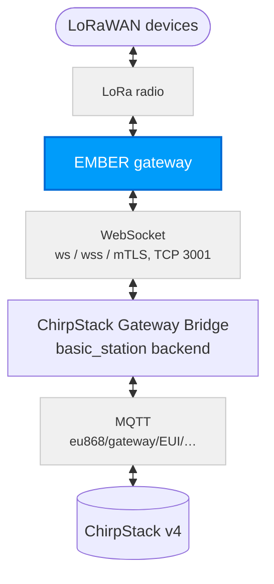
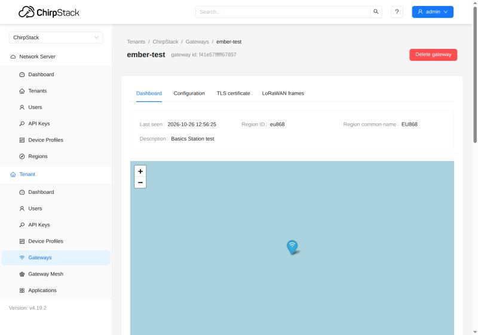
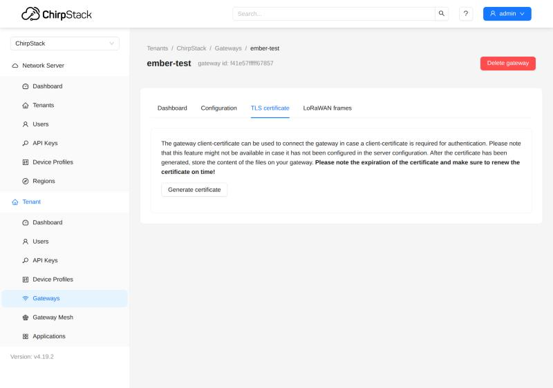

# Basics Station and mTLS {#basics-station-and-mtls}

This guide sets up a **ChirpStack v4** server for gateways that connect over the **LoRa Basics Station** protocol (LNS) instead of the UDP packet forwarder, at three security levels. For production, use **mTLS**: every gateway proves itself with its own certificate. The gateway side is described separately; for EMBER, see [EMBER: Basics Station and mTLS](/ember/lorawan-network-server/lorawan-chirpstack-basics-station).

| Mode | Connection | Who proves their identity |
| --- | --- | --- |
| **ws** | WebSocket, not encrypted | nobody; use it only on a closed network |
| **wss** | WebSocket over TLS (encrypted) | the server presents its certificate, but EMBER does not check it (see [Known limitations](/ember/lorawan-network-server/lorawan-chirpstack-basics-station#known-limitations)) |
| **mTLS** | TLS + a client certificate of the gateway | the gateway, with its certificate: the server accepts only gateways with a valid certificate (EMBER still does not check the server, see [Known limitations](/ember/lorawan-network-server/lorawan-chirpstack-basics-station#known-limitations)) |

The procedure was tested with ChirpStack 4.19 and ChirpStack Gateway Bridge 4.1 against EMBER on RouterOS 7.24.5: OTAA join, uplinks and downlinks with a HARDWARIO STICKER, and every case in which mTLS must refuse a gateway.

## Useful docs {#useful-docs}
- [ChirpStack v4 Installation](/apps/chirpstack/chirpstack-installation)
- [Gateways: Semtech UDP](./chirpstack-gateways.md)
- Gateway side for EMBER: [EMBER: Basics Station and mTLS](/ember/lorawan-network-server/lorawan-chirpstack-basics-station)

## How it works {#how-it-works}
EMBER keeps one permanent WebSocket connection to the Gateway Bridge. Uplinks and downlinks both travel through it, and this is the connection that gets secured.



When it connects, EMBER first asks where to connect (`router-info`), and the bridge answers with an address that contains the gateway EUI. EMBER then connects to that address, and the bridge sends it the frequency plan (`router_config`). From then on, the bridge passes the packets over MQTT under `eu868/gateway/<eui>/…`, and ChirpStack answers the same way back.

**mTLS (mutual TLS):** the gateway proves its identity to the server with its own certificate (EMBER itself does not check the server, see [Known limitations](/ember/lorawan-network-server/lorawan-chirpstack-basics-station#known-limitations)). ChirpStack acts as the certificate authority (CA) that issues the gateway certificates. On every connection the bridge checks that the gateway sent a certificate, that this CA signed it, that it is valid, and that its name (CN) is the EUI of the connecting gateway. If any check fails, the bridge refuses the connection.

## Prerequisites {#prerequisites}

| Area | Requirement |
| --- | --- |
| ChirpStack | v4 (tested 4.19) with the EU868 region |
| Gateway Bridge | ChirpStack Gateway Bridge v4 (tested 4.1) as a second instance with the `basic_station` backend |
| Network | EMBER must reach the server on TCP port 3001 (or the port you choose) |
| Certificates (wss, mTLS) | a certificate authority (CA) and a server certificate issued for the DNS name or IP address the EMBERs connect to |
| Time | correct time on the server (NTP): the bridge checks certificate validity against it; NTP on EMBER is recommended too (log timestamps) |

---

## 1) Gateway Bridge with the basic_station backend {#1-gateway-bridge-with-the-basic_station-backend}
Start a second ChirpStack Gateway Bridge instance with the `basic_station` backend (in chirpstack-docker, this is the `chirpstack-gateway-bridge-basicstation` service). An existing UDP bridge can keep running next to it.

The three modes differ only in the `tls_cert`, `tls_key` and `ca_cert` keys of the `[backend.basic_station]` section. Use the block for your mode:

**ws** (no TLS):

```toml
[backend]
type="basic_station"

  [backend.basic_station]
  bind=":3001"
  tls_cert=""
  tls_key=""
  ca_cert=""
  region="EU868"
  frequency_min=863000000
  frequency_max=870000000
```

**wss** (server certificate):

```toml
[backend]
type="basic_station"

  [backend.basic_station]
  bind=":3001"
  tls_cert="/etc/chirpstack-gateway-bridge/certs/server.crt"
  tls_key="/etc/chirpstack-gateway-bridge/certs/server.key"
  ca_cert=""
  region="EU868"
  frequency_min=863000000
  frequency_max=870000000
```

**mTLS** (server certificate + gateway CA):

```toml
[backend]
type="basic_station"

  [backend.basic_station]
  bind=":3001"
  tls_cert="/etc/chirpstack-gateway-bridge/certs/server.crt"
  tls_key="/etc/chirpstack-gateway-bridge/certs/server.key"
  ca_cert="/etc/chirpstack-gateway-bridge/certs/gateway-ca.crt"
  region="EU868"
  frequency_min=863000000
  frequency_max=870000000
```

Take the frequency plan (`[[backend.basic_station.concentrators]]`) from the `chirpstack-gateway-bridge-basicstation-eu868.toml` file of chirpstack-docker (`configuration/chirpstack-gateway-bridge/`). The MQTT topics must match the region on the ChirpStack server:

```toml
[integration.mqtt]
event_topic_template="eu868/gateway/{{ .GatewayID }}/event/{{ .EventType }}"
state_topic_template="eu868/gateway/{{ .GatewayID }}/state/{{ .StateType }}"
command_topic_template="eu868/gateway/{{ .GatewayID }}/command/#"
```

- The **server certificate** (`tls_cert`) must contain the DNS name or IP address the EMBERs use in its SAN. The simplest way is to sign it with the same CA as the gateway certificates (step 2).
- **With `ca_cert` set**, the bridge requires a client certificate signed by this CA whose name (CN) is exactly the gateway EUI.
- Open port 3001 in the firewall for the network the EMBERs connect from.
- **Restart the bridge at a quiet time**: every restart reconnects all gateways (see [Known limitations](#known-limitations)).

:::warning
The bridge that EMBERs connect to must have `region="EU868"`. EMBER accepts even a frequency plan outside its band (seen with US915); it then looks online, receives nothing, and its LoRa service stays unstable until EMBER is rebooted. See [Wrong region from the server](/ember/lorawan-network-server/lorawan-chirpstack-basics-station#wrong-region-from-the-server).
:::

---

## 2) ChirpStack: CA for gateway certificates (mTLS only) {#2-chirpstack-ca-for-gateway-certificates-mtls-only}
To issue gateway certificates, ChirpStack needs a certificate authority (CA). Add a `[gateway]` section to `chirpstack.toml` (chirpstack-docker does not have one by default) and restart ChirpStack:

```toml
[gateway]
  ca_cert="/etc/chirpstack/certs/gateway-ca.crt"   # CA certificate (PEM)
  ca_key="/etc/chirpstack/certs/gateway-ca.key"    # CA private key (PKCS#8)
  client_cert_lifetime="365days"                    # lifetime of the issued certificates
  allow_unknown_gateways=false
```

- The same `gateway-ca.crt` file goes into `ca_cert` of the Gateway Bridge (step 1).
- **The CA key is the most valuable secret of the whole setup**: whoever has it can issue a certificate for any gateway. Keep it only on the ChirpStack server, with restricted access rights.
- Choose `client_cert_lifetime` deliberately (e.g. 365 days): ChirpStack cannot revoke a certificate, so the lifetime is the only limit for a leaked key. A long lifetime, on the other hand, means fewer renewals.
- With `allow_unknown_gateways=false`, ChirpStack drops the data of gateways that are not registered in it.

---

## 3) Register the gateway in ChirpStack {#3-register-the-gateway-in-chirpstack}
ChirpStack identifies the gateway by its EUI; without a registration, it drops the gateway's data.

1. On EMBER, find the gateway ID: `/iot lora print detail` → `gateway-id` (16 hexadecimal characters, e.g. `F41E57FFFFF67857`).
2. In ChirpStack, open **Tenant → Gateways → Add gateway** and enter this EUI as the **Gateway ID** (details in [Gateways](./chirpstack-gateways.md)).

Once the gateway is connected, its **Dashboard** in ChirpStack shows **Last seen** and the region (`eu868`):



---

## 4) Gateway certificate (mTLS only) {#4-gateway-certificate-mtls-only}
ChirpStack issues the client certificate with one click. Its name (CN) is the gateway EUI, and the CA from step 2 signs it.

1. In ChirpStack, open the gateway → **TLS certificate** tab → **Generate certificate**.
2. Save the three texts as files: **TLS certificate** → `tc.crt`, **TLS key** → `tc.key`, **CA certificate** → `ca.crt`.
3. **The key is shown only once**, and ChirpStack does not store it. Do not send it by e-mail or chat, and delete it once it is on EMBER.
4. Note the certificate's expiry date: ChirpStack shows it only now.

The **TLS certificate** tab of a gateway in ChirpStack:



| File | What it is | Secret? |
| --- | --- | --- |
| `ca.crt` | the CA that signs the gateway certificates. On EMBER, it is imported as the trusted **server** CA (`server-ca`), which is correct only if the same CA also signed the server certificate (recommended in step 1; RouterOS 7.24.5 does not check it anyway, see [Known limitations](/ember/lorawan-network-server/lorawan-chirpstack-basics-station#known-limitations)). If the server certificate comes from another CA, import that CA instead of `ca.crt` | no |
| `tc.crt` | the gateway certificate | no |
| `tc.key` | the gateway private key (ECDSA P-256, PKCS#8) | **yes** |

---

## Known limitations {#known-limitations}
These apply to ChirpStack 4.19 / Gateway Bridge 4.1; check them again after updates.

- **A server (Gateway Bridge) restart reconnects all gateways**, and each of them is offline for about 15 seconds. Restart at a quiet time and check afterwards that all gateways are back online.
- **A certificate cannot be revoked.** The old certificate stays valid until it expires, even after a renewal, and deleting the gateway in ChirpStack does not stop the connection. If a gateway key leaks, replacing the CA is the only sure way.
- **Watch for "online, but no uplinks".** The online status in ChirpStack only means that gateway statistics arrive.
- **Correct time (NTP) on the server** is required: the bridge checks certificate validity against it. Keep NTP on EMBER too, for log timestamps.

---

## Troubleshooting by log line {#troubleshooting-by-log-line}
Find the line in the Gateway Bridge or ChirpStack log and look it up below. The real reason for a refused TLS connection is always in the bridge log.

| Where | Log line (excerpt) | What it means | What to do |
| --- | --- | --- | --- |
| bridge | `router-info … router_uri=` (empty) | the certificate name ≠ the gateway EUI | a certificate for this gateway |
| bridge | `client didn't provide a certificate` | EMBER connected without a certificate | `certificate=` on the server entry, `K` flag |
| bridge | `certificate signed by unknown authority` | a certificate from a foreign CA | issue the certificate in this ChirpStack |
| bridge | `certificate has expired or is not yet valid` | the certificate expired, or the server time is wrong | renew the certificate, NTP on the server |
| bridge | `invalid signature by the client certificate` | the key does not belong to the certificate (renewal error) | a new certificate, see [Renewing the gateway certificate](/ember/lorawan-network-server/lorawan-chirpstack-basics-station#renewing-the-gateway-certificate) |
| bridge | `client sent an HTTP request to an HTTPS server` | EMBER has `ssl=no`, the bridge uses TLS | `ssl=yes` |
| bridge | `connection with same gateway id already exists` | a reconnection before the old connection was closed | wait up to 65 s |
| ChirpStack | `Object does not exist` for the gateway | the gateway is not registered | add the gateway (step 3) |
| ChirpStack | nothing from the gateway, the bridge reports connected | the MQTT topics do not match | `eu868/…` topics matching the region |

Lines from the gateway log are explained on the gateway page, for EMBER in [EMBER: Troubleshooting by log line](/ember/lorawan-network-server/lorawan-chirpstack-basics-station#troubleshooting-by-log-line).

---

## Next step: configure the gateway {#next-step-configure-the-gateway}
With the server ready, configure the gateway: for EMBER, follow [EMBER: Basics Station and mTLS](/ember/lorawan-network-server/lorawan-chirpstack-basics-station) (RouterOS commands for ws, wss and mTLS, verification and certificate renewal).
