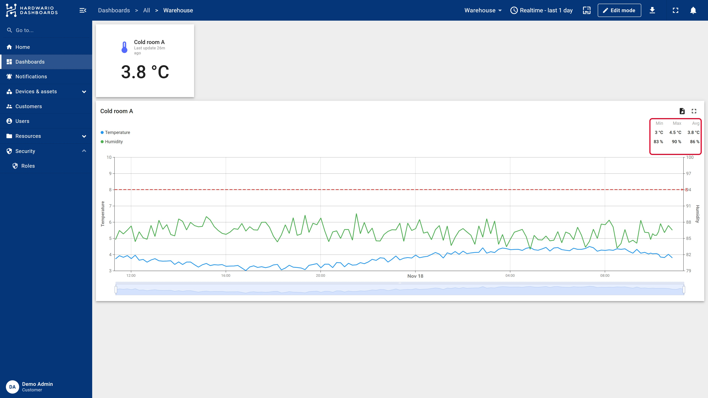
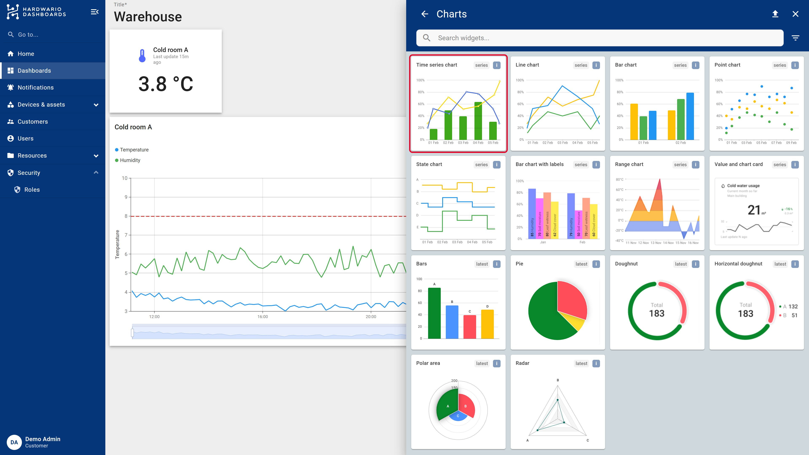
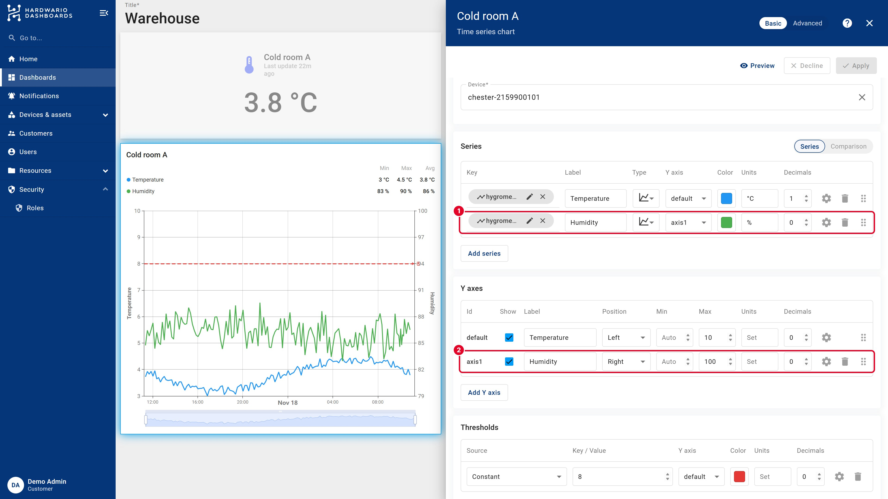
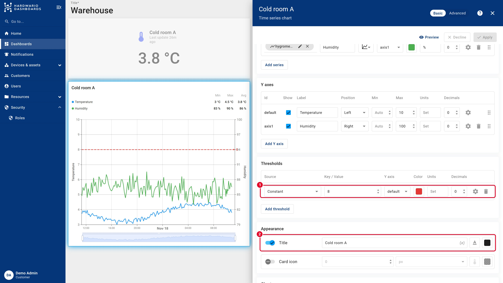
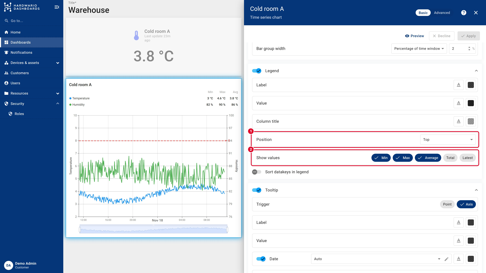
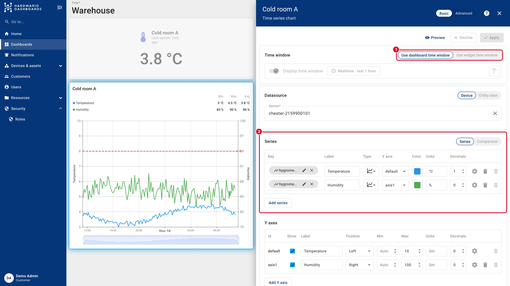

import Image from '@theme/IdealImage';

# Charts & styling

A chart shows how values change over time. In this guide, you'll add a **Time series chart** with temperature and humidity, put humidity on a second axis, draw a limit line and set up the legend.

The result looks like this:

You need a dashboard to put the chart on. See [Your first dashboard](/apps/thingsboard/creating-dashboard) if you don't have one yet.

---

## Step 1: Add the chart

1. Open the dashboard and click **Edit mode** in the top bar.
2. Click **Add widget** and choose the **Charts** bundle.
3. Choose **Time series chart**.

:::tip Which chart?
**Time series chart** is the most flexible: it can show lines, bars and points, several axes and limit lines. **Line chart**, **Bar chart** and **Point chart** are simpler variants with a preset look.
:::

---

## Step 2: Choose the device and the values

1. Under **Datasource**, pick your **Device**.
2. Under **Series**, remove the default key and pick the first value, for example `hygrometer.temperature.measurements.avg`.
3. Set a clear **Label** (*Temperature*), the **Units** (`°C`) and the number of **Decimals**. Click the color square to change the color.
4. To show more values in one chart, click **Add series** and pick another key, for example humidity. Give it its own label, unit (`%`) and color.

Each series has more settings under its **gear icon**: line or bars, smooth or straight line, line width, points and a filled area under the line. The **Type** column switches between a line, bars and points.

---

## Step 3: Add a second Y axis

Temperature is in degrees, humidity in percent. On a single axis, one of them would be a flat line. Give each its own axis:

1. Under **Y axes**, click **Add Y axis**. A new axis `axis1` appears.
2. Set its **Position** to **Right** and its **Label**, for example *Humidity*.
3. Give the default axis a **Label** too, for example *Temperature*.
4. Back in **Series**, set the **Y axis** of the humidity series to `axis1`.

**Min** and **Max** fix the range of an axis. With a fixed range, the chart doesn't jump up and down with every new value, and a limit line always stays in view.

---

## Step 4: Draw a limit line

A threshold is a horizontal line that marks a limit, so anyone sees at a glance when a value is too high.

1. Under **Thresholds**, click **Add threshold**.
2. Keep **Source** on **Constant** and enter the **Value**, for example `8`.
3. Choose the **Y axis** the value belongs to and a **Color**, for example red. The **gear icon** sets a dashed line and its width.

---

## Step 5: Title, legend and tooltip

- **Appearance → Title**: the name shown above the chart, for example *Cold room A*. You can add a **Card icon**, too.
- **Legend**: choose its **Position** and which values it shows next to each series: **Min**, **Max**, **Average**, **Total** or **Latest**.
- **Tooltip**: what appears when you point at the chart. **Axis** shows all series at that moment, **Point** only the one under the mouse.
- **Chart → Data zoom** adds the slider under the chart for zooming in.

Click **Add**, then **Save** the dashboard.

---

## Step 6: Work with the chart

- **Point** at the chart to see the exact values at that time.
- **Drag the slider** under the chart, or drag across the chart, to zoom in.
- **Click a series in the legend** to hide or show it.
- Use the **download icon** in the chart's corner to export its data, and the **expand icon** to show it full screen.

To change the chart later, switch to **Edit mode**, point at the chart and click its **pencil icon**. All settings are in one panel:

:::tip The chart is empty?
Usually the period is the problem: a new dashboard shows only the **last hour**. See [Time window](/apps/thingsboard/time-window).
:::

---

## Next steps

- [Time window](/apps/thingsboard/time-window): choose the period your charts show.
- [Public link](/apps/thingsboard/public-link): share the dashboard.

:::info ThingsBoard documentation
HARDWARIO Dashboards is built on ThingsBoard. More details in the official ThingsBoard documentation: [Time series chart](https://thingsboard.io/docs/pe/reference/widgets/charts/time-series-chart/).
:::
