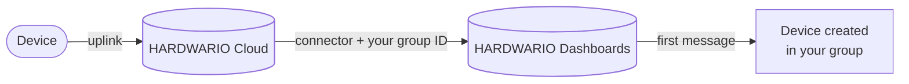
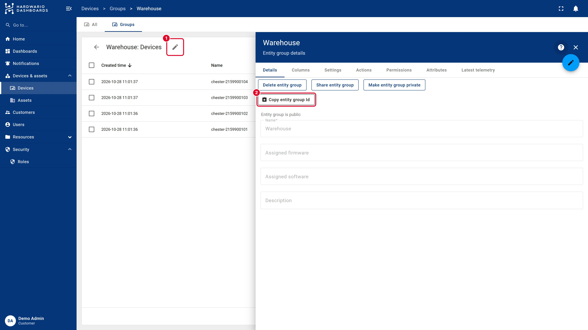

import Image from '@theme/IdealImage';
import ThingsBoardConnector from '@site/src/components/ThingsBoardConnector';

# Connect devices {#connect-from-hardwario-cloud}

There are two ways to get your devices from HARDWARIO Cloud into HARDWARIO Dashboards:

- **[Automatic connection](#automatic-connection)** (recommended, this page): you add one connector, and every tagged device creates itself in your device group.
- **[Manual connection](/apps/thingsboard/manual-connection)**: for devices that already exist in HARDWARIO Dashboards.

---

## Automatic connection {#automatic-connection}

Your devices **appear in your HARDWARIO Dashboards account by themselves**, in the device group you choose. You add one connector and tag the devices you want to send. There is nothing else to set up in HARDWARIO Dashboards.

You need a HARDWARIO Dashboards account. If you do not have one yet, contact us at [ask@hardwario.com](mailto:ask@hardwario.com).

### Step 1: Find your device group

The device group tells HARDWARIO Dashboards where your devices belong.

1. Sign in to [HARDWARIO Dashboards](https://app.hardwario.cloud), open **Devices & assets → Devices** (**Entities → Devices** for tenant administrators) and switch to the **Groups** tab.
2. Click the group you want the devices in to open it. Choose **All** if you do not use groups, or [create a new group](/apps/thingsboard/devices#device-groups) first.
3. Click the **pencil icon** (Entity group details) next to the group name (1), then **Copy entity group Id** (2).

   

:::tip Keep your devices sorted
The group ID decides where your devices are created. Create a group for each building, site or project, and add one connector per group. Give each connector its own group ID and its own tag (e.g. `thingsboard-warehouse`, `thingsboard-office`). Every device then lands in the right group by itself.
:::

### Step 2: Get your connector code

Paste the copied ID below. The code fills itself in.

<ThingsBoardConnector />

### Step 3: Add the connector

[Create a connector](/cloud/connectors#creating-a-connector) of the type **Webhook** with these settings, click **Create** and paste the code from Step 2 on its **Transformation** tab (see [the transformation function](/cloud/connectors#the-transformation-function)):

| Setting | Value |
|---|---|
| **Name** | `thingsboard` |
| **Flows** | **Uplink data**, **Session** and **Configuration report** |
| **Tags** | a new tag `thingsboard` (see [Creating a Tag](/cloud/tags#creating-a-tag)) |

### Step 4: Tag your devices

Add the `thingsboard` tag to each device you want in HARDWARIO Dashboards, see [Assigning tags](/cloud/tags#assigning-tags), or tag many devices at once with [Bulk Actions](/cloud/bulk-actions#tags).

### What happens in HARDWARIO Dashboards {#what-happens-in-thingsboard}

With the **next message** of each tagged device, the device appears in your device group:

| In HARDWARIO Dashboards | Value |
|---|---|
| **Device name** | `chester-<serial number>`, e.g. `chester-2159012345` |
| **Label** | the serial number |
| **Attributes** | device name from HARDWARIO Cloud, product, firmware version, IMEI, ICCID, device configuration, serial numbers of BLE tags |
| **Telemetry** | all measurements with their original timestamps, rounded to two decimals; BLE tags as `ble_tags.0.…`, `ble_tags.1.…` |

Every next message only adds new data. A device reports at its own interval, so it can take up to one interval before it appears.

- **Renaming a device** in HARDWARIO Cloud only updates its name attribute. The device keeps its name, label and history.
- **New devices later:** just tag them with `thingsboard`.
- **A different group:** put the new group's ID into the connector. Devices move there with their next message.
- **Stopping the data:** remove the `thingsboard` tag. The device and its history stay in HARDWARIO Dashboards.
- **Deleting a device in HARDWARIO Dashboards** does not stop the data. While the device is tagged, its next message adds it again, so remove the tag first.
- **Devices you already have in HARDWARIO Dashboards:** do not tag them, they would appear a second time. Use the [manual connection](/apps/thingsboard/manual-connection) for them.

### Troubleshooting

| Problem | What to do |
|---|---|
| A device does not appear | Check that it has the `thingsboard` tag and has sent a message since you tagged it. |
| Devices do not appear in my group | Check the group ID in the connector against your group. After you fix it, devices move there with their next message. |

Anything else: [ask@hardwario.com](mailto:ask@hardwario.com).

### Next steps

- Give your devices readable labels and sort them into groups: [Managing devices](/apps/thingsboard/devices).
- Show the data: [Your first dashboard](/apps/thingsboard/creating-dashboard).

---

## Manual connection {#manual-connection}

The manual connection now has its own guide: **[Manual connection](/apps/thingsboard/manual-connection)**.

:::info ThingsBoard documentation
HARDWARIO Dashboards is built on ThingsBoard. More details in the official ThingsBoard documentation: [HTTP device API](https://thingsboard.io/docs/pe/reference/http-api/getting-connected/).
:::
