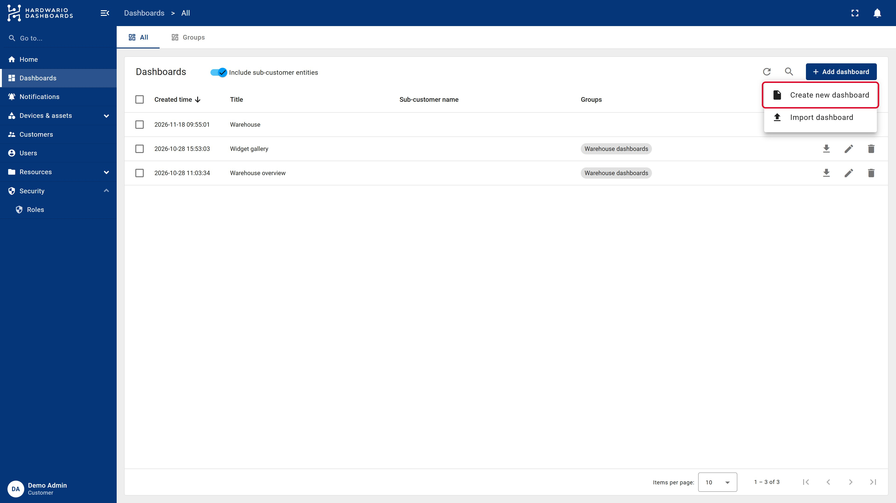
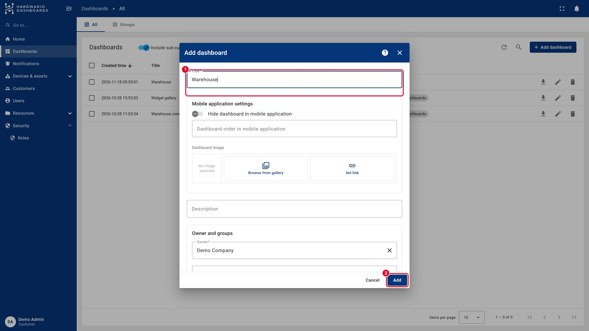
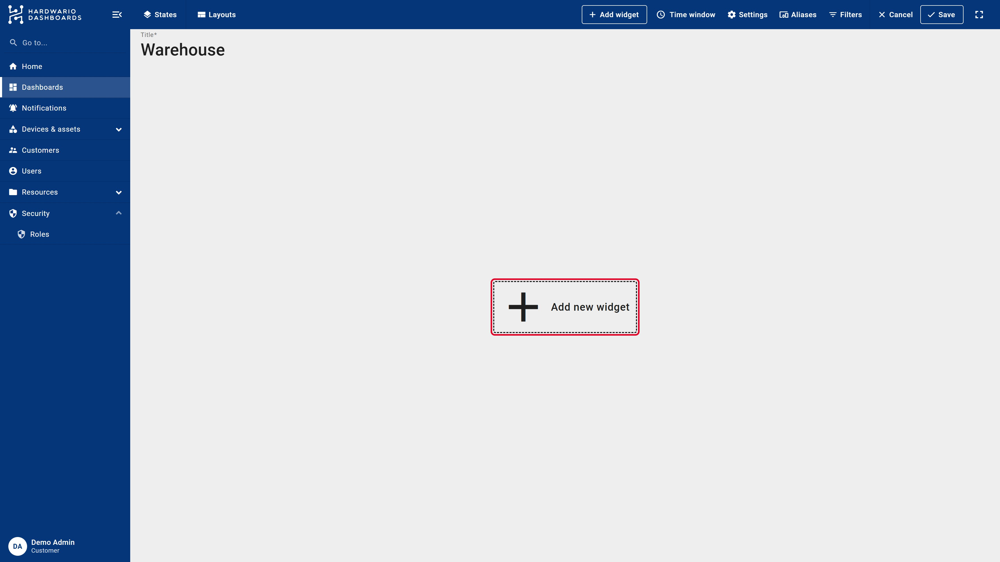
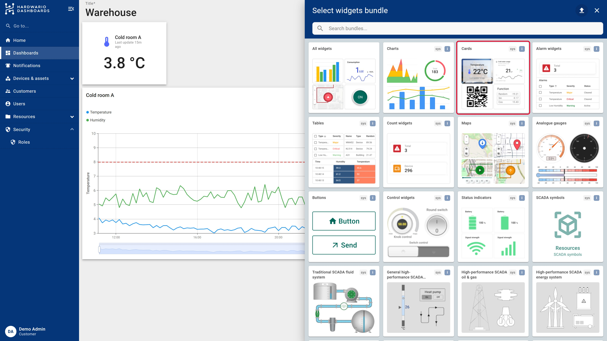
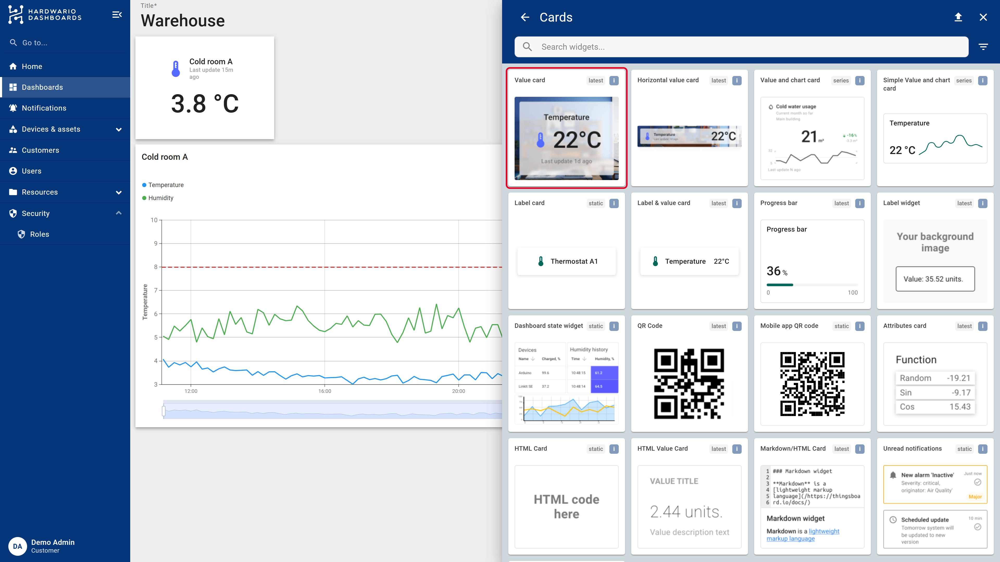
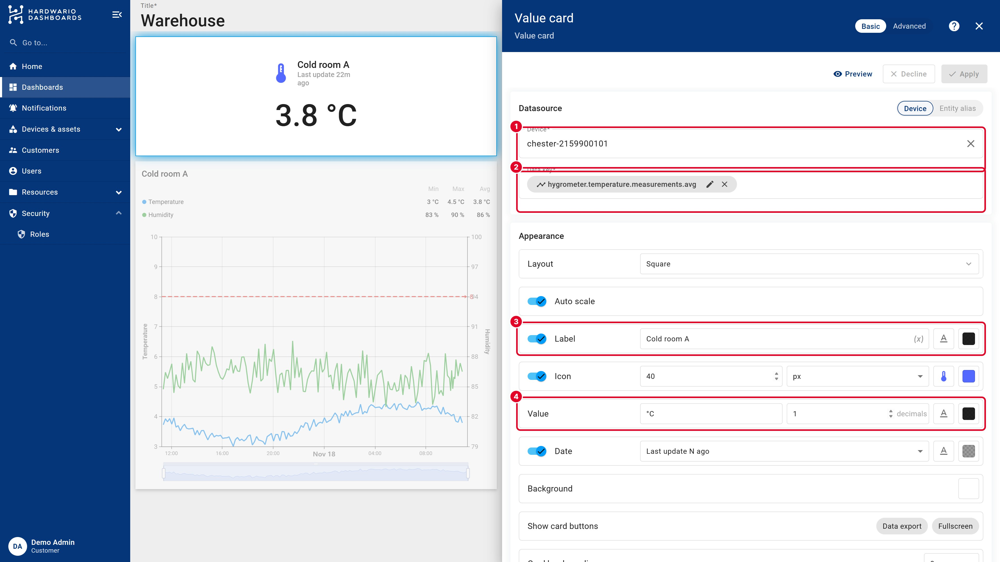
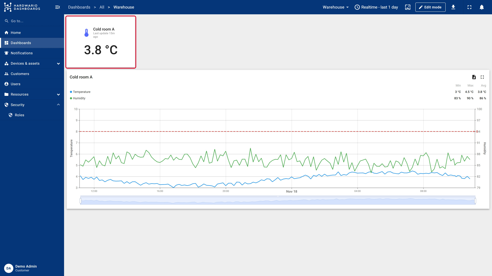
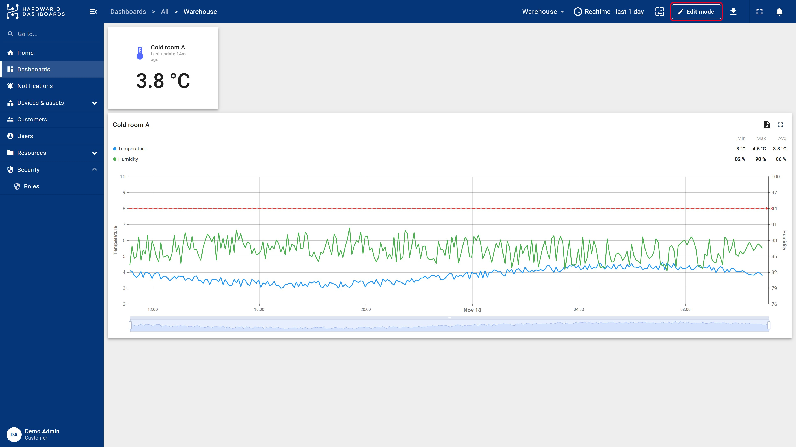
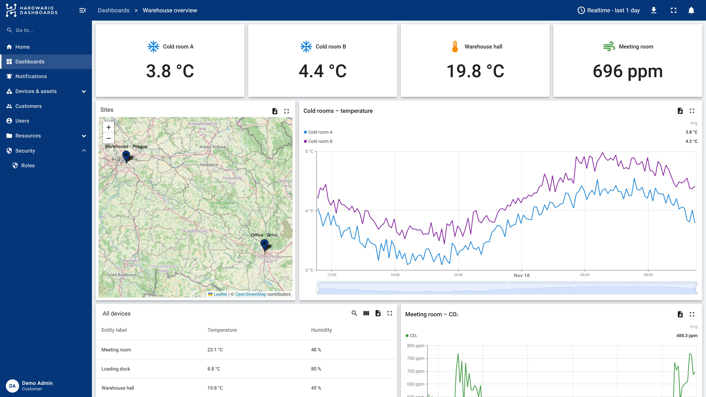

import Image from '@theme/IdealImage';

# Your first dashboard

In this guide, you'll create a dashboard and add a card that shows a live value from your device. Then you can continue with [charts](/apps/thingsboard/charts).

Before you start, your device should be [connected](/apps/thingsboard/cloud-connection) and its values should appear in **Latest telemetry** (see [Managing devices](/apps/thingsboard/devices#check-the-device-data)).

---

## Step 1: Create the dashboard

1. Open **Dashboards** in the left menu.
2. Click **Add dashboard** in the top-right corner and choose **Create new dashboard**.

   

3. Enter a **Title**, for example *Warehouse*. The other fields are optional. Click **Add**.

   

The new dashboard opens in **edit mode**, ready for its first widget.

---

## Step 2: Add a card with a live value

1. Click **Add new widget** in the middle (or **Add widget** in the top bar).
2. A list of widget bundles opens. Choose **Cards**.

   

3. Choose **Value card**. It shows one value that updates in real time.

   

4. Under **Datasource**, type the device name in **Device** and pick your device.
5. In **Data key**, remove the default `temperature` key, click the field and pick the value you want, for example `hygrometer.temperature.measurements.avg`. You can type part of the name to search.
6. Under **Appearance**, set:
   - **Label**: the text above the value, for example *Cold room A*,
   - **Value**: the unit (for example `°C`) and the number of **decimals**,
   - **Icon** and colors, if you want.
7. Click **Add**.

The card appears on the dashboard and shows the latest value with the time of the last update.

---

## Step 3: Arrange the dashboard

- **Resize** a widget by dragging its bottom-right corner.
- **Move** a widget by dragging it.
- **Edit** a widget: hover over it and click the **pencil icon** in its top-right corner.
- **Copy** a widget: right-click it and choose **Copy**, then right-click an empty space and choose **Paste**. In the copy, change only the data key, for example to humidity. It's faster than starting again.

---

## Step 4: Save

Click **Save** in the top-right corner. The dashboard leaves edit mode. The card now updates every time your device sends new data.

To change the dashboard later, open it and click **Edit mode** in the top bar.

:::tip The value is empty?
Check that you picked the right device and key: open the device and compare with its **Latest telemetry**. Charts also depend on the [time window](/apps/thingsboard/time-window).
:::

---

## Example

A finished dashboard can combine value cards, charts, a map and a table:

---

## Next steps

- [Charts & styling](/apps/thingsboard/charts): add a chart with history.
- [Time window](/apps/thingsboard/time-window): choose which period the dashboard shows.
- [Public link](/apps/thingsboard/public-link): share the dashboard.

:::info ThingsBoard documentation
HARDWARIO Dashboards is built on ThingsBoard. More details in the official ThingsBoard documentation: [Dashboards](https://thingsboard.io/docs/pe/user-guide/dashboards/).
:::
