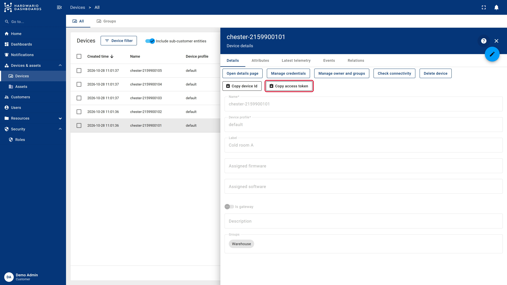
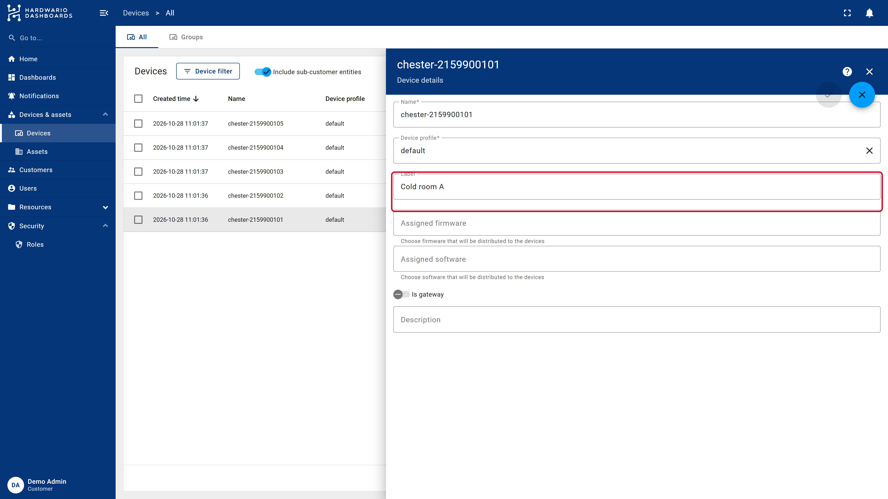
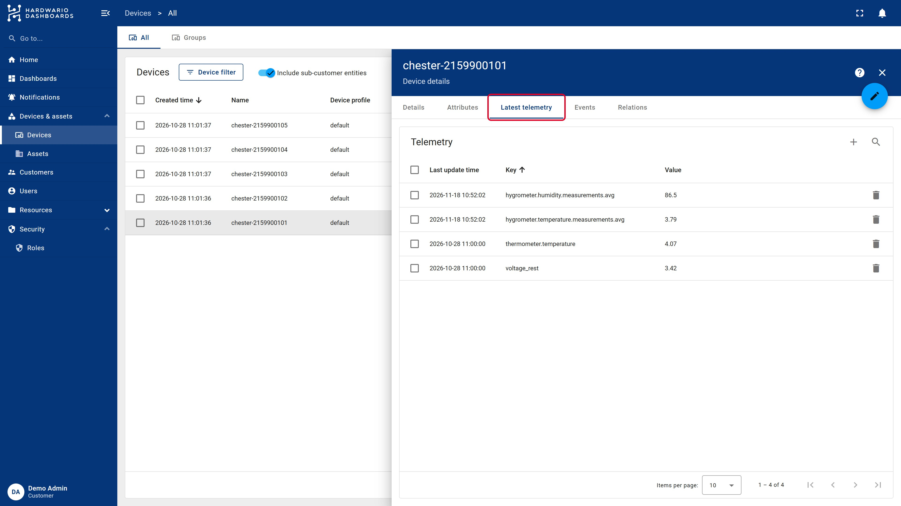
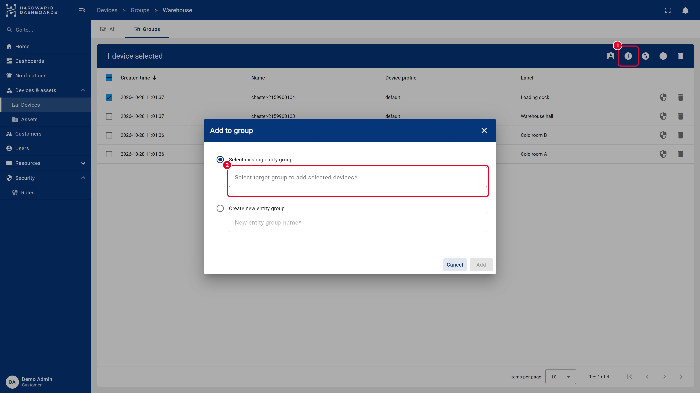

import Image from '@theme/IdealImage';

# Managing devices

Once your devices are [connected](/apps/thingsboard/cloud-connection), this guide shows you how to give them readable names, check their data, sort them into groups and delete them safely.

You find your devices under **Devices & assets → Devices** in the left menu. Tenant administrators find them under **Entities → Devices**.

---

## Give a device a readable label

Devices connected automatically are named `chester-` plus their serial number. That is practical for us, but not very friendly for you. A **label** is the readable name you'll see in lists and on your dashboards.

1. Click the device in the list. The device details open on the right.
2. Click the **pencil icon** in the top-right corner of the details.
3. Fill in the **Label**, for example *Cold room A*. You can also add a **Description**.
4. Confirm with the **tick icon**.

:::tip Keep the name
Change only the label, not the **Name**. The automatic connection finds the device by its name. If you rename it, the next message creates a new device.
:::

---

## Check the device data

The device details have several tabs:

| Tab | What you'll find there |
|---|---|
| **Details** | Name, label, device profile, groups and buttons such as **Copy access token** and **Manage owner and groups**. |
| **Attributes** | Information about the device. With the automatic connection: the device name from HARDWARIO Cloud, product, firmware version and similar. |
| **Latest telemetry** | Every value the device sends, with its latest reading and the time it arrived. |
| **Events**, **Relations** | Advanced information, usually not needed. |

**Latest telemetry** is the place to check whether data is arriving. It also shows the exact names of the values (keys), which you'll need for [dashboards](/apps/thingsboard/creating-dashboard) and [notifications](/apps/thingsboard/notifications-manager).

---

## Sort devices into groups {#device-groups}

Groups keep a growing fleet organized, for example by building, site or customer. They are also the key to deciding [who sees what](/apps/thingsboard/users-managing) and what a [public link](/apps/thingsboard/public-link) shows.

A device can belong to several groups at once. Every device is always in the group **All**.

### Create a group {#creating-a-device-group}

1. Open the **Groups** tab at the top of the devices list.
2. Click **Add entity group**, enter a **Name** (and optionally a description) and click **Add**.

### Add devices to a group

1. On the **Groups** tab, open the group the devices are in now. If you don't use groups yet, open **All**.
2. Tick the devices you want to sort.
3. In the blue bar at the top, click one of the actions:
   - **Add to group**: the devices stay in the current group and are added to another one.
   - **Move to group**: the devices leave the current group and move to another one.
   - **Remove from group**: the devices leave the current group.
4. Pick an existing group, or choose **Create new entity group** and type a name. Click **Add**.

:::tip Automatic connection
With the [automatic connection](/apps/thingsboard/cloud-connection), new devices land in the group whose ID is in the connector. Use one connector per group to sort devices automatically.
:::

---

## Delete a device

Click the **trash icon** at the end of the device's row and confirm. The device is deleted with all its data.

:::caution Remove the tag first
If the device is still tagged in HARDWARIO Cloud, the automatic connection adds it again with its next message. First [remove the tag](/cloud/tags#assigning-tags) in HARDWARIO Cloud, then delete the device here.
:::

---

## Add a device manually

With the automatic connection, devices create themselves, so you rarely need to add one by hand. If you do, for example for the [manual connection](/apps/thingsboard/manual-connection), click **Add device** in the top-right corner of the devices list, fill in the **Name** and **Label** and finish the dialog. The [Manual connection](/apps/thingsboard/manual-connection#step-1-create-the-device) guide shows the steps.

---

## Next steps

- [Your first dashboard](/apps/thingsboard/creating-dashboard): show the data of your devices.
- [Groups, roles & permissions](/apps/thingsboard/users-managing): decide which users see which device groups.

:::info ThingsBoard documentation
HARDWARIO Dashboards is built on ThingsBoard. More details in the official ThingsBoard documentation: [Devices](https://thingsboard.io/docs/pe/user-guide/devices/) · [Entity groups](https://thingsboard.io/docs/pe/user-guide/groups/).
:::
