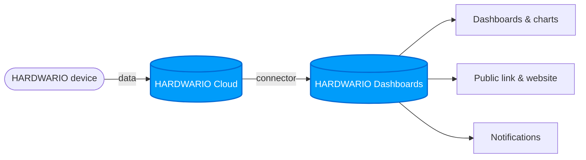

import Image from '@theme/IdealImage';

# HARDWARIO Dashboards

**HARDWARIO Dashboards** shows the data from your HARDWARIO devices in live dashboards. You see current values and history in charts, share dashboards with your customers, put them on your website and get alerts when a value crosses a limit.

HARDWARIO Dashboards is built on the open-source IoT platform [ThingsBoard](https://thingsboard.io/), so you may come across that name in the interface and in the platform's own documentation.

:::info Sign in
HARDWARIO Dashboards runs at **[app.hardwario.cloud](https://app.hardwario.cloud/)**.

Don't have an account yet? Write to us at **[ask@hardwario.com](mailto:ask@hardwario.com)**. We'll set it up and help you connect your devices.
:::

---

## How it works

1. Your devices send data to **HARDWARIO Cloud**.
2. A **connector** in HARDWARIO Cloud forwards the data to HARDWARIO Dashboards. With the [automatic connection](/apps/thingsboard/cloud-connection#automatic-connection), each device appears in your account by itself.
3. In HARDWARIO Dashboards, you **show** the data in dashboards, **share** them and **watch** them with notifications.

---

## Example dashboard

This is a live public dashboard, embedded right in this page:

import ThingsBoardDashboard from '@site/src/components/ThingsBoardDashboard';

<ThingsBoardDashboard />

---

## Step by step

The guides follow the order in which you set things up, from connecting the first device to an alert in your inbox. Each guide has a matching episode in our video series.

### Getting started

| # | Guide | What you will do |
|---|---|---|
| 01 | **Overview** (this page) | See what HARDWARIO Dashboards can do and how to sign in. |
| 02 | [Connect devices](/apps/thingsboard/cloud-connection) | Add one connector, and your devices appear by themselves. **Recommended.** |
| 03 | [Manual connection](/apps/thingsboard/manual-connection) | Connect a device that already exists, using its access token. |
| 04 | [Managing devices](/apps/thingsboard/devices) | Give devices readable labels, sort them into groups and check their data. |

### Dashboards

| # | Guide | What you will do |
|---|---|---|
| 05 | [Your first dashboard](/apps/thingsboard/creating-dashboard) | Create a dashboard and add a card with a live value. |
| 06 | [Charts & styling](/apps/thingsboard/charts) | Add a chart with more values, a second axis, a limit line and a legend. |
| 07 | [Time window](/apps/thingsboard/time-window) | Choose which period the dashboard shows and save it as the default. |

### Sharing

| # | Guide | What you will do |
|---|---|---|
| 08 | [Public link](/apps/thingsboard/public-link) | Share a read-only dashboard with anyone, no login needed. |
| 09 | [Embedding dashboards](/apps/thingsboard/embedding-dashboards) | Put a dashboard or a single chart on your website. |

### Users & access

| # | Guide | What you will do |
|---|---|---|
| 10 | [Groups, roles & permissions](/apps/thingsboard/users-managing) | Decide exactly which users see which devices and dashboards. |
| 11 | [Adding users](/apps/thingsboard/users) | Create an account and invite a user. |

### Notifications

| # | Guide | What you will do |
|---|---|---|
| 12 | [Notification rules](/apps/thingsboard/notifications-manager) | Get an e-mail or SMS when a value crosses a limit. No code needed. |

---

## Advanced

When the basics are in place, see [Advanced](/apps/thingsboard/features) for [assets](/apps/thingsboard/assets) (building → floor → room), the [Rule Engine](/apps/thingsboard/rule-engine) and [integrations](/apps/thingsboard/integrations) such as ChirpStack.

:::tip We'll do it for you
If you get stuck, or would rather not set it up yourself, write to us at **[ask@hardwario.com](mailto:ask@hardwario.com)**. We'll set everything up for you.
:::

:::info ThingsBoard documentation
HARDWARIO Dashboards is built on ThingsBoard. More details in the official ThingsBoard documentation: [ThingsBoard PE documentation](https://thingsboard.io/docs/pe/).
:::
