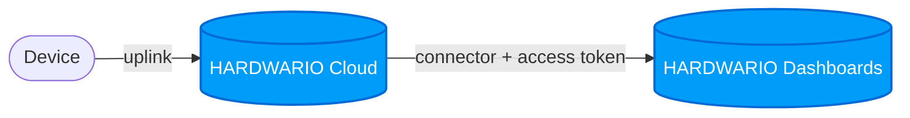
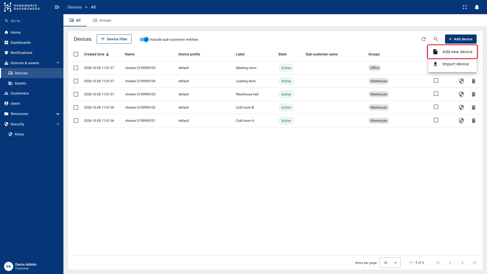
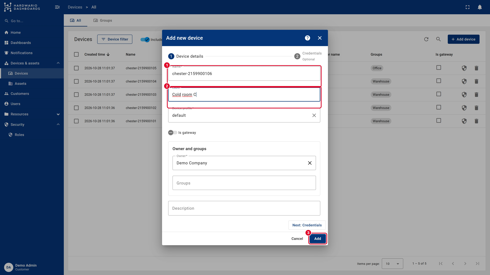
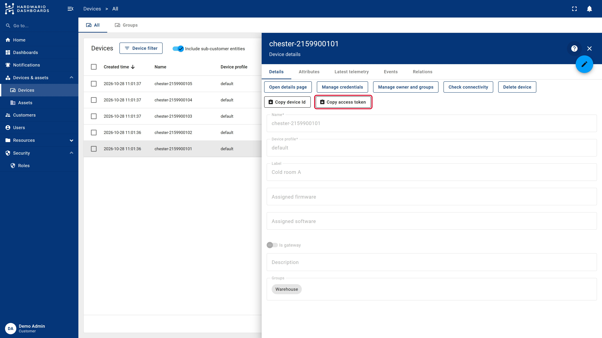
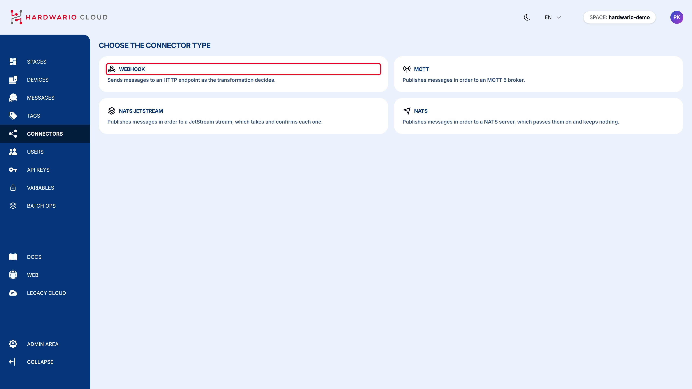
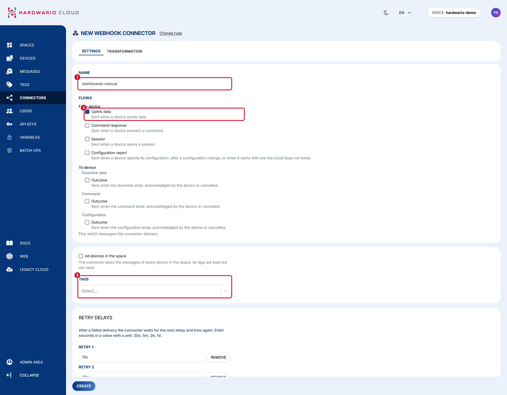
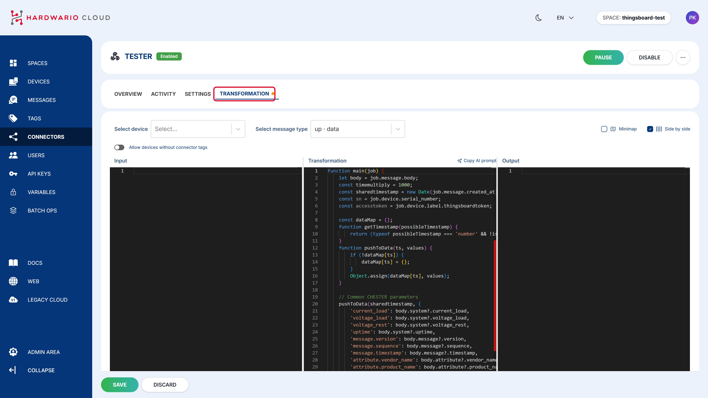
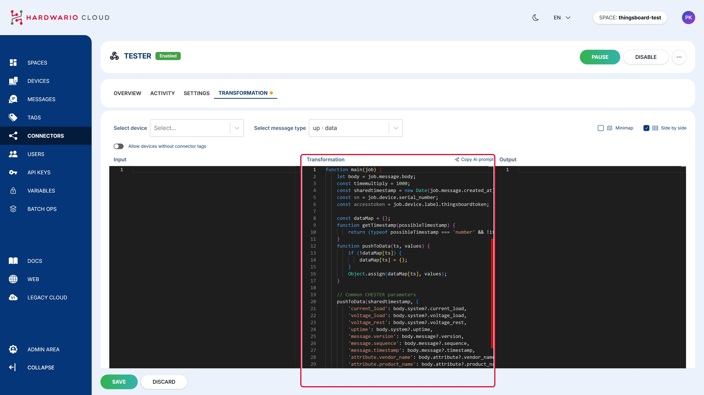
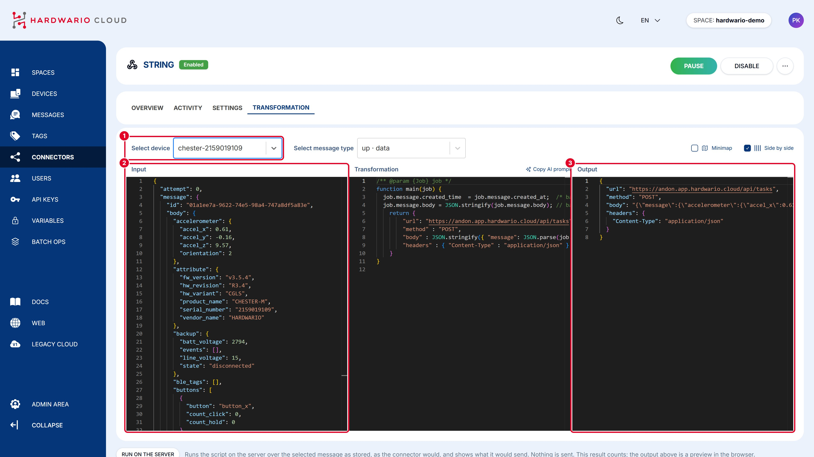
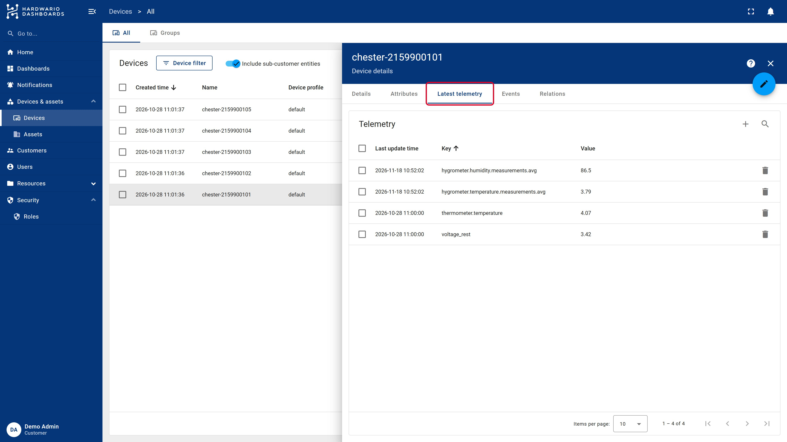

import Image from '@theme/IdealImage';
import EditCodeBlock from './edit-code-block.js';

# Manual connection

:::tip Most devices don't need this
The [automatic connection](/apps/thingsboard/cloud-connection) is simpler: you add one connector and every tagged device appears by itself. Use the manual connection only for devices that **already exist** in HARDWARIO Dashboards, or when you need your own data format.
:::

With the manual connection, each device in HARDWARIO Dashboards has an **access token**. A connector in HARDWARIO Cloud reads the token from a device label and sends the device's data to it.

---

## Step 1: Create the device

Skip this step if the device already exists in HARDWARIO Dashboards.

1. Open **Devices & assets → Devices** (**Entities → Devices** for tenant administrators), click **Add device** in the top-right corner and choose **Add new device**.

   

2. Enter a **Name** (1), for example the serial number, and a **Label** (2), a readable name such as *Cold room A*. You can also pick its **Groups**. Click **Add** (3).

   

The device now appears in the list.

---

## Step 2: Copy the access token

Click the device in the list. In the device details, click **Copy access token**.

:::caution
The access token lets anyone send data to this device. Don't share it outside the connector.
:::

---

## Step 3: Prepare the device in HARDWARIO Cloud

Open the device in [HARDWARIO Cloud](https://hardwario.cloud/):

- **Assign a tag** (for example `dashboards-manual`), see [Assigning tags](/cloud/tags#assigning-tags). The connector sends data of every device with this tag.
- **Add the access token as a label.** At the very bottom of the device page, in the **Labels** section, create a label:
  - **Name**: `thingsboardtoken`. You can choose another name, but it must be the same on all devices that share this connector, and it must match the name in the transformation code (`job.device.label.thingsboardtoken`).
  - **Value**: the access token from Step 2.

---

## Step 4: Create the connector

1. In HARDWARIO Cloud, open **Connectors** in the left menu, click **New connector** and choose **Webhook**.

   

2. Fill in the settings:
   - **Name** (1): for example `dashboards-manual`,
   - **Flows** (2): keep only **Uplink data**, the data the device sends,
   - **Tags** (3): the tag from Step 3.

   

3. Click **Create**.

---

## Step 5: Add the transformation code

HARDWARIO Dashboards expects its own data format. The transformation code converts the device message into it.

1. On the connector page, open the **Transformation** tab.

   

2. Paste the code below into the **Transformation** editor in the middle and click **Save**.

   

The code covers the common CHESTER measurements and BLE tags. You can edit it right here before copying:

<EditCodeBlock initialText={`function main(job) {
    let body = job.message.body;
    const timemultiply = 1000;
    const sharedtimestamp = new Date(job.message.created_at).getTime();
    const sn = job.device.serial_number;
    const accesstoken = job.device.label.thingsboardtoken;

    const dataMap = {};
    function getTimestamp(possibleTimestamp) {
        return (typeof possibleTimestamp === 'number' && !isNaN(possibleTimestamp)) ? possibleTimestamp * timemultiply : sharedtimestamp;
    }
    function pushToData(ts, values) {
        if (!dataMap[ts]) {
            dataMap[ts] = {};
        }
        Object.assign(dataMap[ts], values);
    }

    // Common CHESTER parameters
    pushToData(sharedtimestamp, {
        'current_load': body.system?.current_load,
        'voltage_load': body.system?.voltage_load,
        'voltage_rest': body.system?.voltage_rest,
        'uptime': body.system?.uptime,
        'message.version': body.message?.version,
        'message.sequence': body.message?.sequence,
        'message.timestamp': body.message?.timestamp,
        'attribute.vendor_name': body.attribute?.vendor_name,
        'attribute.product_name': body.attribute?.product_name,
        'attribute.hw_variant': body.attribute?.hw_variant,
        'attribute.hw_revision': body.attribute?.hw_revision,
        'attribute.fw_name': body.attribute?.fw_name,
        'attribute.fw_version': body.attribute?.fw_version,
        'attribute.serial_number': body.attribute?.serial_number,
        'backup.line_voltage': body.backup?.line_voltage,
        'backup.batt_voltage': body.backup?.batt_voltage,
        'backup.state': body.backup?.state,
        'thermometer.temperature': body.thermometer?.temperature,
        'accelerometer.accel_x': body.accelerometer?.accel_x,
        'accelerometer.accel_y': body.accelerometer?.accel_y,
        'accelerometer.accel_z': body.accelerometer?.accel_z,
        'accelerometer.orientation': body.accelerometer?.orientation,
        'network.parameter.eest': body.network?.parameter?.eest,
        'network.parameter.ecl': body.network?.parameter?.ecl,
        'network.parameter.rsrp': body.network?.parameter?.rsrp,
        'network.parameter.rsrq': body.network?.parameter?.rsrq,
        'network.parameter.snr': body.network?.parameter?.snr,
        'network.parameter.plmn': body.network?.parameter?.plmn,
        'network.parameter.cid': body.network?.parameter?.cid,
        'network.parameter.band': body.network?.parameter?.band,
        'network.parameter.earfcn': body.network?.parameter?.earfcn,
        'network.imei': body.network?.imei,
        'network.imsi': body.network?.imsi
    });

    // BLE Tags - use index instead of addr
    body.ble_tags?.forEach((tag, tagIndex) => {
        tag.humidity?.measurements.forEach(m => {
            const ts = getTimestamp(m.timestamp);
            pushToData(ts, {
                [\`ble_tags.\${tagIndex}.humidity.measurement.min\`]: m?.min,
                [\`ble_tags.\${tagIndex}.humidity.measurement.max\`]: m?.max,
                [\`ble_tags.\${tagIndex}.humidity.measurement.avg\`]: m?.avg,
                [\`ble_tags.\${tagIndex}.humidity.measurement.mdn\`]: m?.mdn
            });
        });
        tag.temperature?.measurements.forEach(m => {
            const ts = getTimestamp(m.timestamp);
            pushToData(ts, {
                [\`ble_tags.\${tagIndex}.temperature.measurement.min\`]: m?.min,
                [\`ble_tags.\${tagIndex}.temperature.measurement.max\`]: m?.max,
                [\`ble_tags.\${tagIndex}.temperature.measurement.avg\`]: m?.avg,
                [\`ble_tags.\${tagIndex}.temperature.measurement.mdn\`]: m?.mdn
            });
        });
    });

    const sensorTypes = [
        'w1_thermometers', 'analog_channels', 'rtd_thermometer', 'weight', 'counter', 'current', 'voltage'
    ];

    sensorTypes.forEach(sensorType => {
        body[sensorType]?.forEach((entry, index) => {
            entry.measurements?.forEach(measurement => {
                const ts = getTimestamp(measurement.timestamp);
                const prefix = \`\${sensorType}.\${entry.serial_number || entry.channel || index}.measurement\`;
                const values = {};
                for (const key in measurement) {
                    if (key !== 'timestamp') {
                        values[\`\${prefix}.\${key}\`] = measurement[key];
                    }
                }
                pushToData(ts, values);
            });
        });
    });

    // Buttons
    body.buttons?.forEach((btn, index) => {
        pushToData(sharedtimestamp, {
            [\`button_\${index}.button\`]: btn?.button,
            [\`button_\${index}.count_click\`]: btn?.count_click,
            [\`button_\${index}.count_hold\`]: btn?.count_hold,
            [\`button_\${index}.events\`]: btn?.events
        });
    });

    // Weather Station, Hygrometer, Barometer, Radon Probe, IAQ Sensor, Soil Sensors
    const nestedSensors = [
        ['weather_station', ['wind_speed', 'wind_direction', 'rainfall']],
        ['hygrometer', ['temperature', 'humidity']],
        ['barometer', ['pressure']],
        ['radon_probe', ['chamber_humidity', 'chamber_temperature', 'concentration_daily', 'concentration_hourly']],
        ['iaq_sensor', ['temperature', 'humidity', 'illuminance', 'altitude', 'pressure', 'co2_conc', 'motion_count', 'press_count']],
        ['soil_sensors', ['moisture', 'temperature']]
    ];

    nestedSensors.forEach(([sensorKey, subkeys]) => {
        const sensor = body[sensorKey];
        if (!sensor) return;

        subkeys.forEach(subkey => {
            sensor?.[subkey]?.measurements?.forEach(m => {
                const ts = getTimestamp(m.timestamp);
                const prefix = \`\${sensorKey}.\${subkey}.measurements\`;
                const values = {};
                for (const k in m) {
                    if (k !== 'timestamp') {
                        values[\`\${prefix}.\${k}\`] = m[k];
                    }
                }
                pushToData(ts, values);
            });
        });
    });

    const data = Object.entries(dataMap).map(([ts, values]) => ({
        ts: Number(ts),
        values: values
    }));

    const url = "https://app.hardwario.cloud/api/v1/" + accesstoken + '/telemetry';
    return {
        method: "POST",
        url: url,
        header: {
            "Content-Type": "application/json"
        },
        data: data
    };
}`} />

---

## Step 6: Check the data

On the **Transformation** tab, pick your device in **Select device** (1). On the left (**Input**, 2) you see the last message from the device, on the right (**Output**, 3) the transformed data sent to HARDWARIO Dashboards. If the device is not in the list yet, turn on **Allow devices without connector tags**.

With the next message of the device, open it in HARDWARIO Dashboards and switch to **Latest telemetry**. The values should appear and update with each new message.

### Troubleshooting

| Problem | What to do |
|---|---|
| No data in Latest telemetry | Check that the device has the tag and the label, and that the label name matches the code. Wait for the next message of the device. |
| The transformed data look right, but nothing arrives | The access token in the label is probably wrong. Copy it again from the device details. |

Anything else: [ask@hardwario.com](mailto:ask@hardwario.com).

### Next steps

- [Managing devices](/apps/thingsboard/devices): labels, groups and the data of your devices.
- [Your first dashboard](/apps/thingsboard/creating-dashboard): show the data.

:::info ThingsBoard documentation
HARDWARIO Dashboards is built on ThingsBoard. More details in the official ThingsBoard documentation: [HTTP device API](https://thingsboard.io/docs/pe/reference/http-api/getting-connected/).
:::
