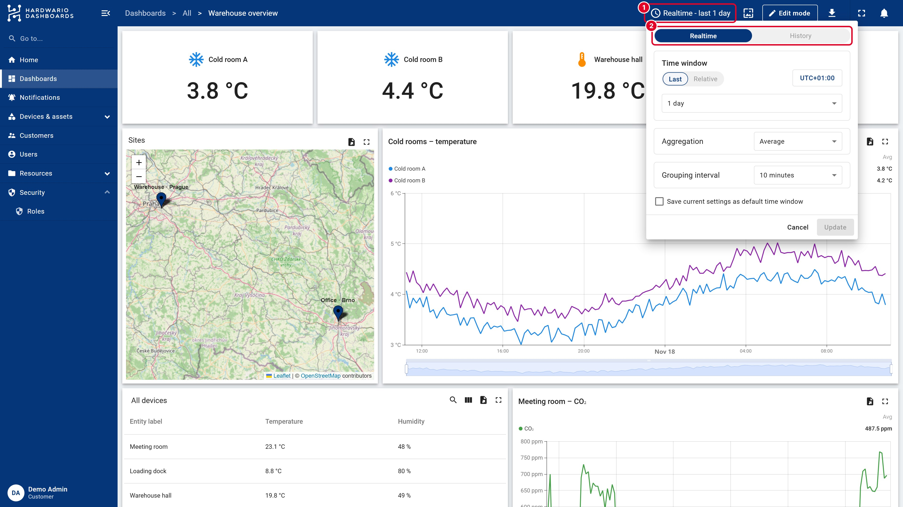
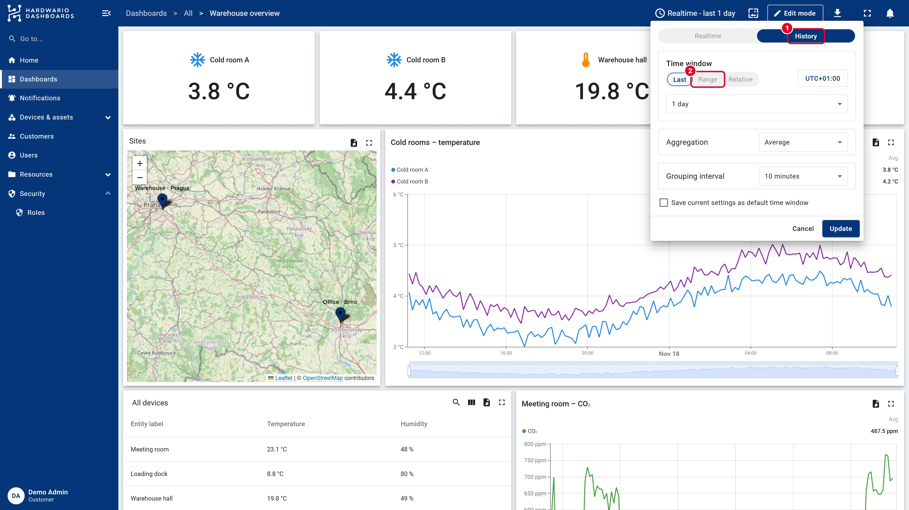
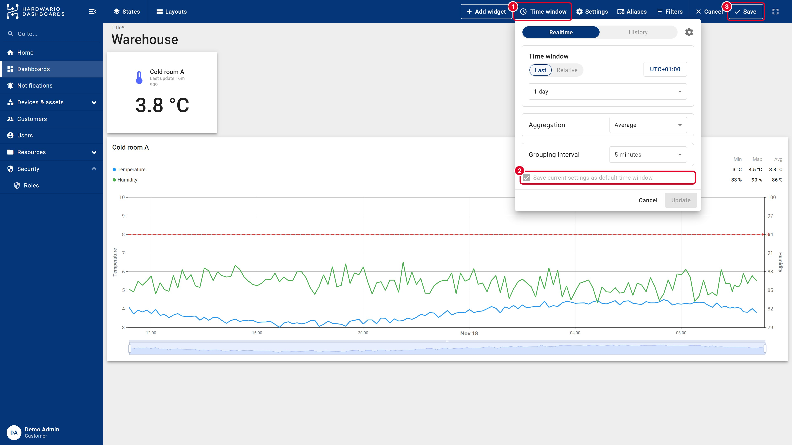
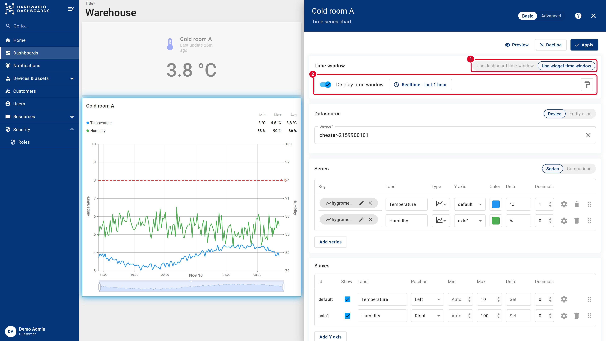

import Image from '@theme/IdealImage';

# Time window

The **time window** decides which period the charts on a dashboard show: the last hour, the last 24 hours, last week... It's in the top-right corner of every dashboard.

:::tip "I don't see any data"
This is the most common reason. A new dashboard shows only the **last hour**. If your device sends data every 15 minutes, the chart has just a few points; if it sends once a day, the chart may be empty. Set a longer time window.
:::

---

## Realtime or history

Click the time window in the top bar (for example **Realtime - last 1 day**). A panel opens with two tabs:

| Tab | What it shows | Example |
|---|---|---|
| **Realtime** | A period that ends **now** and keeps moving as new data arrives. | the last 24 hours, the last 7 days |
| **History** | A **fixed period** in the past. Choose **Range** to set the start and end. | last week, 1–31 October |

Choose the period and click **Update**. All charts on the dashboard redraw.

---

## Aggregation

For long periods, a chart with every single value is hard to read and slow to load. **Aggregation** joins the values into intervals:

| Aggregation | Each interval shows |
|---|---|
| **Average** | the average value (the most common choice) |
| **Min**, **Max** | the lowest or highest value, for example the peak temperature |
| **Sum**, **Count** | the total or the number of values, for example for counters |
| **None** | every value as it was measured |

**Grouping interval** sets the length of one interval, for example 1 hour for a week, 1 day for a year.

---

## Save the default time window

What you set in the time window while viewing a dashboard is **only temporary**: the next time you open the dashboard, it's back to the default. To change the default for everyone who opens the dashboard, including people with a [public link](/apps/thingsboard/public-link):

1. Click **Edit mode** in the top bar.
2. Click **Time window** in the edit toolbar and set the period and aggregation. **Save current settings as default time window** is turned on.
3. Click **Update**, then **Save** the dashboard.

---

## A different time window for one widget

Sometimes one chart should show a different period, for example a weekly overview next to today's detail.

1. In **Edit mode**, point at the widget and click its **pencil icon**.
2. Under **Time window**, switch from **Use dashboard time window** to **Use widget time window**.
3. Set the widget's own period. With **Display time window** on, viewers can change it right in the widget.
4. Click **Apply**, then **Save** the dashboard.

This widget then keeps its own period when you change the time window of the dashboard.

---

## Next steps

- [Public link](/apps/thingsboard/public-link): share the dashboard, with the default time window you saved.
- [Charts & styling](/apps/thingsboard/charts): fine-tune your charts.

:::info ThingsBoard documentation
HARDWARIO Dashboards is built on ThingsBoard. More details in the official ThingsBoard documentation: [Dashboard time window](https://thingsboard.io/docs/pe/user-guide/dashboards/#dashboard-time-window).
:::
