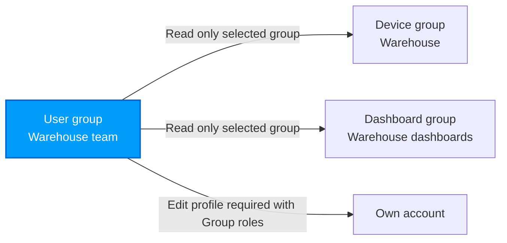

import Image from '@theme/IdealImage';
import Tabs from '@theme/Tabs';
import TabItem from '@theme/TabItem';

# Groups, roles & permissions

HARDWARIO Dashboards lets you decide exactly **what each user can see and do**. Some colleagues see all your devices, others only one site, and an administrator can manage everything.

## How it works

Everything is built on **groups**:

- **Users** are sorted into **user groups**.
- **Devices** and **dashboards** are sorted into **device groups** and **dashboard groups**.
- A **role** is a set of permissions, for example *read only*.

You connect them with one rule: **this user group** has **this role**, optionally on **this device group** and **this dashboard group**.

---

## Roles ready for you

Your account comes with four roles, so you don't have to create any. You find them under **Security → Roles**.

| Role | Type | What it allows |
|---|---|---|
| **Read only (all devices)** | Generic | See all your devices, assets and dashboards, change own profile and password. |
| **Admin** | Generic | Manage devices, dashboards, groups, users and roles, change own profile and password. |
| **Read only (selected group)** | Group | See only the device or dashboard group you assign it to. |
| **Edit profile (required with Group roles)** | Generic | Basic role: change own profile and password. Users who have only Group roles need it, otherwise they cannot change their password. |

- A **Generic** role applies to everything in your account. Use it when the user should see all devices.
- A **Group** role applies only to the group you pick when you add the role to a user group. Use it when the user should see only some devices.

:::tip
New HARDWARIO Dashboards accounts get these four roles automatically.
:::

---

## Which roles to use

| The user should… | Add these roles to the user group |
|---|---|
| see all devices and dashboards | **Read only (all devices)** |
| see only some devices | **Read only (selected group)** on the device group, **Read only (selected group)** on the dashboard group, and **Edit profile (required with Group roles)** |
| manage devices, dashboards and users | **Admin** |

Your account also has two default user groups: *Customer Administrators* (full access) and *Customer Users*. For users who should see only some devices, create your own user group as shown below.

---

## Step 1: Prepare device and dashboard groups

To show a user only some devices, the devices and their dashboards must be in groups. Skip this step if the user should see everything.

### Creating a device group {#creating-a-device-group}
1. Go to **Devices & assets → Devices** in the left menu (**Entities → Devices** for tenant administrators).
2. Switch to the **Groups** tab.
3. Click **Add entity group** in the top-right corner.
4. Enter a **Name** and **Description** for the group, then save it.

### Adding devices to the group
1. Open the new device group.
2. Add devices with **Add to group**, see [Add devices to a group](/apps/thingsboard/devices#add-devices-to-a-group). A device can be in several groups at the same time.

Create a **dashboard group** the same way under **Dashboards → Groups** and put the dashboards for these users into it.

---

## Step 2: Create a user group

1.  Go to the **Users** section and select the **Groups** tab.
2.  Click **Add entity group** in the top-right corner, enter a name and description.

3.  Click the new group to open it, then click the **pencil icon** next to its name to open the group details.
4.  Navigate to the **Roles** tab (1).

---

## Step 3: Add roles to the user group

Add the roles from [Which roles to use](#which-roles-to-use). Click the **plus (+) icon** (2) above the table for each one.

### A Group role (only some devices)
1.  Set **Role Type** to *Group* and pick **Read only (selected group)**.
2.  **Group Owner:** your company.
3.  **Type:** *Device*.
4.  **Entity Group:** the device group from step 1.
5.  Click **Add**.
6.  Repeat with **Type** *Dashboard* and your dashboard group, so the users also see the dashboards.

### A Generic role
Set **Role Type** to *Generic*, pick the role (for example **Edit profile (required with Group roles)** or **Read only (all devices)**) and click **Add**. Nothing else is needed, a Generic role applies to the whole account.

:::tip
One device group can be shared with several user groups. The same devices can be visible to a site team (read only) and to your service team (Admin).
:::

---

## Step 4: Add users to the group

1.  **New users:** Open your group and click **Add user** in the top-right corner. More in [Adding users](/apps/thingsboard/users).

2.  **Existing users:**
    * Go to the main **Users** -> **Users** section.
    * Click on a specific user.
    * In the **Details** tab, click the **Manage owner and groups** button.
    * Select the desired user group and click **Update**.

The user gets the permissions of the group right away. Nothing has to be set on the user itself.

---

## Optional: Create your own role

If none of the four roles fits, an **Admin** can create a new one, for example a role that can also change device settings.

1.  Go to **Security → Roles**.
2.  Click **Add role** in the top-right corner.
3.  Enter the **Role Name**, **Description**, and choose the **Role Type**.

* **Group:** You specify only the operations (e.g., read, write). The role is linked to a device or dashboard group later, when you add it to a user group.

  For a read-only role, allow **Read**, **Read Attributes** and **Read Telemetry**. Without the last two, users see the devices but not their data.
* **Generic:** You define permissions per resource (Device, Dashboard, Profile…). If you grant access to *Device* here, the user sees **all devices** in your account, not just one group.

<Tabs>
  <TabItem value="group" label="Group">

  </TabItem>
  <TabItem value="generic" label="Generic">

  </TabItem>
</Tabs>

:::warning
Users with only a Group role cannot change their password. Always add **Edit profile (required with Group roles)** (or your own Generic role with **Profile → All**) to their user group.
:::

---

## Next steps

- [Adding users](/apps/thingsboard/users): create a user in the group you've just set up and invite them.

:::info ThingsBoard documentation
HARDWARIO Dashboards is built on ThingsBoard. More details in the official ThingsBoard documentation: [Roles](https://thingsboard.io/docs/pe/user-guide/roles/) · [Entity groups](https://thingsboard.io/docs/pe/user-guide/groups/).
:::
