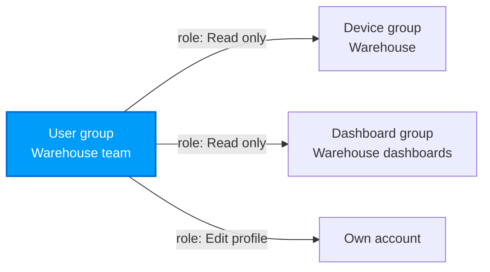
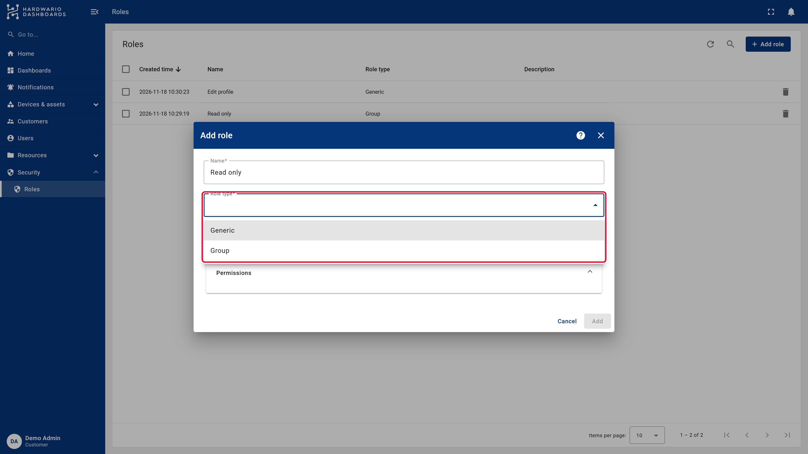
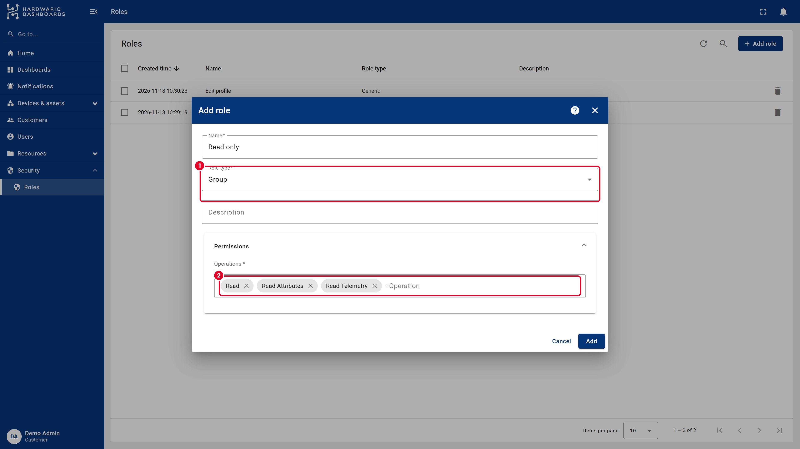
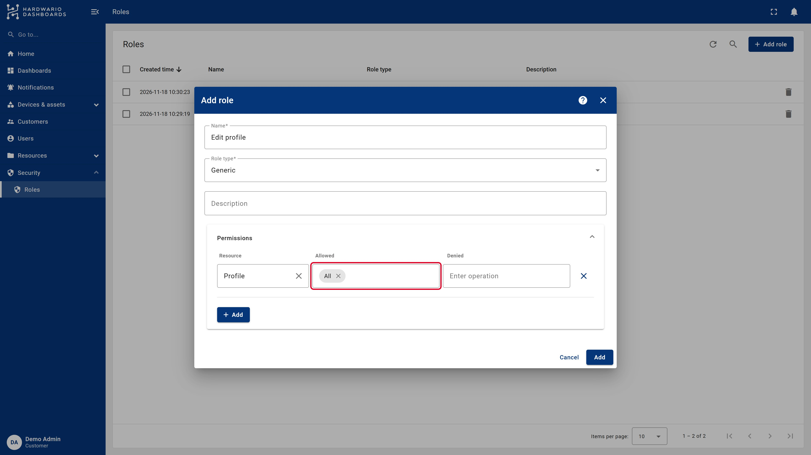
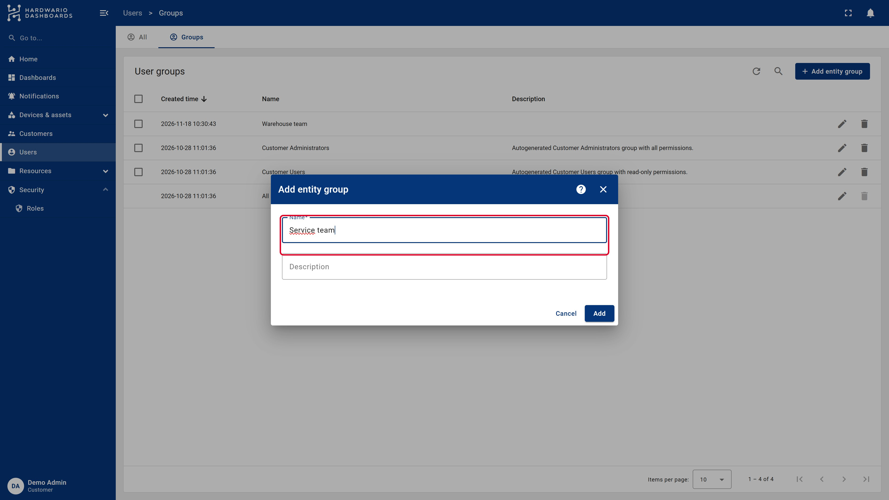
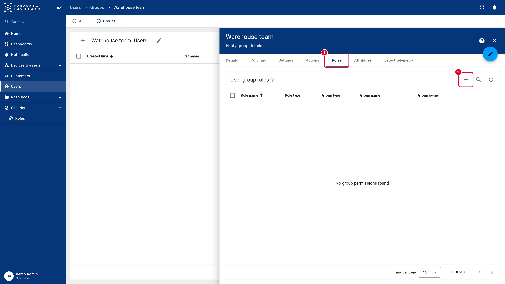
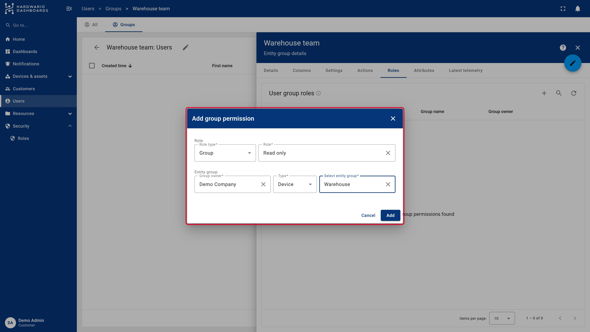
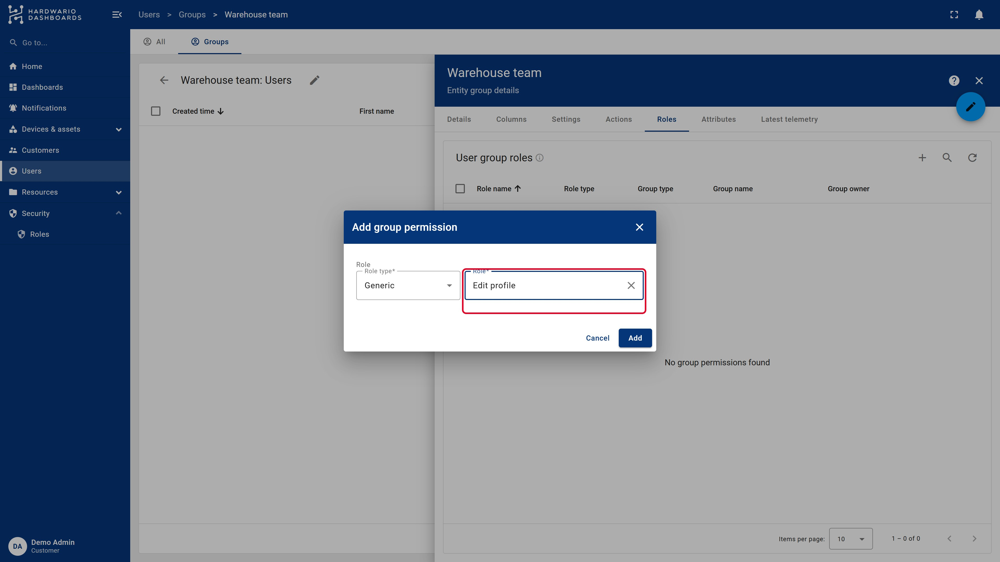
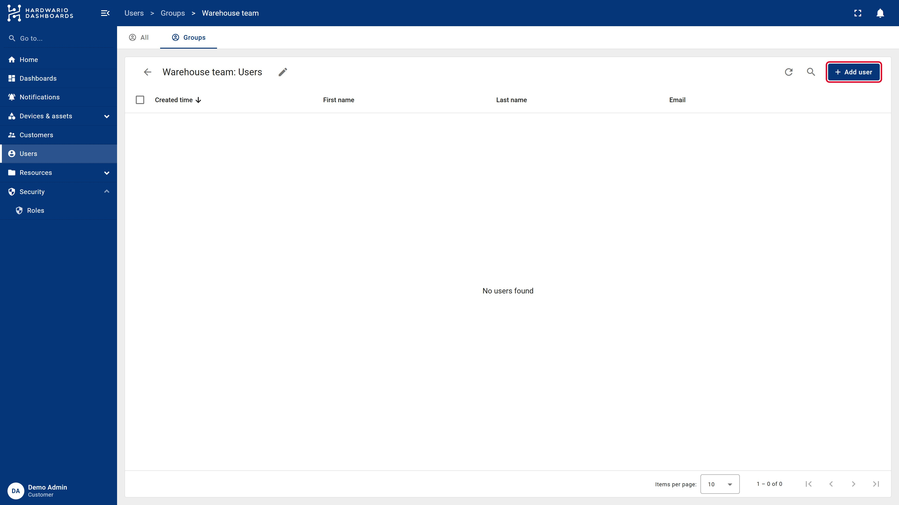
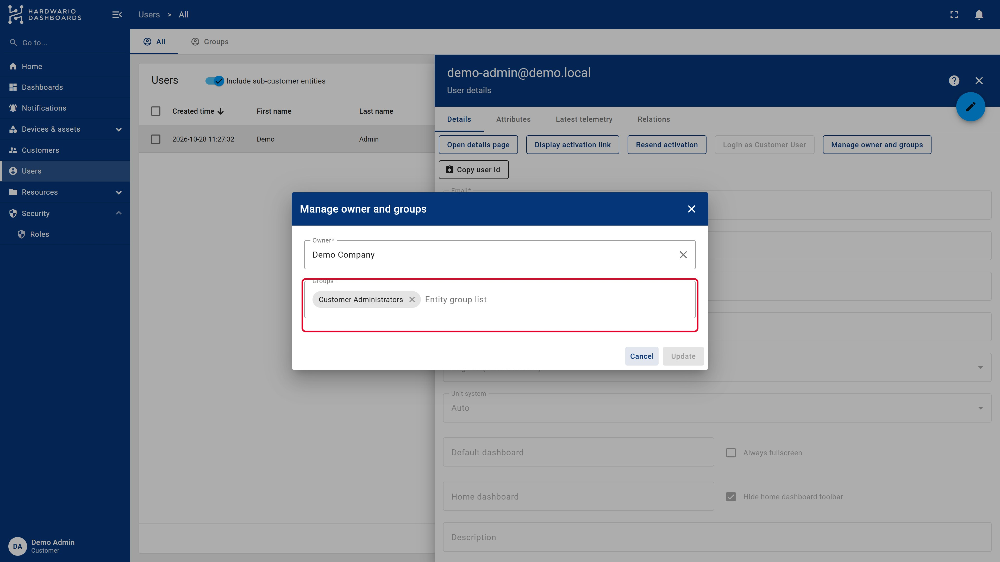

import Image from '@theme/IdealImage';
import Tabs from '@theme/Tabs';
import TabItem from '@theme/TabItem';

# Groups, roles & permissions

HARDWARIO Dashboards lets you decide exactly **what each user can see and do**. A customer sees only their own devices and dashboards, your service team can see and edit more.

## How it works

Everything is built on **groups**:

- **Users** are sorted into **user groups**.
- **Devices** and **dashboards** are sorted into **device groups** and **dashboard groups**.
- A **role** is a set of permissions, for example *read only*.

You connect them with one rule: **this user group** has **this role** on **this device group** and **this dashboard group**.

The steps below set this up: first the roles, then the user group, then the permissions. Your devices and dashboards should already be in groups, see [Sort devices into groups](/apps/thingsboard/devices#device-groups).

---

## Step 1: Creating user roles

The first step is to define roles, which act as sets of permissions.

1.  Go to the **Security** section in the left menu (the last item).
2.  Expand it and select **Roles**.
3.  To create a new role, click **Add role** in the top-right corner.
4.  Enter the **Role Name**, **Description**, and choose the **Role Type**.

### Difference between role types:
* **Group:** In this type, you only specify the operations (e.g., read, write) the user can perform. This role is linked to a specific entity (device, dashboard, etc.) later when setting up user groups.

  For a read-only role, allow **Read**, **Read Attributes** and **Read Telemetry**. Without the last two, users see the devices but not their data.
* **Generic:** Here, you define exactly what the user can and cannot do globally. Note: If you grant access to "Devices" here, the user will see **all devices** belonging to that customer, not just a specific group.

<Tabs>
  <TabItem value="lte" label="Group">

  </TabItem>
  <TabItem value="lora" label="Generic">

  </TabItem>
</Tabs>

**Important (User Profile Management):**
For users with restricted access, it is recommended to create a **Generic** role where you allow **All** operations for the **Profile** resource. Adding this role to a user group allows users to change their own passwords and account details.

---

## Step 2: Creating user groups

Next, you need to create groups to which you will assign the roles created above.

1.  Go to the **Users** section and select the **Groups** tab.
2.  You will see default groups: *Customer Administrators* (full access) and *Customer Users* (read-only access to everything).
3.  Click **Add entity group** in the top-right corner, enter a name and description.

4.  Click the new group to open it, then click the **pencil icon** next to its name to open the group details.
5.  Navigate to the **Roles** tab (1).

### Adding permissions to the group:
1.  Click the **plus (+) icon** (2) above the table.
2.  Select your **Role Type** and the specific role.
3.  If you selected **Group role type**, you must also specify:
    * **Group Owner:** Usually yourself or the specific customer.
    * **Type:** Define what the rules apply to (e.g., *Device* or *Dashboard*).
    * **Entity Group:** The specific group of entities the user should have access to.

:::info
You must have your **Entity Groups** ready beforehand. This means your devices or dashboards should already be organized into groups. You will pair these groups with the user group in this step. Creating groups for devices/dashboards is similar to creating user groups.
:::

If you are adding a **Generic** role (like the profile editing role), you only need to select the role, and it will apply globally to the user's account permissions.

---

## Step 3: Adding users to the group

You can add users to your newly configured group in two ways:

1.  **New Users:** Open your group and click **Add user** in the top-right corner.

2.  **Existing Users:** * Go to the main **Users** -> **Users** section.
    * Click on a specific user.
    * In the **Details** tab, click the **Manage owner and groups** button.
    * Select the desired user group and click **Update**.

---

## Step 4: Creating and sharing device groups

As mentioned in the previous steps, to give users access to specific devices without showing them everything, you need to use **Device Groups**. HARDWARIO Dashboards allows a flexible structure where a single device group can be shared with multiple user groups (for example, allowing both the end customer and your internal maintenance team to see the same devices).

### Creating a device group {#creating-a-device-group}
1. Go to **Devices & assets → Devices** in the left menu (**Entities → Devices** for tenant administrators).
2. Switch to the **Groups** tab.
3. Click **Add entity group** in the top-right corner to create a new group.
4. Enter a **Name** and **Description** for the group, then save it.

### Adding devices to the group
1. Click on your newly created device group to open it.
2. Go to the **Entities** tab inside the group.
3. Add devices with **Add to group**, see [Add devices to a group](/apps/thingsboard/devices#add-devices-to-a-group). *(Note: A single device can belong to multiple groups at the same time).*

### Sharing the device group with users
Once your device group is populated, you need to grant users access to it by linking it to the user groups created in Step 2.

1. Go back to **Users** -> **Groups** and open your specific user group.
2. Navigate to the **Roles** tab and click the **plus (+) icon**.
3. Select a **Group** role type (e.g., a role that grants read-only or read/write access).
4. Set the **Type** to *Device* and select your newly created **Entity Group** (the Device Group).
5. Click **Add**.

:::tip
You can repeat this sharing process across as many user groups as needed. The exact same device group can be shared with "Customer A" (with read-only rights) and your "Service Team" (with full access rights) simultaneously.
:::

---

## Next steps

- [Adding users](/apps/thingsboard/users): create a user in the group you've just set up and invite them.

:::info ThingsBoard documentation
HARDWARIO Dashboards is built on ThingsBoard. More details in the official ThingsBoard documentation: [Roles](https://thingsboard.io/docs/pe/user-guide/roles/) · [Entity groups](https://thingsboard.io/docs/pe/user-guide/groups/).
:::
