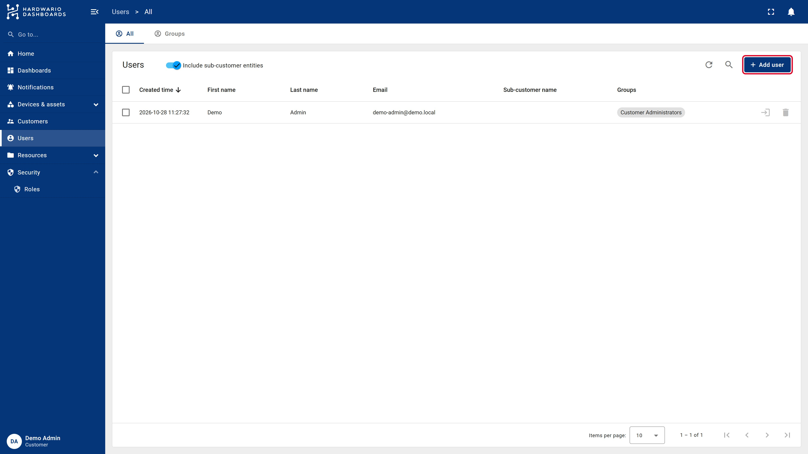
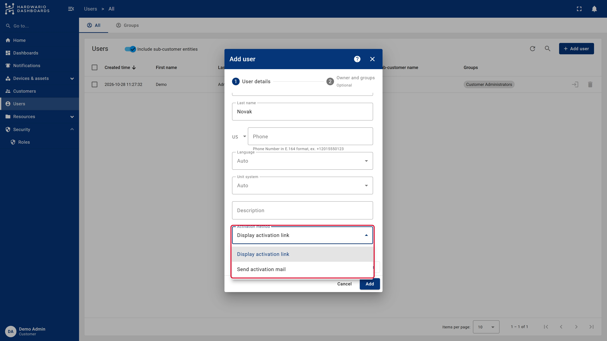
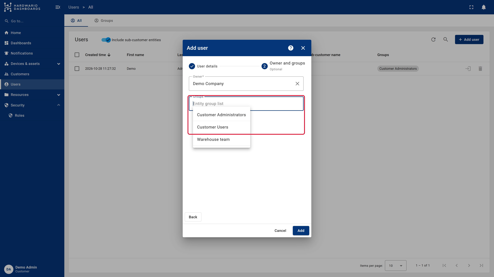
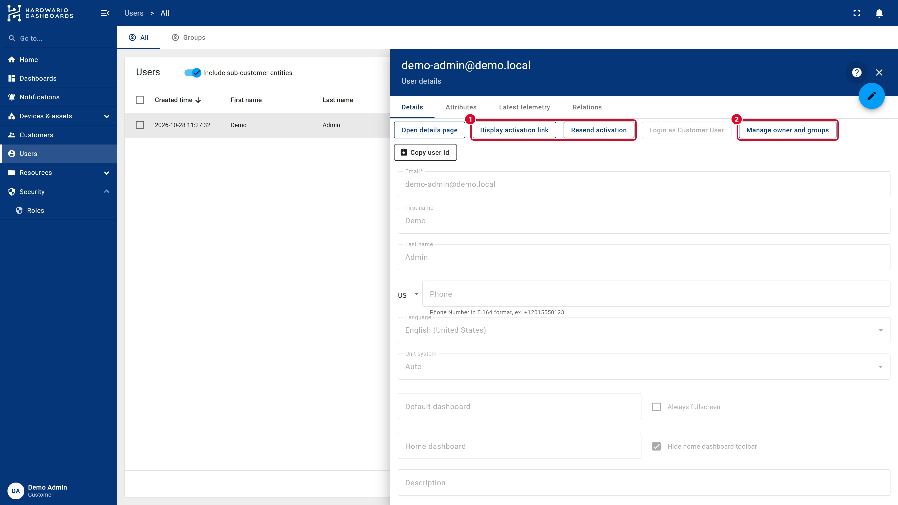
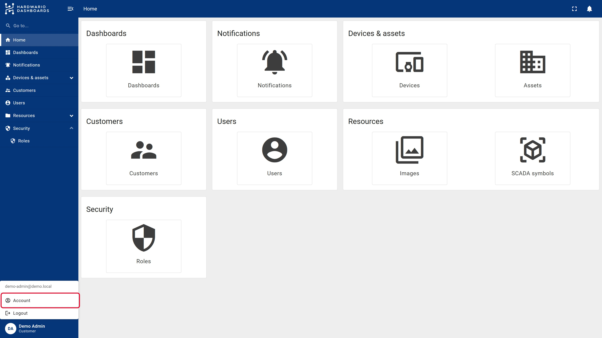
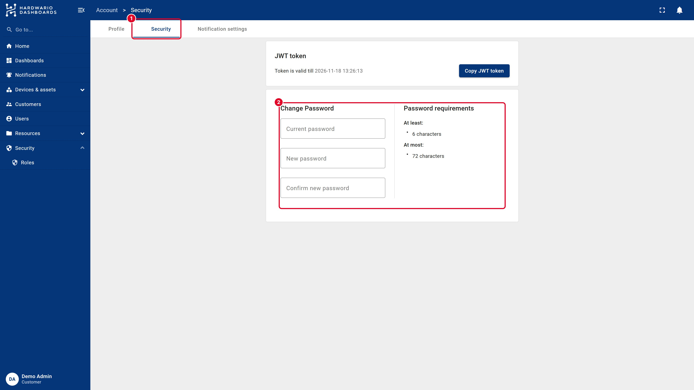

import Image from '@theme/IdealImage';

# Adding users

In this guide, you will learn how to create new user accounts, send activation links, and manage login credentials in HARDWARIO Dashboards.

:::tip First the groups
The user group decides what the user will see. Set up the group and its permissions first, see [Groups, roles & permissions](/apps/thingsboard/users-managing). Otherwise a new user sees either everything or nothing.
:::

---

## Step 1: Create a new user

1. Select **Users** from the left-hand navigation menu.
2. Click **Add user** in the top-right corner.

3. Enter the required information about the user.
4. At the bottom, locate the **Activation method** section. You have two options for inviting the user (this can also be done later):
   - **Display activation link:** Generates a link that you can manually copy and send to the user yourself.
   - **Send activation mail:** Sends an automated email with the activation link.

5. Click **Next: Owner and groups**.
6. Select the **Customer** and the **User Group** the user will belong to.
   > **Reminder:** The assigned group determines which dashboards and devices the user will be able to see, as well as their specific permissions.

7. Finally, click **Add**.

You have successfully created a new user.

:::info
**Need to manage user access?** See [**Groups, roles & permissions**](/apps/thingsboard/users-managing) to learn how to create groups, assign roles, and control access to specific devices or dashboards.
:::

---

## Step 2: Invite or activate a user

If you skipped the activation step during creation, or if you need to resend the invite so the user can log in and create a password, do the following:

1. Click on the specific user from your Users list.
2. In the **Details** tab, choose one of the following actions:
   - **Resend activation:** Automatically sends an email with the activation link to the user.
   - **Display activation link:** Displays a URL that you can manually copy and send to the user. Once they click this link, they will be prompted to create their new password.

---

## How to change your password

1. Click your name in the bottom-left corner.
2. Select **Account** from the drop-down menu.

3. You will be directed to the **Profile** tab, where you can also update your general account information.
4. To **change your password**, switch to the **Security** tab.
5. Enter your current password, followed by your new password.

:::info
If you received a **temporary password via email**, please enter it in the current password field.
:::

:::info ThingsBoard documentation
HARDWARIO Dashboards is built on ThingsBoard. More details in the official ThingsBoard documentation: [Users](https://thingsboard.io/docs/pe/user-guide/users/).
:::
