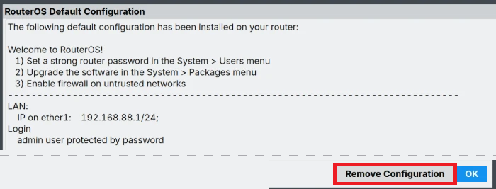
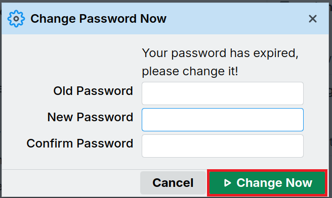
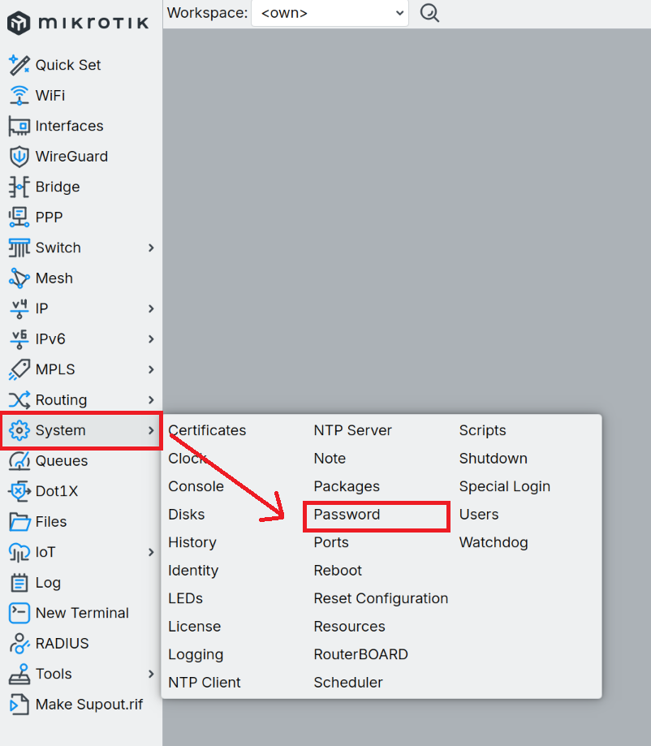
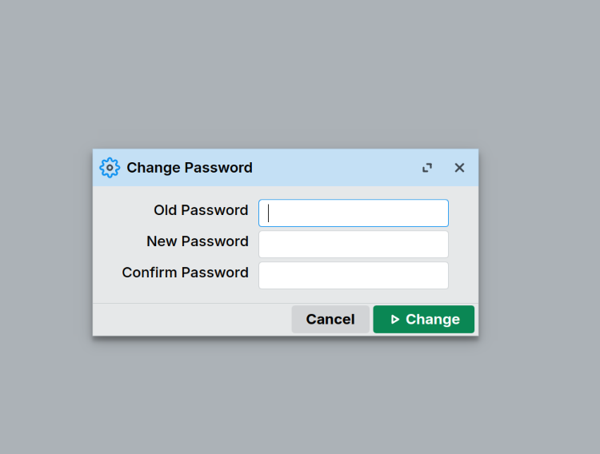
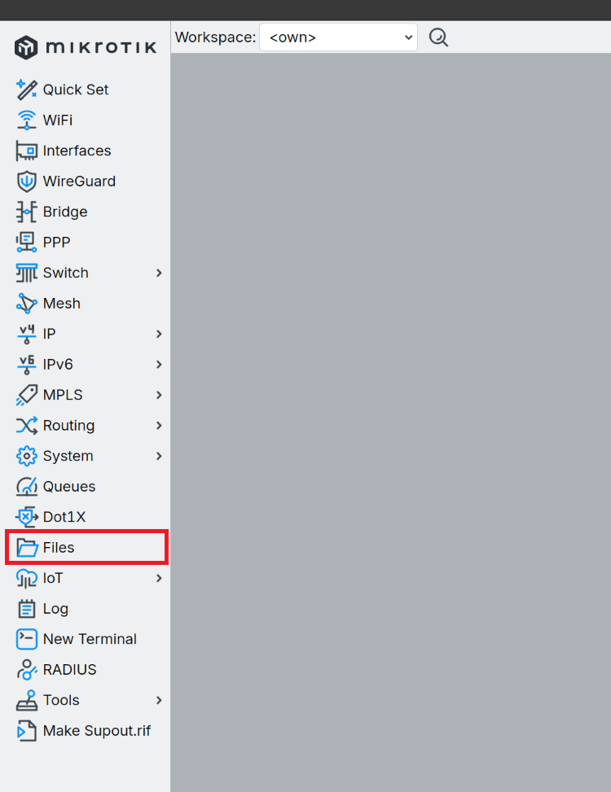
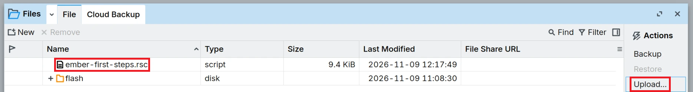
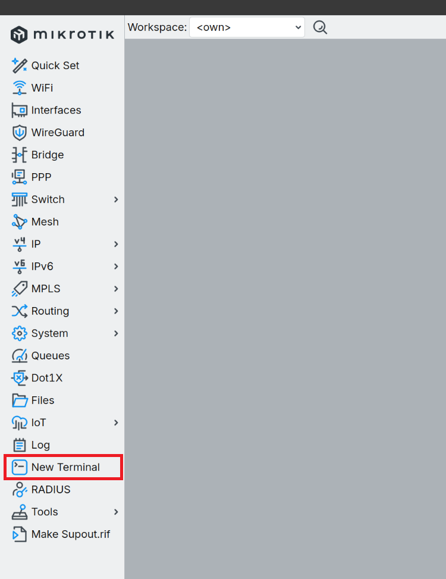

# EMBER Automated Setup

This page sets up EMBER with one script, after [Hardware Setup](hardware-setup.md). The result is the same as the [Manual Setup](manual-setup.md).

:::warning Which device is this for?

**An EMBER you received from HARDWARIO is already set up. There is nothing on these pages for you to run.**
RouterOS, the iot package and the base configuration are already on it, and its admin password is in the setup
protocol that comes with it. Start with [First Steps](getting-started.md).

These pages set up an EMBER from scratch: after a reset, or when it did not come set up from HARDWARIO.

:::

The script does steps 1.2 to 1.6 of the Manual Setup:
- Sets the identity to **ember**
- Creates **bridge0** with **ether2** and **ether3** and the address **172.31.255.1/24**
- Enables the DHCP client on **ether1** (WAN)
- Turns off the login note
- Updates RouterOS to the newest stable version and installs the **iot** package if it is missing
- Removes what is left of the MikroTik default configuration (`192.168.88.1/24` on ether1, `bridgeLocal`)
- Removes the preconfigured LoRaWAN Network Server entries
- Upgrades the RouterBOARD firmware
- Sets a new random admin password and saves a setup protocol in **Files** (see 1.3)

EMBER restarts by itself once or twice and continues after each restart. The whole setup takes about 12 minutes.

---

## Before you start

- You are connected to EMBER with Winbox, see [Hardware Setup → Step 2](hardware-setup.md#step-2-connect-for-local-access).
- The **WAN** port (ether1) is connected to a network with DHCP and internet access, and your computer is in the same network.
- Download the script: [ember-first-steps.rsc](pathname:///download/ember-first-steps.rsc)

---

## Step 1: Run the Setup Script

### 1.1 First Login

**Log in.** In Winbox, log in as `admin`. The password is `admin`, or empty on an EMBER with RouterOS 6.

**Remove the MikroTik default configuration.** After the first boot, Winbox first shows the **RouterOS Default Configuration** window. Click **Remove Configuration**, so that EMBER starts from an empty configuration. EMBER restarts: connect again from the **Neighbors** list (by its MAC address) and log in as `admin` with an empty password.



If this window does not appear for you, or you clicked **OK**, that is fine: the setup script removes the MikroTik default configuration.

**Set a new password.** When you log in, Winbox asks you to change the password. Fill in the old password (the one you logged in with) and the new one twice, and click **Change Now**. The setup script later replaces it with a random password (see 1.3).



If this window does not appear for you, set the password manually. Open a **New Terminal** (type `n` if it asks about
the software license; if it asks for **Login** and **Password**, enter `admin` and your password; on a cleared EMBER the password is empty, just press **Enter**) and paste:

```
/user set admin password=YOUR_NEW_PASSWORD
```

Or do it by hand in Winbox:

1. In the left panel, open **System → Password**.

   

2. Fill in the fields and click **Change**:
   - Old Password: the one you logged in with (empty on a cleared EMBER, **ember** on a new EMBER from HARDWARIO)
   - New Password: `<YOUR_PASSWORD>`
   - Confirm Password: `<YOUR_PASSWORD>`

   

**Then** disconnect Winbox and connect again with the new password. Winbox then uses it to connect again after each restart.

### 1.2 Upload the Script

In the left panel, open **Files**:



Drag `ember-first-steps.rsc` from your computer into the window, or click **Upload...** and select the file:



### 1.3 Run the Script

1. Open a **New Terminal**. If it asks `Do you want to see the software license? [Y/n]`, type `n`. If it asks for **Login** and **Password**, enter `admin` and your password.

   

2. Paste this command and press **Enter**:

   ```routeros
   /import file-name=ember-first-steps.rsc
   ```

   The terminal confirms that the setup has started. Even when it says **Script file loaded and executed successfully**,
   the setup is not finished yet: it continues in the background (see 1.4).

   The terminal also shows the **new admin password**. Write it down now: the setup waits 2 minutes before it starts,
   and from then on Winbox logs in with this password, also after each restart. It is also saved in **Files**, in the
   **flash** folder, as **ember-protocol.txt**. Each import sets a new password.

### 1.4 Wait Until It Is Done

In the left panel, open **Log**. When EMBER restarts, Winbox disconnects: connect again from the **Neighbors** list. Do not disconnect the power during the setup.

The setup is done when the log shows a line starting with **ember-first-steps: DONE**, followed by the installed RouterOS and RouterBOARD firmware versions. If a line starting with **ember-first-steps: STOPPED** appears instead, that line says what to do next.

### 1.5 Check the Result

- **System → RouterBOARD**: **Current Firmware** is the same as **Upgrade Firmware**.
- **System → Packages → Check for Updates**: *System is already up to date*.
- **Files → flash → ember-protocol.txt**: drag it to your computer and keep it. This setup protocol holds the admin
  password and everything the setup set.

The LoRa interface itself, including the antenna selection and the `antenna-gain` value for the
antenna in use, is set together with your backend in Step 3. See
[Hotspot Configuration → LoRaWAN](hotspot-configuration/lorawan.md) and
[Antenna Gain & Output Power](mikrotik/antenna-gain.md).

---

## Step 2: Check the Setup

Check this before you choose your backend:

| Done | What to check |
|:---:|---|
| ☐ | An antenna is connected to the LoRa card: the internal one from the factory, or an external one on **LRW** |
| ☐ | Power connected (24 V DC or 24 V passive PoE via WAN) |
| ☐ | Outdoor installation: connectors facing down |
| ☐ | PC connected to a **LAN** port (ether2 or ether3) with a static IP in `172.31.255.0/24`, can reach `172.31.255.1` (updated from default) |
| ☐ | RouterOS login works (`admin` / the password from the setup protocol) |
| ☐ | MikroTik default configuration removed (no `192.168.88.1/24`, no `bridgeLocal`) |
| ☐ | Initial configuration script completed (Step 1) |
| ☐ | RouterOS updated to the newest stable version |
| ☐ | IoT package installed |
| ☐ | RouterBOARD firmware upgraded |

---

## Step 3: Choose your LoRaWAN backend

### HARDWARIO managed network server (managed backend)

HARDWARIO can operate the LoRaWAN Network Server for you as a fully **managed service**.  
It is designed for a fast start without the need to run your own infrastructure.

What the service typically provides:
- **The Things Stack**: LoRaWAN Network Server  
- **Node-RED**: data processing, payload decoding, and forwarding  
- Preconfigured connectivity between the gateway, LNS, and integrations

Alongside EMBER, HARDWARIO optionally also provides a **SIM card with connectivity** for the LTE backhaul and **secure remote access via OpenVPN**.

Recommended if you want to **get data from devices quickly** and forward it to applications or dashboards.

#### Key links
- Service overview and concept:  
  **https://docs.hardwario.com/ember/cloud-service/**

- Web portal (service management):  
  https://docs.hardwario.com/ember/cloud-service/#web-management

- Node-RED in the managed service:  
  https://docs.hardwario.com/ember/cloud-service/#node-red-application

---

### ChirpStack (self-hosted)

**Documentation:**
- ChirpStack (LoRaWAN Network Server overview):  
  **https://docs.hardwario.com/ember/lorawan-network-server/lorawan-chirpstack**

Additional resources:
- Add EMBER gateway to ChirpStack v4 (HARDWARIO tutorial):  
  https://docs.hardwario.com/apps/chirpstack/chirpstack-configuration/chirpstack-gateways/

- (Optional) Install ChirpStack v4 (Debian/Ubuntu):  
  https://docs.hardwario.com/apps/chirpstack/chirpstack-installation/

---

### The Things Stack

**Documentation**
- The Things Stack (LoRaWAN Network Server overview):  
  **https://docs.hardwario.com/ember/lorawan-network-server/lorawan-tts**


---

### Self-Hosted LoRaWAN Server
If you already run another LoRaWAN server, you can set EMBER to forward packets to your server.

Key note from the official Hotspot Configuration:
- If you **do not use the HARDWARIO managed service**, use **your LoRaWAN server IP address**
  and you **don't need to configure VPN tunnels**.

Reference: https://docs.hardwario.com/ember/hotspot-configuration/lorawan/

---

## Troubleshooting (quick)

#### Can't reach `172.31.255.1`
- Make sure you are plugged into a **LAN** port (ether2 or ether3), not WAN. After the configuration script, `172.31.255.1` is on the LAN bridge, and WAN (ether1) is only a DHCP client.
- Set a static IP in `172.31.255.0/24` on your PC (e.g. `172.31.255.10`): the configuration script does not start a DHCP server.
- Check the Ethernet link LEDs.
- If you haven't run the configuration script yet, the default IP might still be `172.31.255.254`.
- After **Remove Configuration**, EMBER has no IP address until the configuration script runs: connect by its MAC address from **Neighbors**.

#### Gateway is powered, but not "seen" in the LoRaWAN server
- Check that the jumper on the board is removed. Picture is [here](hardware-setup.md#21-connect-to-ember-using-winbox-4).
- Confirm the gateway's forwarding destination (server address / ports / protocol).
- Verify WAN/LTE Internet connectivity.
- Ensure the IoT package is installed (check with `/system package print`).
- Verify LoRa interface is configured (check with `/iot lora print`).
- If using the HARDWARIO managed service, confirm you are using the provided service URL and correct configuration guidance.

#### Reset device
Unplug the power cable, hold the reset button and plug the power cable back in. After about 5 seconds the LED starts blinking: release the button right away. The reset button location can be found in the image [here](hardware-setup.md#21-connect-to-ember-using-winbox-4).

#### Want to understand the baseline RouterOS configuration
- The reference configuration is documented here:  
  https://docs.hardwario.com/ember/hotspot-configuration/
