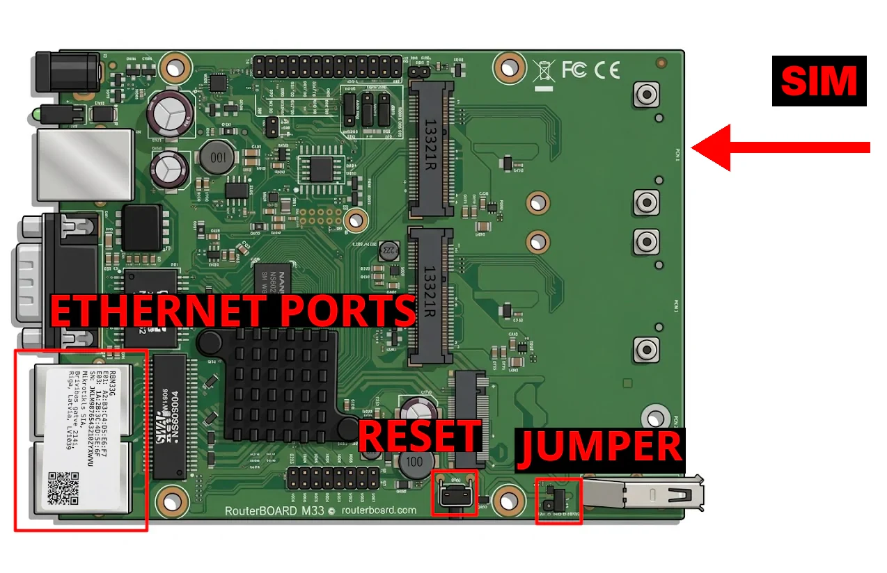
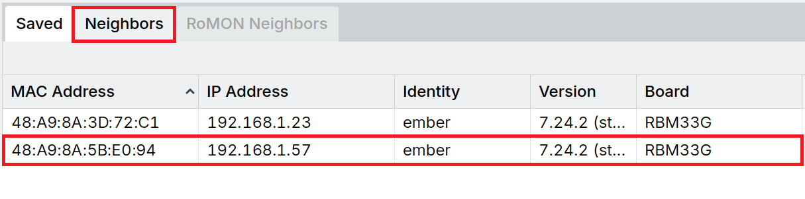
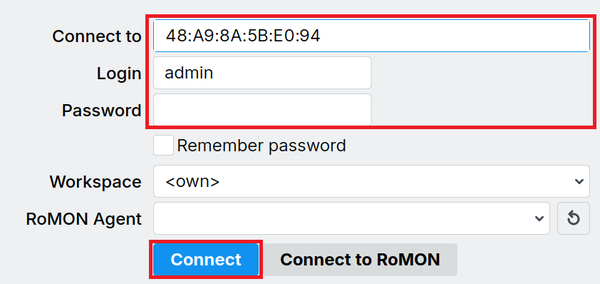

# EMBER First Steps

This page is for an EMBER you received from HARDWARIO. It comes **already set up**: RouterOS, the iot package and the
base configuration are on it, and its admin password is in the setup protocol that comes with it.

Setting up an EMBER that is not set up yet, for example after a reset? See [Automated Setup](automated-setup.md) or
[Manual Setup](manual-setup.md).

---

## Step 1: Antennas, SIM and Power

- **Antennas:** the LoRaWAN and LTE antennas are fitted inside the enclosure and connected from the factory, so there
  is nothing to attach or check. Only if you want to use an external antenna, see
  [Switching to an external antenna](hardware-description.md#switching-to-an-external-antenna).
- **SIM card** (EMBER with the LTE modem only): if there is no SIM card inside, insert your own before you power
  EMBER up: open the enclosure and push the SIM card (mini-SIM size) into the SIM slot under the LTE card, where the
  arrow shows. You don't need to remove any screws. Close the enclosure carefully, its **IP67** rating depends on the
  seal. Apart from fitting an external antenna, the SIM card is the only reason to open the enclosure.

  

- **Power:** 24 V DC adapter, 24 V DC power supply, or 24 V DC passive PoE through the **WAN** port. More details:
  [Power Supply Options](hardware-description.md#power-supply-options).
- **Internet:** connect the **WAN** port (ether1) to a network with DHCP and internet access, or use LTE, see
  [Hotspot Configuration → LTE](hotspot-configuration/interface-configuration.md#lte).

:::danger

For outdoor installations, **EMBER Hotspot** has to be mounted with connectors facing down.

:::

---

## Step 2: Log In

1. If you don't have Winbox 4 yet, install it, see [Winbox 4 Installation](mikrotik/winbox-setup.md).
2. Open Winbox on a computer in the same local network as EMBER (cable or Wi-Fi). If EMBER doesn't show up,
   connect your computer to its **LAN** port with a cable.
3. In the **Neighbors** tab, select your EMBER. If there is more than one device, find yours by the MAC address
   in the setup protocol.

   

4. Log in as **admin** with the password from the setup protocol and click **Connect**.

   

---

## Step 3: Connect EMBER

### LoRaWAN Network Server

Connect EMBER to your LoRaWAN Network Server:

- [HARDWARIO Managed Network Server](cloud-service.md)
- [ChirpStack v4: Semtech UDP](lorawan-network-server/lorawan-chirpstack.md)
- [ChirpStack v4: Basics Station and mTLS](lorawan-network-server/lorawan-chirpstack-basics-station.md)
- [The Things Stack](lorawan-network-server/lorawan-tts.md)

If you fitted an external antenna, set `antenna-gain` to its gain, see
[Antenna Gain & Output Power](mikrotik/antenna-gain.md).

### Remote Access

VPN tunnels to the HARDWARIO managed service:

- [OpenVPN](hotspot-configuration/interface-configuration.md#openvpn): LoRaWAN traffic
- [WireGuard](hotspot-configuration/interface-configuration.md#wireguard): remote management

---

## Step 4: Keep It Up to Date

Update RouterOS and the RouterBOARD firmware from time to time, see [Gateway Update](mikrotik/gateway-update.md).
