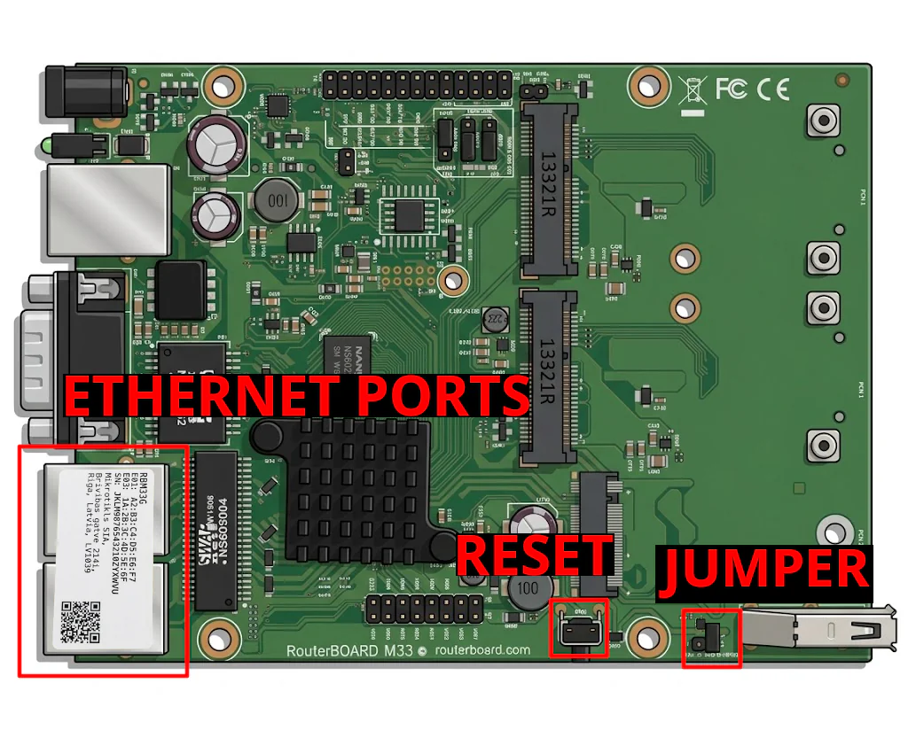

import Image from '@theme/IdealImage';

# EMBER Hardware Setup

:::warning Which device is this for?

**An EMBER you received from HARDWARIO is already set up: start with [First Steps](getting-started.md) instead.**
This page is for an EMBER that is not set up yet: after a reset, or when it did not come set up from HARDWARIO.

:::

This page helps you **power up** your HARDWARIO **EMBER**, connect to it and choose the
[Manual Setup](manual-setup.md) or the [Automated Setup](automated-setup.md).

---

## Before you start

#### What EMBER is 
EMBER is an industrial **LoRaWAN gateway (IoT Hotspot)** based on **MikroTik RBM33G**, designed for outdoor deployments (IP67 enclosure).  
Hardware description: https://docs.hardwario.com/ember/hardware-description/

#### You will need
- EMBER gateway (Hotspot): its **LoRaWAN and LTE antennas are already fitted inside** and connected from
  the factory, so there is no antenna to attach
- *(Optional)* an **external LoRaWAN antenna** with an N-type connector, if the internal one will not give
  you the range you need. It is ordered separately, and fitting it means opening the enclosure
- Power source:
  - 24 V DC adapter / 24 V DC power supply, or
  - 24 V DC passive PoE via the **WAN** port
- Internet connectivity (WAN and/or LTE, depending on your setup)
- A LoRaWAN backend (HARDWARIO managed service / self-hosted ChirpStack / TTS / other)

#### Quick links
- EMBER product page (datasheet + overview): https://www.hardwario.com/products/ember/
- Hotspot configuration (LAN IP, login, RouterOS script): https://docs.hardwario.com/ember/hotspot-configuration/
- Managed network server (ChirpStack + Node-RED operated by HARDWARIO): https://docs.hardwario.com/ember/cloud-service/

---

## Step 1: Set up your EMBER

#### 1.1 Antennas – already connected

EMBER arrives with **two antennas fitted inside the enclosure**, one for **LoRaWAN** and one for **LTE**,
both connected at the factory. **There is nothing to attach**, and the radio is never left without an
antenna, so you can power it up straight away.

An **external** antenna is optional. Because the internal antenna occupies the card's u.FL connector,
fitting one means opening the enclosure and plugging the **LRW** connector's pigtail into the card in its place, see
[Switching to an external antenna](hardware-description.md#switching-to-an-external-antenna).

If you fit an external antenna, set **`antenna-gain`** to its gain, see
[Antenna Gain & Output Power](mikrotik/antenna-gain.md).

:::caution If you open the enclosure
Never power the gateway with the LoRa card's u.FL connector left empty. Transmitting into an open
connector can damage the card. Reseal the enclosure carefully; its **IP67** rating depends on it.
:::

More details: [Hardware Description → Antennas](hardware-description.md#antennas)

#### 1.2 Power the gateway
EMBER can be powered by:
- **24 V DC power adapter**
- **24 V DC power supply**
- **24 V DC passive PoE** through the **WAN Ethernet port**

More details: https://docs.hardwario.com/ember/hardware-description/#power-supply-options

#### 1.3 Outdoor mounting safety note
:::danger

For outdoor installations, **EMBER Hotspot** has to be mounted with connectors facing down.

:::

---

## Step 2: Connect for local access

EMBER runs **MikroTik RouterOS**.  
For initial access and management, use the WAN interface (leftmost RJ-45 port) and standard RouterOS tools.

**If you don't already have Winbox 4 installed, follow the [Winbox 4 Installation guide](/ember/mikrotik/winbox4-installation).**
#### 2.1 Connect to EMBER using Winbox 4

After opening the application, look at the list where you should see your **EMBER**.
- If there is more than one device, look at the EMBER board. On its left side there are two ethernet connectors with a sticker on them. On the sticker, find the **MAC address**, a combination of numbers and letters after the text **E01** (for example: **E01: 48:A5:8A:4F:17:A6**).
- Go back to **Winbox** and find the device with the **matching MAC address**. Click on the device in the list to select it.
- Make sure the **jumper** on the board is **removed**. The location of the jumper is shown in the picture below.

---

## Step 3: Initial RouterOS Configuration

Configure RouterOS in one of two ways. Both give the same result.

- **[Manual Setup](manual-setup.md)**: set each part step by step in Winbox.
- **[Automated Setup](automated-setup.md)**: upload one script and run one command; EMBER does the rest by itself.
