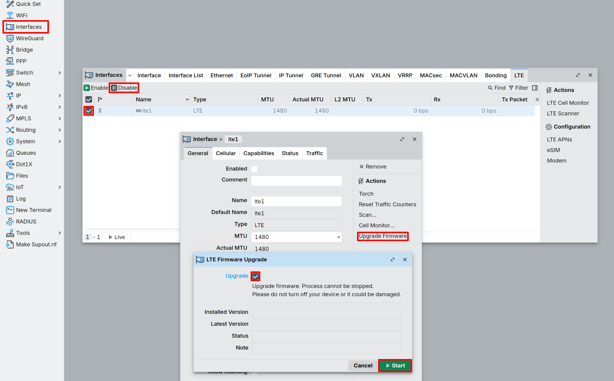

# Interface Configuration

## LAN

```
/interface bridge add name=bridge1
/interface bridge port add bridge=bridge1 interface=ether2
/interface bridge port add bridge=bridge1 interface=ether3
/ip address add address=172.31.255.254/24 interface=bridge1 network=172.31.255.0
/ip pool add name=pool1 ranges=172.31.255.100-172.31.255.199
/ip dhcp-server add address-pool=pool1 interface=bridge1 name=dhcp1
/ip dhcp-server network add address=172.31.255.0/24 dns-server=172.31.255.254,8.8.8.8,8.8.4.4 gateway=172.31.255.254 netmask=24
```

## LTE

```
/interface ppp-client add apn=internet name=ppp-out1 port=usb3
/interface lte apn set [ find default=yes ] apn=internet ip-type=ipv4 use-network-apn=no
/interface lte set [ find ] allow-roaming=yes apn-profiles=default band="" name=lte1 network-mode=lte
/ip dns set allow-remote-requests=yes servers=8.8.8.8,8.8.4.4
/system clock set time-zone-autodetect=no time-zone-name=Europe/Prague
```

:::tip

Replace `internet` with the **APN** provided by your mobile carrier.

:::

### SIM PIN Unlock

If the **SIM** card requires a **PIN** code, unlock it with:

```
/interface/lte/set lte1 pin="1234"
```

To permanently disable the **PIN** on the **SIM** card (recommended for unattended routers):

```
/interface/lte/at-chat lte1 input="AT+CLCK=\"SC\",0,\"1234\""
```

:::caution

Replace `1234` with the actual **PIN** code of your **SIM** card.

:::

### Verification

Check the **LTE** connection status:

```
/interface/lte/monitor lte1 once
```

Verify internet connectivity:

```
/ping 8.8.8.8 count=3
```

### Update LTE

Keep the **LTE** modem firmware up to date to ensure stable connectivity.

1. In the left menu, select **Interfaces**.
2. Select your `lte1` interface and click **Disable**.
3. Double-click the `lte1` interface and select **Upgrade firmware**.
4. Click **Start** to check for available updates.
5. If an update is available, check **Upgrade** and click **Start**.
6. Once the installation finishes, reboot the device.

:::tip

The SIM card requirement depends on the size of the version jump.
For an upgrade of only one or two versions, the SIM card must be
inserted and configured for the upgrade to work. For a larger version
jump, the upgrade completes without a SIM card present.
:::

:::caution

Do not disconnect power or interrupt the device during the firmware
upgrade. An interrupted upgrade can leave the modem in an unusable state.
:::



## WAN

:::tip

LTE connectivity has precedence over WAN by route distance (the default LTE route distance is 2).

:::

```
/ip dhcp-client add default-route-distance=5 interface=ether1 use-peer-dns=no use-peer-ntp=no
```

## OpenVPN

:::tip

Certificates (Certificate Authority, **EMBER Hotspot** certificate, **EMBER Hotspot** private key) are imported from the managed service.

:::

```
/interface ovpn-client import-ovpn-configuration file-name=device_<device name>.ovpn ovpn-user=device:<device name> skip-cert-import=no
/interface ovpn-client set [find name~"ovpn-import"] name=ember-cloud-ovpn cipher=aes256-cbc auth=sha1 use-peer-dns=no
/interface ovpn-client enable ember-cloud-ovpn
```

## WireGuard

The **WireGuard** keys (public key for the managed service + private key for **EMBER Hotspot**) are taken from the managed service.

```
/interface wireguard add disabled=no listen-port=51820 mtu=1420 name=wireguard1
/interface wireguard peers add endpoint-address=<public IPv4 of Cloud Services> endpoint-port=51820 allowed-address=192.168.17.1/32 interface=wireguard1 persistent-keepalive=1m public-key="<WireGuard Cloud Service public>"
/ip address add address=192.168.17.10/24 network=192.168.17.0 interface=wireguard1
```
