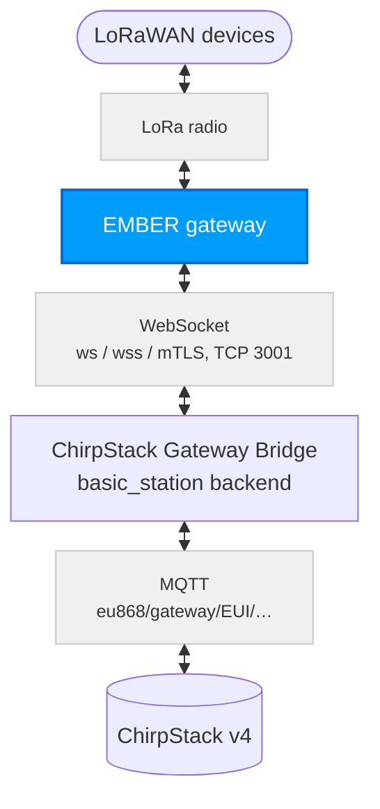
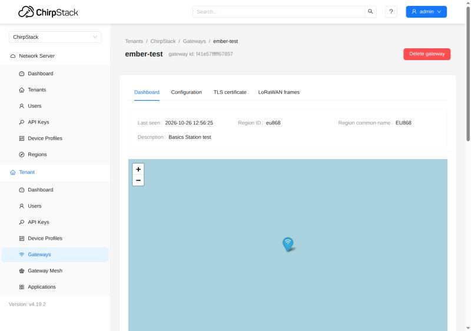
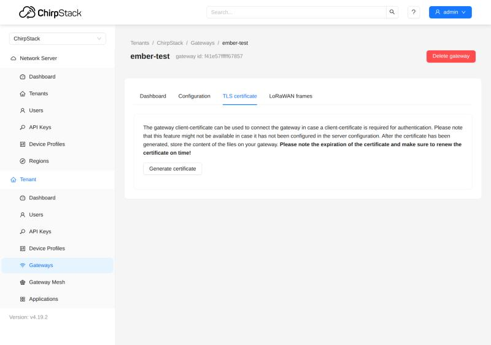

# ChirpStack v4: Basics Station and mTLS {#chirpstack-v4-basics-station-and-mtls}

This guide shows how to connect the **HARDWARIO EMBER** LoRaWAN gateway (MikroTik RouterOS) to a **ChirpStack v4** network server with the **LoRa Basics Station** protocol (LNS) instead of the UDP packet forwarder, at three security levels. For production, use **mTLS**: every gateway proves itself with its own certificate.

| Mode | Connection | Who proves their identity |
| --- | --- | --- |
| **ws** | WebSocket, not encrypted | nobody; use it only on a closed network |
| **wss** | WebSocket over TLS (encrypted) | the server presents its certificate, but EMBER does not check it (see [Known limitations](#known-limitations)) |
| **mTLS** | TLS + a client certificate of the gateway | the gateway, with its certificate: the server accepts only gateways with a valid certificate (EMBER still does not check the server, see [Known limitations](#known-limitations)) |

The procedure was tested with EMBER on RouterOS 7.24.5 (LoRa card R11e-LR8G, firmware 1.4.4) against ChirpStack 4.19 with ChirpStack Gateway Bridge 4.1: OTAA join, uplinks and downlinks with a HARDWARIO STICKER, and every case in which mTLS must refuse a gateway.

## Useful docs {#useful-docs}
- ChirpStack v4 Installation → https://docs.hardwario.com/apps/chirpstack/chirpstack-installation
- EMBER with ChirpStack over UDP: [ChirpStack v4](./lorawan-chirpstack.md)
- EMBER hotspot configuration (RouterOS basics): [Hotspot Configuration](../hotspot-configuration.md)

## How it works {#how-it-works}
EMBER keeps one permanent WebSocket connection to the Gateway Bridge. Uplinks and downlinks both travel through it, and this is the connection that gets secured.



When it connects, EMBER first asks where to connect (`router-info`), and the bridge answers with an address that contains the gateway EUI. EMBER then connects to that address, and the bridge sends it the frequency plan (`router_config`). From then on, the bridge passes the packets over MQTT under `eu868/gateway/<eui>/…`, and ChirpStack answers the same way back.

**mTLS (mutual TLS):** the gateway proves its identity to the server with its own certificate (EMBER itself does not check the server, see [Known limitations](#known-limitations)). ChirpStack acts as the certificate authority (CA) that issues the gateway certificates. On every connection the bridge checks that the gateway sent a certificate, that this CA signed it, that it is valid, and that its name (CN) is the EUI of the connecting gateway. If any check fails, the bridge refuses the connection.

## Prerequisites {#prerequisites}

| Area | Requirement |
| --- | --- |
| ChirpStack | v4 (tested 4.19) with the EU868 region |
| Gateway Bridge | ChirpStack Gateway Bridge v4 (tested 4.1) as a second instance with the `basic_station` backend |
| EMBER | RouterOS 7.20 or newer recommended (tested on 7.24.5; according to the MikroTik changelog, older versions lack fixes for the LNS client), LoRa card with the `eu-868` channel plan, access through **WinBox** or SSH as admin |
| Network | EMBER must reach the server on TCP port 3001 (or the port you choose) |
| Certificates (wss, mTLS) | a certificate authority (CA) and a server certificate issued for the DNS name or IP address the EMBERs connect to |
| Time | correct time on the server (NTP): the bridge checks certificate validity against it; NTP on EMBER is recommended too (log timestamps) |

:::caution
The EMBER commands below are for the WinBox **Terminal**. Enter them **one line at a time** and never send a multi-line block as a single SSH command: RouterOS then runs it line by line, and a line that fails can leave the LoRa card disabled. For the same reason, never chain `disable`, `set` and `enable` on one line separated by `;`: RouterOS stops at the first error (`Device is busy`), and the card stays disabled.
:::

---

## 1) Gateway Bridge with the basic_station backend {#1-gateway-bridge-with-the-basic_station-backend}
Start a second ChirpStack Gateway Bridge instance with the `basic_station` backend (in chirpstack-docker, this is the `chirpstack-gateway-bridge-basicstation` service). An existing UDP bridge can keep running next to it.

The three modes differ only in three keys of the `[backend.basic_station]` section:

```toml
[backend]
type="basic_station"

  [backend.basic_station]
  bind=":3001"
  # ws:   leave tls_cert, tls_key and ca_cert empty
  # wss:  tls_cert + tls_key
  # mTLS: tls_cert + tls_key + ca_cert
  tls_cert="/etc/chirpstack-gateway-bridge/certs/server.crt"
  tls_key="/etc/chirpstack-gateway-bridge/certs/server.key"
  ca_cert="/etc/chirpstack-gateway-bridge/certs/gateway-ca.crt"   # mTLS only
  region="EU868"
  frequency_min=863000000
  frequency_max=870000000
```

Take the frequency plan (`[[backend.basic_station.concentrators]]`) from the `chirpstack-gateway-bridge-basicstation-eu868.toml` file of chirpstack-docker (`configuration/chirpstack-gateway-bridge/`). The MQTT topics must match the region on the ChirpStack server:

```toml
[integration.mqtt]
event_topic_template="eu868/gateway/{{ .GatewayID }}/event/{{ .EventType }}"
state_topic_template="eu868/gateway/{{ .GatewayID }}/state/{{ .StateType }}"
command_topic_template="eu868/gateway/{{ .GatewayID }}/command/#"
```

- The **server certificate** (`tls_cert`) must contain the DNS name or IP address the EMBERs use in its SAN. The simplest way is to sign it with the same CA as the gateway certificates (step 2).
- **With `ca_cert` set**, the bridge requires a client certificate signed by this CA whose name (CN) is exactly the gateway EUI.
- Open port 3001 in the firewall for the network the EMBERs connect from.
- **Restart the bridge at a quiet time**: every restart reconnects all gateways (see [Known limitations](#known-limitations)).

:::warning
The bridge that EMBERs connect to must have `region="EU868"`. EMBER accepts even a frequency plan outside its band (seen with US915); it then looks online, receives nothing, and its LoRa service stays unstable until EMBER is rebooted. See [Wrong region from the server](#wrong-region-from-the-server).
:::

---

## 2) ChirpStack: CA for gateway certificates (mTLS only) {#2-chirpstack-ca-for-gateway-certificates-mtls-only}
To issue gateway certificates, ChirpStack needs a certificate authority (CA). Add a `[gateway]` section to `chirpstack.toml` (chirpstack-docker does not have one by default) and restart ChirpStack:

```toml
[gateway]
  ca_cert="/etc/chirpstack/certs/gateway-ca.crt"   # CA certificate (PEM)
  ca_key="/etc/chirpstack/certs/gateway-ca.key"    # CA private key (PKCS#8)
  client_cert_lifetime="365days"                    # lifetime of the issued certificates
  allow_unknown_gateways=false
```

- The same `gateway-ca.crt` file goes into `ca_cert` of the Gateway Bridge (step 1).
- **The CA key is the most valuable secret of the whole setup**: whoever has it can issue a certificate for any gateway. Keep it only on the ChirpStack server, with restricted access rights.
- Choose `client_cert_lifetime` deliberately (e.g. 365 days): ChirpStack cannot revoke a certificate, so the lifetime is the only limit for a leaked key. A long lifetime, on the other hand, means fewer renewals.
- With `allow_unknown_gateways=false`, ChirpStack drops the data of gateways that are not registered in it.

---

## 3) Register the gateway in ChirpStack {#3-register-the-gateway-in-chirpstack}
ChirpStack identifies the gateway by its EUI; without a registration, it drops the gateway's data.

1. On EMBER, find the gateway ID: `/iot lora print detail` → `gateway-id` (16 hexadecimal characters, e.g. `F41E57FFFFF67857`).
2. In ChirpStack, open **Tenant → Gateways → Add gateway** and enter this EUI as the **Gateway ID** (details in [ChirpStack v4](./lorawan-chirpstack.md)).

Once the gateway is connected, its **Dashboard** in ChirpStack shows **Last seen** and the region (`eu868`):



---

## 4) Gateway certificate (mTLS only) {#4-gateway-certificate-mtls-only}
ChirpStack issues the client certificate with one click. Its name (CN) is the gateway EUI, and the CA from step 2 signs it.

1. In ChirpStack, open the gateway → **TLS certificate** tab → **Generate certificate**.
2. Save the three texts as files: **TLS certificate** → `tc.crt`, **TLS key** → `tc.key`, **CA certificate** → `ca.crt`.
3. **The key is shown only once**, and ChirpStack does not store it. Do not send it by e-mail or chat, and delete it once it is on EMBER.
4. Note the certificate's expiry date: ChirpStack shows it only now.

The **TLS certificate** tab of a gateway in ChirpStack:



| File | What it is | Secret? |
| --- | --- | --- |
| `ca.crt` | the gateway CA; EMBER imports it as trusted. EMBER needs the CA that signed the server certificate: with one CA for both (step 1), this is the same file | no |
| `tc.crt` | the gateway certificate | no |
| `tc.key` | the gateway private key (ECDSA P-256, PKCS#8) | **yes** |

---

## 5) Configure EMBER (MikroTik RouterOS) {#5-configure-ember-mikrotik-routeros}
EMBER gets a server entry of the LNS type, and the LoRa card is switched to it. **Change the card and its servers only while the card is disabled.** After `disable`, wait until `/iot lora print detail` shows the status `Inactive` before the next command; after `enable`, check that it changes to `Active` (send `enable` again if it stays `Inactive`). Replace `<server>` with the DNS name or IP address of the server. Upload files in WinBox → **Files** → **Upload** (the upload and import dialogs are shown in [The Things Stack](./lorawan-tts.md)).

Before you switch, note the server the card uses now: `:put [/iot lora get [find] servers]` (several servers are printed separated by `;`). If EMBER does not connect to the new server (step 6), switch back the same way, with the card disabled: `/iot lora disable [find]`, `/iot lora set [find] servers="<old>"` (the name in quotes, several names separated by commas), `/iot lora enable [find]`. If `disable` fails with `Plan … not allowed by band`, do not change anything and follow [Wrong region from the server](#wrong-region-from-the-server).

**ws:**

```
/iot lora servers add name=cs-ws address=<server> protocol=LNS port=3001 ssl=no
/iot lora disable [find]
/iot lora set [find] servers=cs-ws
/iot lora enable [find]
```

**wss**: upload `ca.crt` (the CA that signed the server certificate) to EMBER, then:

```
/certificate import file-name=ca.crt name=server-ca passphrase="" trusted=yes
/iot lora servers add name=cs-wss address=<server> protocol=LNS port=3001 ssl=yes
/iot lora disable [find]
/iot lora set [find] servers=cs-wss
/iot lora enable [find]
```

**mTLS**: upload `ca.crt`, `tc.crt` and `tc.key`. Import the certificate first and the key second (RouterOS attaches the key to the certificate, which gets the `K` flag), then delete the key file:

```
/certificate import file-name=ca.crt name=server-ca passphrase="" trusted=yes
/certificate import file-name=tc.crt name=gw-client passphrase=""
/certificate import file-name=tc.key passphrase=""
/certificate print where name="gw-client"
/file remove [find name="tc.key"]
/iot lora servers add name=cs-mtls address=<server> protocol=LNS port=3001 ssl=yes certificate=gw-client
/iot lora disable [find]
/iot lora set [find] servers=cs-mtls
/iot lora enable [find]
```

- `/certificate print` must show the flags **KT** for `gw-client` (key attached). Without `K`, EMBER connects without a certificate and the server refuses it; in that case, remove `gw-client` and import the certificate and the key again before you delete the key file.
- Leave the server's `key` field empty: it is meant for other network servers, and ChirpStack does not use it.
- Before you import a new client certificate, EMBER must not hold another certificate with the same EUI as its name (CN); see [Renewing the gateway certificate](#renewing-the-gateway-certificate).
- The antenna setting (`antenna=`) and the card's channel plan (`channel-plan=eu-868`) stay as your installation needs them.

---

## 6) Verify {#6-verify}
The connection works when EMBER reports `forwarder is ready` and ChirpStack shows the gateway online with uplinks coming in.

1. On EMBER, turn on the detailed LoRa log (only while you verify): `/system logging add topics=lora,debug action=memory comment=lora-debug`
2. `/log print where topics~"lora"`: a good connection goes `connecting to …/router-info` → `discovered` → `disconnected` → `connecting to …/gateway/<eui>` → `configured` → `forwarder is ready` (the `disconnected` in between is normal).
3. In the `router_config` line, check `"region":"EU863"`.
4. `/iot lora print detail`: the card status is `Active`.
5. In ChirpStack: the gateway is **online**, **Last seen** keeps updating (gateway statistics arrive about every 30 s), and the gateway charts show received packets.
6. With a test device, check OTAA join, uplink and downlink (e.g. a MAC command confirmed in the next uplink).
7. Turn the detailed log off again: `/system logging remove [find comment="lora-debug"]`

The card status `Starting` means EMBER has not connected to the server yet (address, port, TLS or certificate; see [Troubleshooting by log line](#troubleshooting-by-log-line)).

---

## Wrong region from the server {#wrong-region-from-the-server}
If the Gateway Bridge ever sent EMBER a frequency plan other than EU868 (a wrong `region` setting), the LoRa service of EMBER stays unstable until EMBER is rebooted: the card cannot be disabled, and it may drop out on the next connection (`[DEV] Device communication error.`, the card disappears from `/iot lora`).

1. Set `region="EU868"` on the Gateway Bridge and restart the bridge.
2. Reboot EMBER once (`/system reboot`).
3. Verify the connection as in step 6.

With a correct server configuration, a Gateway Bridge restart does not harm EMBER: it reconnects in about 15 seconds.

---

## Renewing the gateway certificate {#renewing-the-gateway-certificate}
Renew the certificate before it expires. **The order of the steps matters**, and the gateway is offline for about 30 seconds. Do steps 2–4 in one sitting: after step 2, the server entry points at a deleted certificate, so a reconnection before step 4 (a Gateway Bridge restart, a power cut) will most likely fail.

1. Generate a new certificate in ChirpStack (step 4) and upload `tc.crt` and `tc.key` to EMBER.
2. **Delete the old client certificate first**: `/certificate remove [find name="gw-client"]` (use the name of the certificate in use). This works while the gateway is running; the open connection stays up.
3. Import the new certificate under a new name, then its key, and check that `gw-client-2` shows the flags **KT**. Without `K`, remove it (`/certificate remove [find name="gw-client-2"]`) and import the certificate and the key again. Then delete the key file:

```
/certificate import file-name=tc.crt name=gw-client-2 passphrase=""
/certificate import file-name=tc.key passphrase=""
/certificate print where name="gw-client-2"
/file remove [find name="tc.key"]
```

4. Point the server entry at the new certificate (with the card disabled):

```
/iot lora disable [find]
/iot lora servers set [find name="cs-mtls"] certificate=gw-client-2
/iot lora enable [find]
```

**Why the order matters:** if the new certificate is imported while the old one with the same EUI is still on EMBER, RouterOS 7.24.5 then signs the connection with the key of the old certificate. The server refuses it (`invalid signature by the client certificate`), and the gateway stays offline. To fix it, repeat this procedure from step 1 with a new certificate (the old key file is already deleted, and ChirpStack shows a key only once), and in step 2 delete every certificate whose name (CN) is this EUI (`/certificate print detail` shows it as `common-name`, in lower case).

An expiring certificate does not cut a running connection (it is checked only when connecting), but the gateway drops out at the next reconnection. Renew it in time even on a gateway that works right now.

---

## Known limitations {#known-limitations}
These apply to RouterOS 7.24.5 and ChirpStack 4.19 / Gateway Bridge 4.1; check them again after updates.

- **RouterOS 7.24.5 on EMBER does not verify the server certificate.** EMBER also connects to a server with an untrusted certificate or with a certificate issued for another name. wss and mTLS connections are encrypted, and mTLS protects the server from foreign gateways, but the gateway itself does not detect a fake server. Protect the path between the gateway and the server on the network level too (VPN, firewall). Still import the server CA to EMBER.
- **A server (Gateway Bridge) restart reconnects all gateways**, and each of them is offline for about 15 seconds. Restart at a quiet time and check afterwards that all gateways are back online.
- **EMBER does not refuse a wrong region from the server.** The gateway then looks online but receives nothing, and the card may not even be disabled afterwards (RouterOS reports `Plan [US 915 Sub 2] not allowed by band [863-870]`). After the server is fixed, reboot such an EMBER once (see [Wrong region from the server](#wrong-region-from-the-server)). The Gateway Bridge must have `region="EU868"`.
- **A certificate cannot be revoked.** The old certificate stays valid until it expires, even after a renewal, and deleting the gateway in ChirpStack does not stop the connection. If a gateway key leaks, replacing the CA is the only sure way.
- **Watch for "online, but no uplinks".** The online status in ChirpStack only means that gateway statistics arrive.
- **Correct time (NTP) on the server** is required: the bridge checks certificate validity against it. Keep NTP on EMBER too, for log timestamps.
- The EMBER log tells only two reasons for a refused TLS connection apart; the exact reason is always in the Gateway Bridge log.

---

## Troubleshooting by log line {#troubleshooting-by-log-line}
Find the line in the EMBER log (`/log print where topics~"lora"`) or in the Gateway Bridge log and look it up below. The real reason for a refused TLS connection is always in the bridge log.

| Where | Log line (excerpt) | What it means | What to do |
| --- | --- | --- | --- |
| EMBER | `connecting to …/router-info`, but no `discovered` | no connection to the server | address, port, firewall, `ssl` |
| EMBER | `discovered`, but no `configured` | the bridge refused the data connection | certificate name (CN) = gateway EUI, certificate; the reason is in the bridge log |
| EMBER | `configured`, but no uplinks in ChirpStack | gateway registration, MQTT topics or region | see the two ChirpStack rows below and [Wrong region from the server](#wrong-region-from-the-server) |
| EMBER | `socket error on connection [2001]` | nothing listens on the address and port | port (3001); is the Gateway Bridge running? |
| EMBER | `socket error on timeout [2001]` | the server cannot be reached | address, routing, firewall |
| EMBER | `socket error on handshake [2001]` | TLS does not match | `ssl=` must match the bridge: `yes` for wss and mTLS, `no` for ws |
| EMBER | `ssl: fatal alert handshake (6) [2006]` | EMBER did not send a client certificate | `certificate=` on the server entry, certificate with the `K` flag |
| EMBER | `ssl: fatal alert received (6) [2006]` | the server refused the certificate | the reason is in the bridge log |
| EMBER | `certificate CommonName <x> does not match router <eui>` | a certificate of another gateway | a certificate issued for this EUI |
| EMBER | `router_config` (debug log) with a region other than `EU863` | wrong region on the bridge | `region="EU868"` on the bridge |
| EMBER | `[DEV] Device communication error.` | the radio could not be reconfigured (seen only after a wrong region) | fix the region on the server and reboot EMBER; check for `forwarder is ready`; an empty `/iot lora` = EMBER must be rebooted |
| bridge | `router-info … router_uri=` (empty) | the certificate name ≠ the gateway EUI | a certificate for this gateway |
| bridge | `client didn't provide a certificate` | EMBER connected without a certificate | `certificate=` on the server entry, `K` flag |
| bridge | `certificate signed by unknown authority` | a certificate from a foreign CA | issue the certificate in this ChirpStack |
| bridge | `certificate has expired or is not yet valid` | the certificate expired, or the server time is wrong | renew the certificate, NTP on the server |
| bridge | `invalid signature by the client certificate` | the key does not belong to the certificate (renewal error) | a new certificate, see [Renewing the gateway certificate](#renewing-the-gateway-certificate) |
| bridge | `client sent an HTTP request to an HTTPS server` | EMBER has `ssl=no`, the bridge uses TLS | `ssl=yes` |
| bridge | `connection with same gateway id already exists` | a reconnection before the old connection was closed | wait up to 65 s |
| ChirpStack | `Object does not exist` for the gateway | the gateway is not registered | add the gateway (step 3) |
| ChirpStack | nothing from the gateway, the bridge reports connected | the MQTT topics do not match | `eu868/…` topics matching the region |
