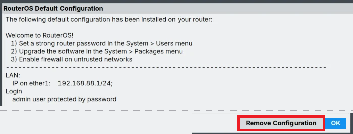
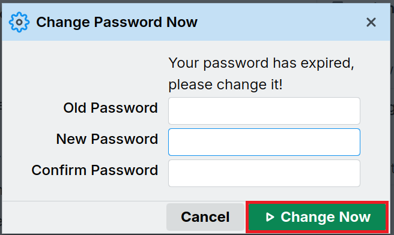
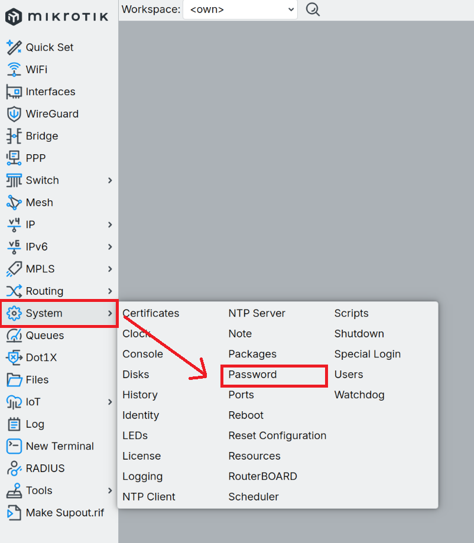
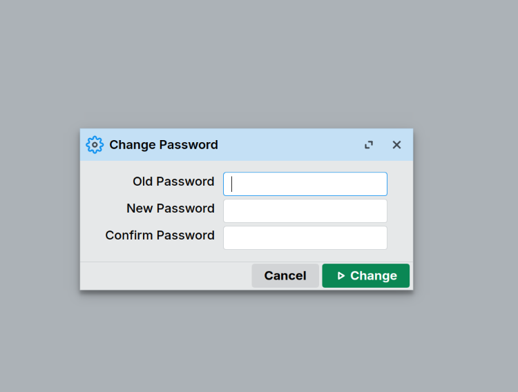
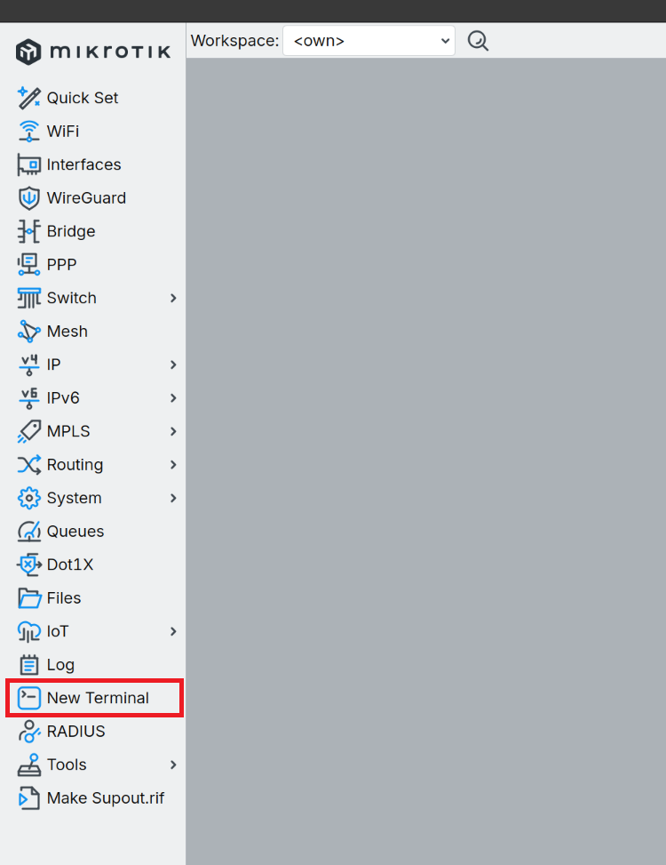
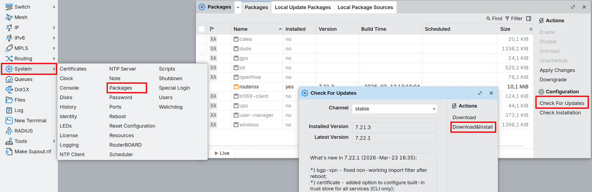
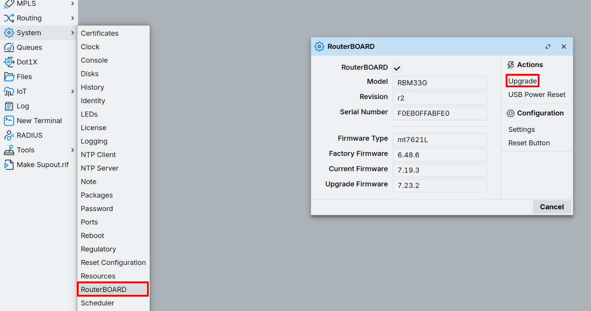

# EMBER Manual Setup

This page sets up EMBER by hand in Winbox, after [Hardware Setup](hardware-setup.md). The [Automated Setup](automated-setup.md) does the same with one script.

:::warning Which device is this for?

**An EMBER you received from HARDWARIO is already set up. There is nothing on these pages for you to run.**
RouterOS, the iot package and the base configuration are already on it, and its admin password is in the setup
protocol that comes with it. Start with [First Steps](getting-started.md).

These pages set up an EMBER from scratch: after a reset, or when it did not come set up from HARDWARIO.

:::

---

## Step 1: Initial RouterOS Configuration Script

### 1.1 First Login

**Log in.** In Winbox, log in as `admin`. The password is `admin`, or empty on an EMBER with RouterOS 6.

**Remove the MikroTik default configuration.** After the first boot, Winbox first shows the **RouterOS Default Configuration** window. Click **Remove Configuration** (not **OK**), so that EMBER starts from an empty configuration. EMBER restarts: connect again from the **Neighbors** list (by its MAC address) and log in as `admin` with an empty password.



**Set a new password.** When you log in, Winbox asks you to change the password. Fill in the old password (the one you logged in with) and the new one twice, and click **Change Now**.



If this window does not appear for you, set the password manually. Open a **New Terminal** (type `n` if it asks about
the software license; if it asks for **Login** and **Password**, enter `admin` and your password; on a cleared EMBER the password is empty, just press **Enter**) and paste:

```
/user set admin password=YOUR_NEW_PASSWORD
```

Or do it by hand in Winbox:

1. In the left panel, open **System → Password**.

   

2. Fill in the fields and click **Change**:
   - Old Password: the one you logged in with (empty on a cleared EMBER, **ember** on a new EMBER from HARDWARIO)
   - New Password: `<YOUR_PASSWORD>`
   - Confirm Password: `<YOUR_PASSWORD>`

   

**Then** disconnect Winbox and connect again with the new password. Winbox then uses it to connect again after each restart.

### 1.2 Run Base Configuration

Open a **New Terminal** window. If it asks `Do you want to see the software license? [Y/n]`, type `n`. If it asks for **Login** and **Password**, enter `admin` and your password.



Then paste the following script, or do the same by hand in Winbox (see below).

```routeros
/system identity set name=ember
/interface bridge add name=bridge0
/interface bridge port add bridge=bridge0 interface=ether2
/interface bridge port add bridge=bridge0 interface=ether3
/ip address add address=172.31.255.1/24 interface=bridge0 network=172.31.255.0
/ip dhcp-client add interface=ether1 disabled=no
/system note set show-at-login=no
```

Press **Enter** to execute the script.
If you pasted the script, go on with [1.3 Update RouterOS](#13-update-routeros).

#### By hand in Winbox

1. Sets the system identity to "ember". In **System → Identity**, change your identity to **ember** and click **OK**.

   

2. Creates a bridge interface (bridge0). In **Bridge → New**, change name to **bridge0** and click **OK**.

   

3. Assigns IP address 172.31.255.1/24 to the bridge for LAN access. In **IP → Addresses → New**, fill **Address**, **Network** and select **Interface**, then confirm it by clicking **OK**:
   - Address: **172.31.255.1/24**
   - Network: **172.31.255.0**
   - Interface: **bridge0**

   

4. Adds ether2 to the bridge. In the Bridge window go to **Ports → New**, select interface **ether2**. Make sure that **bridge0** is selected and click **OK**.

   

5. Adds ether3 to the bridge. In the Bridge window go to **Ports → New**, select interface **ether3**. Make sure that **bridge0** is selected and click **OK**.

   

6. Enables the DHCP client on ether1 (WAN) for internet connectivity. In the left panel **IP → DHCP Client → New**, select **ether1** as interface and click **OK**.

   

7. Turns off the login note. In the left panel **System → Note**, uncheck **Show At Login** and click **OK**.

   

---

### 1.3 Update RouterOS

In the left panel, open **System → Packages** and click **Check for Updates**. In the new window, set **Channel** to **stable**. If the installed and the latest version differ, click **Download&Install** and wait a few minutes: EMBER restarts by itself.



---

### 1.4 Install IoT Package

After reconnecting, open **System → Packages** in the left panel and click **Check for Updates**. If **iot** is already installed, skip this step. Otherwise find **iot** in the list and click it. In the right panel, click **Enable** and then **Apply Changes**. In the new window, click **OK** and wait a few seconds: EMBER restarts.


---

### 1.5 Upgrade RouterBOARD

1. In the left panel, go to **System → RouterBOARD** and click **Upgrade**. In the new window, click **OK**.

   

2. After the upgrade, restart EMBER: in the left panel, go to **System → Reboot** and click **OK** in the new window.

   

---

### 1.6 Remove Preconfigured LoRaWAN Servers

After reconnecting, paste this command in a **New Terminal**:

```routeros
/iot lora servers remove [find]
```

**What this command does:**
- Removes any preconfigured LoRaWAN Network Server (LNS) entries

Press **Enter** to execute.

The LoRa interface itself, including the `antenna=uFL` selection and the `antenna-gain` value for the
antenna in use, is set together with your backend in Step 3. See
[Hotspot Configuration → LoRaWAN](hotspot-configuration.md#lorawan) and
[Antenna Gain & Output Power](mikrotik/antenna-gain.md).

---

## Step 2: Check the Setup

Check this before you choose your backend:

| Done | What to check |
|:---:|---|
| ☐ | An antenna is connected to the LoRa card: the internal one from the factory, or an external one on **LRW** |
| ☐ | Power connected (24 V DC or 24 V passive PoE via WAN) |
| ☐ | Outdoor installation: connectors facing down |
| ☐ | PC connected to a **LAN** port (ether2 or ether3) with a static IP in `172.31.255.0/24`, can reach `172.31.255.1` (updated from default) |
| ☐ | RouterOS login works (`admin` / `[your-password]`) |
| ☐ | MikroTik default configuration removed (no `192.168.88.1/24`, no `bridgeLocal`) |
| ☐ | Initial configuration script completed (Step 1) |
| ☐ | RouterOS updated to the newest stable version |
| ☐ | IoT package installed |
| ☐ | RouterBOARD firmware upgraded |

---

## Step 3: Choose your LoRaWAN backend

### HARDWARIO managed network server (managed backend)

HARDWARIO can operate the LoRaWAN Network Server for you as a fully **managed service**.  
It is designed for a fast start without the need to run your own infrastructure.

What the service typically provides:
- **ChirpStack**: LoRaWAN Network Server  
- **Node-RED**: data processing, payload decoding, and forwarding  
- Preconfigured connectivity between the gateway, LNS, and integrations

Alongside EMBER, HARDWARIO optionally also provides a **SIM card with connectivity** for the LTE backhaul and **secure remote access via OpenVPN**.

Recommended if you want to **get data from devices quickly** and forward it to applications or dashboards.

#### Key links
- Service overview and concept:  
  **https://docs.hardwario.com/ember/cloud-service/**

- Web portal (service management):  
  https://docs.hardwario.com/ember/cloud-service/#web-management

- ChirpStack in the managed service:  
  https://docs.hardwario.com/ember/cloud-service/#chirpstack-lorawan-server

- Node-RED in the managed service:  
  https://docs.hardwario.com/ember/cloud-service/#node-red-application

---

### ChirpStack (self-hosted)

**Documentation:**
- ChirpStack (LoRaWAN Network Server overview):  
  **https://docs.hardwario.com/ember/lorawan-network-server/lorawan-chirpstack**

Additional resources:
- Add EMBER gateway to ChirpStack v4 (HARDWARIO tutorial):  
  https://docs.hardwario.com/apps/chirpstack/chirpstack-configuration/chirpstack-gateways/

- (Optional) Install ChirpStack v4 (Debian/Ubuntu):  
  https://docs.hardwario.com/apps/chirpstack/chirpstack-installation/

---

### The Things Stack

**Documentation**
- The Things Stack (LoRaWAN Network Server overview):  
  **https://docs.hardwario.com/ember/lorawan-network-server/lorawan-tts**


---

### Self-Hosted LoRaWAN Server
If you already run another LoRaWAN server, you can set EMBER to forward packets to your server.

Key note from the official Hotspot Configuration:
- If you **do not use the HARDWARIO managed service**, use **your LoRaWAN server IP address**
  and you **don't need to configure VPN tunnels**.

Reference: https://docs.hardwario.com/ember/hotspot-configuration/

---

## Troubleshooting (quick)

#### Can't reach `172.31.255.1`
- Make sure you are plugged into a **LAN** port (ether2 or ether3), not WAN. After the configuration script, `172.31.255.1` is on the LAN bridge, and WAN (ether1) is only a DHCP client.
- Set a static IP in `172.31.255.0/24` on your PC (e.g. `172.31.255.10`): the configuration script does not start a DHCP server.
- Check the Ethernet link LEDs.
- If you haven't run the configuration script yet, the default IP might still be `172.31.255.254`.
- After **Remove Configuration**, EMBER has no IP address until the configuration script runs: connect by its MAC address from **Neighbors**.

#### Gateway is powered, but not "seen" in the LoRaWAN server
- Check that the jumper on the board is removed. Picture is [here](hardware-setup.md#21-connect-to-ember-using-winbox-4).
- Confirm the gateway's forwarding destination (server address / ports / protocol).
- Verify WAN/LTE Internet connectivity.
- Ensure the IoT package is installed (check with `/system package print`).
- Verify LoRa interface is configured (check with `/iot lora print`).
- If using the HARDWARIO managed service, confirm you are using the provided service URL and correct configuration guidance.

#### Reset device
Unplug the power cable, hold the reset button and plug the power cable back in. After about 5 seconds the LED starts blinking: release the button right away. The reset button location can be found in the image [here](hardware-setup.md#21-connect-to-ember-using-winbox-4).

#### Want to understand the baseline RouterOS configuration
- The reference configuration is documented here:  
  https://docs.hardwario.com/ember/hotspot-configuration/
