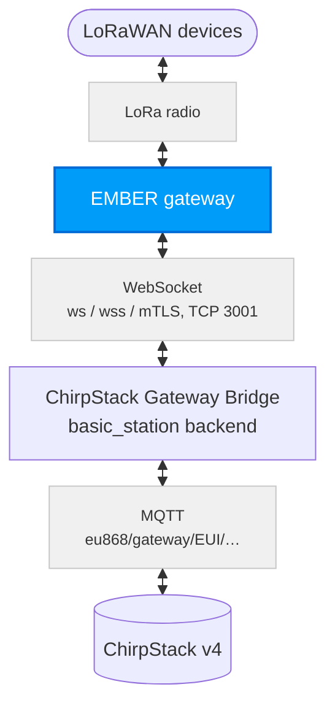
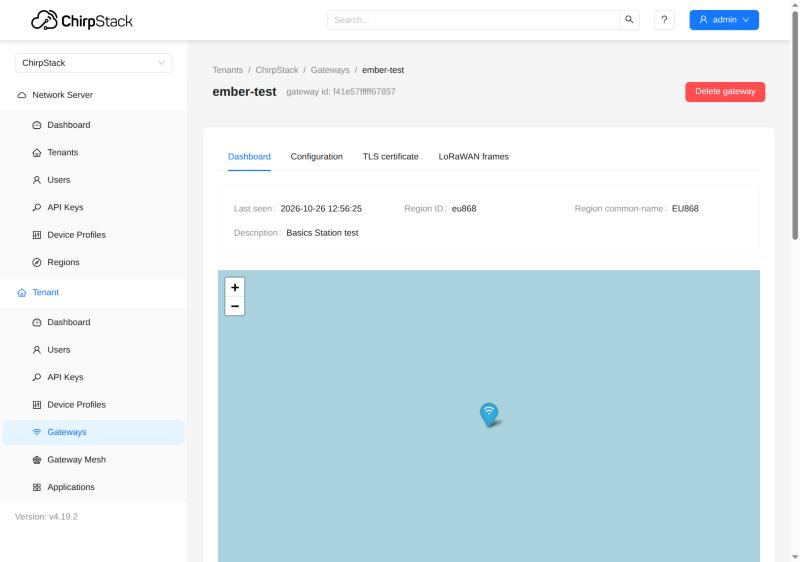
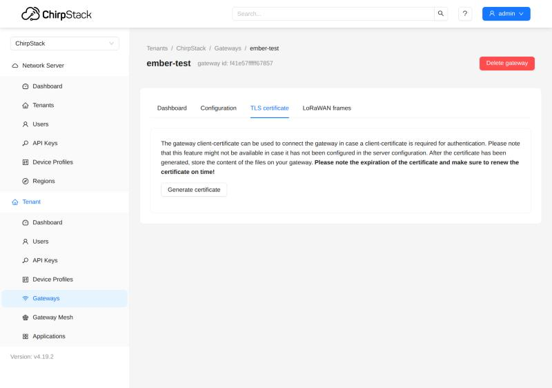

# Basics Station a mTLS {#basics-station-and-mtls}

Tento návod nastavuje server **ChirpStack v4** pro brány, které se připojují protokolem **LoRa Basics Station** (LNS) místo protokolu UDP (packet forwarder), a to ve třech úrovních zabezpečení. Pro produkční provoz použijte **mTLS**: každá brána se prokazuje vlastním certifikátem. Nastavení brány je popsané zvlášť; pro EMBER viz [EMBER: Basics Station a mTLS](/ember/lorawan-network-server/lorawan-chirpstack-basics-station).

| Varianta | Spojení | Kdo se prokazuje |
| --- | --- | --- |
| **ws** | WebSocket bez šifrování | nikdo; vhodné jen pro uzavřenou síť |
| **wss** | WebSocket přes TLS (šifrovaný) | server předkládá svůj certifikát, EMBER ho ale nekontroluje (viz [Známá omezení](/ember/lorawan-network-server/lorawan-chirpstack-basics-station#known-limitations)) |
| **mTLS** | TLS + klientský certifikát brány | brána svým certifikátem: server přijme jen bránu s platným certifikátem (EMBER server ani tak nekontroluje, viz [Známá omezení](/ember/lorawan-network-server/lorawan-chirpstack-basics-station#known-limitations)) |

Postup byl ověřen se serverem ChirpStack 4.19 a ChirpStack Gateway Bridge 4.1 proti zařízení EMBER s RouterOS 7.24.5: bezdrátová aktivace (OTAA), uplinky a downlinky se senzorem HARDWARIO STICKER a všechny případy, kdy musí mTLS bránu odmítnout.

## Užitečná dokumentace {#useful-docs}
- [Instalace ChirpStack v4](/apps/chirpstack/chirpstack-installation)
- [Brány: Semtech UDP](./chirpstack-gateways.md)
- Nastavení brány EMBER: [EMBER: Basics Station a mTLS](/ember/lorawan-network-server/lorawan-chirpstack-basics-station)

## Jak to funguje {#how-it-works}
Zařízení EMBER drží jedno trvalé spojení (WebSocket) s Gateway Bridge. Tečou jím uplinky i downlinky a právě toto spojení se zabezpečuje.



Při připojení se zařízení EMBER nejdřív zeptá, kam se připojit (`router-info`), a bridge odpoví adresou s EUI brány. EMBER se pak připojí na tuto adresu a bridge mu pošle frekvenční plán (`router_config`). Od té chvíle bridge předává pakety přes MQTT pod tématem `eu868/gateway/<eui>/…` a server ChirpStack odpovídá stejnou cestou zpět.

**mTLS (vzájemné TLS):** brána se serveru prokazuje vlastním certifikátem (EMBER sám server nekontroluje, viz [Známá omezení](/ember/lorawan-network-server/lorawan-chirpstack-basics-station#known-limitations)). ChirpStack slouží jako certifikační autorita (CA), která certifikáty bran vydává. Bridge při každém připojení kontroluje, že brána certifikát poslala, že ho podepsala tato CA, že je platný a že jeho jméno (CN) je EUI připojující se brány. Když kterákoli kontrola selže, bridge spojení odmítne.

## Předpoklady {#prerequisites}

| Oblast | Požadavek |
| --- | --- |
| ChirpStack | v4 (ověřeno 4.19) s regionem EU868 |
| Gateway Bridge | ChirpStack Gateway Bridge v4 (ověřeno 4.1) jako druhá instance s backendem `basic_station` |
| Síť | zařízení EMBER musí mít přístup k serveru na portu TCP 3001 (nebo jiném zvoleném) |
| Certifikáty (wss, mTLS) | certifikační autorita (CA) a certifikát serveru vydaný na DNS jméno nebo IP adresu, na kterou se brány EMBER připojují |
| Čas | správný čas na serveru (NTP): bridge podle něj kontroluje platnost certifikátů; NTP doporučujeme i na zařízení EMBER (čas v logu) |

---

## 1) Gateway Bridge s backendem basic_station {#1-gateway-bridge-with-the-basic_station-backend}
Spusťte druhou instanci ChirpStack Gateway Bridge s backendem `basic_station` (v chirpstack-docker je to služba `chirpstack-gateway-bridge-basicstation`). Stávající bridge pro UDP může běžet dál vedle ní.

Varianty se liší jen v klíčích `tls_cert`, `tls_key` a `ca_cert` sekce `[backend.basic_station]`. Použijte blok pro svou variantu:

**ws** (bez TLS):

```toml
[backend]
type="basic_station"

  [backend.basic_station]
  bind=":3001"
  tls_cert=""
  tls_key=""
  ca_cert=""
  region="EU868"
  frequency_min=863000000
  frequency_max=870000000
```

**wss** (certifikát serveru):

```toml
[backend]
type="basic_station"

  [backend.basic_station]
  bind=":3001"
  tls_cert="/etc/chirpstack-gateway-bridge/certs/server.crt"
  tls_key="/etc/chirpstack-gateway-bridge/certs/server.key"
  ca_cert=""
  region="EU868"
  frequency_min=863000000
  frequency_max=870000000
```

**mTLS** (certifikát serveru + CA bran):

```toml
[backend]
type="basic_station"

  [backend.basic_station]
  bind=":3001"
  tls_cert="/etc/chirpstack-gateway-bridge/certs/server.crt"
  tls_key="/etc/chirpstack-gateway-bridge/certs/server.key"
  ca_cert="/etc/chirpstack-gateway-bridge/certs/gateway-ca.crt"
  region="EU868"
  frequency_min=863000000
  frequency_max=870000000
```

Frekvenční plán (`[[backend.basic_station.concentrators]]`) převezměte ze souboru `chirpstack-gateway-bridge-basicstation-eu868.toml` v chirpstack-docker (`configuration/chirpstack-gateway-bridge/`). Témata MQTT musí souhlasit s regionem na serveru ChirpStack:

```toml
[integration.mqtt]
event_topic_template="eu868/gateway/{{ .GatewayID }}/event/{{ .EventType }}"
state_topic_template="eu868/gateway/{{ .GatewayID }}/state/{{ .StateType }}"
command_topic_template="eu868/gateway/{{ .GatewayID }}/command/#"
```

- **Certifikát serveru** (`tls_cert`) musí v SAN obsahovat DNS jméno nebo IP adresu, kterou brány EMBER používají. Nejjednodušší je podepsat ho stejnou CA jako certifikáty bran (krok 2).
- **S vyplněným `ca_cert`** bridge vyžaduje klientský certifikát podepsaný touto CA, jehož jméno (CN) je přesně EUI brány.
- Port 3001 otevřete ve firewallu pro síť, ze které se brány EMBER připojují.
- **Bridge restartujte v klidné době**: každý restart znamená znovupřipojení všech bran (viz [Známá omezení](#known-limitations)).

:::warning
Bridge, ke kterému se brány EMBER připojují, musí mít `region="EU868"`. Zařízení EMBER přijme i frekvenční plán mimo své pásmo (ověřeno s US915); pak vypadá online, nic nepřijímá a jeho služba LoRa zůstane nestabilní až do restartu zařízení. Viz [Špatný region ze serveru](/ember/lorawan-network-server/lorawan-chirpstack-basics-station#wrong-region-from-the-server).
:::

---

## 2) ChirpStack: CA pro certifikáty bran (jen mTLS) {#2-chirpstack-ca-for-gateway-certificates-mtls-only}
Aby server ChirpStack uměl vydávat certifikáty bran, potřebuje certifikační autoritu (CA). Do `chirpstack.toml` přidejte sekci `[gateway]` (chirpstack-docker ji ve výchozím stavu nemá) a ChirpStack restartujte:

```toml
[gateway]
  ca_cert="/etc/chirpstack/certs/gateway-ca.crt"   # CA certificate (PEM)
  ca_key="/etc/chirpstack/certs/gateway-ca.key"    # CA private key (PKCS#8)
  client_cert_lifetime="365days"                    # lifetime of the issued certificates
  allow_unknown_gateways=false
```

- Stejný soubor `gateway-ca.crt` patří do `ca_cert` na Gateway Bridge (krok 1).
- **Klíč CA je nejcennější tajemství celého řešení**: kdo ho má, může vydat certifikát pro libovolnou bránu. Uložte ho jen na server ChirpStack s omezenými přístupovými právy.
- `client_cert_lifetime` volte vědomě (např. 365 dní): ChirpStack neumí certifikát zneplatnit, takže platnost je jediná hranice pro uniklý klíč. Dlouhá platnost zase znamená méně obnov.
- S `allow_unknown_gateways=false` server ChirpStack zahazuje data bran, které v něm nejsou zaregistrované.

---

## 3) Zaregistrujte bránu v aplikaci ChirpStack {#3-register-the-gateway-in-chirpstack}
ChirpStack bránu pozná podle jejího EUI; bez registrace její data zahazuje.

1. Na zařízení EMBER zjistěte gateway ID: `/iot lora print detail` → `gateway-id` (16 hexadecimálních znaků, např. `F41E57FFFFF67857`).
2. V aplikaci ChirpStack otevřete **Tenant → Gateways → Add gateway** a jako **Gateway ID** zadejte toto EUI (podrobnosti v návodu [Brány](./chirpstack-gateways.md)).

Jakmile je brána připojená, její **Dashboard** v aplikaci ChirpStack ukazuje **Last seen** a region (`eu868`):



---

## 4) Certifikát brány (jen mTLS) {#4-gateway-certificate-mtls-only}
Klientský certifikát vydá ChirpStack jedním kliknutím. Jeho jméno (CN) je EUI brány a podepisuje ho CA z kroku 2.

1. V aplikaci ChirpStack otevřete bránu → záložka **TLS certificate** → **Generate certificate**.
2. Uložte si tři texty jako soubory: **TLS certificate** → `tc.crt`, **TLS key** → `tc.key`, **CA certificate** → `ca.crt`.
3. **Klíč se zobrazí jen jednou** a ChirpStack si ho neukládá. Neposílejte ho e-mailem ani chatem a po nahrání do zařízení EMBER ho smažte.
4. Poznamenejte si datum vypršení certifikátu: ChirpStack ho ukáže jen teď.

Záložka **TLS certificate** u brány v aplikaci ChirpStack:



| Soubor | Co to je | Tajné? |
| --- | --- | --- |
| `ca.crt` | CA, která podepisuje certifikáty bran. Do zařízení EMBER se importuje jako důvěryhodná CA **serveru** (`server-ca`), což funguje jen tehdy, když stejná CA podepsala i certifikát serveru (doporučeno v kroku 1). Pokud certifikát serveru pochází z jiné CA, importujte místo `ca.crt` tuto CA | ne |
| `tc.crt` | certifikát brány | ne |
| `tc.key` | privátní klíč brány (ECDSA P-256, PKCS#8) | **ano** |

---

## Známá omezení {#known-limitations}
Tato omezení platí pro ChirpStack 4.19 / Gateway Bridge 4.1; po aktualizacích je znovu ověřte.

- **Restart serveru (Gateway Bridge) znamená znovupřipojení všech bran**; každá je přitom asi 15 sekund offline. Restartujte v klidné době a potom zkontrolujte, že jsou všechny brány zpět online.
- **Certifikát nejde zneplatnit.** Starý certifikát platí až do vypršení, i po obnově. Ani smazání brány v aplikaci ChirpStack spojení nezastaví. Při úniku klíče brány je jistá cesta jen výměna CA.
- **Hlídejte stav „online, ale bez uplinků“.** Stav online v aplikaci ChirpStack znamená jen to, že chodí statistiky brány.
- **Správný čas (NTP) na serveru** je nutný: bridge podle něj kontroluje platnost certifikátů. NTP nechte zapnuté i na zařízení EMBER, kvůli času v logu.

---

## Řešení problémů podle logu {#troubleshooting-by-log-line}
Najděte řádek v logu Gateway Bridge nebo serveru ChirpStack a vyhledejte ho v tabulce. Skutečný důvod odmítnutí TLS je vždy v logu bridge.

| Kde | Řádek v logu (výňatek) | Co znamená | Co udělat |
| --- | --- | --- | --- |
| bridge | `router-info … router_uri=` (prázdné) | jméno certifikátu ≠ EUI brány | certifikát pro tuto bránu |
| bridge | `client didn't provide a certificate` | EMBER se připojil bez certifikátu | `certificate=` u záznamu serveru, příznak `K` |
| bridge | `certificate signed by unknown authority` | certifikát z cizí CA | vydejte certifikát na tomto serveru ChirpStack |
| bridge | `certificate has expired or is not yet valid` | certifikát vypršel nebo nesedí čas serveru | obnova certifikátu, NTP na serveru |
| bridge | `invalid signature by the client certificate` | klíč nepatří k certifikátu (chyba při obnově) | nový certifikát, viz [Obnova certifikátu brány](/ember/lorawan-network-server/lorawan-chirpstack-basics-station#renewing-the-gateway-certificate) |
| bridge | `client sent an HTTP request to an HTTPS server` | EMBER má `ssl=no`, bridge používá TLS | `ssl=yes` |
| bridge | `connection with same gateway id already exists` | znovupřipojení před uzavřením starého spojení | počkejte až 65 s |
| ChirpStack | `Object does not exist` u brány | brána není zaregistrovaná | přidejte bránu (krok 3) |
| ChirpStack | od brány nic nepřichází, bridge hlásí connected | nesedí témata MQTT | témata `eu868/…` podle regionu |

Řádky z logu brány vysvětluje stránka brány, pro EMBER [EMBER: Řešení problémů podle logu](/ember/lorawan-network-server/lorawan-chirpstack-basics-station#troubleshooting-by-log-line).

---

## Další krok: nastavení brány {#next-step-configure-the-gateway}
Když je server připravený, nastavte bránu: pro EMBER postupujte podle návodu [EMBER: Basics Station a mTLS](/ember/lorawan-network-server/lorawan-chirpstack-basics-station) (příkazy RouterOS pro ws, wss a mTLS, ověření a obnova certifikátu).
