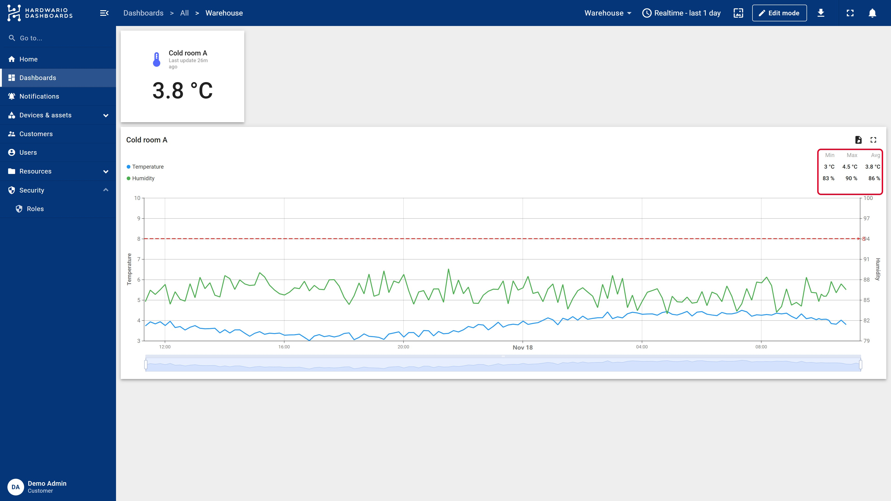
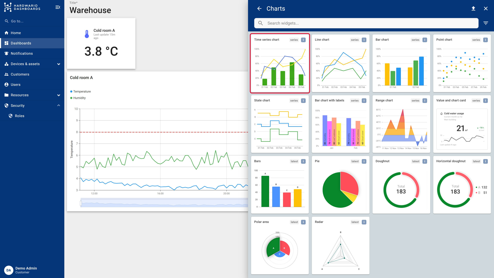
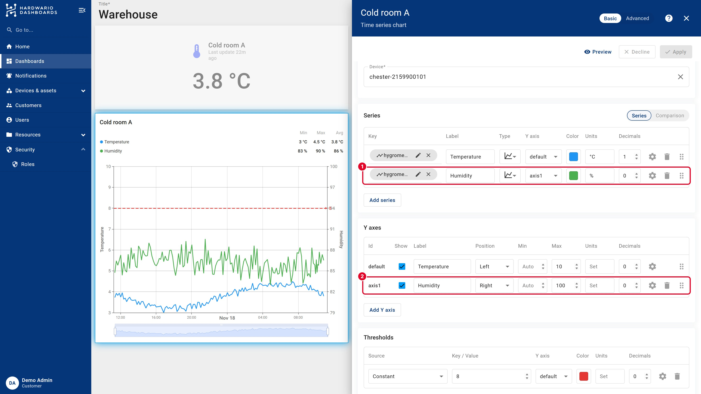
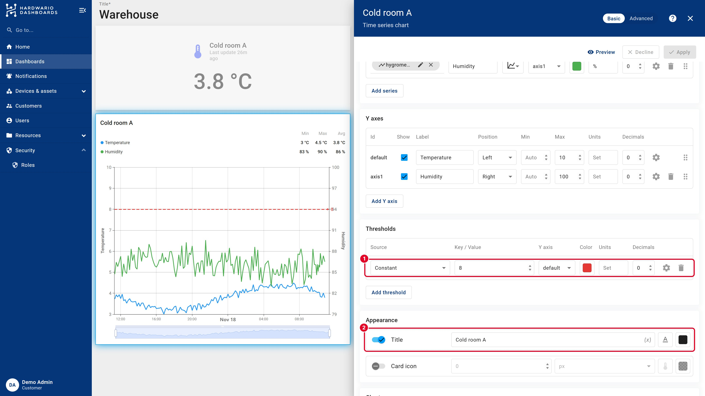
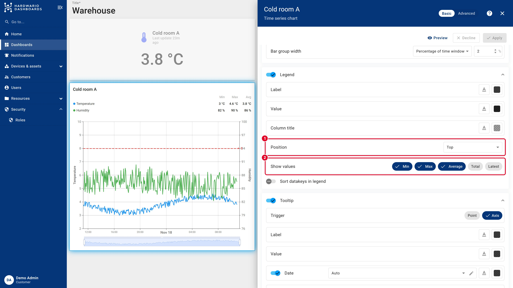
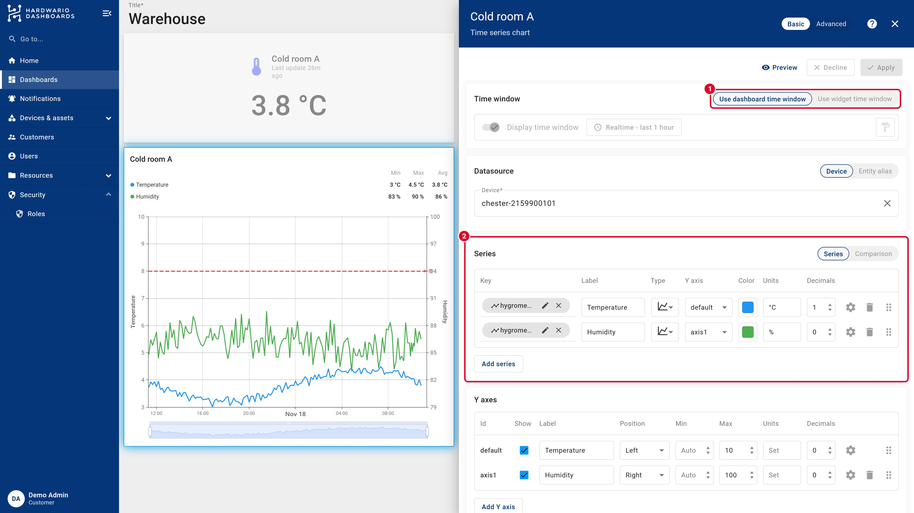

import Image from '@theme/IdealImage';

# Grafy a jejich vzhled {#charts--styling}

Graf ukazuje, jak se hodnoty mění v čase. V tomto návodu přidáte **Time series chart** s teplotou a vlhkostí, vlhkost dáte na druhou osu, nakreslíte limitní čáru a nastavíte legendu.

Výsledek vypadá takto:

Potřebujete dashboard, na který graf dáte. Pokud ho ještě nemáte, podívejte se na [První dashboard](/apps/thingsboard/creating-dashboard).

---

## Krok 1: Přidejte graf {#step-1-add-the-chart}

1. Otevřete dashboard a v horní liště klikněte na **Edit mode**.
2. Klikněte na **Add widget** a zvolte balíček **Charts**.
3. Zvolte **Time series chart**.

:::tip Jaký graf?
**Time series chart** je nejuniverzálnější: umí čáry, sloupce i body, více os a limitní čáry. **Line chart**, **Bar chart** a **Point chart** jsou jednodušší varianty s přednastaveným vzhledem.
:::

---

## Krok 2: Vyberte zařízení a hodnoty {#step-2-choose-the-device-and-the-values}

1. V sekci **Datasource** vyberte **Device**.
2. V sekci **Series** odeberte výchozí klíč a vyberte první hodnotu, například `hygrometer.temperature.measurements.avg`.
3. Nastavte srozumitelný **Label** (*Teplota*), jednotku (**Units**, `°C`) a počet desetinných míst (**Decimals**). Kliknutím na barevný čtvereček změníte barvu.
4. Pokud chcete v jednom grafu víc hodnot, klikněte na **Add series** a vyberte další klíč, například vlhkost. Dejte jí vlastní label, jednotku (`%`) a barvu.

Každá série má další nastavení pod **ikonou ozubeného kola**: čára nebo sloupce, plynulá nebo lomená čára, šířka čáry, body a vyplněná plocha pod čarou. Sloupec **Type** přepíná mezi čárou, sloupci a body.

---

## Krok 3: Přidejte druhou osu Y {#step-3-add-a-second-y-axis}

Teplota je ve stupních, vlhkost v procentech. Na jedné ose by jedna z nich byla jen rovná čára. Dejte každé vlastní osu:

1. V sekci **Y axes** klikněte na **Add Y axis**. Objeví se nová osa `axis1`.
2. Nastavte jí **Position** na **Right** a **Label**, například *Vlhkost*.
3. Label dejte i výchozí ose, například *Teplota*.
4. Zpátky v sekci **Series** nastavte sérii vlhkosti **Y axis** na `axis1`.

**Min** a **Max** pevně nastaví rozsah osy. S pevným rozsahem graf neposkakuje s každou novou hodnotou a limitní čára zůstane vždy vidět.

---

## Krok 4: Nakreslete limitní čáru {#step-4-draw-a-limit-line}

Threshold je vodorovná čára, která označuje limit. Každý tak na první pohled vidí, kdy je hodnota příliš vysoká.

1. V sekci **Thresholds** klikněte na **Add threshold**.
2. **Source** nechte na **Constant** a zadejte hodnotu (**Value**), například `8`.
3. Zvolte osu (**Y axis**), ke které hodnota patří, a barvu (**Color**), například červenou. Pod **ikonou ozubeného kola** nastavíte přerušovanou čáru a její šířku.

---

## Krok 5: Nadpis, legenda a tooltip {#step-5-title-legend-and-tooltip}

- **Appearance → Title**: nadpis nad grafem, například *Chladírna A*. Můžete přidat i ikonu (**Card icon**).
- **Legend**: zvolte pozici (**Position**) a které hodnoty se u každé série ukazují: **Min**, **Max**, **Average**, **Total** nebo **Latest**.
- **Tooltip**: co se ukáže, když najedete myší na graf. **Axis** ukáže všechny série v daném čase, **Point** jen tu pod kurzorem.
- **Chart → Data zoom** přidá pod graf posuvník pro přiblížení.

Klikněte na **Add** a dashboard uložte (**Save**).

---

## Krok 6: Práce s grafem {#step-6-work-with-the-chart}

- **Najeďte myší** na graf a uvidíte přesné hodnoty v daném čase.
- **Posuvníkem** pod grafem, nebo tažením přes graf, ho přiblížíte.
- **Kliknutím na sérii v legendě** ji skryjete nebo zobrazíte.
- **Ikonou stažení** v rohu grafu exportujete jeho data, **ikonou roztažení** ho zobrazíte přes celou obrazovku.

Pokud chcete graf později změnit, přepněte do **Edit mode**, najeďte na graf a klikněte na jeho **ikonu tužky**. Všechna nastavení jsou v jednom panelu:

:::tip Graf je prázdný?
Nejčastěji je problém v období: nový dashboard ukazuje jen **poslední hodinu**. Viz [Časové okno](/apps/thingsboard/time-window).
:::

---

## Další kroky {#next-steps}

- [Časové okno](/apps/thingsboard/time-window): zvolte období, které grafy ukazují.
- [Veřejný odkaz](/apps/thingsboard/public-link): nasdílejte dashboard.

:::info Dokumentace ThingsBoard
HARDWARIO Dashboards jsou postavené na platformě ThingsBoard. Podrobnosti najdete v oficiální dokumentaci ThingsBoard (anglicky): [Time series chart](https://thingsboard.io/docs/pe/reference/widgets/charts/time-series-chart/).
:::
