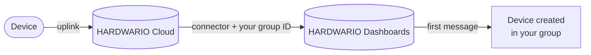
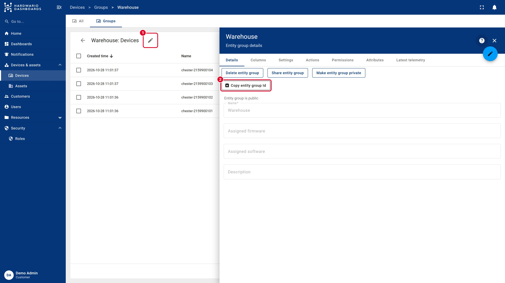

import Image from '@theme/IdealImage';
import ThingsBoardConnector from '@site/src/components/ThingsBoardConnector';

# Připojení zařízení {#connect-from-hardwario-cloud}

Zařízení z HARDWARIO Cloud dostanete do HARDWARIO Dashboards dvěma způsoby:

- **[Automatické připojení](#automatic-connection)** (doporučeno, tato stránka): přidáte jeden konektor a každé otagované zařízení se samo vytvoří ve vaší skupině zařízení.
- **[Ruční připojení](/apps/thingsboard/manual-connection)**: pro zařízení, která už v HARDWARIO Dashboards existují.

---

## Automatické připojení {#automatic-connection}

Vaše zařízení se **objeví ve vašem účtu HARDWARIO Dashboards sama**, ve skupině zařízení, kterou si zvolíte. Přidáte jeden konektor a otagujete zařízení, která chcete posílat. V HARDWARIO Dashboards už nic dalšího nastavovat nemusíte.

Potřebujete účet v HARDWARIO Dashboards. Pokud ho ještě nemáte, napište nám na [ask@hardwario.com](mailto:ask@hardwario.com).

### Krok 1: Najděte svou skupinu zařízení {#step-1-find-your-device-group}

Skupina zařízení říká HARDWARIO Dashboards, kam vaše zařízení patří.

1. Přihlaste se do [HARDWARIO Dashboards](https://app.hardwario.cloud), otevřete **Devices & assets → Devices** (správci tenantu **Entities → Devices**) a přepněte na záložku **Groups**.
2. Kliknutím otevřete skupinu, do které chcete zařízení přidávat. Pokud skupiny nepoužíváte, zvolte **All**, nebo si nejdřív [vytvořte novou skupinu](/apps/thingsboard/devices#device-groups).
3. Klikněte na **ikonu tužky** (Entity group details) vedle názvu skupiny (1) a potom na **Copy entity group Id** (2).

   

:::tip Mějte zařízení roztříděná
ID skupiny určuje, kde se vaše zařízení vytvoří. Vytvořte si skupinu pro každou budovu, lokalitu nebo projekt a pro každou skupinu přidejte jeden konektor. Každému konektoru dejte vlastní ID skupiny a vlastní tag (např. `thingsboard-sklad`, `thingsboard-kancelar`). Každé zařízení pak skončí ve správné skupině samo.
:::

### Krok 2: Získejte kód konektoru {#step-2-get-your-connector-code}

Vložte zkopírované ID níže. Kód se doplní sám.

<ThingsBoardConnector />

### Krok 3: Přidejte konektor {#step-3-add-the-connector}

[Vytvořte konektor](/cloud/connectors#creating-a-connector) typu **Webhook** s tímto nastavením, klikněte na **Create** a na jeho záložce **Transformation** vložte kód z kroku 2 (viz [transformační funkce](/cloud/connectors#the-transformation-function)):

| Nastavení | Hodnota |
|---|---|
| **Name** | `thingsboard` |
| **Flows** | **Uplink data**, **Session** a **Configuration report** |
| **Tags** | nový tag `thingsboard` (viz [Vytvoření tagu](/cloud/tags#creating-a-tag)) |

### Krok 4: Otagujte zařízení {#step-4-tag-your-devices}

Přidejte tag `thingsboard` každému zařízení, které chcete mít v HARDWARIO Dashboards, viz [Přiřazování tagů](/cloud/tags#assigning-tags), nebo otagujte víc zařízení najednou přes [Hromadné akce](/cloud/bulk-actions#tags).

### Co se stane v HARDWARIO Dashboards {#what-happens-in-thingsboard}

S **další zprávou** každého otagovaného zařízení se zařízení objeví ve vaší skupině zařízení:

| V HARDWARIO Dashboards | Hodnota |
|---|---|
| **Název zařízení** | `chester-<sériové číslo>`, např. `chester-2159012345` |
| **Label** | sériové číslo |
| **Atributy** | název zařízení z HARDWARIO Cloud, výrobek, verze firmwaru, IMEI, ICCID, konfigurace zařízení, sériová čísla BLE tagů |
| **Telemetrie** | všechna měření s původními časy, zaokrouhlená na dvě desetinná místa; BLE tagy jako `ble_tags.0.…`, `ble_tags.1.…` |

Každá další zpráva už jen přidává nová data. Zařízení se hlásí ve svém intervalu, takže se může objevit až za jeden interval.

- **Přejmenování zařízení** v HARDWARIO Cloud změní jen atribut s jeho názvem. Zařízení si ponechá název, label i historii.
- **Další zařízení později:** stačí je otagovat tagem `thingsboard`.
- **Jiná skupina:** vložte do konektoru ID nové skupiny. Zařízení se tam přesunou s další zprávou.
- **Zastavení dat:** odeberte tag `thingsboard`. Zařízení i jeho historie v HARDWARIO Dashboards zůstanou.
- **Smazání zařízení v HARDWARIO Dashboards** data nezastaví. Dokud má zařízení tag, další zpráva ho přidá znovu, proto nejdřív odeberte tag.
- **Zařízení, která už v HARDWARIO Dashboards máte:** netagujte je, objevila by se podruhé. Použijte pro ně [ruční připojení](/apps/thingsboard/manual-connection).

### Řešení potíží {#troubleshooting}

| Problém | Co dělat |
|---|---|
| Zařízení se neobjevuje | Zkontrolujte, že má tag `thingsboard` a že od otagování poslalo zprávu. |
| Zařízení nejsou v mé skupině | Porovnejte ID skupiny v konektoru se svou skupinou. Po opravě se zařízení přesunou s další zprávou. |

Cokoli dalšího: [ask@hardwario.com](mailto:ask@hardwario.com).

### Další kroky {#next-steps}

- Dejte zařízením srozumitelné názvy a roztřiďte je do skupin: [Správa zařízení](/apps/thingsboard/devices).
- Zobrazte data: [První dashboard](/apps/thingsboard/creating-dashboard).

---

## Ruční připojení {#manual-connection}

Ruční připojení má nyní vlastní návod: **[Ruční připojení](/apps/thingsboard/manual-connection)**.

:::info Dokumentace ThingsBoard
HARDWARIO Dashboards jsou postavené na platformě ThingsBoard. Podrobnosti najdete v oficiální dokumentaci ThingsBoard (anglicky): [HTTP device API](https://thingsboard.io/docs/pe/reference/http-api/getting-connected/).
:::
