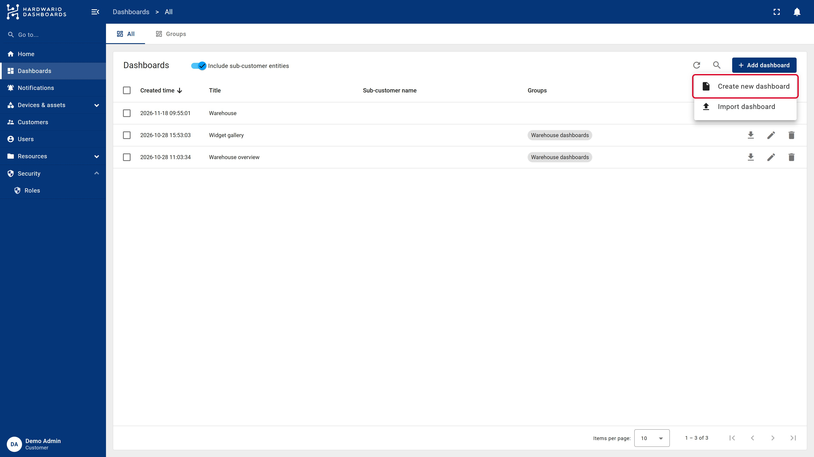
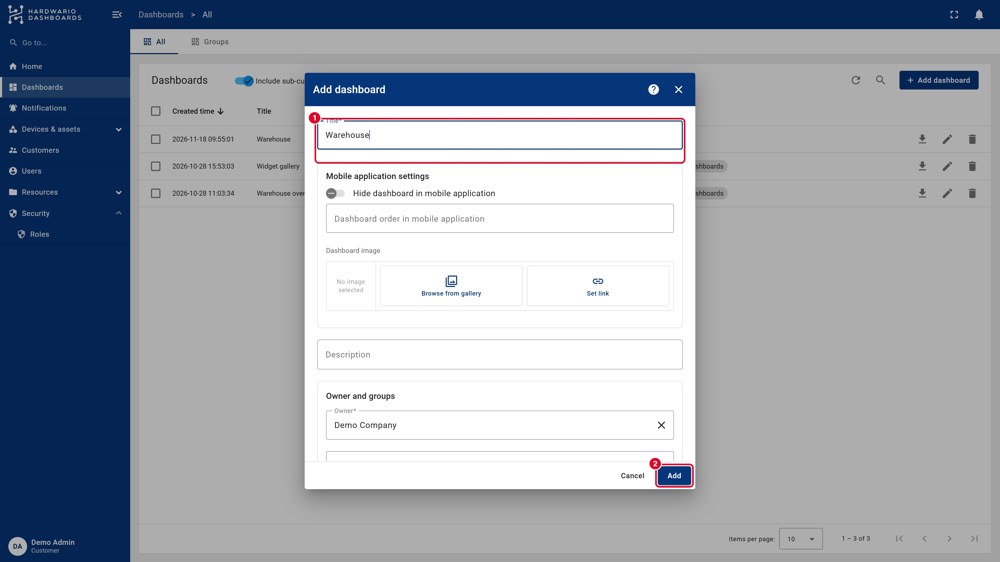
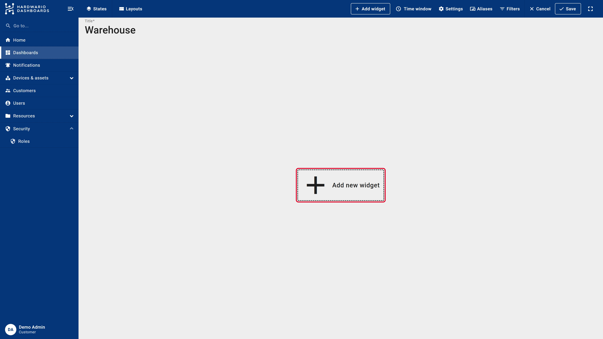
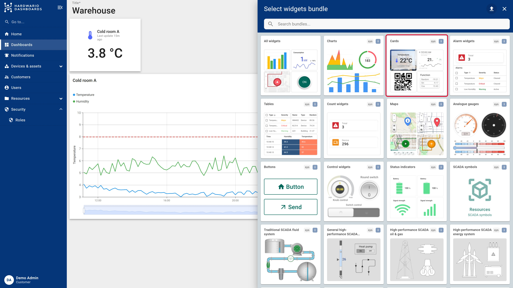
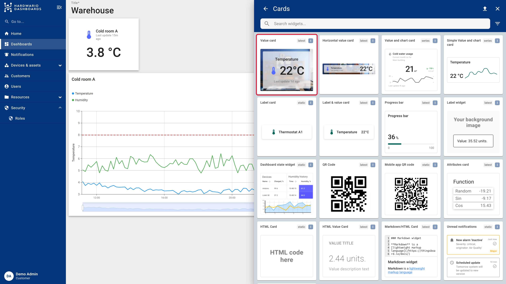
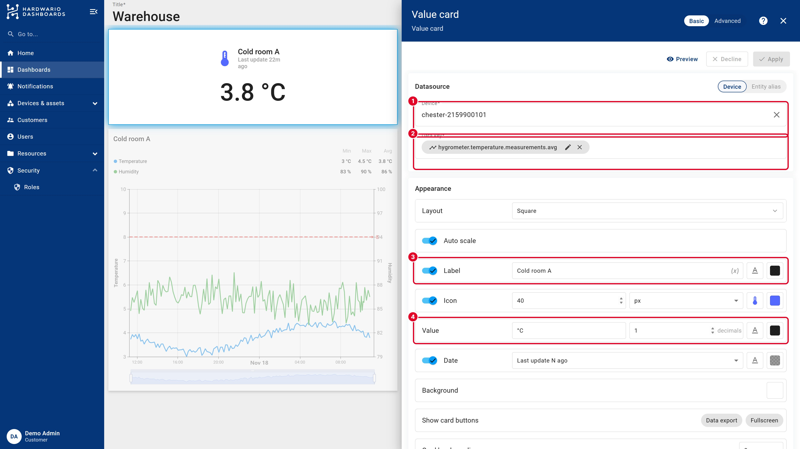
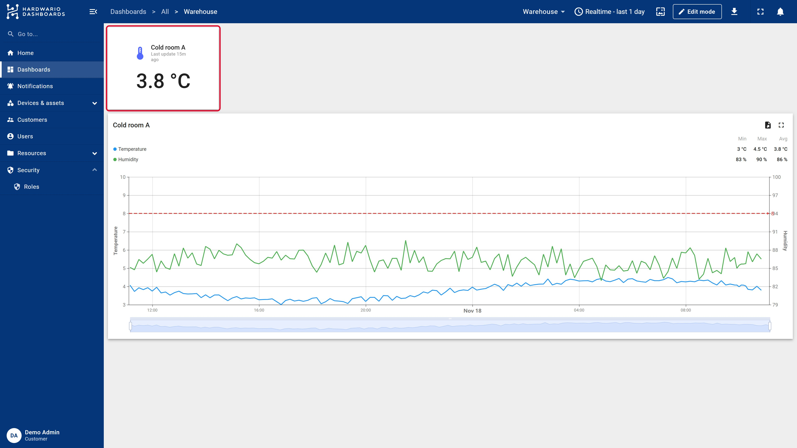
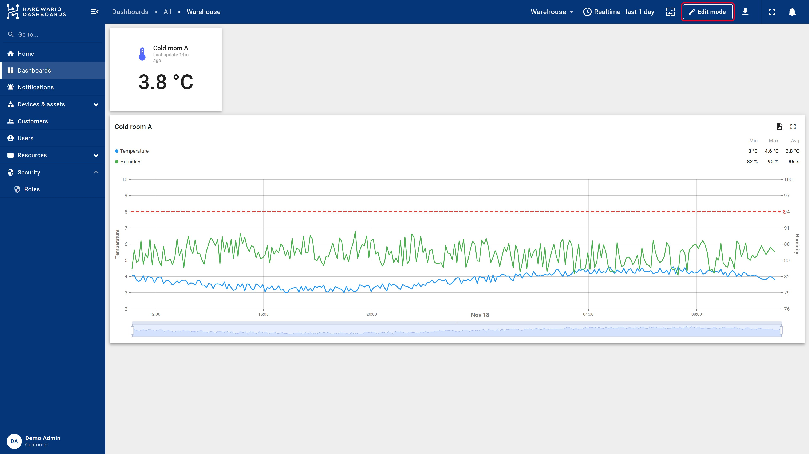
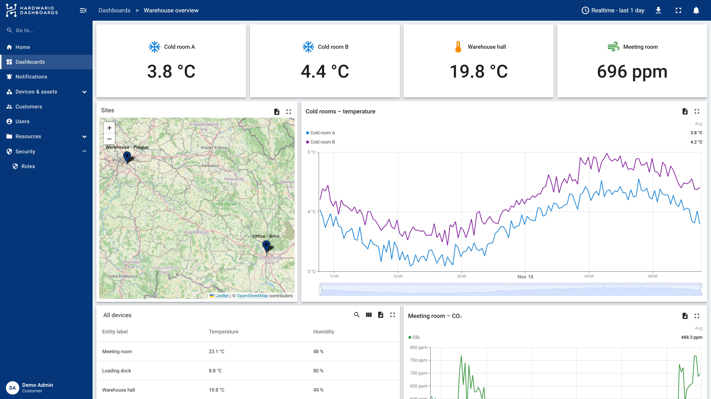

import Image from '@theme/IdealImage';

# První dashboard {#your-first-dashboard}

V tomto návodu vytvoříte dashboard a přidáte na něj kartu, která ukazuje živou hodnotu ze zařízení. Potom můžete pokračovat [grafy](/apps/thingsboard/charts).

Než začnete, zařízení by mělo být [připojené](/apps/thingsboard/cloud-connection) a jeho hodnoty by se měly objevovat v **Latest telemetry** (viz [Správa zařízení](/apps/thingsboard/devices#check-the-device-data)).

---

## Krok 1: Vytvořte dashboard {#step-1-create-the-dashboard}

1. V levém menu otevřete **Dashboards**.
2. Vpravo nahoře klikněte na **Add dashboard** a zvolte **Create new dashboard**.

   

3. Zadejte **Title**, například *Warehouse*. Ostatní pole jsou nepovinná. Klikněte na **Add**.

   

Nový dashboard se otevře v **režimu úprav**, připravený na první widget.

---

## Krok 2: Přidejte kartu s živou hodnotou {#step-2-add-a-card-with-a-live-value}

1. Klikněte na **Add new widget** uprostřed (nebo na **Add widget** v horní liště).
2. Otevře se seznam balíčků widgetů. Zvolte **Cards**.

   

3. Zvolte **Value card**. Ukazuje jednu hodnotu, která se aktualizuje v reálném čase.

   

4. V sekci **Datasource** napište do pole **Device** název zařízení a vyberte ho.
5. V poli **Data key** odeberte výchozí klíč `temperature`, klikněte do pole a vyberte hodnotu, kterou chcete zobrazit, například `hygrometer.temperature.measurements.avg`. Můžete napsat část názvu a vyhledat ji.
6. V sekci **Appearance** nastavte:
   - **Label**: text nad hodnotou, například *Chladírna A*,
   - **Value**: jednotku (například `°C`) a počet desetinných míst (**decimals**),
   - případně **Icon** a barvy.
7. Klikněte na **Add**.

Karta se objeví na dashboardu a ukazuje poslední hodnotu s časem poslední aktualizace.

---

## Krok 3: Uspořádejte dashboard {#step-3-arrange-the-dashboard}

- **Velikost** widgetu změníte tažením za jeho pravý dolní roh.
- **Přesunete** ho tažením.
- **Upravíte** ho tak, že na něj najedete myší a kliknete na **ikonu tužky** v jeho pravém horním rohu.
- **Zkopírujete** ho pravým kliknutím a volbou **Copy**, potom pravým kliknutím na volné místo a volbou **Paste**. V kopii změňte jen datový klíč, třeba na vlhkost. Je to rychlejší než začínat znovu.

---

## Krok 4: Uložte {#step-4-save}

Vpravo nahoře klikněte na **Save**. Dashboard opustí režim úprav. Karta se teď aktualizuje pokaždé, když zařízení pošle nová data.

Pokud budete chtít dashboard později upravit, otevřete ho a v horní liště klikněte na **Edit mode**.

:::tip Hodnota je prázdná?
Zkontrolujte, že jste vybrali správné zařízení a klíč: otevřete zařízení a porovnejte to s jeho **Latest telemetry**. Grafy navíc závisí na [časovém okně](/apps/thingsboard/time-window).
:::

---

## Ukázka {#example}

Hotový dashboard může kombinovat karty s hodnotami, grafy, mapu a tabulku:

---

## Další kroky {#next-steps}

- [Grafy a jejich vzhled](/apps/thingsboard/charts): přidejte graf s historií.
- [Časové okno](/apps/thingsboard/time-window): zvolte, jaké období dashboard ukazuje.
- [Veřejný odkaz](/apps/thingsboard/public-link): nasdílejte dashboard.

:::info Dokumentace ThingsBoard
HARDWARIO Dashboards jsou postavené na platformě ThingsBoard. Podrobnosti najdete v oficiální dokumentaci ThingsBoard (anglicky): [Dashboards](https://thingsboard.io/docs/pe/user-guide/dashboards/).
:::
