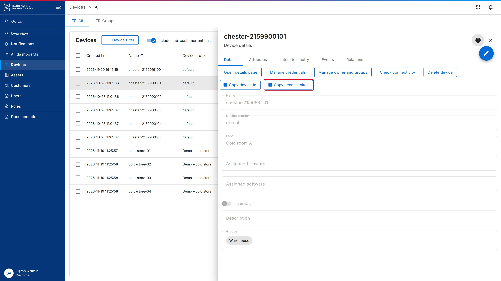
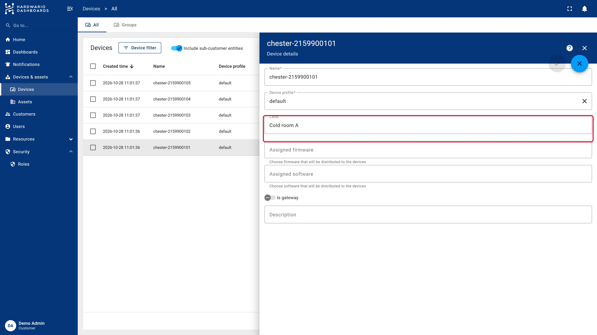
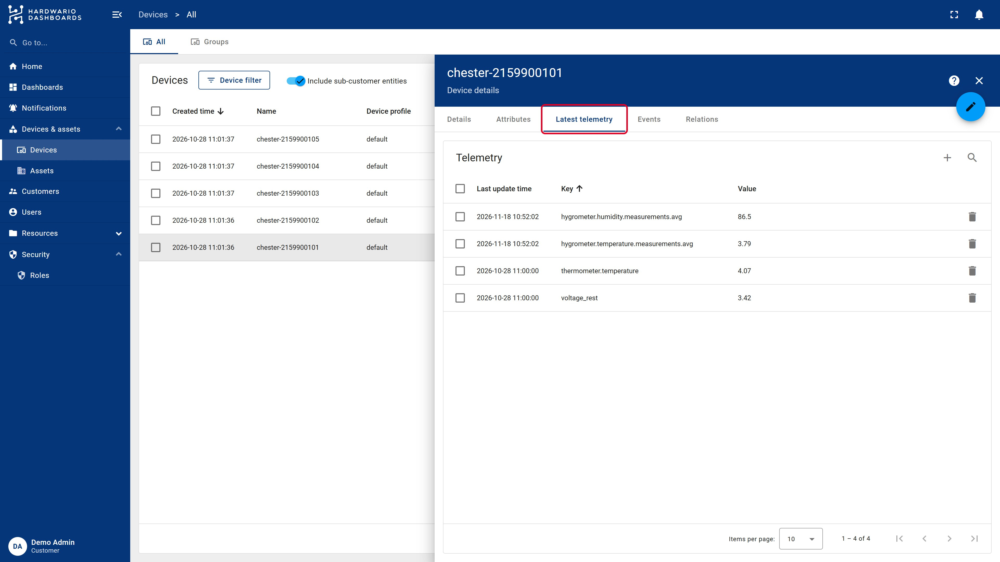
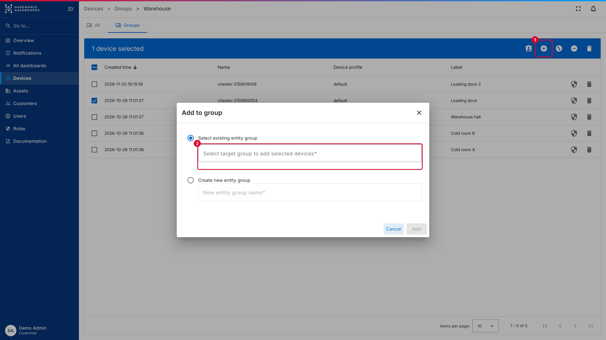

import Image from '@theme/IdealImage';

# Správa zařízení {#managing-devices}

Jakmile máte zařízení [připojená](/apps/thingsboard/cloud-connection), tento návod ukáže, jak jim dát srozumitelné názvy, zkontrolovat jejich data, roztřídit je do skupin a bezpečně je smazat.

Zařízení najdete v levém menu pod **Devices**. Správci tenantu je najdou pod **Entities → Devices**.

---

## Dejte zařízení srozumitelný label {#give-a-device-a-readable-label}

Automaticky připojená zařízení se jmenují `chester-` a sériové číslo. Pro nás je to praktické, pro vás už méně. **Label** je srozumitelný název, který uvidíte v seznamech i na dashboardech.

1. Klikněte na zařízení v seznamu. Vpravo se otevře detail zařízení.
2. Vpravo nahoře v detailu klikněte na **ikonu tužky**.
3. Vyplňte **Label**, například *Chladírna A*. Můžete přidat i popis do pole **Description**.
4. Potvrďte **ikonou fajfky**.

:::tip Název neměňte
Měňte jen label, ne **Name**. Automatické připojení hledá zařízení podle jeho názvu. Pokud ho přejmenujete, další zpráva vytvoří nové zařízení.
:::

---

## Zkontrolujte data zařízení {#check-the-device-data}

Detail zařízení má několik záložek:

| Záložka | Co tam najdete |
|---|---|
| **Details** | Název, label, profil zařízení, skupiny a tlačítka jako **Copy access token** a **Manage owner and groups**. |
| **Attributes** | Informace o zařízení. U automatického připojení: název zařízení z HARDWARIO Cloud, výrobek, verze firmwaru a podobně. |
| **Latest telemetry** | Všechny hodnoty, které zařízení posílá, s poslední naměřenou hodnotou a časem, kdy přišla. |
| **Events**, **Relations** | Pokročilé informace, obvykle je nepotřebujete. |

V **Latest telemetry** zkontrolujete, jestli data přicházejí. Najdete tu také přesné názvy hodnot (klíče), které budete potřebovat pro [dashboardy](/apps/thingsboard/creating-dashboard) a [notifikace](/apps/thingsboard/notifications-manager).

---

## Roztřiďte zařízení do skupin {#device-groups}

Skupiny udrží v pořádku i rostoucí počet zařízení, například podle budovy, lokality nebo zákazníka. Jsou také klíčem k tomu, [kdo co uvidí](/apps/thingsboard/users-managing) a co ukáže [veřejný odkaz](/apps/thingsboard/public-link).

Zařízení může být ve více skupinách najednou. Každé zařízení je vždy ve skupině **All**.

### Vytvořte skupinu {#creating-a-device-group}

1. Nahoře nad seznamem zařízení otevřete záložku **Groups**.
2. Klikněte na **Add entity group**, zadejte **Name** (případně popis) a klikněte na **Add**.

### Přidejte zařízení do skupiny {#add-devices-to-a-group}

1. Na záložce **Groups** otevřete skupinu, ve které zařízení teď jsou. Pokud skupiny ještě nepoužíváte, otevřete **All**.
2. Zaškrtněte zařízení, která chcete roztřídit.
3. V modré liště nahoře klikněte na jednu z akcí:
   - **Add to group**: zařízení zůstanou v aktuální skupině a přidají se i do další.
   - **Move to group**: zařízení z aktuální skupiny odejdou a přesunou se do jiné.
   - **Remove from group**: zařízení z aktuální skupiny odejdou.
4. Vyberte existující skupinu, nebo zvolte **Create new entity group** a napište název. Klikněte na **Add**.

:::tip Automatické připojení
Při [automatickém připojení](/apps/thingsboard/cloud-connection) se nová zařízení vytvoří ve skupině, jejíž ID je v konektoru. Když použijete jeden konektor pro každou skupinu, zařízení se roztřídí sama.
:::

---

## Smažte zařízení {#delete-a-device}

Klikněte na **ikonu koše** na konci řádku zařízení a potvrďte. Zařízení se smaže i se všemi daty.

:::caution Nejdřív odeberte tag
Pokud má zařízení v HARDWARIO Cloud stále tag, automatické připojení ho s další zprávou přidá znovu. Nejdřív v HARDWARIO Cloud [odeberte tag](/cloud/tags#assigning-tags) a teprve potom zařízení smažte tady.
:::

---

## Přidejte zařízení ručně {#add-a-device-manually}

Při automatickém připojení se zařízení vytvářejí sama, takže ručně je přidáváte jen výjimečně. Pokud to potřebujete, například pro [ruční připojení](/apps/thingsboard/manual-connection), klikněte vpravo nahoře nad seznamem zařízení na **Add device**, vyplňte **Name** a **Label** a dokončete dialog. Postup ukazuje návod [Ruční připojení](/apps/thingsboard/manual-connection#step-1-create-the-device).

---

## Další kroky {#next-steps}

- [První dashboard](/apps/thingsboard/creating-dashboard): zobrazte data svých zařízení.
- [Skupiny, role a oprávnění](/apps/thingsboard/users-managing): určete, kteří uživatelé uvidí které skupiny zařízení.

:::info Dokumentace ThingsBoard
HARDWARIO Dashboards jsou postavené na platformě ThingsBoard. Podrobnosti najdete v oficiální dokumentaci ThingsBoard (anglicky): [Devices](https://thingsboard.io/docs/pe/user-guide/devices/) · [Entity groups](https://thingsboard.io/docs/pe/user-guide/groups/).
:::
