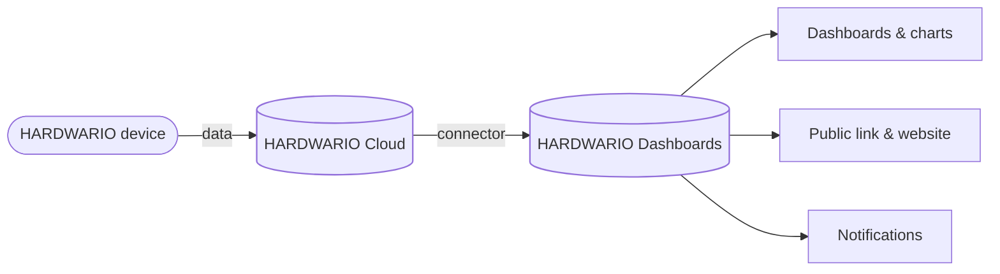

import Image from '@theme/IdealImage';

# HARDWARIO Dashboards {#hardwario-dashboards}

**HARDWARIO Dashboards** zobrazuje data z vašich zařízení HARDWARIO v živých dashboardech. Vidíte aktuální hodnoty i historii v grafech, dashboardy sdílíte se svými zákazníky, vložíte je na svůj web a dostanete upozornění, když hodnota překročí limit.

HARDWARIO Dashboards je postavený na open-source IoT platformě [ThingsBoard](https://thingsboard.io/), proto se s tímto názvem můžete setkat v rozhraní i v dokumentaci samotné platformy.

:::info Přihlášení
HARDWARIO Dashboards běží na adrese **[app.hardwario.cloud](https://app.hardwario.cloud/)**.

Ještě nemáte účet? Napište nám na **[ask@hardwario.com](mailto:ask@hardwario.com)**. Účet vám založíme a pomůžeme s připojením zařízení.
:::

---

## Jak to funguje {#how-it-works}

1. Vaše zařízení posílají data do **HARDWARIO Cloud**.
2. **Konektor** v HARDWARIO Cloud data předává do HARDWARIO Dashboards. S [automatickým připojením](/apps/thingsboard/cloud-connection#automatic-connection) se každé zařízení ve vašem účtu objeví samo.
3. V HARDWARIO Dashboards data **zobrazíte** v dashboardech, **sdílíte** je a **hlídáte** pomocí notifikací.

---

## Ukázkový dashboard {#example-dashboard}

Toto je interaktivní ukázkový dashboard s ukázkovými daty, vložený přímo do této stránky:

import ThingsBoardDashboard from '@site/src/components/ThingsBoardDashboard';

<ThingsBoardDashboard />

---

## Krok za krokem {#step-by-step}

Návody jdou v pořadí, v jakém vše nastavujete: od připojení prvního zařízení až po upozornění ve vaší e-mailové schránce. Ke každému návodu existuje díl naší video série.

### Začínáme {#getting-started}

| # | Návod | Co uděláte |
|---|---|---|
| 01 | **Přehled** (tato stránka) | Zjistíte, co HARDWARIO Dashboards umí a jak se přihlásit. |
| 02 | [Připojení zařízení](/apps/thingsboard/cloud-connection) | Přidáte jeden konektor a zařízení se objeví sama. **Doporučeno.** |
| 03 | [Ruční připojení](/apps/thingsboard/manual-connection) | Připojíte zařízení, které už existuje, pomocí jeho access tokenu. |
| 04 | [Správa zařízení](/apps/thingsboard/devices) | Dáte zařízením srozumitelné názvy, roztřídíte je do skupin a zkontrolujete jejich data. |

### Dashboardy {#dashboards}

| # | Návod | Co uděláte |
|---|---|---|
| 05 | [První dashboard](/apps/thingsboard/creating-dashboard) | Vytvoříte dashboard a přidáte kartu s živou hodnotou. |
| 06 | [Grafy a jejich vzhled](/apps/thingsboard/charts) | Přidáte graf s více hodnotami, druhou osou, limitní čarou a legendou. |
| 07 | [Časové okno](/apps/thingsboard/time-window) | Zvolíte, jaké období dashboard ukazuje, a uložíte ho jako výchozí. |

### Sdílení {#sharing}

| # | Návod | Co uděláte |
|---|---|---|
| 08 | [Veřejný odkaz](/apps/thingsboard/public-link) | Nasdílíte dashboard komukoli jen pro čtení, bez přihlášení. |
| 09 | [Vložení dashboardu do webu](/apps/thingsboard/embedding-dashboards) | Dáte dashboard nebo jeden graf na svůj web. |

### Uživatelé a přístup {#users--access}

| # | Návod | Co uděláte |
|---|---|---|
| 10 | [Skupiny, role a oprávnění](/apps/thingsboard/users-managing) | Přesně určíte, kteří uživatelé vidí která zařízení a dashboardy. |
| 11 | [Přidání uživatelů](/apps/thingsboard/users) | Založíte účet a pozvete uživatele. |

### Notifikace {#notifications}

| # | Návod | Co uděláte |
|---|---|---|
| 12 | [Pravidla notifikací](/apps/thingsboard/notifications-manager) | Dostanete e-mail nebo SMS, když hodnota překročí limit. Bez programování. |

---

## Pokročilé {#advanced}

Až budete mít základy hotové, v sekci [Pokročilé](/apps/thingsboard/features) najdete [assety](/apps/thingsboard/assets) (budova → patro → místnost), [Rule Engine](/apps/thingsboard/rule-engine) a [integrace](/apps/thingsboard/integrations), například ChirpStack.

:::tip Nastavíme to za vás
Pokud si nevíte rady nebo to nechcete nastavovat sami, napište nám na **[ask@hardwario.com](mailto:ask@hardwario.com)**. Vše nastavíme za vás.
:::

:::info Dokumentace ThingsBoard
HARDWARIO Dashboards jsou postavené na platformě ThingsBoard. Podrobnosti najdete v oficiální dokumentaci ThingsBoard (anglicky): [ThingsBoard PE documentation](https://thingsboard.io/docs/pe/).
:::
