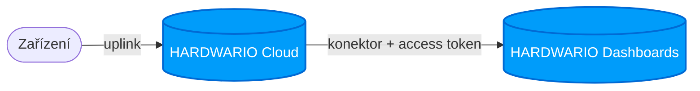
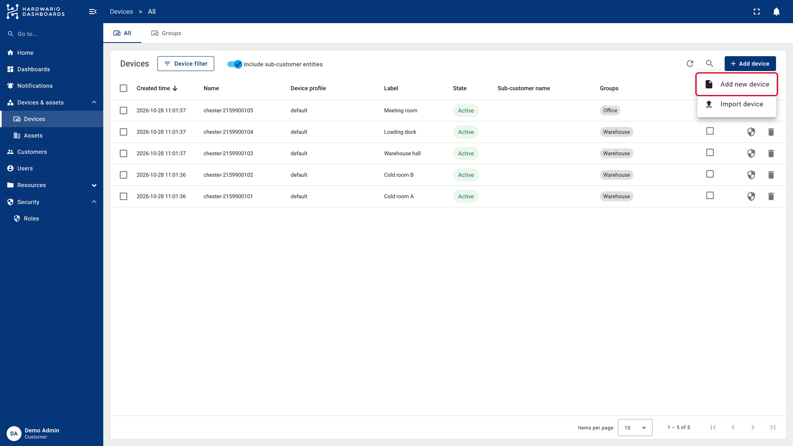
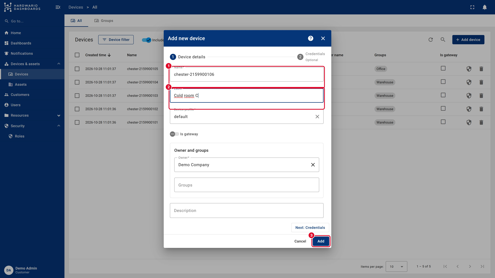
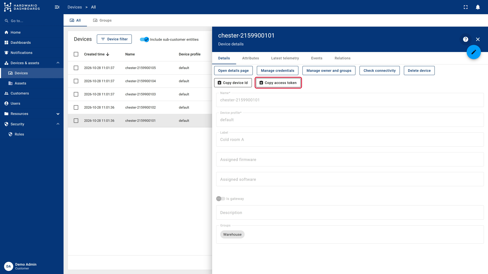
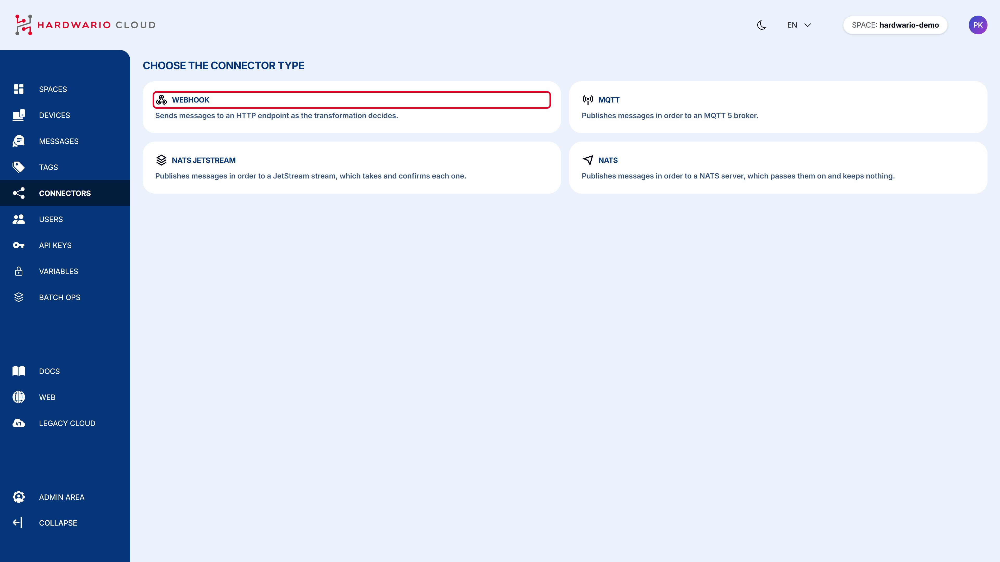
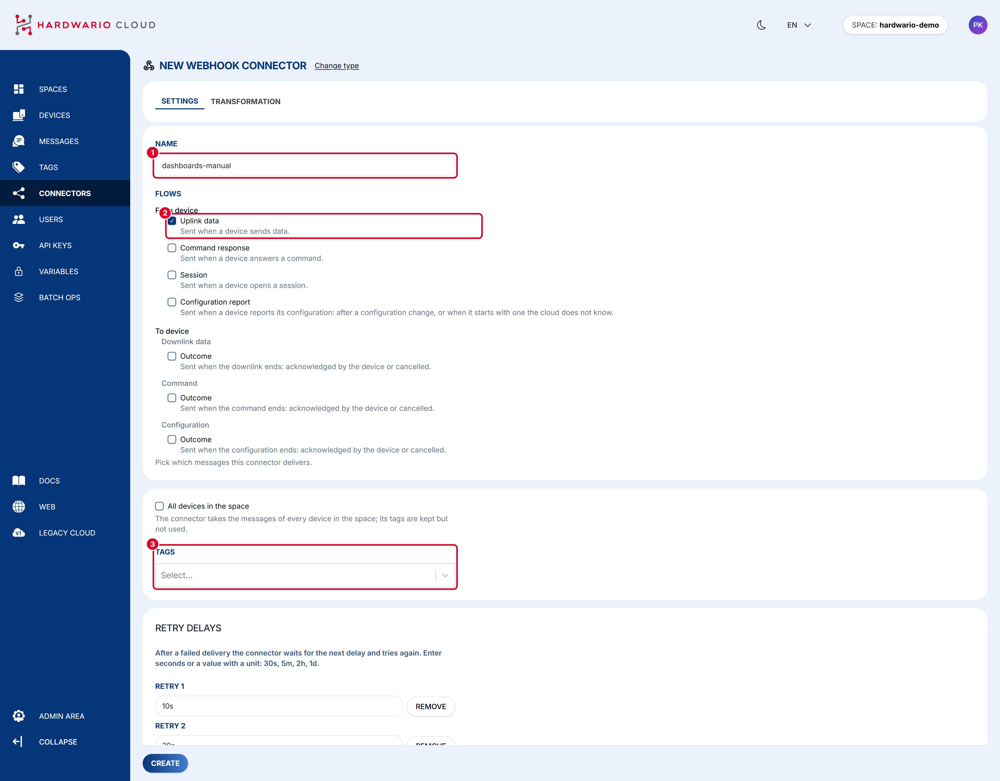
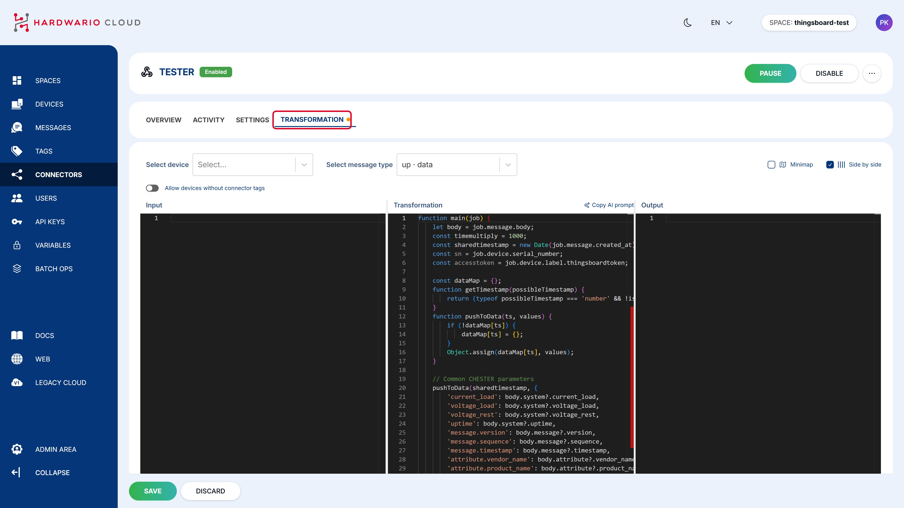
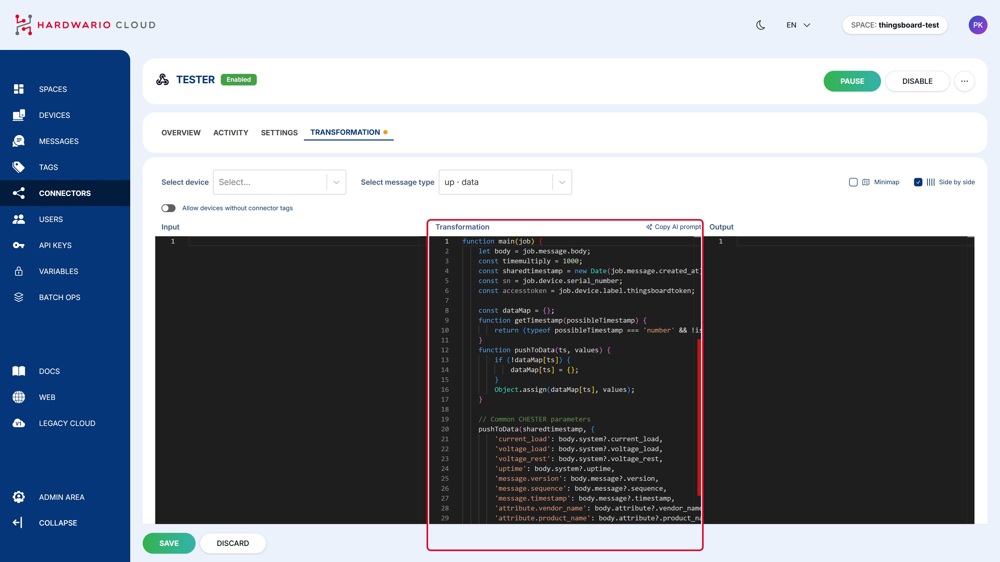
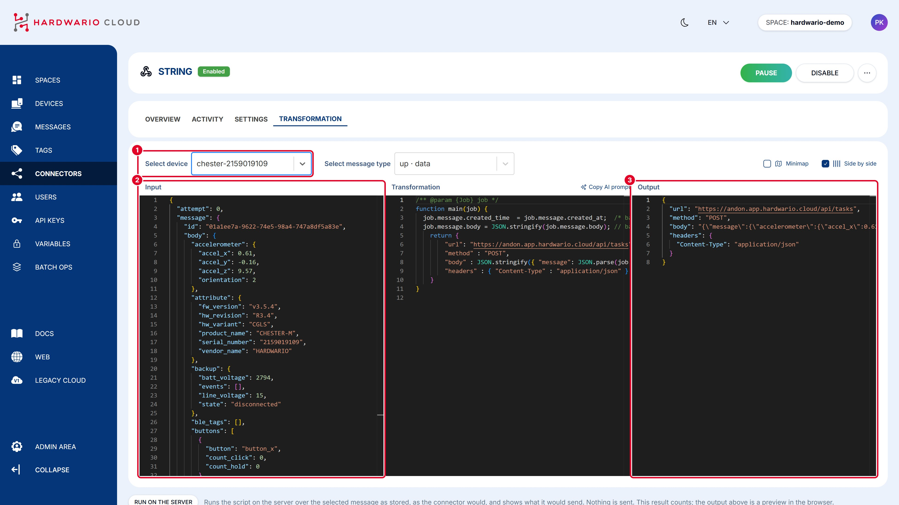
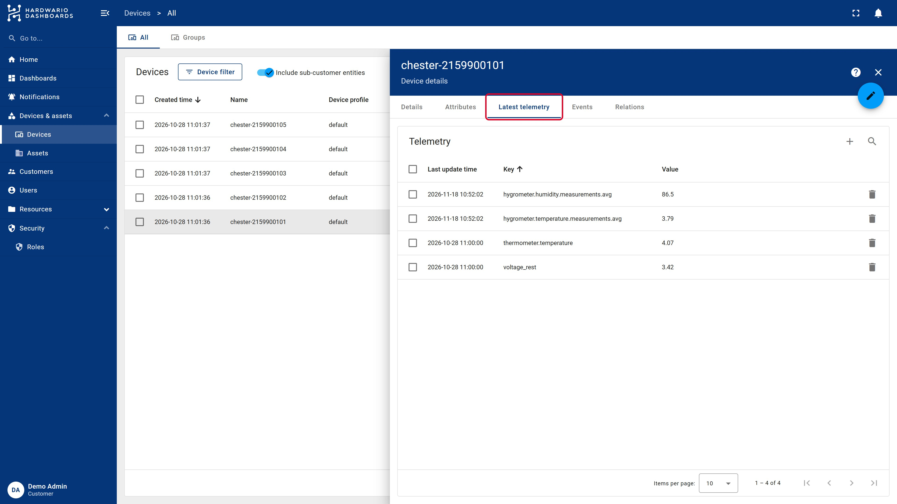

import Image from '@theme/IdealImage';
import EditCodeBlock from '../../../../../apps/thingsboard/edit-code-block.js';

# Ruční připojení {#manual-connection}

:::tip Většina zařízení to nepotřebuje
[Automatické připojení](/apps/thingsboard/cloud-connection) je jednodušší: přidáte jeden konektor a každé otagované zařízení se objeví samo. Ruční připojení použijte jen pro zařízení, která už v HARDWARIO Dashboards **existují**, nebo když potřebujete vlastní formát dat.
:::

Při ručním připojení má každé zařízení v HARDWARIO Dashboards svůj **access token**. Konektor v HARDWARIO Cloud si token přečte z labelu zařízení a pošle na něj data zařízení.

---

## Krok 1: Vytvořte zařízení {#step-1-create-the-device}

Pokud zařízení v HARDWARIO Dashboards už existuje, tento krok přeskočte.

1. Otevřete **Devices & assets → Devices** (správci tenantu **Entities → Devices**) vpravo nahoře klikněte na **Add device** a zvolte **Add new device**.

   

2. Zadejte **Name** (1), například sériové číslo, a **Label** (2), tedy srozumitelný název jako *Chladírna A*. Můžete vybrat i skupiny (**Groups**). Klikněte na **Add** (3).

   

Zařízení se objeví v seznamu.

---

## Krok 2: Zkopírujte access token {#step-2-copy-the-access-token}

Klikněte na zařízení v seznamu. V detailu zařízení klikněte na **Copy access token**.

:::caution
S access tokenem může do zařízení posílat data kdokoli. Nesdílejte ho nikde jinde než v konektoru.
:::

---

## Krok 3: Připravte zařízení v HARDWARIO Cloud {#step-3-prepare-the-device-in-hardwario-cloud}

Otevřete zařízení v [HARDWARIO Cloud](https://hardwario.cloud/):

- **Přiřaďte mu tag** (například `dashboards-manual`), viz [Přiřazování tagů](/cloud/tags#assigning-tags). Konektor posílá data všech zařízení s tímto tagem.
- **Přidejte access token jako label.** Úplně dole na stránce zařízení v sekci **Labels** vytvořte label:
  - **Name**: `thingsboardtoken`. Můžete zvolit i jiný název, ale musí být stejný u všech zařízení, která konektor sdílejí, a musí odpovídat názvu v transformačním kódu (`job.device.label.thingsboardtoken`).
  - **Value**: access token z kroku 2.

---

## Krok 4: Vytvořte konektor {#step-4-create-the-connector}

1. V HARDWARIO Cloud otevřete v levém menu **Connectors**, klikněte na **New connector** a zvolte **Webhook**.

   

2. Vyplňte nastavení:
   - **Name** (1): například `dashboards-manual`,
   - **Flows** (2): nechte jen **Uplink data**, tedy data, která zařízení posílá,
   - **Tags** (3): tag z kroku 3.

   

3. Klikněte na **Create**.

---

## Krok 5: Vložte transformační kód {#step-5-add-the-transformation-code}

HARDWARIO Dashboards očekává vlastní formát dat. Transformační kód do něj zprávu zařízení převede.

1. Na stránce konektoru otevřete záložku **Transformation**.

   

2. Vložte kód níže do prostředního editoru **Transformation** a klikněte na **Save**.

   

Kód pokrývá běžná měření CHESTER a BLE tagy. Před zkopírováním ho můžete upravit přímo tady:

<EditCodeBlock initialText={`function main(job) {
    let body = job.message.body;
    const timemultiply = 1000;
    const sharedtimestamp = new Date(job.message.created_at).getTime();
    const sn = job.device.serial_number;
    const accesstoken = job.device.label.thingsboardtoken;

    const dataMap = {};
    function getTimestamp(possibleTimestamp) {
        return (typeof possibleTimestamp === 'number' && !isNaN(possibleTimestamp)) ? possibleTimestamp * timemultiply : sharedtimestamp;
    }
    function pushToData(ts, values) {
        if (!dataMap[ts]) {
            dataMap[ts] = {};
        }
        Object.assign(dataMap[ts], values);
    }

    // Common CHESTER parameters
    pushToData(sharedtimestamp, {
        'current_load': body.system?.current_load,
        'voltage_load': body.system?.voltage_load,
        'voltage_rest': body.system?.voltage_rest,
        'uptime': body.system?.uptime,
        'message.version': body.message?.version,
        'message.sequence': body.message?.sequence,
        'message.timestamp': body.message?.timestamp,
        'attribute.vendor_name': body.attribute?.vendor_name,
        'attribute.product_name': body.attribute?.product_name,
        'attribute.hw_variant': body.attribute?.hw_variant,
        'attribute.hw_revision': body.attribute?.hw_revision,
        'attribute.fw_name': body.attribute?.fw_name,
        'attribute.fw_version': body.attribute?.fw_version,
        'attribute.serial_number': body.attribute?.serial_number,
        'backup.line_voltage': body.backup?.line_voltage,
        'backup.batt_voltage': body.backup?.batt_voltage,
        'backup.state': body.backup?.state,
        'thermometer.temperature': body.thermometer?.temperature,
        'accelerometer.accel_x': body.accelerometer?.accel_x,
        'accelerometer.accel_y': body.accelerometer?.accel_y,
        'accelerometer.accel_z': body.accelerometer?.accel_z,
        'accelerometer.orientation': body.accelerometer?.orientation,
        'network.parameter.eest': body.network?.parameter?.eest,
        'network.parameter.ecl': body.network?.parameter?.ecl,
        'network.parameter.rsrp': body.network?.parameter?.rsrp,
        'network.parameter.rsrq': body.network?.parameter?.rsrq,
        'network.parameter.snr': body.network?.parameter?.snr,
        'network.parameter.plmn': body.network?.parameter?.plmn,
        'network.parameter.cid': body.network?.parameter?.cid,
        'network.parameter.band': body.network?.parameter?.band,
        'network.parameter.earfcn': body.network?.parameter?.earfcn,
        'network.imei': body.network?.imei,
        'network.imsi': body.network?.imsi
    });

    // BLE Tags - use index instead of addr
    body.ble_tags?.forEach((tag, tagIndex) => {
        tag.humidity?.measurements.forEach(m => {
            const ts = getTimestamp(m.timestamp);
            pushToData(ts, {
                [\`ble_tags.\${tagIndex}.humidity.measurement.min\`]: m?.min,
                [\`ble_tags.\${tagIndex}.humidity.measurement.max\`]: m?.max,
                [\`ble_tags.\${tagIndex}.humidity.measurement.avg\`]: m?.avg,
                [\`ble_tags.\${tagIndex}.humidity.measurement.mdn\`]: m?.mdn
            });
        });
        tag.temperature?.measurements.forEach(m => {
            const ts = getTimestamp(m.timestamp);
            pushToData(ts, {
                [\`ble_tags.\${tagIndex}.temperature.measurement.min\`]: m?.min,
                [\`ble_tags.\${tagIndex}.temperature.measurement.max\`]: m?.max,
                [\`ble_tags.\${tagIndex}.temperature.measurement.avg\`]: m?.avg,
                [\`ble_tags.\${tagIndex}.temperature.measurement.mdn\`]: m?.mdn
            });
        });
    });

    const sensorTypes = [
        'w1_thermometers', 'analog_channels', 'rtd_thermometer', 'weight', 'counter', 'current', 'voltage'
    ];

    sensorTypes.forEach(sensorType => {
        body[sensorType]?.forEach((entry, index) => {
            entry.measurements?.forEach(measurement => {
                const ts = getTimestamp(measurement.timestamp);
                const prefix = \`\${sensorType}.\${entry.serial_number || entry.channel || index}.measurement\`;
                const values = {};
                for (const key in measurement) {
                    if (key !== 'timestamp') {
                        values[\`\${prefix}.\${key}\`] = measurement[key];
                    }
                }
                pushToData(ts, values);
            });
        });
    });

    // Buttons
    body.buttons?.forEach((btn, index) => {
        pushToData(sharedtimestamp, {
            [\`button_\${index}.button\`]: btn?.button,
            [\`button_\${index}.count_click\`]: btn?.count_click,
            [\`button_\${index}.count_hold\`]: btn?.count_hold,
            [\`button_\${index}.events\`]: btn?.events
        });
    });

    // Weather Station, Hygrometer, Barometer, Radon Probe, IAQ Sensor, Soil Sensors
    const nestedSensors = [
        ['weather_station', ['wind_speed', 'wind_direction', 'rainfall']],
        ['hygrometer', ['temperature', 'humidity']],
        ['barometer', ['pressure']],
        ['radon_probe', ['chamber_humidity', 'chamber_temperature', 'concentration_daily', 'concentration_hourly']],
        ['iaq_sensor', ['temperature', 'humidity', 'illuminance', 'altitude', 'pressure', 'co2_conc', 'motion_count', 'press_count']],
        ['soil_sensors', ['moisture', 'temperature']]
    ];

    nestedSensors.forEach(([sensorKey, subkeys]) => {
        const sensor = body[sensorKey];
        if (!sensor) return;

        subkeys.forEach(subkey => {
            sensor?.[subkey]?.measurements?.forEach(m => {
                const ts = getTimestamp(m.timestamp);
                const prefix = \`\${sensorKey}.\${subkey}.measurements\`;
                const values = {};
                for (const k in m) {
                    if (k !== 'timestamp') {
                        values[\`\${prefix}.\${k}\`] = m[k];
                    }
                }
                pushToData(ts, values);
            });
        });
    });

    const data = Object.entries(dataMap).map(([ts, values]) => ({
        ts: Number(ts),
        values: values
    }));

    const url = "https://app.hardwario.cloud/api/v1/" + accesstoken + '/telemetry';
    return {
        method: "POST",
        url: url,
        header: {
            "Content-Type": "application/json"
        },
        data: data
    };
}`} />

---

## Krok 6: Zkontrolujte data {#step-6-check-the-data}

Na záložce **Transformation** vyberte zařízení v poli **Select device** (1). Vlevo (**Input**, 2) vidíte poslední zprávu ze zařízení, vpravo (**Output**, 3) transformovaná data, která se posílají do HARDWARIO Dashboards. Pokud zařízení v seznamu ještě není, zapněte **Allow devices without connector tags**.

Po další zprávě zařízení ho otevřete v HARDWARIO Dashboards a přepněte na **Latest telemetry**. Hodnoty by se měly objevit a s každou zprávou aktualizovat.

### Řešení potíží {#troubleshooting}

| Problém | Co dělat |
|---|---|
| V Latest telemetry nejsou žádná data | Zkontrolujte, že zařízení má tag i label a že název labelu odpovídá kódu. Počkejte na další zprávu zařízení. |
| Transformovaná data vypadají správně, ale nic nepřichází | Access token v labelu je nejspíš špatně. Zkopírujte ho znovu z detailu zařízení. |

Cokoli dalšího: [ask@hardwario.com](mailto:ask@hardwario.com).

### Další kroky {#next-steps}

- [Správa zařízení](/apps/thingsboard/devices): labely, skupiny a data vašich zařízení.
- [První dashboard](/apps/thingsboard/creating-dashboard): zobrazte data.

:::info Dokumentace ThingsBoard
HARDWARIO Dashboards jsou postavené na platformě ThingsBoard. Podrobnosti najdete v oficiální dokumentaci ThingsBoard (anglicky): [HTTP device API](https://thingsboard.io/docs/pe/reference/http-api/getting-connected/).
:::
