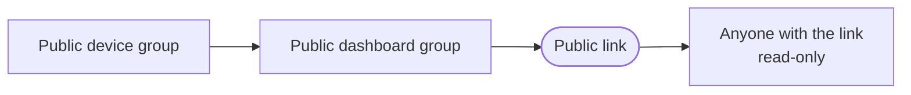
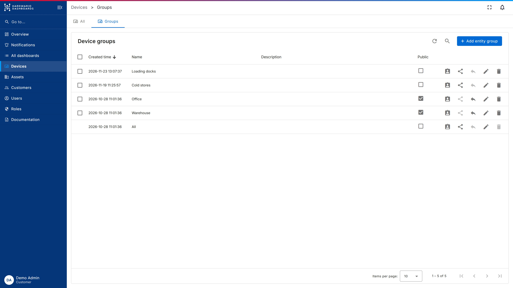
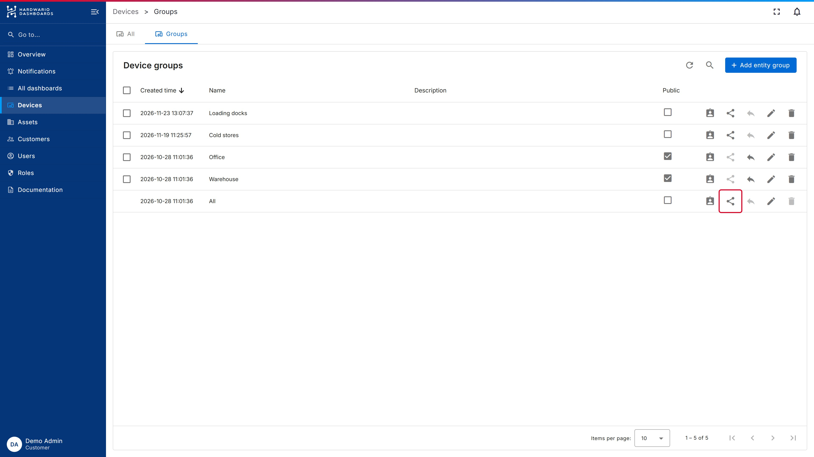
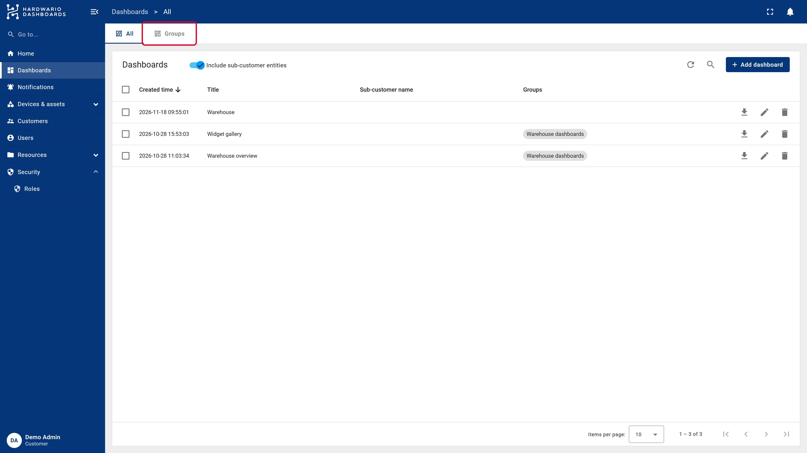
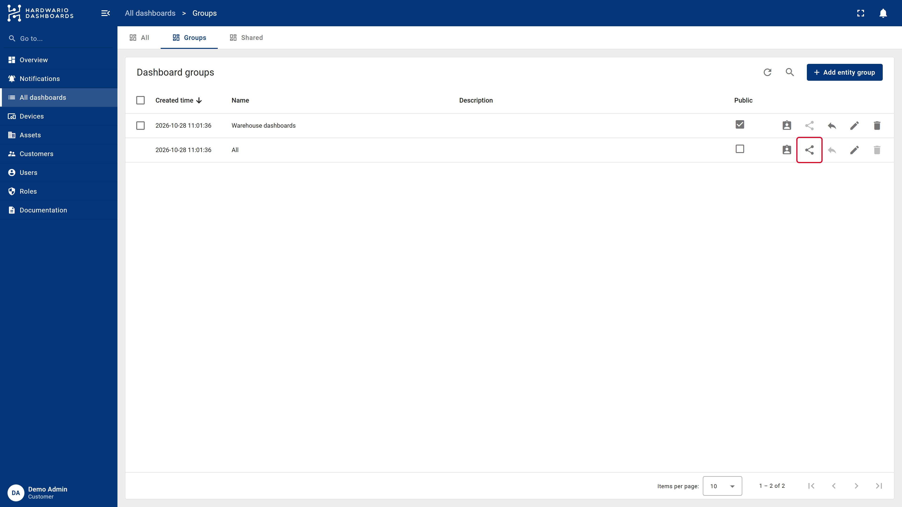
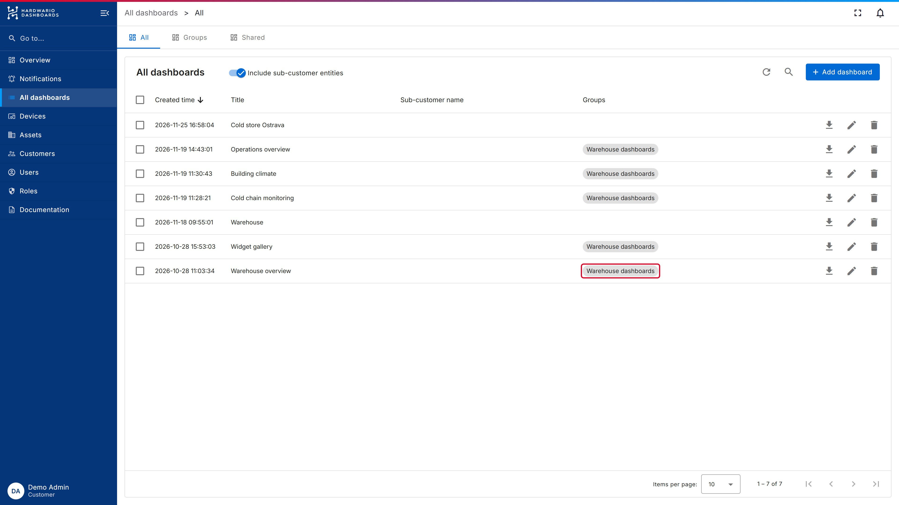

import Image from '@theme/IdealImage';
import Tabs from '@theme/Tabs';
import TabItem from '@theme/TabItem';

# Veřejný odkaz {#public-link}

Veřejný odkaz umožní komukoli otevřít dashboard v prohlížeči **bez účtu**, například vašim zákazníkům, na prezentaci nebo na televizi v kanceláři. Odkaz je **jen pro čtení**: nikdo nic nezmění.

:::info Jedno pravidlo
Aby veřejný dashboard ukazoval data, musí být veřejný **dashboard i zařízení za ním**. Zveřejňuje se vždy celá **skupina**: skupina dashboardů a skupina zařízení.
:::

:::caution
Kdo má odkaz, vidí data. Neposílejte odkaz na dashboard s citlivými daty.
:::

---

:::info
#### ⚠️ Důležitá poznámka: práce s podřízenými zákazníky {#️-important-note-working-with-sub-customers}

Pokud tento veřejný odkaz nastavujete pro konkrétního podřízeného zákazníka, jeho skupiny zařízení ani dashboardů možná neuvidíte, dokud jste přihlášení jako Tenant Administrator. 

V takovém případě se přihlaste jako **Customer Administrator** daného zákazníka:
1. **Přejděte** v levém menu na **Customers**.
2. **Najděte** zákazníka, klikněte na ikonu **Manage customer users** a přihlaste se jako některý z jeho administrátorů. 
3. **Náhradní postup:** Pokud podřízený zákazník ještě žádný účet Customer Administrator nemá, můžete si vytvořit dočasný testovací profil. Nemusíte použít skutečnou e-mailovou adresu (například `test@temp.local`). Vytvořte uživatele, přihlaste se pod jeho účtem, projděte tento návod a dočasný účet pak smažte.

*(Pokud potřebujete jen získat veřejný odkaz a nechcete se přihlašovat za podřízeného zákazníka, použijte [**tip níže**](#-pro-tip-how-to-get-the-link-without-logging-in-as-a-sub-customer).)*
:::
---

## Krok 1: Zveřejněte skupinu zařízení {#step-1-make-the-device-group-public}

Aby dashboard správně zobrazoval data, potřebuje veřejný uživatel přístup pro čtení k zařízením, ze kterých dashboard čerpá data. 

**(Volitelně) Jak vytvořit novou skupinu zařízení:**
Pokud ještě žádnou konkrétní skupinu nemáte, můžete si ji vytvořit:
1. **Přejděte** v levém menu na **Devices -> Groups**.
2. **Klikněte** vpravo nahoře na **Add entity group**.
3. **Zadejte** název nové skupiny a klikněte na **Add**.

**Zveřejnění skupiny zařízení:**
1. **Přejděte** v levém menu na **Devices -> Groups**.

2. **Najděte** skupinu se zařízeními, která chcete na dashboardu zobrazit.
   > **Tip:** Můžete použít vlastní skupinu, nebo výchozí skupinu **„All“**. Když zveřejníte skupinu „All“, budou přes veřejný odkaz automaticky vidět i všechna zařízení, která tomuto zákazníkovi v budoucnu přidáte, bez dalšího nastavování.
3. **Klikněte** na **ikonu sdílení** (ikona se třemi spojenými body) na pravé straně řádku skupiny. **Případně** skupinu otevřete, klikněte na **ikonu tužky** vedle jejího názvu a zvolte **Make entity group public**.
4. **Výsledek:** Skupina je teď veřejná a jen pro čtení. Má zaškrtnuté políčko **Public**.

---

## Krok 2: Zveřejněte skupinu dashboardů {#step-2-make-the-dashboard-group-public}

Dále sdílejte samotný dashboard.

**(Volitelně) Jak vytvořit novou skupinu dashboardů:**
Pokud pro své dashboardy ještě žádnou konkrétní skupinu nemáte:
1. **Přejděte** v levém menu na **Dashboards -> Groups**.
2. **Klikněte** vpravo nahoře na **Add entity group**.
3. **Zadejte** název nové skupiny a klikněte na **Add**.

**Zveřejnění skupiny dashboardů:**
1. **Přejděte** v levém menu na **Dashboards -> Groups**.

2. **Najděte** skupinu dashboardů, která obsahuje dashboard, který chcete sdílet.
3. **Klikněte** na **ikonu sdílení** (ikona se třemi spojenými body) na pravé straně řádku skupiny. **Případně** skupinu otevřete, klikněte na **ikonu tužky** vedle jejího názvu a zvolte **Make entity group public**.

---

## Krok 3: Získejte veřejný odkaz {#step-3-obtain-the-public-link}

Teď, když jsou zařízení i dashboard veřejné, můžete vygenerovat a sdílet funkční URL.

1. **Zůstaňte** v sekci **Dashboards -> Groups**.
2. **Klikněte** přímo na **název** skupiny dashboardů, kterou jste právě zveřejnili. Skupina se otevře a zobrazí seznam všech dashboardů v ní.
3. **Najděte** konkrétní dashboard, který chcete sdílet.
4. **Klikněte** na první ikonu na pravé straně řádku dashboardu, **ikonu řetězu (🔗)** s popiskem „Public dashboard link“.
5. **Výsledek:** URL je teď zkopírovaná ve schránce. 

Tento odkaz můžete poslat zákazníkům nebo uživatelům. Kdokoli s tímto odkazem si může dashboard a jeho data v reálném čase zobrazit přímo v prohlížeči, bez přihlašování.

## Zrušení sdílení {#stop-sharing}

Sdílení zrušíte tak, že skupiny znovu nastavíte jako soukromé: na záložce **Groups** klikněte v řádku skupiny dashboardů na ikonu **Make private** (zahnutá šipka) a totéž udělejte u skupiny zařízení. Veřejný odkaz přestane fungovat.

:::tip
Skupina může obsahovat víc dashboardů nebo zařízení než jen ty, které chcete sdílet. Zveřejněte jen skupinu, ve které není nic, co byste neukázali. Pokud je potřeba, vytvořte si samostatnou skupinu jen pro sdílení, například *Public*.
:::

---

## 💡 Tip: jak získat odkaz bez přihlašování za podřízeného zákazníka {#-pro-tip-how-to-get-the-link-without-logging-in-as-a-sub-customer}

Pokud pracujete na úrovni nadřazeného zákazníka (Tenant Administrator) a chcete veřejný odkaz získat, aniž byste se zdlouhavě přihlašovali za administrátora podřízeného zákazníka, použijte tuto zkratku:

1. **Přejděte** do svého hlavního seznamu **Dashboards** (nebo Devices), kde vidíte všechny dashboardy a zařízení v celém systému, včetně těch, které patří podřízeným zákazníkům.
2. **Najděte** konkrétní dashboard, který chcete sdílet.
3. **Najděte** na řádku tohoto dashboardu sloupec **Groups**.
4. **Klikněte** přímo na název skupiny v tomto sloupci.

5. **Výsledek:** Otevře se přímo stránka s obsahem skupiny. Odtud už snadno kliknete na **ikonu řetězu (🔗)** a veřejný odkaz zkopírujete, přesně jak popisuje [**krok 3**](#step-3-obtain-the-public-link) výše. 

---

## Další kroky {#next-steps}

- [Vložení dashboardu do webu](/apps/thingsboard/embedding-dashboards): dejte veřejný dashboard na svůj web.
- [Časové okno](/apps/thingsboard/time-window#save-the-default-time-window): nastavte, jaké období návštěvníci uvidí jako první.

:::info Dokumentace ThingsBoard
HARDWARIO Dashboards jsou postavené na platformě ThingsBoard. Podrobnosti najdete v oficiální dokumentaci ThingsBoard (anglicky): [Make dashboard public](https://thingsboard.io/docs/pe/user-guide/dashboards/#make-dashboard-public) · [Public entity groups](https://thingsboard.io/docs/pe/user-guide/groups/#make-group-public-or-private).
:::
