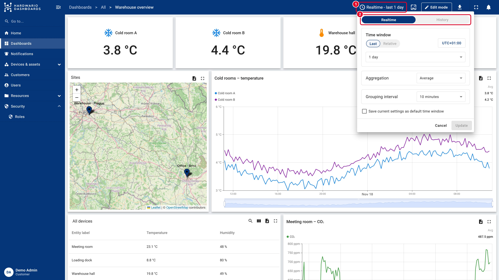
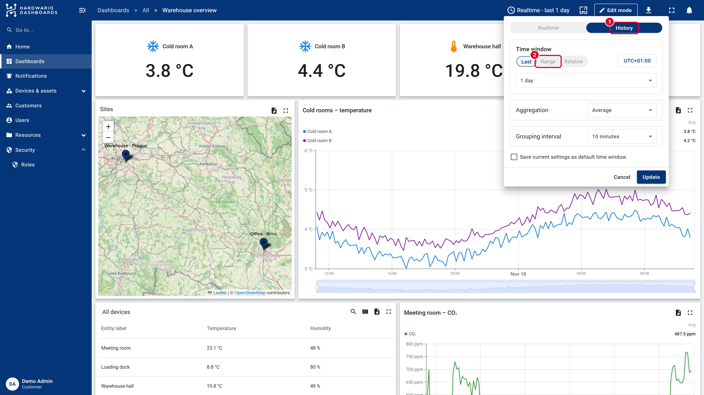
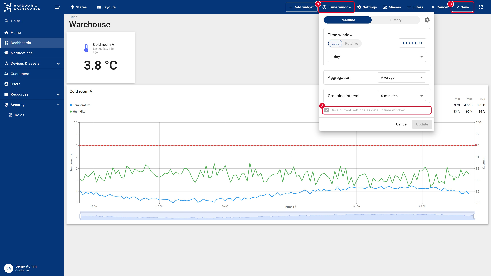
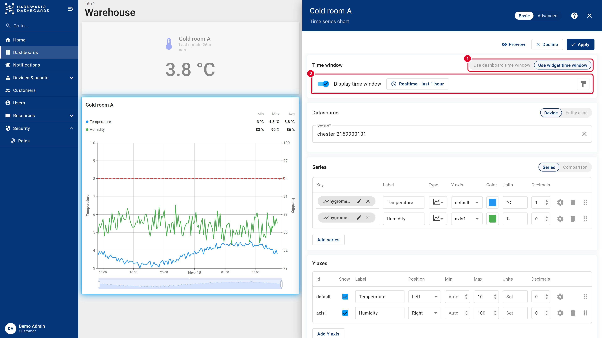

import Image from '@theme/IdealImage';

# Časové okno {#time-window}

**Časové okno** (time window) určuje, jaké období grafy na dashboardu ukazují: poslední hodinu, posledních 24 hodin, minulý týden... Najdete ho vpravo nahoře na každém dashboardu.

:::tip „Nevidím žádná data“
To je nejčastější důvod. Nový dashboard ukazuje jen **poslední hodinu**. Pokud zařízení posílá data každých 15 minut, má graf jen pár bodů; pokud posílá jednou denně, může být graf prázdný. Nastavte delší časové okno.
:::

---

## Realtime, nebo historie {#realtime-or-history}

V horní liště klikněte na časové okno (například **Realtime - last 1 day**). Otevře se panel se dvěma záložkami:

| Záložka | Co ukazuje | Příklad |
|---|---|---|
| **Realtime** | Období, které končí **teď** a posouvá se s novými daty. | posledních 24 hodin, posledních 7 dní |
| **History** | **Pevné období** v minulosti. Volbou **Range** nastavíte začátek a konec. | minulý týden, 1.–31. října |

Zvolte období a klikněte na **Update**. Všechny grafy na dashboardu se překreslí.

---

## Agregace {#aggregation}

U dlouhých období je graf se všemi hodnotami nepřehledný a pomalu se načítá. **Agregace** (Aggregation) spojí hodnoty do intervalů:

| Agregace | Každý interval ukazuje |
|---|---|
| **Average** | průměrnou hodnotu (nejčastější volba) |
| **Min**, **Max** | nejnižší nebo nejvyšší hodnotu, například teplotní špičku |
| **Sum**, **Count** | součet nebo počet hodnot, například u čítačů |
| **None** | každou hodnotu tak, jak byla naměřena |

**Grouping interval** nastaví délku jednoho intervalu, například 1 hodinu pro týden, 1 den pro rok.

---

## Uložte výchozí časové okno {#save-the-default-time-window}

Co nastavíte v časovém okně při prohlížení dashboardu, je **jen dočasné**: při příštím otevření dashboardu je zase výchozí. Pokud chcete změnit výchozí okno pro všechny, kdo dashboard otevřou, včetně lidí s [veřejným odkazem](/apps/thingsboard/public-link):

1. V horní liště klikněte na **Edit mode**.
2. V liště úprav klikněte na **Time window** a nastavte období a agregaci. Volba **Save current settings as default time window** je zapnutá.
3. Klikněte na **Update** a potom dashboard uložte (**Save**).

---

## Jiné časové okno pro jeden widget {#a-different-time-window-for-one-widget}

Někdy má jeden graf ukazovat jiné období, například týdenní přehled vedle detailu za dnešek.

1. V **Edit mode** najeďte na widget a klikněte na jeho **ikonu tužky**.
2. V sekci **Time window** přepněte z **Use dashboard time window** na **Use widget time window**.
3. Nastavte widgetu vlastní období. Se zapnutou volbou **Display time window** ho můžou diváci měnit přímo ve widgetu.
4. Klikněte na **Apply** a dashboard uložte (**Save**).

Tento widget si pak své období ponechá, i když změníte časové okno dashboardu.

---

## Další kroky {#next-steps}

- [Veřejný odkaz](/apps/thingsboard/public-link): nasdílejte dashboard s výchozím časovým oknem, které jste uložili.
- [Grafy a jejich vzhled](/apps/thingsboard/charts): dolaďte své grafy.

:::info Dokumentace ThingsBoard
HARDWARIO Dashboards jsou postavené na platformě ThingsBoard. Podrobnosti najdete v oficiální dokumentaci ThingsBoard (anglicky): [Dashboard time window](https://thingsboard.io/docs/pe/user-guide/dashboards/#dashboard-time-window).
:::
