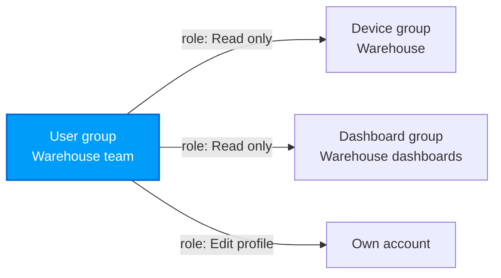
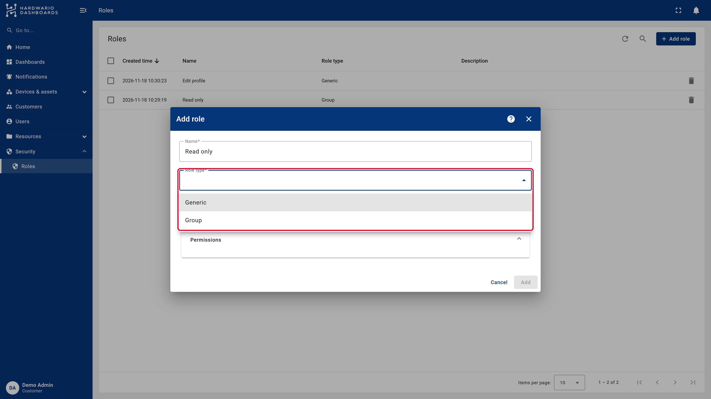
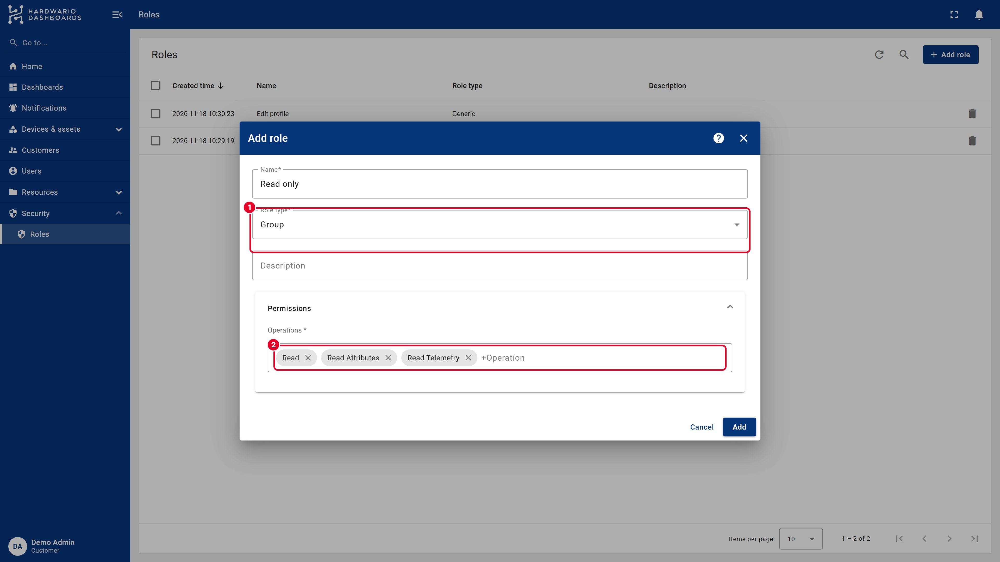
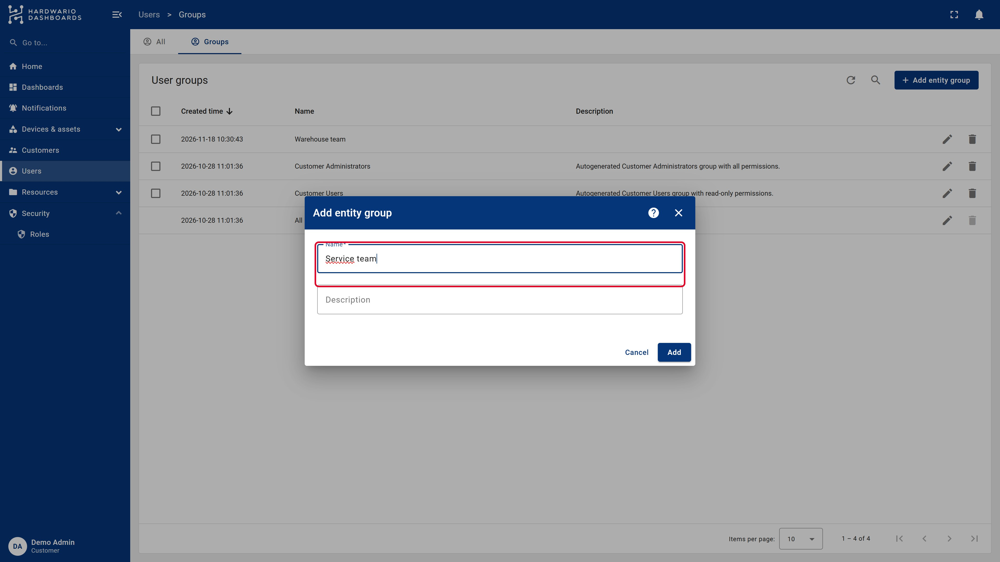
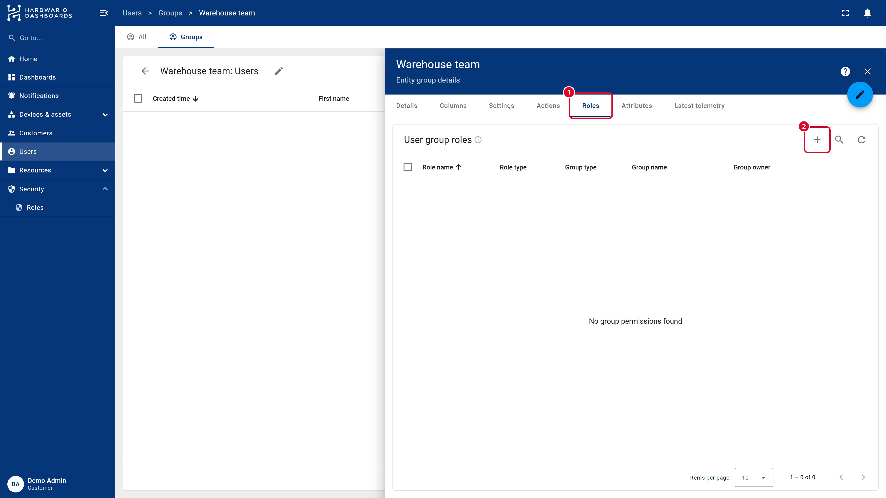
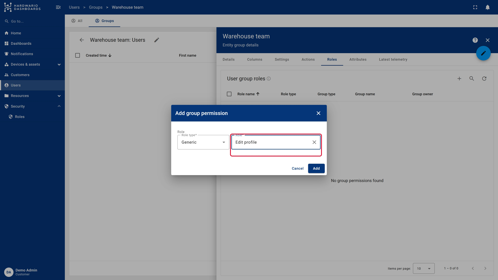
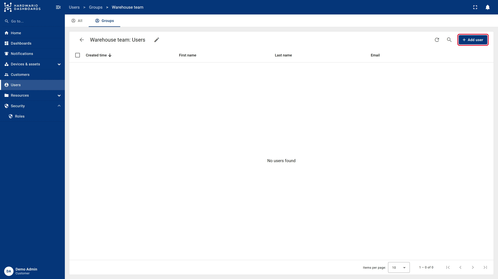
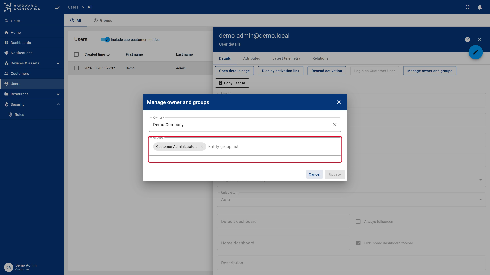

import Image from '@theme/IdealImage';
import Tabs from '@theme/Tabs';
import TabItem from '@theme/TabItem';

# Skupiny, role a oprávnění {#groups-roles--permissions}

V HARDWARIO Dashboards přesně určíte, **co každý uživatel vidí a co smí dělat**. Zákazník vidí jen svá zařízení a dashboardy, váš servisní tým vidí a upravuje víc.

## Jak to funguje {#how-it-works}

Všechno stojí na **skupinách**:

- **Uživatelé** jsou roztříděni do **uživatelských skupin**.
- **Zařízení** a **dashboardy** jsou roztříděny do **skupin zařízení** a **skupin dashboardů**.
- **Role** je sada oprávnění, například *jen pro čtení*.

Propojíte je jedním pravidlem: **tato skupina uživatelů** má **tuto roli** na **tuto skupinu zařízení** a **tuto skupinu dashboardů**.

Kroky níže to nastaví: nejdřív role, potom skupinu uživatelů a nakonec oprávnění. Zařízení a dashboardy byste už měli mít ve skupinách, viz [Roztřiďte zařízení do skupin](/apps/thingsboard/devices#device-groups).

---

## Krok 1: Vytvoření uživatelských rolí {#step-1-creating-user-roles}

Nejdřív vytvořte role, které fungují jako sady oprávnění.

1.  V levém menu přejděte do sekce **Security** (poslední položka).
2.  Rozbalte ji a zvolte **Roles**.
3.  Novou roli vytvoříte kliknutím na **Add role** vpravo nahoře.
4.  Zadejte **Role Name**, **Description** a zvolte **Role Type**.

### Rozdíl mezi typy rolí: {#difference-between-role-types}
* **Group:** U tohoto typu určujete jen operace (například čtení, zápis), které uživatel může provádět. Tato role se ke konkrétní entitě (zařízení, dashboardu a podobně) váže až později, při nastavování uživatelských skupin.

  Pro roli jen pro čtení povolte **Read**, **Read Attributes** a **Read Telemetry**. Bez posledních dvou uživatelé zařízení uvidí, ale jejich data ne.
* **Generic:** Tady přesně určíte, co uživatel smí a nesmí globálně dělat. Pozor: Pokud tu povolíte přístup k „Devices“, uvidí uživatel **všechna zařízení** daného zákazníka, ne jen konkrétní skupinu.

<Tabs>
  <TabItem value="lte" label="Group">

  </TabItem>
  <TabItem value="lora" label="Generic">

  </TabItem>
</Tabs>

**Důležité (správa vlastního profilu):**
U uživatelů s omezeným přístupem doporučujeme vytvořit roli typu **Generic**, kde pro zdroj **Profile** povolíte operaci **All**. Když tuto roli přidáte do uživatelské skupiny, uživatelé si budou moci sami změnit heslo a údaje účtu.

---

## Krok 2: Vytvoření uživatelských skupin {#step-2-creating-user-groups}

Dále vytvořte skupiny, kterým přiřadíte výše vytvořené role.

1.  Přejděte do sekce **Users** a zvolte záložku **Groups**.
2.  Uvidíte výchozí skupiny: *Customer Administrators* (plný přístup) a *Customer Users* (přístup ke všemu jen pro čtení).
3.  Klikněte vpravo nahoře na **Add entity group** a zadejte název a popis.

4.  Kliknutím novou skupinu otevřete a potom klikněte na **ikonu tužky** vedle jejího názvu, otevře se detail skupiny.
5.  Přejděte na záložku **Roles** (1).

### Přidání oprávnění do skupiny: {#adding-permissions-to-the-group}
1.  Klikněte na **ikonu plus (+)** (2) nad tabulkou.
2.  Zvolte **Role Type** a konkrétní roli.
3.  Pokud jste zvolili typ role **Group**, musíte také určit:
    * **Group Owner:** Obvykle vy sami nebo konkrétní zákazník.
    * **Type:** Určete, na co pravidla platí (například *Device* nebo *Dashboard*).
    * **Entity Group:** Konkrétní skupina entit, ke které má uživatel mít přístup.

:::info
**Skupiny entit** musíte mít připravené předem, zařízení nebo dashboardy tedy už musí být uspořádané do skupin. V tomto kroku tyto skupiny spárujete s uživatelskou skupinou. Vytváření skupin zařízení a dashboardů je podobné jako vytváření uživatelských skupin.
:::

Pokud přidáváte roli typu **Generic** (třeba roli pro úpravu profilu), stačí zvolit samotnou roli a ta pak platí globálně pro oprávnění účtu uživatele.

---

## Krok 3: Přidání uživatelů do skupiny {#step-3-adding-users-to-the-group}

Uživatele do nově nastavené skupiny můžete přidat dvěma způsoby:

1.  **Noví uživatelé:** Otevřete skupinu a vpravo nahoře klikněte na **Add user**.

2.  **Existující uživatelé:** * Přejděte do hlavní sekce **Users** -> **Users**.
    * Klikněte na konkrétního uživatele.
    * Na záložce **Details** klikněte na tlačítko **Manage owner and groups**.
    * Zvolte požadovanou uživatelskou skupinu a klikněte na **Update**.

---

## Krok 4: Vytváření a sdílení skupin zařízení {#step-4-creating-and-sharing-device-groups}

Jak už zaznělo v předchozích krocích, chcete-li uživatelům zpřístupnit jen konkrétní zařízení, a ne všechno, použijte **skupiny zařízení**. Struktura v HARDWARIO Dashboards je pružná: jednu skupinu zařízení můžete sdílet s více uživatelskými skupinami (například aby stejná zařízení viděl koncový zákazník i váš interní servisní tým).

### Vytvoření skupiny zařízení {#creating-a-device-group}
1. V levém menu přejděte do **Devices & assets → Devices** (správci tenantu **Entities → Devices**).
2. Přepněte na záložku **Groups**.
3. Kliknutím na **Add entity group** vpravo nahoře vytvořte novou skupinu.
4. Zadejte **Name** a **Description** skupiny a uložte ji.

### Přidání zařízení do skupiny {#adding-devices-to-the-group}
1. Nově vytvořenou skupinu zařízení otevřete kliknutím.
2. Uvnitř skupiny přejděte na záložku **Entities**.
3. Zařízení přidáte akcí **Add to group**, viz [Přidejte zařízení do skupiny](/apps/thingsboard/devices#add-devices-to-a-group). *(Poznámka: Jedno zařízení může patřit do několika skupin současně.)*

### Sdílení skupiny zařízení s uživateli {#sharing-the-device-group-with-users}
Jakmile skupina obsahuje zařízení, zpřístupněte ji uživatelům: propojte ji s uživatelskými skupinami z kroku 2.

1. Vraťte se na **Users** -> **Groups** a otevřete příslušnou uživatelskou skupinu.
2. Přejděte na záložku **Roles** a klikněte na **ikonu plus (+)**.
3. Zvolte typ role **Group** (například roli, která dává přístup jen pro čtení, nebo pro čtení i zápis).
4. Nastavte **Type** na *Device* a zvolte nově vytvořenou **skupinu entit** (skupinu zařízení).
5. Klikněte na **Add**.

:::tip
Sdílení můžete zopakovat pro libovolný počet uživatelských skupin. Tutéž skupinu zařízení můžete současně sdílet se zákazníkem A (s právy jen pro čtení) i se svým servisním týmem (s plnými právy).
:::

---

## Další kroky {#next-steps}

- [Přidání uživatelů](/apps/thingsboard/users): založte uživatele ve skupině, kterou jste právě nastavili, a pozvěte ho.

:::info Dokumentace ThingsBoard
HARDWARIO Dashboards jsou postavené na platformě ThingsBoard. Podrobnosti najdete v oficiální dokumentaci ThingsBoard (anglicky): [Roles](https://thingsboard.io/docs/pe/user-guide/roles/) · [Entity groups](https://thingsboard.io/docs/pe/user-guide/groups/).
:::
