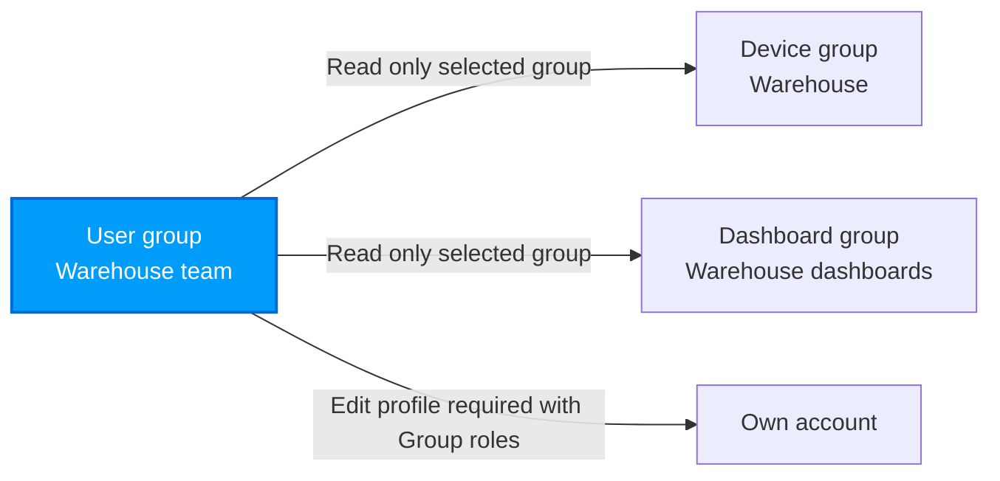
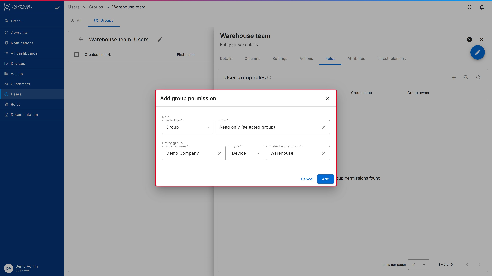
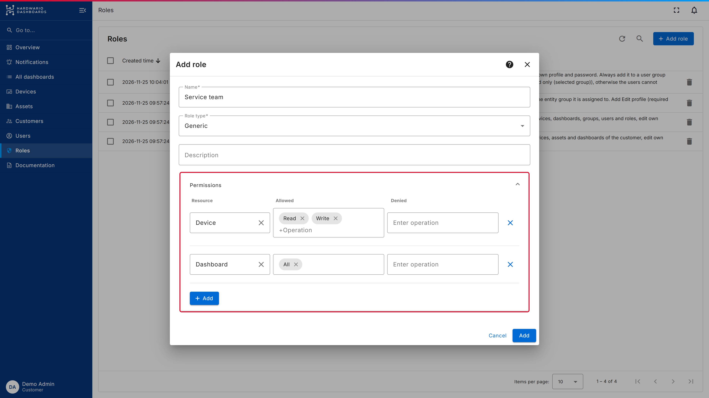

import Image from '@theme/IdealImage';
import Tabs from '@theme/Tabs';
import TabItem from '@theme/TabItem';

# Skupiny, role a oprávnění {#groups-roles--permissions}

V HARDWARIO Dashboards přesně určíte, **co každý uživatel vidí a co smí dělat**. Někteří kolegové vidí všechna vaše zařízení, jiní jen jednu pobočku a administrátor může spravovat všechno.

## Jak to funguje {#how-it-works}

Všechno stojí na **skupinách**:

- **Uživatelé** jsou roztříděni do **uživatelských skupin**.
- **Zařízení** a **dashboardy** jsou roztříděny do **skupin zařízení** a **skupin dashboardů**.
- **Role** je sada oprávnění, například *jen pro čtení*.

Propojíte je jedním pravidlem: **tato skupina uživatelů** má **tuto roli**, případně jen na **tuto skupinu zařízení** a **tuto skupinu dashboardů**.

---

## Připravené role {#roles-ready-for-you}

Ve vašem účtu jsou připravené čtyři role, žádnou nemusíte vytvářet. Najdete je v **Security → Roles**.

| Role | Typ | Co umožňuje |
|---|---|---|
| **Read only (all devices)** | Generic | Vidí všechna vaše zařízení, assety a dashboardy, mění si vlastní profil a heslo. |
| **Admin** | Generic | Spravuje zařízení, dashboardy, skupiny, uživatele a role, mění si vlastní profil a heslo. |
| **Read only (selected group)** | Group | Vidí jen tu skupinu zařízení nebo dashboardů, ke které roli přiřadíte. |
| **Edit profile (required with Group roles)** | Generic | Základní role: změna vlastního profilu a hesla. Potřebují ji uživatelé, kteří mají jen role typu Group, jinak si nezmění heslo. |

- Role typu **Generic** platí pro všechno ve vašem účtu. Použijte ji, když má uživatel vidět všechna zařízení.
- Role typu **Group** platí jen pro skupinu, kterou zvolíte při přidání role do uživatelské skupiny. Použijte ji, když má uživatel vidět jen některá zařízení.

:::tip
Nové účty HARDWARIO Dashboards dostanou tyto čtyři role automaticky.
:::

---

## Které role použít {#which-roles-to-use}

| Uživatel má… | Přidejte do uživatelské skupiny role |
|---|---|
| vidět všechna zařízení a dashboardy | **Read only (all devices)** |
| vidět jen některá zařízení | **Read only (selected group)** na skupinu zařízení, **Read only (selected group)** na skupinu dashboardů a **Edit profile (required with Group roles)** |
| spravovat zařízení, dashboardy a uživatele | **Admin** |

Váš účet má také dvě výchozí uživatelské skupiny: *Customer Administrators* (plný přístup) a *Customer Users*. Pro uživatele, kteří mají vidět jen některá zařízení, vytvořte vlastní uživatelskou skupinu podle kroků níže.

---

## Krok 1: Připravte skupiny zařízení a dashboardů {#step-1-prepare-device-and-dashboard-groups}

Chcete-li uživateli ukázat jen některá zařízení, musí být zařízení a jejich dashboardy ve skupinách. Pokud má uživatel vidět všechno, tento krok přeskočte.

### Vytvoření skupiny zařízení {#creating-a-device-group}
1. V levém menu přejděte do **Devices & assets → Devices** (správci tenantu **Entities → Devices**).
2. Přepněte na záložku **Groups**.
3. Klikněte vpravo nahoře na **Add entity group**.
4. Zadejte **Name** a **Description** skupiny a uložte ji.

### Přidání zařízení do skupiny {#adding-devices-to-the-group}
1. Otevřete novou skupinu zařízení.
2. Zařízení přidáte akcí **Add to group**, viz [Přidejte zařízení do skupiny](/apps/thingsboard/devices#add-devices-to-a-group). Jedno zařízení může být v několika skupinách současně.

Stejně vytvořte **skupinu dashboardů** v **Dashboards → Groups** a vložte do ní dashboardy pro tyto uživatele.

---

## Krok 2: Vytvořte uživatelskou skupinu {#step-2-create-a-user-group}

1.  Přejděte do sekce **Users** a zvolte záložku **Groups**.
2.  Klikněte vpravo nahoře na **Add entity group** a zadejte název a popis.

3.  Kliknutím novou skupinu otevřete a potom klikněte na **ikonu tužky** vedle jejího názvu, otevře se detail skupiny.
4.  Přejděte na záložku **Roles** (1).

---

## Krok 3: Přidejte role do uživatelské skupiny {#step-3-add-roles-to-the-user-group}

Přidejte role podle tabulky [Které role použít](#which-roles-to-use). Pro každou klikněte na **ikonu plus (+)** (2) nad tabulkou.

### Role typu Group (jen některá zařízení) {#a-group-role-only-some-devices}
1.  **Role Type** nastavte na *Group* a zvolte **Read only (selected group)**.
2.  **Group Owner:** vaše firma.
3.  **Type:** *Device*.
4.  **Entity Group:** skupina zařízení z kroku 1.
5.  Klikněte na **Add**.
6.  Zopakujte s **Type** *Dashboard* a vaší skupinou dashboardů, aby uživatelé viděli i dashboardy.

### Role typu Generic {#a-generic-role}
**Role Type** nastavte na *Generic*, zvolte roli (například **Edit profile (required with Group roles)** nebo **Read only (all devices)**) a klikněte na **Add**. Nic dalšího není potřeba, role typu Generic platí pro celý účet.

:::tip
Jednu skupinu zařízení můžete sdílet s více uživatelskými skupinami. Stejná zařízení tak může vidět tým pobočky (jen pro čtení) i váš servisní tým (Admin).
:::

---

## Krok 4: Přidejte uživatele do skupiny {#step-4-add-users-to-the-group}

1.  **Noví uživatelé:** Otevřete skupinu a vpravo nahoře klikněte na **Add user**. Více v [Přidání uživatelů](/apps/thingsboard/users).

2.  **Existující uživatelé:**
    * Přejděte do hlavní sekce **Users** -> **Users**.
    * Klikněte na konkrétního uživatele.
    * Na záložce **Details** klikněte na tlačítko **Manage owner and groups**.
    * Zvolte požadovanou uživatelskou skupinu a klikněte na **Update**.

Uživatel získá oprávnění skupiny hned. U samotného uživatele se nic nastavovat nemusí.

---

## Volitelně: Vytvořte vlastní roli {#optional-create-your-own-role}

Pokud žádná ze čtyř rolí nesedí, **Admin** může vytvořit novou, třeba roli, která smí měnit i nastavení zařízení.

1.  Přejděte do **Security → Roles**.
2.  Klikněte vpravo nahoře na **Add role**.
3.  Zadejte **Role Name**, **Description** a zvolte **Role Type**.

* **Group:** Určujete jen operace (například čtení, zápis). Ke skupině zařízení nebo dashboardů se role váže až při přidání do uživatelské skupiny.

  Pro roli jen pro čtení povolte **Read**, **Read Attributes** a **Read Telemetry**. Bez posledních dvou uživatelé zařízení uvidí, ale jejich data ne.
* **Generic:** Oprávnění určujete po zdrojích (Device, Dashboard, Profile…). Pokud tu povolíte *Device*, uvidí uživatel **všechna zařízení** ve vašem účtu, ne jen jednu skupinu.

<Tabs>
  <TabItem value="group" label="Group">

  </TabItem>
  <TabItem value="generic" label="Generic">

  </TabItem>
</Tabs>

:::warning
Uživatelé, kteří mají jen roli typu Group, si nemohou změnit heslo. Do jejich uživatelské skupiny vždy přidejte i **Edit profile (required with Group roles)** (nebo vlastní roli typu Generic s **Profile → All**).
:::

---

## Další kroky {#next-steps}

- [Přidání uživatelů](/apps/thingsboard/users): založte uživatele ve skupině, kterou jste právě nastavili, a pozvěte ho.

:::info Dokumentace ThingsBoard
HARDWARIO Dashboards jsou postavené na platformě ThingsBoard. Podrobnosti najdete v oficiální dokumentaci ThingsBoard (anglicky): [Roles](https://thingsboard.io/docs/pe/user-guide/roles/) · [Entity groups](https://thingsboard.io/docs/pe/user-guide/groups/).
:::
