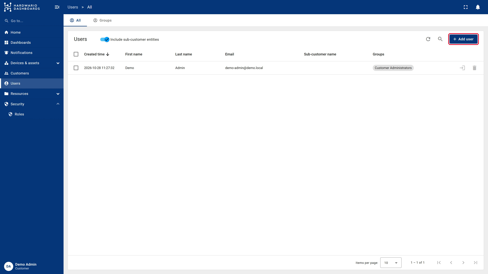
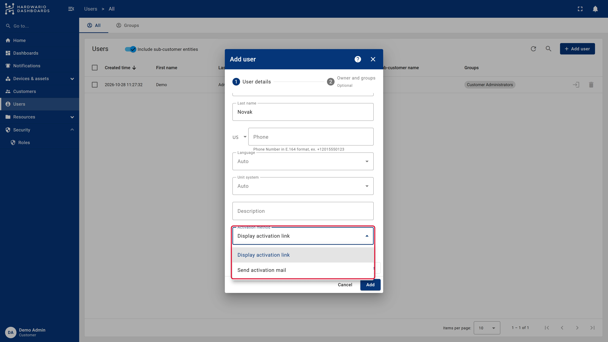
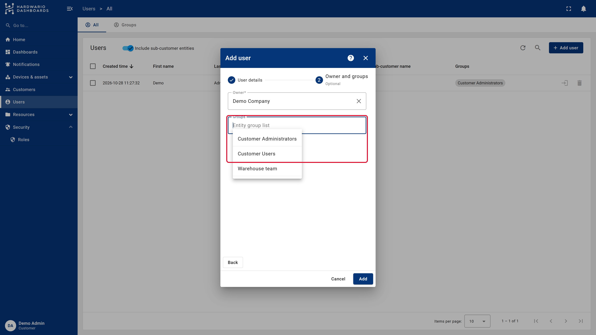
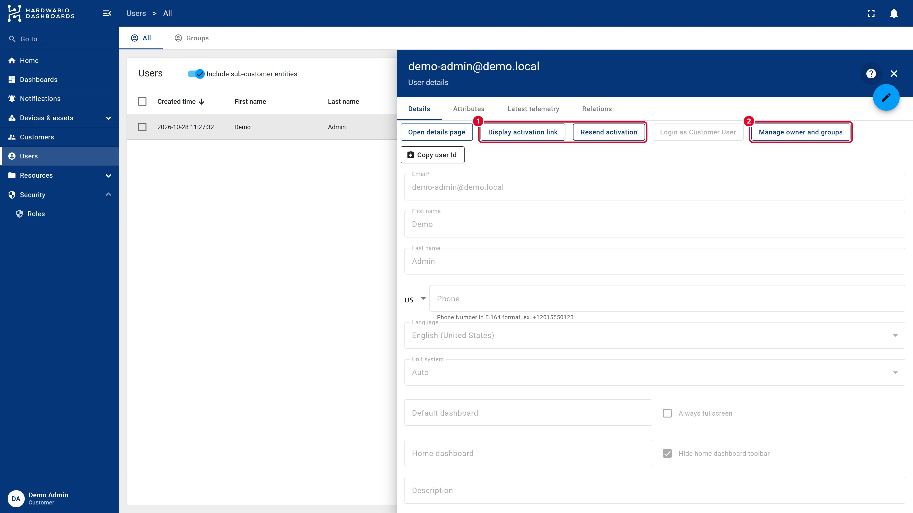
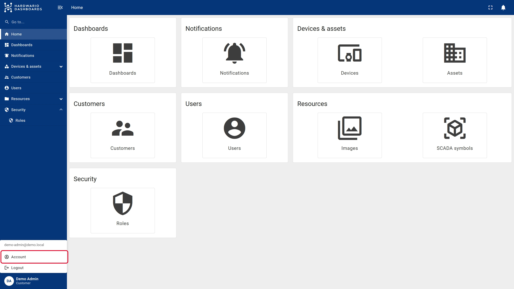
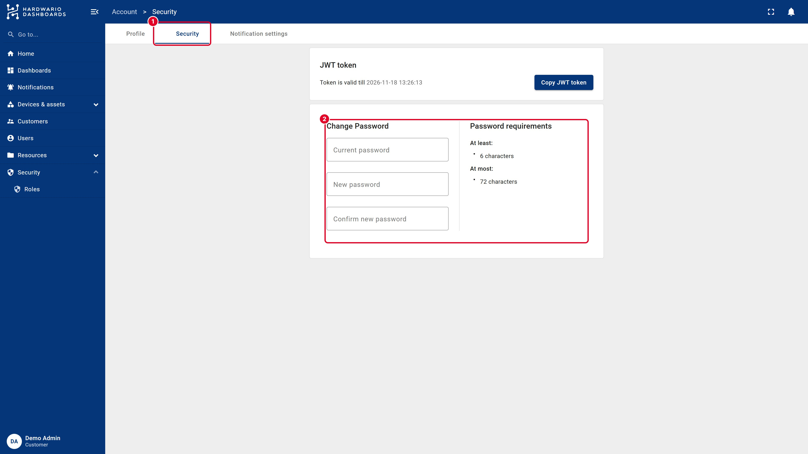

import Image from '@theme/IdealImage';

# Přidávání uživatelů {#adding-users}

V tomto návodu se naučíte, jak v HARDWARIO Dashboards vytvářet nové uživatelské účty, posílat aktivační odkazy a spravovat přihlašovací údaje.

:::tip Nejdřív skupiny
Co uživatel uvidí, určuje jeho uživatelská skupina. Skupinu a její oprávnění proto nastavte jako první, viz [Skupiny, role a oprávnění](/apps/thingsboard/users-managing). Jinak nový uživatel uvidí buď všechno, nebo nic.
:::

---

## Krok 1: Vytvořte nového uživatele {#step-1-create-a-new-user}

1. V levém navigačním menu zvolte **Users**.
2. Vpravo nahoře klikněte na **Add user**.

3. Zadejte potřebné údaje o uživateli.
4. Dole najdete sekci **Activation method**. Uživatele můžete pozvat dvěma způsoby (i později):
   - **Display activation link:** Vygeneruje odkaz, který můžete ručně zkopírovat a uživateli sami poslat.
   - **Send activation mail:** uživateli se automaticky pošle e-mail s aktivačním odkazem.

5. Klikněte na **Next: Owner and groups**.
6. Zvolte **Customer** a **User Group**, do které bude uživatel patřit.
   > **Připomínka:** Přiřazená skupina určuje, které dashboardy a zařízení uživatel uvidí, a také jeho konkrétní oprávnění.

7. Nakonec klikněte na **Add**.

Tím je nový uživatel vytvořený.

:::info
**Potřebujete spravovat přístupy uživatelů?** Na stránce [**Skupiny, role a oprávnění**](/apps/thingsboard/users-managing) se dozvíte, jak vytvářet skupiny, přiřazovat role a řídit přístup ke konkrétním zařízením nebo dashboardům.
:::

---

## Krok 2: Pozvěte nebo aktivujte uživatele {#step-2-invite-or-activate-a-user}

Pokud jste aktivaci při vytváření přeskočili nebo potřebujete pozvánku poslat znovu, aby se uživatel mohl přihlásit a vytvořit si heslo, postupujte takto:

1. Klikněte v seznamu Users na konkrétního uživatele.
2. Na záložce **Details** zvolte jednu z těchto akcí:
   - **Resend activation:** Automaticky pošle uživateli e-mail s aktivačním odkazem.
   - **Display activation link:** Zobrazí URL, kterou můžete ručně zkopírovat a uživateli poslat. Po kliknutí na odkaz si uživatel vytvoří nové heslo.

---

## Jak si změnit heslo {#how-to-change-your-password}

1. Klikněte na své jméno vlevo dole.
2. V rozbalovací nabídce zvolte **Account**.

3. Otevře se záložka **Profile**, kde můžete upravit i obecné údaje o svém účtu.
4. Chcete-li **změnit heslo**, přepněte na záložku **Security**.
5. Zadejte současné heslo a pak nové heslo.

:::info
Pokud jste dostali **dočasné heslo e-mailem**, zadejte ho do pole pro současné heslo.
:::

:::info Dokumentace ThingsBoard
HARDWARIO Dashboards jsou postavené na platformě ThingsBoard. Podrobnosti najdete v oficiální dokumentaci ThingsBoard (anglicky): [Users](https://thingsboard.io/docs/pe/user-guide/users/).
:::
