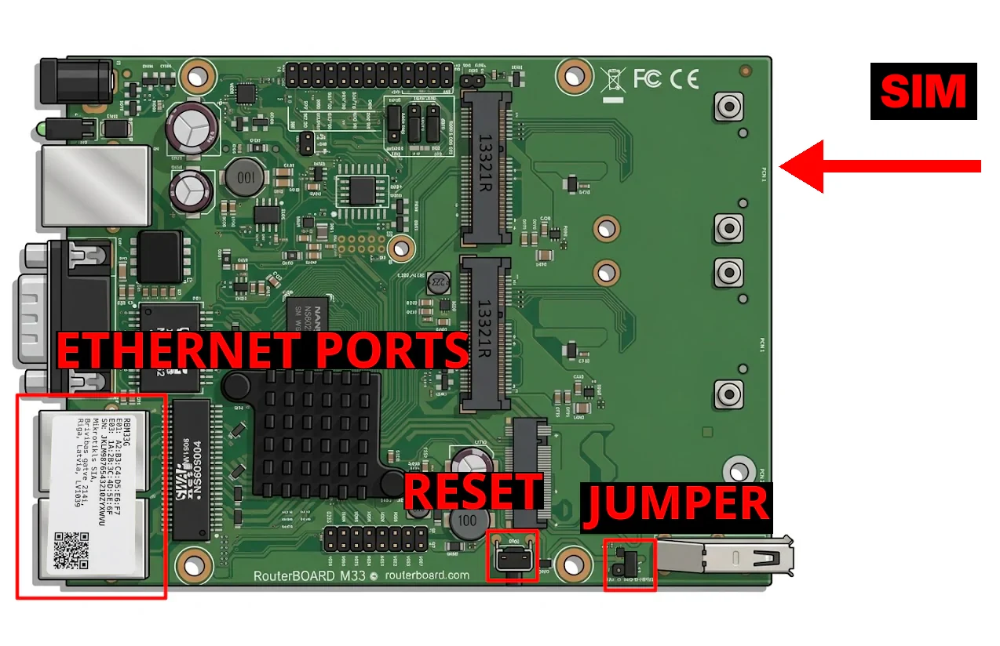
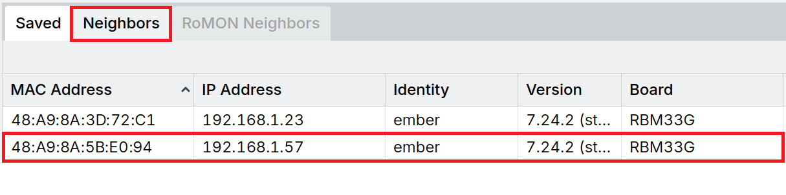
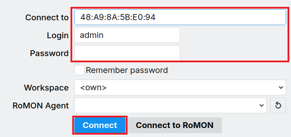

# První kroky se zařízením EMBER {#ember-first-steps}

Tato stránka je pro zařízení EMBER, které jste dostali od HARDWARIO. Dodává se **už nastavené**: RouterOS, balíček iot
i základní konfigurace na něm už jsou a heslo uživatele admin najdete v protokolu nastavení, který k němu dostanete.

Nastavujete EMBER, které ještě nastavené není, například po resetu? Viz [Automatické nastavení](automated-setup.md) nebo
[Ruční nastavení](manual-setup.md).

---

## Krok 1: Antény, SIM a napájení {#step-1-antennas-sim-and-power}

- **Antény:** antény LoRaWAN a LTE jsou namontované uvnitř krabičky a připojené z výroby, takže nic připojovat ani
  kontrolovat nemusíte. Jen pokud chcete použít externí anténu, viz
  [Přechod na externí anténu](hardware-description.md#switching-to-an-external-antenna).
- **SIM karta** (jen EMBER s modemem LTE): pokud uvnitř není SIM karta, vložte svou ještě před zapnutím: otevřete
  krabičku a zasuňte SIM kartu (velikost mini-SIM) do slotu pro SIM pod kartou LTE, kam ukazuje šipka. Žádné
  šrouby povolovat nemusíte. Krabičku pečlivě zavřete, závisí na tom její krytí **IP67**. Kromě montáže externí antény je
  SIM karta jediný důvod krabičku otevírat.

  

- **Napájení:** adaptér 24 V DC, napájecí zdroj 24 V DC, nebo pasivní PoE 24 V DC přes port **WAN**. Více informací:
  [Možnosti napájení](hardware-description.md#power-supply-options).
- **Internet:** připojte port **WAN** (ether1) do sítě s DHCP a přístupem k internetu, nebo použijte LTE, viz
  [Konfigurace hotspotu → LTE](hotspot-configuration/interface-configuration.md#lte).

:::danger

Při venkovní instalaci musí být **EMBER Hotspot** namontovaný konektory dolů.

:::

---

## Krok 2: Přihlášení {#step-2-log-in}

1. Pokud ještě nemáte Winbox 4, nainstalujte ho, viz [Instalace Winbox 4](mikrotik/winbox-setup.md).
2. Otevřete Winbox na počítači ve stejné místní síti jako EMBER (kabelem nebo přes Wi-Fi). Pokud se EMBER
   v seznamu neobjeví, připojte počítač kabelem k jeho portu **LAN**.
3. Na kartě **Neighbors** vyberte své zařízení EMBER. Pokud je v seznamu více zařízení, najděte to své podle
   MAC adresy z protokolu nastavení.

   

4. Přihlaste se jako **admin** heslem z protokolu nastavení a klikněte na **Connect**.

   

---

## Krok 3: Připojení zařízení EMBER {#step-3-connect-ember}

### Síťový server LoRaWAN {#lorawan-network-server}

Připojte EMBER ke svému síťovému serveru LoRaWAN:

- [Spravovaný síťový server HARDWARIO](cloud-service.md)
- [ChirpStack v4: Semtech UDP](lorawan-network-server/lorawan-chirpstack.md)
- [ChirpStack v4: Basics Station a mTLS](lorawan-network-server/lorawan-chirpstack-basics-station.md)
- [The Things Stack](lorawan-network-server/lorawan-tts.md)

Pokud jste namontovali externí anténu, nastavte `antenna-gain` na její zisk, viz
[Zisk antény a výstupní výkon](mikrotik/antenna-gain.md).

### Vzdálený přístup {#remote-access}

VPN tunely ke spravované službě HARDWARIO:

- [OpenVPN](hotspot-configuration/interface-configuration.md#openvpn): provoz LoRaWAN
- [WireGuard](hotspot-configuration/interface-configuration.md#wireguard): vzdálená správa

---

## Krok 4: Aktualizace {#step-4-keep-it-up-to-date}

RouterOS a firmware RouterBOARD čas od času aktualizujte, viz [Aktualizace brány](mikrotik/gateway-update.md).
