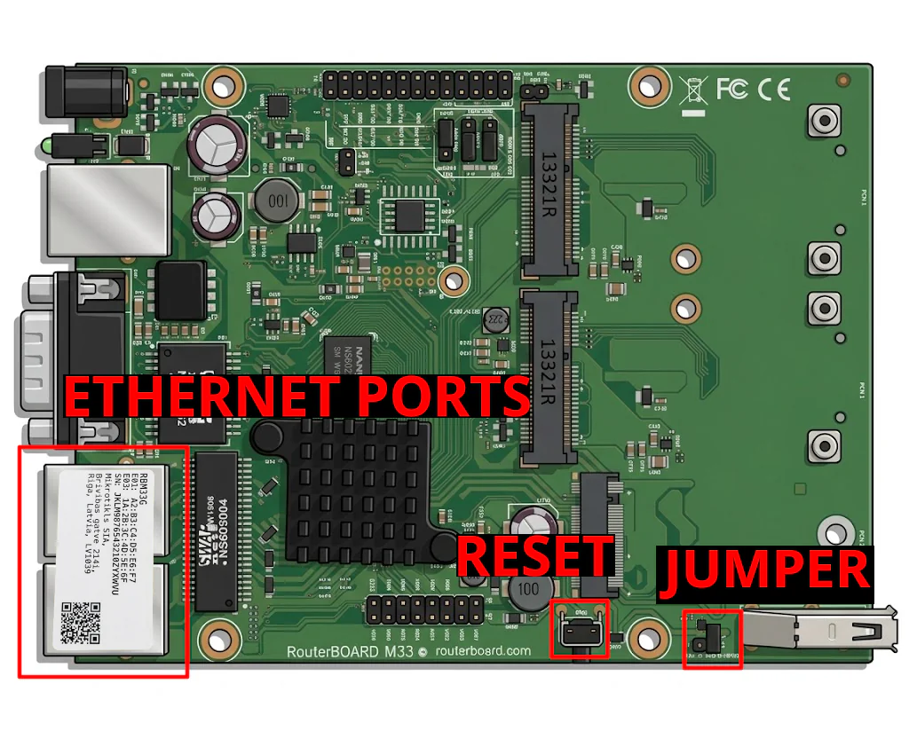

import Image from '@theme/IdealImage';

# Nastavení hardwaru zařízení EMBER {#ember-hardware-setup}

:::warning Pro které zařízení je tento postup?

**Zařízení EMBER, které jste dostali od HARDWARIO, je už nastavené: začněte raději stránkou [První kroky](getting-started.md).**
Tato stránka je pro zařízení EMBER, které ještě nastavené není: po resetu, nebo když nepřišlo nastavené od HARDWARIO.

:::

Tato stránka vám pomůže zařízení HARDWARIO **EMBER** **zapnout**, připojit se k němu a vybrat
[ruční nastavení](manual-setup.md), nebo [automatické nastavení](automated-setup.md).

---

## Než začnete {#before-you-start}

#### Co je EMBER {#what-ember-is}
EMBER je průmyslová **brána LoRaWAN (IoT Hotspot)** postavená na platformě **MikroTik RBM33G** a určená pro venkovní nasazení (krabička IP67).  
Popis hardwaru: https://docs.hardwario.com/ember/hardware-description/

#### Budete potřebovat {#you-will-need}
- Bránu EMBER (Hotspot): její **antény LoRaWAN a LTE jsou už namontované uvnitř** a připojené
  z výroby, takže žádnou anténu připojovat nemusíte
- *(Volitelně)* **externí anténu LoRaWAN** s konektorem typu N, pokud vám vnitřní anténa nezajistí
  potřebný dosah. Objednává se zvlášť a při její montáži je třeba otevřít krabičku
- Napájení:
  - adaptér 24 V DC / napájecí zdroj 24 V DC, nebo
  - pasivní PoE 24 V DC přes port **WAN**
- Připojení k internetu (WAN a/nebo LTE, podle konfigurace)
- Backend LoRaWAN (spravovaná služba HARDWARIO / vlastní ChirpStack / TTS / jiný)

#### Rychlé odkazy {#quick-links}
- Produktová stránka EMBER (produktový list + přehled): https://www.hardwario.com/products/ember/
- Konfigurace hotspotu (IP adresa LAN, přihlášení, skript RouterOS): https://docs.hardwario.com/ember/hotspot-configuration/
- Spravovaný síťový server (The Things Stack + Node-RED, provozuje HARDWARIO): https://docs.hardwario.com/ember/cloud-service/

---

## Krok 1: Nastavení zařízení EMBER {#step-1-set-up-your-ember}

#### 1.1 Antény jsou už připojené {#11-antennas--already-connected}

EMBER se dodává se **dvěma anténami uvnitř krabičky**, jednou pro **LoRaWAN** a jednou pro **LTE**;
obě jsou připojené z výroby. **Nic nemusíte připojovat**, rádio nikdy nezůstane bez antény,
a bránu tak můžete hned zapnout.

**Externí** anténa je volitelná. Vnitřní anténa zabírá konektor u.FL na kartě, takže při montáži
externí antény musíte otevřít krabičku a na místo vnitřní antény připojit pigtail konektoru **LRW**, viz
[Přechod na externí anténu](hardware-description.md#switching-to-an-external-antenna).

Pokud namontujete externí anténu, nastavte **`antenna-gain`** na její zisk, viz
[Zisk antény a výstupní výkon](mikrotik/antenna-gain.md).

:::caution Pokud otevřete krabičku
Nikdy nezapínejte bránu, když je konektor u.FL na kartě LoRa prázdný. Vysílání do nezapojeného
konektoru může kartu poškodit. Krabičku pak pečlivě znovu utěsněte, závisí na tom její krytí **IP67**.
:::

Více informací: [Popis hardwaru → Antény](hardware-description.md#antennas)

#### 1.2 Napájení brány {#12-power-the-gateway}
EMBER lze napájet:
- **napájecím adaptérem 24 V DC**
- **napájecím zdrojem 24 V DC**
- **pasivním PoE 24 V DC** přes **ethernetový port WAN**

Více informací: https://docs.hardwario.com/ember/hardware-description/#power-supply-options

#### 1.3 Bezpečnostní poznámka k venkovní montáži {#13-outdoor-mounting-safety-note}
:::danger

Při venkovní instalaci musí být **EMBER Hotspot** namontovaný konektory dolů.

:::

---

## Krok 2: Připojení pro lokální přístup {#step-2-connect-for-local-access}

EMBER používá systém **MikroTik RouterOS**.  
K prvnímu přístupu a ke správě použijte rozhraní WAN (krajní levý port RJ-45) a standardní nástroje RouterOS.

**Pokud ještě nemáte nainstalovaný Winbox 4, postupujte podle [návodu k instalaci Winbox 4](/ember/mikrotik/winbox4-installation).**
#### 2.1 Připojení k zařízení EMBER přes Winbox 4 {#21-connect-to-ember-using-winbox-4}

Po otevření aplikace byste v seznamu měli vidět své zařízení **EMBER**.
- Pokud je v seznamu více zařízení, podívejte se na desku EMBER. Na její levé straně jsou dva ethernetové konektory se štítkem. Na štítku najděte **MAC adresu**, tedy řetězec číslic a písmen za textem **E01** (například **E01: 48:A5:8A:4F:17:A6**).
- Vraťte se do aplikace **Winbox** a najděte zařízení s **odpovídající MAC adresou**. Vyberte ho kliknutím v seznamu.
- Zkontrolujte, že je **propojka** na desce **vyjmutá**. Kde propojka je, ukazuje obrázek níže.

---

## Krok 3: Počáteční konfigurace RouterOS {#step-3-initial-routeros-configuration}

RouterOS nastavíte jedním ze dvou způsobů. Oba vedou ke stejnému výsledku.

- **[Ruční nastavení](manual-setup.md)**: jednotlivé části nastavíte krok za krokem ve Winboxu.
- **[Automatické nastavení](automated-setup.md)**: nahrajete jeden skript a spustíte jeden příkaz, zbytek udělá EMBER sám.
