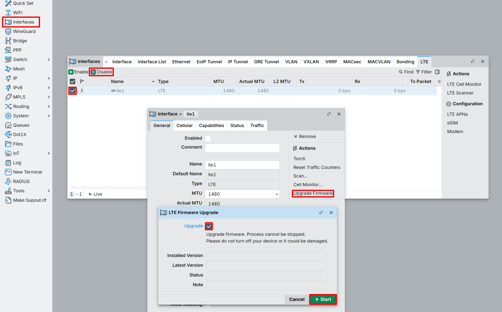

# Konfigurace rozhraní {#interface-configuration}

## LAN {#lan}

```
/interface bridge add name=bridge1
/interface bridge port add bridge=bridge1 interface=ether2
/interface bridge port add bridge=bridge1 interface=ether3
/ip address add address=172.31.255.254/24 interface=bridge1 network=172.31.255.0
/ip pool add name=pool1 ranges=172.31.255.100-172.31.255.199
/ip dhcp-server add address-pool=pool1 interface=bridge1 name=dhcp1
/ip dhcp-server network add address=172.31.255.0/24 dns-server=172.31.255.254,8.8.8.8,8.8.4.4 gateway=172.31.255.254 netmask=24
```

## LTE {#lte}

```
/interface ppp-client add apn=internet name=ppp-out1 port=usb3
/interface lte apn set [ find default=yes ] apn=internet ip-type=ipv4 use-network-apn=no
/interface lte set [ find ] allow-roaming=yes apn-profiles=default band="" name=lte1 network-mode=lte
/ip dns set allow-remote-requests=yes servers=8.8.8.8,8.8.4.4
/system clock set time-zone-autodetect=no time-zone-name=Europe/Prague
```

:::tip

Nahraďte `internet` názvem **APN** od svého mobilního operátora.

:::

### Odemčení PIN SIM karty {#sim-pin-unlock}

Pokud **SIM** karta vyžaduje kód **PIN**, odemkněte ji příkazem:

```
/interface/lte/set lte1 pin="1234"
```

Kód **PIN** na **SIM** kartě trvale vypnete takto (doporučujeme u routerů bez obsluhy):

```
/interface/lte/at-chat lte1 input="AT+CLCK=\"SC\",0,\"1234\""
```

:::caution

Nahraďte `1234` skutečným kódem **PIN** své **SIM** karty.

:::

### Ověření {#verification}

Zkontrolujte stav připojení **LTE**:

```
/interface/lte/monitor lte1 once
```

Ověřte připojení k internetu:

```
/ping 8.8.8.8 count=3
```

### Aktualizace LTE {#update-lte}

Aby bylo připojení stabilní, udržujte firmware modemu **LTE** aktuální.

1. V levém menu vyberte **Interfaces**.
2. Vyberte rozhraní `lte1` a klikněte na **Disable**.
3. Dvakrát klikněte na rozhraní `lte1` a vyberte **Upgrade firmware**.
4. Kliknutím na **Start** zkontrolujte dostupné aktualizace.
5. Pokud je aktualizace dostupná, zaškrtněte **Upgrade** a klikněte na **Start**.
6. Po dokončení instalace zařízení restartujte.

:::tip

Zda je potřeba SIM karta, závisí na tom, o kolik verzí aktualizujete.
Při aktualizaci o jednu nebo dvě verze musí být SIM karta vložená
a nakonfigurovaná, jinak aktualizace neproběhne. Při větším skoku
se aktualizace dokončí i bez SIM karty.
:::

:::caution

Během aktualizace firmwaru neodpojujte napájení a práci zařízení
nepřerušujte. Přerušená aktualizace může modem vyřadit z provozu.
:::



## WAN {#wan}

:::tip

Připojení LTE má přednost před WAN díky menší vzdálenosti trasy (route distance; výchozí vzdálenost trasy LTE je 2).

:::

```
/ip dhcp-client add default-route-distance=5 interface=ether1 use-peer-dns=no use-peer-ntp=no
```

## OpenVPN {#openvpn}

:::tip

Certifikáty (certifikační autorita, certifikát zařízení **EMBER Hotspot**, privátní klíč zařízení **EMBER Hotspot**) se importují ze spravované služby.

:::

```
/interface ovpn-client import-ovpn-configuration file-name=device_<device name>.ovpn ovpn-user=device:<device name> skip-cert-import=no
/interface ovpn-client set [find name~"ovpn-import"] name=ember-cloud-ovpn cipher=aes256-cbc auth=sha1 use-peer-dns=no
/interface ovpn-client enable ember-cloud-ovpn
```

## WireGuard {#wireguard}

Klíče **WireGuard** (veřejný klíč spravované služby a privátní klíč zařízení **EMBER Hotspot**) se přebírají ze spravované služby.

```
/interface wireguard add disabled=no listen-port=51820 mtu=1420 name=wireguard1
/interface wireguard peers add endpoint-address=<public IPv4 of Cloud Services> endpoint-port=51820 allowed-address=192.168.17.1/32 interface=wireguard1 persistent-keepalive=1m public-key="<WireGuard Cloud Service public>"
/ip address add address=192.168.17.10/24 network=192.168.17.0 interface=wireguard1
```
