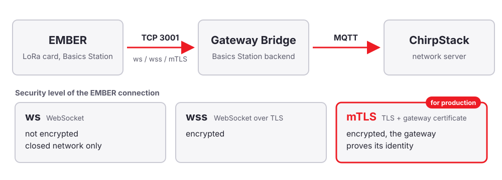
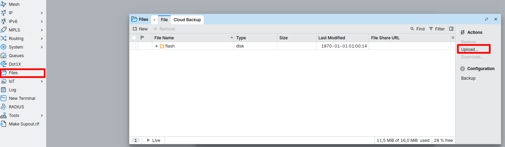
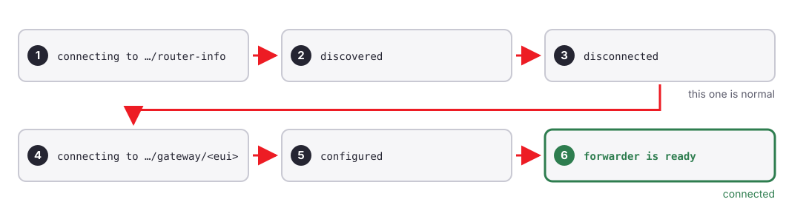

import Tabs from '@theme/Tabs';
import TabItem from '@theme/TabItem';

# ChirpStack v4: Basics Station a mTLS {#chirpstack-v4-basics-station-and-mtls}

Tento návod ukazuje, jak připojit bránu LoRaWAN **HARDWARIO EMBER** (MikroTik RouterOS) k síťovému serveru **ChirpStack v4** protokolem **LoRa Basics Station** (LNS) místo protokolu UDP (packet forwarder).



:::tip Nejdřív nastavte server
Nastavení serveru (Gateway Bridge, certifikační autorita, registrace brány a její certifikát) popisuje návod [ChirpStack: Basics Station a mTLS](/apps/chirpstack/chirpstack-configuration/chirpstack-basics-station). Udělejte ho jako první a potom pokračujte zde.
:::

## Výběr úrovně zabezpečení {#choose-the-security-level}

Pro produkční provoz použijte **mTLS**: každá brána se prokazuje vlastním certifikátem.

| Varianta | Spojení | Kdo se prokazuje |
| --- | --- | --- |
| **ws** | WebSocket bez šifrování | nikdo; vhodné jen pro uzavřenou síť |
| **wss** | WebSocket přes TLS (šifrovaný) | server předkládá svůj certifikát, EMBER ho ale nekontroluje (viz [Známá omezení](#known-limitations)) |
| **mTLS** | TLS + klientský certifikát brány | brána svým certifikátem: server přijme jen bránu s platným certifikátem (EMBER server ani tak nekontroluje, viz [Známá omezení](#known-limitations)) |

Postup byl ověřen na zařízení EMBER s RouterOS 7.24.5 (karta LoRa R11e-LR8G, firmware 1.4.4) proti serveru ChirpStack 4.19 s ChirpStack Gateway Bridge 4.1: bezdrátová aktivace (OTAA), uplinky a downlinky se senzorem HARDWARIO STICKER a všechny případy, kdy musí mTLS bránu odmítnout.

## Než začnete {#prerequisites}

- **EMBER:** doporučujeme RouterOS 7.20 nebo novější (ověřeno na 7.24.5; starším verzím podle changelogu firmy MikroTik chybí opravy klienta LNS), karta LoRa s plánem kanálů `eu-868`, přístup přes **WinBox** nebo SSH s právy admin.
- **Síť:** zařízení EMBER musí mít přístup k serveru na portu TCP 3001 (nebo jiném zvoleném).
- **Soubory z nastavení serveru:** `ca.crt` (CA, která podepsala certifikát serveru) pro wss a mTLS a `tc.crt` + `tc.key` (certifikát brány) pro mTLS.

:::caution
Příkazy pro zařízení EMBER níže jsou pro okno **Terminal** v aplikaci WinBox. Zadávejte je **po jednom řádku** a víceřádkový blok nikdy neposílejte jako jeden příkaz SSH: RouterOS ho pak provede řádek po řádku a řádek, který selže, může nechat kartu LoRa vypnutou. Ze stejného důvodu nikdy nezadávejte `disable`, `set` a `enable` na jeden řádek oddělené středníkem (`;`): RouterOS se při první chybě (`Device is busy`) zastaví a karta zůstane vypnutá.
:::

---

## 1) Nastavte zařízení EMBER (MikroTik RouterOS) {#1-configure-ember-mikrotik-routeros}

### Poznamenejte si současný server {#note-the-current-server}

Před přepnutím si poznamenejte server, který karta používá teď: `:put [/iot lora get [find] servers]` (více serverů vypíše oddělené `;`).

<details>
<summary>Když se EMBER k novému serveru nepřipojí: přepnutí zpět</summary>

Když kontrola v [kroku 2](#2-verify) selže, přepněte ho stejným postupem zpět, při vypnuté kartě: `/iot lora disable [find]`, `/iot lora set [find] servers="<old>"` (jméno v uvozovkách, více jmen oddělte čárkami), `/iot lora enable [find]`. Když `disable` selže s hláškou `Plan … not allowed by band`, nic neměňte a postupujte podle části [Špatný region ze serveru](#wrong-region-from-the-server).

</details>

### Nahrajte soubory {#upload-the-files}

Pro **wss** a **mTLS** nahrajte soubory v aplikaci WinBox → **Files** → **Upload**: pro wss `ca.crt`; pro mTLS `ca.crt`, `tc.crt` a `tc.key`. **ws** žádné soubory nepotřebuje.



Dialog pro import certifikátu ukazuje návod [The Things Stack](./lorawan-tts.md).

### Přepněte kartu LoRa na server {#switch-the-lora-card-to-the-server}

Na zařízení EMBER se založí záznam serveru typu LNS a karta LoRa se na něj přepne. **Kartu a její servery měňte jen při vypnuté kartě.** Po `disable` počkejte, až `/iot lora print detail` ukáže stav `Inactive`, a teprve pak zadejte další příkaz; po `enable` zkontrolujte, že se stav změní na `Active` (když zůstane `Inactive`, pošlete `enable` znovu). Stav uvidíte také v aplikaci WinBox → **IoT** → **LoRa**.


Místo `<server>` doplňte DNS jméno nebo IP adresu serveru.

<Tabs groupId="basics-station-mode" defaultValue="mtls">
<TabItem value="mtls" label="mTLS (pro produkční provoz)">

Importujte nejdřív certifikát, potom klíč (RouterOS klíč připojí k certifikátu, který dostane příznak `K`), a soubor s klíčem smažte:

```
/certificate import file-name=ca.crt name=server-ca passphrase="" trusted=yes
/certificate import file-name=tc.crt name=gw-client passphrase=""
/certificate import file-name=tc.key passphrase=""
/certificate print where name="gw-client"
/file remove [find name="tc.key"]
/iot lora servers add name=cs-mtls address=<server> protocol=LNS port=3001 ssl=yes certificate=gw-client
/iot lora disable [find]
/iot lora set [find] servers=cs-mtls
/iot lora enable [find]
```

- `/certificate print` musí u `gw-client` ukazovat příznaky **KT** (klíč připojen). Bez `K` se EMBER připojí bez certifikátu a server ho odmítne; v tom případě `gw-client` smažte a certifikát i klíč importujte znovu, ještě než smažete soubor s klíčem.
- Pole `key` u serveru nechte prázdné: je určené pro jiné síťové servery a ChirpStack ho nepoužívá.
- Před importem nového klientského certifikátu nesmí na zařízení EMBER zůstat jiný certifikát se stejným EUI ve jméně (CN); viz [Obnova certifikátu brány](#renewing-the-gateway-certificate).

</TabItem>
<TabItem value="wss" label="wss">

```
/certificate import file-name=ca.crt name=server-ca passphrase="" trusted=yes
/iot lora servers add name=cs-wss address=<server> protocol=LNS port=3001 ssl=yes
/iot lora disable [find]
/iot lora set [find] servers=cs-wss
/iot lora enable [find]
```

</TabItem>
<TabItem value="ws" label="ws">

```
/iot lora servers add name=cs-ws address=<server> protocol=LNS port=3001 ssl=no
/iot lora disable [find]
/iot lora set [find] servers=cs-ws
/iot lora enable [find]
```

</TabItem>
</Tabs>

Nastavení antény (`antenna=`) a plánu kanálů karty (`channel-plan=eu-868`) zůstává podle vaší instalace.

---

## 2) Ověřte připojení {#2-verify}

Spojení funguje, když EMBER hlásí `forwarder is ready` a ChirpStack ukazuje bránu online s přicházejícími uplinky. Při správném připojení se v logu postupně objeví tyto řádky:



1. Na zařízení EMBER zapněte podrobný log LoRa (jen na dobu ověření): `/system logging add topics=lora,debug action=memory comment=lora-debug`
2. `/log print where topics~"lora"`: správné připojení projde kroky `connecting to …/router-info` → `discovered` → `disconnected` → `connecting to …/gateway/<eui>` → `configured` → `forwarder is ready` (řádek `disconnected` mezi nimi je v pořádku).
3. V řádku `router_config` zkontrolujte `"region":"EU863"`.
4. `/iot lora print detail`: stav karty je `Active`.
5. V aplikaci ChirpStack: brána je **online**, **Last seen** se obnovuje (statistiky brány chodí asi každých 30 s) a v grafech brány přibývají přijaté pakety.
6. Testovacím zařízením ověřte bezdrátovou aktivaci (OTAA), uplink a downlink (např. příkaz MAC potvrzený v dalším uplinku).
7. Podrobný log opět vypněte: `/system logging remove [find comment="lora-debug"]`

Stav karty `Starting` znamená, že se EMBER na server zatím nepřipojil (adresa, port, TLS nebo certifikát; viz [Řešení problémů podle logu](#troubleshooting-by-log-line)).

---

## Obnova certifikátu brány {#renewing-the-gateway-certificate}

Certifikát obnovte před vypršením. Brána je asi 30 sekund offline.

:::danger Na pořadí kroků záleží
Starý klientský certifikát smažte **dřív**, než importujete nový, a kroky 2–4 proveďte hned po sobě: po kroku 2 ukazuje záznam serveru na smazaný certifikát, takže znovupřipojení před krokem 4 (restart Gateway Bridge, výpadek napájení) nejspíš selže.
:::

1. V aplikaci ChirpStack vygenerujte nový certifikát ([Certifikát brány](/apps/chirpstack/chirpstack-configuration/chirpstack-basics-station#4-gateway-certificate-mtls-only)) a nahrajte `tc.crt` a `tc.key` do zařízení EMBER.
2. **Nejdřív smažte starý klientský certifikát**: `/certificate remove [find name="gw-client"]` (použijte jméno certifikátu, který je právě v provozu). Jde to i za provozu; běžící spojení zůstane.
3. Importujte nový certifikát pod novým jménem, potom jeho klíč, a zkontrolujte, že `gw-client-2` má příznaky **KT**. Bez `K` ho smažte (`/certificate remove [find name="gw-client-2"]`) a certifikát i klíč importujte znovu. Potom smažte soubor s klíčem:

```
/certificate import file-name=tc.crt name=gw-client-2 passphrase=""
/certificate import file-name=tc.key passphrase=""
/certificate print where name="gw-client-2"
/file remove [find name="tc.key"]
```

4. Přepněte záznam serveru na nový certifikát (při vypnuté kartě):

```
/iot lora disable [find]
/iot lora servers set [find name="cs-mtls"] certificate=gw-client-2
/iot lora enable [find]
```

<details>
<summary>Proč na pořadí záleží</summary>

Když se nový certifikát importuje, zatímco starý se stejným EUI je ještě na zařízení EMBER, RouterOS 7.24.5 pak podepisuje spojení klíčem starého certifikátu. Server ho odmítne (`invalid signature by the client certificate`) a brána zůstane offline. Náprava: celý postup zopakujte od kroku 1 s novým certifikátem (starý soubor s klíčem je už smazaný a ChirpStack klíč ukazuje jen jednou) a v kroku 2 smažte všechny certifikáty, jejichž jméno (CN) je toto EUI (`/certificate print detail` ho ukazuje jako `common-name`, malými písmeny).

</details>

Vypršení certifikátu běžící spojení nepřeruší (kontroluje se jen při připojení), brána ale vypadne při nejbližším znovupřipojení. Obnovte ho proto včas i u brány, která zrovna funguje.

---

## Špatný region ze serveru {#wrong-region-from-the-server}

:::warning
Pokud Gateway Bridge někdy poslal zařízení EMBER jiný frekvenční plán než EU868 (chybné nastavení `region`), zůstane služba LoRa zařízení nestabilní až do jeho restartu: kartu nejde vypnout a při dalším připojení může vypadnout (`[DEV] Device communication error.`, karta zmizí z `/iot lora`).
:::

1. Nastavte na Gateway Bridge `region="EU868"` a bridge restartujte.
2. Zařízení EMBER jednou restartujte (`/system reboot`).
3. Ověřte spojení podle [kroku 2](#2-verify).

Při správné konfiguraci serveru restart Gateway Bridge zařízení EMBER nevadí: znovu se připojí asi za 15 sekund.

---

## Známá omezení {#known-limitations}
Tato omezení platí pro RouterOS 7.24.5 a ChirpStack 4.19 / Gateway Bridge 4.1; po aktualizacích je znovu ověřte.

- **RouterOS 7.24.5 na zařízení EMBER neověřuje certifikát serveru.** EMBER se připojí i k serveru s nedůvěryhodným certifikátem nebo s certifikátem vydaným na jiné jméno. Spojení wss i mTLS je šifrované a mTLS chrání server před cizími branami, ale brána sama podvržený server nepozná. Cestu mezi bránou a serverem proto chraňte i na úrovni sítě (VPN, firewall). Import CA serveru do zařízení EMBER přesto proveďte.
- **EMBER neodmítne špatný region ze serveru.** Brána pak vypadá online, ale nic nepřijímá, a kartu potom nemusí jít ani vypnout (RouterOS hlásí `Plan [US 915 Sub 2] not allowed by band [863-870]`). Po opravě serveru takové zařízení EMBER jednou restartujte (viz [Špatný region ze serveru](#wrong-region-from-the-server)). Na Gateway Bridge musí být `region="EU868"`.
- Log zařízení EMBER rozliší jen dva důvody odmítnutí TLS; přesný důvod je vždy v logu Gateway Bridge.

Omezení na straně serveru (zneplatnění certifikátu, restart Gateway Bridge, NTP) uvádí [ChirpStack: Známá omezení](/apps/chirpstack/chirpstack-configuration/chirpstack-basics-station#known-limitations).

---

## Řešení problémů podle logu {#troubleshooting-by-log-line}
Najděte řádek v logu zařízení EMBER (`/log print where topics~"lora"`) a vyhledejte ho v tabulce. Skutečný důvod odmítnutí TLS je vždy v logu bridge.

| Kde | Řádek v logu (výňatek) | Co znamená | Co udělat |
| --- | --- | --- | --- |
| EMBER | `connecting to …/router-info`, ale žádné `discovered` | žádné spojení se serverem | adresa, port, firewall, `ssl` |
| EMBER | `discovered`, ale žádné `configured` | bridge odmítl datové spojení | jméno certifikátu (CN) = EUI brány, certifikát; důvod je v logu bridge |
| EMBER | `configured`, ale v aplikaci ChirpStack žádné uplinky | registrace brány, témata MQTT nebo region | viz dva řádky ChirpStack v [ChirpStack: Řešení problémů podle logu](/apps/chirpstack/chirpstack-configuration/chirpstack-basics-station#troubleshooting-by-log-line) a [Špatný region ze serveru](#wrong-region-from-the-server) |
| EMBER | `socket error on connection [2001]` | na adrese a portu nic neposlouchá | port (3001); běží Gateway Bridge? |
| EMBER | `socket error on timeout [2001]` | server je nedostupný | adresa, směrování, firewall |
| EMBER | `socket error on handshake [2001]` | nesedí TLS | `ssl=` musí odpovídat bridge: `yes` pro wss a mTLS, `no` pro ws |
| EMBER | `ssl: fatal alert handshake (6) [2006]` | EMBER neposlal klientský certifikát | `certificate=` u záznamu serveru, certifikát s příznakem `K` |
| EMBER | `ssl: fatal alert received (6) [2006]` | server certifikát odmítl | důvod je v logu bridge |
| EMBER | `certificate CommonName <x> does not match router <eui>` | certifikát jiné brány | certifikát vydaný pro toto EUI |
| EMBER | `router_config` (podrobný log) s jiným regionem než `EU863` | špatný region na bridge | `region="EU868"` na bridge |
| EMBER | `[DEV] Device communication error.` | rádio se nepodařilo přenastavit (vídáno jen po špatném regionu) | opravte region na serveru a EMBER restartujte; kontrola: `forwarder is ready`; prázdné `/iot lora` = restart zařízení EMBER nutný |

Řádky z logu Gateway Bridge a serveru ChirpStack vysvětluje [ChirpStack: Řešení problémů podle logu](/apps/chirpstack/chirpstack-configuration/chirpstack-basics-station#troubleshooting-by-log-line).

## Užitečná dokumentace {#useful-docs}
- Nastavení serveru: [ChirpStack: Basics Station a mTLS](/apps/chirpstack/chirpstack-configuration/chirpstack-basics-station)
- Zařízení EMBER se serverem ChirpStack přes UDP: [ChirpStack v4](./lorawan-chirpstack.md)
- Konfigurace hotspotu EMBER (základy RouterOS): [Konfigurace hotspotu](../hotspot-configuration.md)
