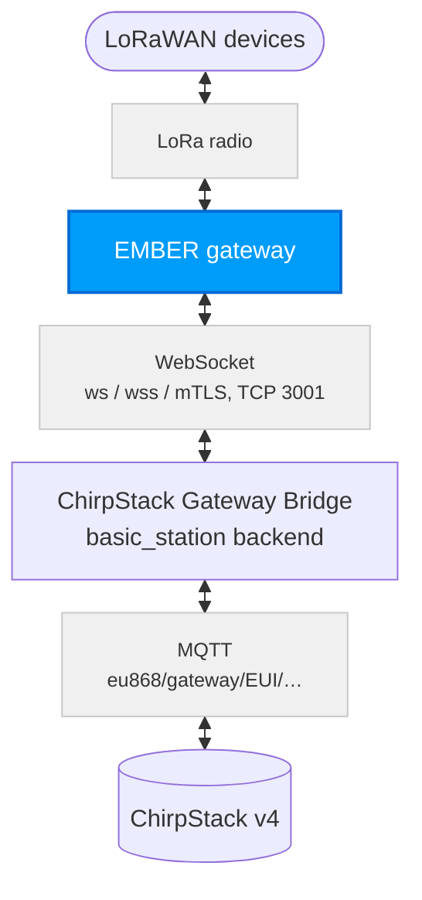
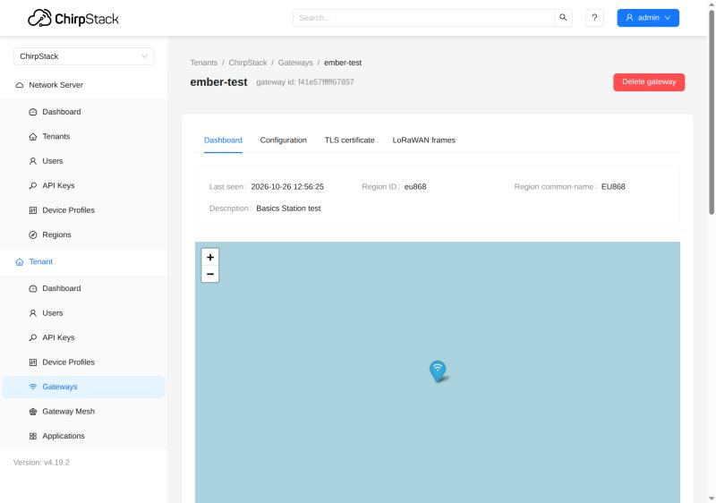
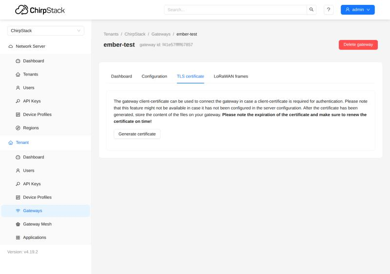

# ChirpStack v4: Basics Station a mTLS {#chirpstack-v4-basics-station-and-mtls}

Tento návod ukazuje, jak připojit bránu LoRaWAN **HARDWARIO EMBER** (MikroTik RouterOS) k síťovému serveru **ChirpStack v4** protokolem **LoRa Basics Station** (LNS) místo protokolu UDP (packet forwarder), a to ve třech úrovních zabezpečení. Pro produkční provoz použijte **mTLS**: každá brána se prokazuje vlastním certifikátem.

| Varianta | Spojení | Kdo se prokazuje |
| --- | --- | --- |
| **ws** | WebSocket bez šifrování | nikdo; vhodné jen pro uzavřenou síť |
| **wss** | WebSocket přes TLS (šifrovaný) | server předkládá svůj certifikát, EMBER ho ale nekontroluje (viz [Známá omezení](#known-limitations)) |
| **mTLS** | TLS + klientský certifikát brány | brána svým certifikátem: server přijme jen bránu s platným certifikátem (EMBER server ani tak nekontroluje, viz [Známá omezení](#known-limitations)) |

Postup byl ověřen na zařízení EMBER s RouterOS 7.24.5 (karta LoRa R11e-LR8G, firmware 1.4.4) proti serveru ChirpStack 4.19 s ChirpStack Gateway Bridge 4.1: bezdrátová aktivace (OTAA), uplinky a downlinky se senzorem HARDWARIO STICKER a všechny případy, kdy musí mTLS bránu odmítnout.

## Užitečná dokumentace {#useful-docs}
- Instalace ChirpStack v4 → https://docs.hardwario.com/apps/chirpstack/chirpstack-installation
- Zařízení EMBER se serverem ChirpStack přes UDP: [ChirpStack v4](./lorawan-chirpstack.md)
- Konfigurace hotspotu EMBER (základy RouterOS): [Konfigurace hotspotu](../hotspot-configuration.md)

## Jak to funguje {#how-it-works}
Zařízení EMBER drží jedno trvalé spojení (WebSocket) s Gateway Bridge. Tečou jím uplinky i downlinky a právě toto spojení se zabezpečuje.



Při připojení se zařízení EMBER nejdřív zeptá, kam se připojit (`router-info`), a bridge odpoví adresou s EUI brány. EMBER se pak připojí na tuto adresu a bridge mu pošle frekvenční plán (`router_config`). Od té chvíle bridge předává pakety přes MQTT pod tématem `eu868/gateway/<eui>/…` a server ChirpStack odpovídá stejnou cestou zpět.

**mTLS (vzájemné TLS):** brána se serveru prokazuje vlastním certifikátem (EMBER sám server nekontroluje, viz [Známá omezení](#known-limitations)). ChirpStack slouží jako certifikační autorita (CA), která certifikáty bran vydává. Bridge při každém připojení kontroluje, že brána certifikát poslala, že ho podepsala tato CA, že je platný a že jeho jméno (CN) je EUI připojující se brány. Když kterákoli kontrola selže, bridge spojení odmítne.

## Předpoklady {#prerequisites}

| Oblast | Požadavek |
| --- | --- |
| ChirpStack | v4 (ověřeno 4.19) s regionem EU868 |
| Gateway Bridge | ChirpStack Gateway Bridge v4 (ověřeno 4.1) jako druhá instance s backendem `basic_station` |
| EMBER | RouterOS 7.20 nebo novější (ověřeno 7.24.5; starším verzím chybí opravy klienta LNS), karta LoRa s plánem kanálů `eu-868`, přístup přes **WinBox** nebo SSH s právy admin |
| Síť | zařízení EMBER musí mít přístup k serveru na portu TCP 3001 (nebo jiném zvoleném) |
| Certifikáty (wss, mTLS) | certifikační autorita (CA) a certifikát serveru vydaný na DNS jméno nebo IP adresu, na kterou se brány EMBER připojují |
| Čas | správný čas na serveru (NTP): bridge podle něj kontroluje platnost certifikátů; NTP doporučujeme i na zařízení EMBER (čas v logu) |

:::caution
Příkazy pro zařízení EMBER níže jsou pro okno **Terminal** v aplikaci WinBox. Zadávejte je **po jednom řádku** a víceřádkový blok nikdy neposílejte jako jeden příkaz SSH: RouterOS ho pak provede řádek po řádku a řádek, který selže, může nechat kartu LoRa vypnutou.
:::

---

## 1) Gateway Bridge s backendem basic_station {#1-gateway-bridge-with-the-basic_station-backend}
Spusťte druhou instanci ChirpStack Gateway Bridge s backendem `basic_station` (v chirpstack-docker je to služba `chirpstack-gateway-bridge-basicstation`). Stávající bridge pro UDP může běžet dál vedle ní.

Varianty se liší jen ve třech klíčích sekce `[backend.basic_station]`:

```toml
[backend]
type="basic_station"

  [backend.basic_station]
  bind=":3001"
  # ws:   leave tls_cert, tls_key and ca_cert empty
  # wss:  tls_cert + tls_key
  # mTLS: tls_cert + tls_key + ca_cert
  tls_cert="/etc/chirpstack-gateway-bridge/certs/server.crt"
  tls_key="/etc/chirpstack-gateway-bridge/certs/server.key"
  ca_cert="/etc/chirpstack-gateway-bridge/certs/gateway-ca.crt"   # mTLS only
  region="EU868"
  frequency_min=863000000
  frequency_max=870000000
```

Frekvenční plán (`[[backend.basic_station.concentrators]]`) převezměte ze souboru `chirpstack-gateway-bridge-basicstation-eu868.toml` v chirpstack-docker (`configuration/chirpstack-gateway-bridge/`). Témata MQTT musí souhlasit s regionem na serveru ChirpStack:

```toml
[integration.mqtt]
event_topic_template="eu868/gateway/{{ .GatewayID }}/event/{{ .EventType }}"
state_topic_template="eu868/gateway/{{ .GatewayID }}/state/{{ .StateType }}"
command_topic_template="eu868/gateway/{{ .GatewayID }}/command/#"
```

- **Certifikát serveru** (`tls_cert`) musí v SAN obsahovat DNS jméno nebo IP adresu, kterou brány EMBER používají. Nejjednodušší je podepsat ho stejnou CA jako certifikáty bran (krok 2).
- **S vyplněným `ca_cert`** bridge vyžaduje klientský certifikát podepsaný touto CA, jehož jméno (CN) je přesně EUI brány.
- Port 3001 otevřete ve firewallu pro síť, ze které se brány EMBER připojují.
- **Bridge restartujte v klidné době**: každý restart znamená znovupřipojení všech bran (viz [Známá omezení](#known-limitations)).

:::warning
Bridge, ke kterému se brány EMBER připojují, musí mít `region="EU868"`. Zařízení EMBER přijme i frekvenční plán mimo své pásmo (ověřeno s US915); pak vypadá online, nic nepřijímá a jeho služba LoRa zůstane nestabilní až do restartu zařízení. Viz [Špatný region ze serveru](#wrong-region-from-the-server).
:::

---

## 2) ChirpStack: CA pro certifikáty bran (jen mTLS) {#2-chirpstack-ca-for-gateway-certificates-mtls-only}
Aby server ChirpStack uměl vydávat certifikáty bran, potřebuje certifikační autoritu (CA). Do `chirpstack.toml` přidejte sekci `[gateway]` (chirpstack-docker ji ve výchozím stavu nemá) a ChirpStack restartujte:

```toml
[gateway]
  ca_cert="/etc/chirpstack/certs/gateway-ca.crt"   # CA certificate (PEM)
  ca_key="/etc/chirpstack/certs/gateway-ca.key"    # CA private key (PKCS#8)
  client_cert_lifetime="365days"                    # lifetime of the issued certificates
  allow_unknown_gateways=false
```

- Stejný soubor `gateway-ca.crt` patří do `ca_cert` na Gateway Bridge (krok 1).
- **Klíč CA je nejcennější tajemství celého řešení**: kdo ho má, může vydat certifikát pro libovolnou bránu. Uložte ho jen na server ChirpStack s omezenými přístupovými právy.
- `client_cert_lifetime` volte vědomě (např. 365 dní): ChirpStack neumí certifikát zneplatnit, takže platnost je jediná hranice pro uniklý klíč. Dlouhá platnost zase znamená méně obnov.
- S `allow_unknown_gateways=false` server ChirpStack zahazuje data bran, které v něm nejsou zaregistrované.

---

## 3) Zaregistrujte bránu v aplikaci ChirpStack {#3-register-the-gateway-in-chirpstack}
ChirpStack bránu pozná podle jejího EUI; bez registrace její data zahazuje.

1. Na zařízení EMBER zjistěte gateway ID: `/iot lora print detail` → `gateway-id` (16 hexadecimálních znaků, např. `F41E57FFFFF67857`).
2. V aplikaci ChirpStack otevřete **Tenant → Gateways → Add gateway** a jako **Gateway ID** zadejte toto EUI (podrobnosti v návodu [ChirpStack v4](./lorawan-chirpstack.md)).

Jakmile je brána připojená, její **Dashboard** v aplikaci ChirpStack ukazuje **Last seen** a region (`eu868`):



---

## 4) Certifikát brány (jen mTLS) {#4-gateway-certificate-mtls-only}
Klientský certifikát vydá ChirpStack jedním kliknutím. Jeho jméno (CN) je EUI brány a podepisuje ho CA z kroku 2.

1. V aplikaci ChirpStack otevřete bránu → záložka **TLS certificate** → **Generate certificate**.
2. Uložte si tři texty jako soubory: **TLS certificate** → `tc.crt`, **TLS key** → `tc.key`, **CA certificate** → `ca.crt`.
3. **Klíč se zobrazí jen jednou** a ChirpStack si ho neukládá. Neposílejte ho e-mailem ani chatem a po nahrání do zařízení EMBER ho smažte.
4. Poznamenejte si datum vypršení certifikátu: ChirpStack ho ukáže jen teď.

Záložka **TLS certificate** u brány v aplikaci ChirpStack:



| Soubor | Co to je | Tajné? |
| --- | --- | --- |
| `ca.crt` | CA bran; EMBER ji importuje jako důvěryhodnou. EMBER potřebuje CA, která podepsala certifikát serveru: s jednou CA pro obojí (krok 1) je to tentýž soubor | ne |
| `tc.crt` | certifikát brány | ne |
| `tc.key` | privátní klíč brány (ECDSA P-256, PKCS#8) | **ano** |

---

## 5) Nastavte zařízení EMBER (MikroTik RouterOS) {#5-configure-ember-mikrotik-routeros}
Na zařízení EMBER se založí záznam serveru typu LNS a karta LoRa se na něj přepne. **Kartu a její servery měňte jen při vypnuté kartě.** Po `disable` počkejte, až `/iot lora print detail` ukáže stav `Inactive`, a teprve pak zadejte další příkaz; po `enable` zkontrolujte, že se stav změní na `Active` (když zůstane `Inactive`, pošlete `enable` znovu). Místo `<server>` doplňte DNS jméno nebo IP adresu serveru. Soubory nahrajte v aplikaci WinBox (**Files** → **Upload**; dialogy pro nahrání a import ukazuje návod [The Things Stack](./lorawan-tts.md)).

**ws:**

```
/iot lora servers add name=cs-ws address=<server> protocol=LNS port=3001 ssl=no
/iot lora disable [find]
/iot lora set [find] servers=cs-ws
/iot lora enable [find]
```

**wss**: nahrajte do zařízení EMBER soubor `ca.crt` (CA, která podepsala certifikát serveru) a pak:

```
/certificate import file-name=ca.crt name=server-ca passphrase="" trusted=yes
/iot lora servers add name=cs-wss address=<server> protocol=LNS port=3001 ssl=yes
/iot lora disable [find]
/iot lora set [find] servers=cs-wss
/iot lora enable [find]
```

**mTLS**: nahrajte `ca.crt`, `tc.crt` a `tc.key`. Importujte nejdřív certifikát, potom klíč (RouterOS klíč připojí k certifikátu, který dostane příznak `K`), a soubor s klíčem smažte:

```
/certificate import file-name=ca.crt name=server-ca passphrase="" trusted=yes
/certificate import file-name=tc.crt name=gw-client passphrase=""
/certificate import file-name=tc.key passphrase=""
/file remove [find name="tc.key"]
/certificate print where name="gw-client"
/iot lora servers add name=cs-mtls address=<server> protocol=LNS port=3001 ssl=yes certificate=gw-client
/iot lora disable [find]
/iot lora set [find] servers=cs-mtls
/iot lora enable [find]
```

- `/certificate print` musí u `gw-client` ukazovat příznaky **KT** (klíč připojen). Bez `K` se EMBER připojí bez certifikátu a server ho odmítne.
- Pole `key` u serveru nechte prázdné: je určené pro jiné síťové servery a ChirpStack ho nepoužívá.
- Před importem nového klientského certifikátu nesmí na zařízení EMBER zůstat jiný certifikát se stejným EUI ve jméně (CN); viz [Obnova certifikátu brány](#renewing-the-gateway-certificate).
- Nastavení antény (`antenna=internal-antenna` / `external-antenna`) a plánu kanálů karty (`channel-plan=eu-868`) zůstává podle vaší instalace.

---

## 6) Ověřte připojení {#6-verify}
Spojení funguje, když EMBER hlásí `forwarder is ready` a ChirpStack ukazuje bránu online s přicházejícími uplinky.

1. Na zařízení EMBER zapněte podrobný log LoRa (jen na dobu ověření): `/system logging add topics=lora,debug action=memory comment=lora-debug`
2. `/log print where topics~"lora"`: správné připojení vypadá takto: `connecting to …/router-info` → `discovered` → `disconnected` → `connecting to …/gateway/<eui>` → `configured` → `forwarder is ready` (`disconnected` mezi tím je v pořádku).
3. V řádku `router_config` zkontrolujte `"region":"EU863"`.
4. `/iot lora print detail`: stav karty je `Active`.
5. V aplikaci ChirpStack: brána je **online**, **Last seen** se obnovuje (statistiky brány chodí asi každých 30 s) a v grafech brány přibývají přijaté pakety.
6. Testovacím zařízením ověřte bezdrátovou aktivaci (OTAA), uplink a downlink (např. příkaz MAC potvrzený v dalším uplinku).
7. Podrobný log opět vypněte: `/system logging remove [find comment="lora-debug"]`

Stav karty `Starting` znamená, že se EMBER na server zatím nepřipojil (adresa, port, TLS nebo certifikát; viz [Řešení problémů podle logu](#troubleshooting-by-log-line)).

---

## Špatný region ze serveru {#wrong-region-from-the-server}
Pokud Gateway Bridge někdy poslal zařízení EMBER jiný frekvenční plán než EU868 (chybné nastavení `region`), zůstane služba LoRa zařízení nestabilní až do jeho restartu: kartu nejde vypnout a při dalším připojení může vypadnout (`[DEV] Device communication error.`, karta zmizí z `/iot lora`).

1. Nastavte na Gateway Bridge `region="EU868"` a bridge restartujte.
2. Zařízení EMBER jednou restartujte (`/system reboot`).
3. Ověřte spojení podle kroku 6.

Při správné konfiguraci serveru restart Gateway Bridge zařízení EMBER nevadí: znovu se připojí asi za 15 sekund.

---

## Obnova certifikátu brány {#renewing-the-gateway-certificate}
Certifikát obnovte před vypršením. **Na pořadí kroků záleží** a brána je asi 30 sekund offline.

1. V aplikaci ChirpStack vygenerujte nový certifikát (krok 4) a nahrajte `tc.crt` a `tc.key` do zařízení EMBER.
2. **Nejdřív smažte starý klientský certifikát**: `/certificate remove [find name="gw-client"]` (použijte jméno certifikátu, který je právě v provozu). Jde to i za provozu; běžící spojení zůstane.
3. Importujte nový certifikát pod novým jménem, potom jeho klíč, a soubor s klíčem smažte:

```
/certificate import file-name=tc.crt name=gw-client-2 passphrase=""
/certificate import file-name=tc.key passphrase=""
/file remove [find name="tc.key"]
```

4. Přepněte záznam serveru na nový certifikát (při vypnuté kartě):

```
/iot lora disable [find]
/iot lora servers set [find name="cs-mtls"] certificate=gw-client-2
/iot lora enable [find]
```

**Proč na pořadí záleží:** když se nový certifikát importuje, zatímco starý se stejným EUI je ještě na zařízení EMBER, RouterOS 7.24.5 pak podepisuje spojení klíčem starého certifikátu. Server ho odmítne (`invalid signature by the client certificate`) a brána zůstane offline. Náprava: smažte všechny certifikáty s tímto EUI a nový importujte znovu.

Vypršení certifikátu běžící spojení nepřeruší (kontroluje se jen při připojení), brána ale vypadne při nejbližším znovupřipojení. Obnovte ho proto včas i u brány, která zrovna funguje.

---

## Známá omezení {#known-limitations}
Tato omezení platí pro RouterOS 7.24.5 a ChirpStack 4.19 / Gateway Bridge 4.1; po aktualizacích je znovu ověřte.

- **RouterOS 7.24.5 na zařízení EMBER neověřuje certifikát serveru.** EMBER se připojí i k serveru s nedůvěryhodným certifikátem nebo s certifikátem vydaným na jiné jméno. Spojení wss i mTLS je šifrované a mTLS chrání server před cizími branami, ale brána sama podvržený server nepozná. Cestu mezi bránou a serverem proto chraňte i na úrovni sítě (VPN, firewall). Import CA serveru do zařízení EMBER přesto proveďte.
- **Restart serveru (Gateway Bridge) znamená znovupřipojení všech bran**; každá je přitom asi 15 sekund offline. Restartujte v klidné době a potom zkontrolujte, že jsou všechny brány zpět online.
- **EMBER neodmítne špatný region ze serveru.** Brána pak vypadá online, ale nic nepřijímá, a kartu potom nemusí jít ani vypnout (RouterOS hlásí `Plan [US 915 Sub 2] not allowed by band [863-870]`). Po opravě serveru takové zařízení EMBER jednou restartujte (viz [Špatný region ze serveru](#wrong-region-from-the-server)). Na Gateway Bridge musí být `region="EU868"`.
- **Certifikát nejde zneplatnit.** Starý certifikát platí až do vypršení, i po obnově. Ani smazání brány v aplikaci ChirpStack spojení nezastaví. Při úniku klíče brány je jistá cesta jen výměna CA.
- **Hlídejte stav „online, ale bez uplinků“.** Stav online v aplikaci ChirpStack znamená jen to, že chodí statistiky brány.
- **Správný čas (NTP) na serveru** je nutný: bridge podle něj kontroluje platnost certifikátů. NTP nechte zapnuté i na zařízení EMBER, kvůli času v logu.
- Log zařízení EMBER rozliší jen dva důvody odmítnutí TLS; přesný důvod je vždy v logu Gateway Bridge.

---

## Řešení problémů podle logu {#troubleshooting-by-log-line}
Najděte řádek v logu zařízení EMBER (`/log print where topics~"lora"`) nebo v logu Gateway Bridge a vyhledejte ho v tabulce. Skutečný důvod odmítnutí TLS je vždy v logu bridge.

| Kde | Řádek v logu (výňatek) | Co znamená | Co udělat |
| --- | --- | --- | --- |
| EMBER | `connecting to …/router-info`, ale ne `discovered` | žádné spojení se serverem | adresa, port, firewall, `ssl` |
| EMBER | `socket error on connection [2001]` | na adrese a portu nic neposlouchá | port (3001); běží Gateway Bridge? |
| EMBER | `socket error on timeout [2001]` | server je nedostupný | adresa, směrování, firewall |
| EMBER | `socket error on handshake [2001]` | nesedí TLS | `ssl=` musí odpovídat bridge: `yes` pro wss a mTLS, `no` pro ws |
| EMBER | `ssl: fatal alert handshake (6) [2006]` | EMBER neposlal klientský certifikát | `certificate=` u záznamu serveru, certifikát s příznakem `K` |
| EMBER | `ssl: fatal alert received (6) [2006]` | server certifikát odmítl | důvod je v logu bridge |
| EMBER | `certificate CommonName <x> does not match router <eui>` | certifikát jiné brány | certifikát vydaný pro toto EUI |
| EMBER | `router_config` s jiným regionem než `EU863` | špatný region na bridge | `region="EU868"` na bridge |
| EMBER | `[DEV] Device communication error.` | rádio se nepodařilo přenastavit (vídáno jen po špatném regionu) | opravte region na serveru a EMBER restartujte; kontrola: `forwarder is ready`; prázdné `/iot lora` = restart zařízení EMBER nutný |
| bridge | `router-info … router_uri=` (prázdné) | jméno certifikátu ≠ EUI brány | certifikát pro tuto bránu |
| bridge | `client didn't provide a certificate` | EMBER se připojil bez certifikátu | `certificate=` u záznamu serveru, příznak `K` |
| bridge | `certificate signed by unknown authority` | certifikát z cizí CA | vydejte certifikát na tomto serveru ChirpStack |
| bridge | `certificate has expired or is not yet valid` | certifikát vypršel nebo nesedí čas serveru | obnova certifikátu, NTP na serveru |
| bridge | `invalid signature by the client certificate` | klíč nepatří k certifikátu (chyba při obnově) | smažte certifikáty s tímto EUI a importujte znovu |
| bridge | `client sent an HTTP request to an HTTPS server` | EMBER má `ssl=no`, bridge používá TLS | `ssl=yes` |
| bridge | `connection with same gateway id already exists` | znovupřipojení před uzavřením starého spojení | počkejte až 65 s |
| ChirpStack | `Object does not exist` u brány | brána není zaregistrovaná | přidejte bránu (krok 3) |
| ChirpStack | od brány nic nepřichází, bridge hlásí connected | nesedí témata MQTT | témata `eu868/…` podle regionu |
