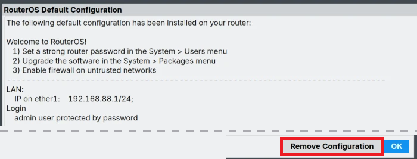
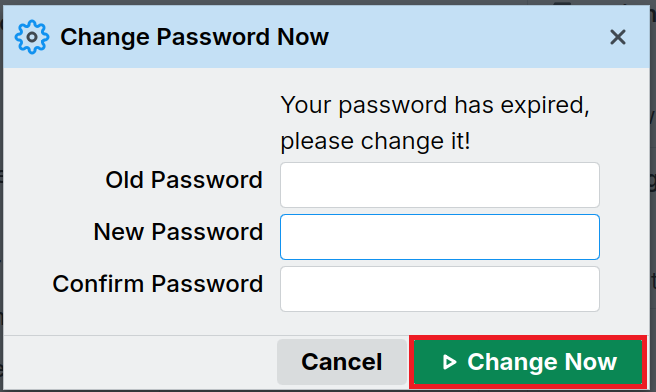
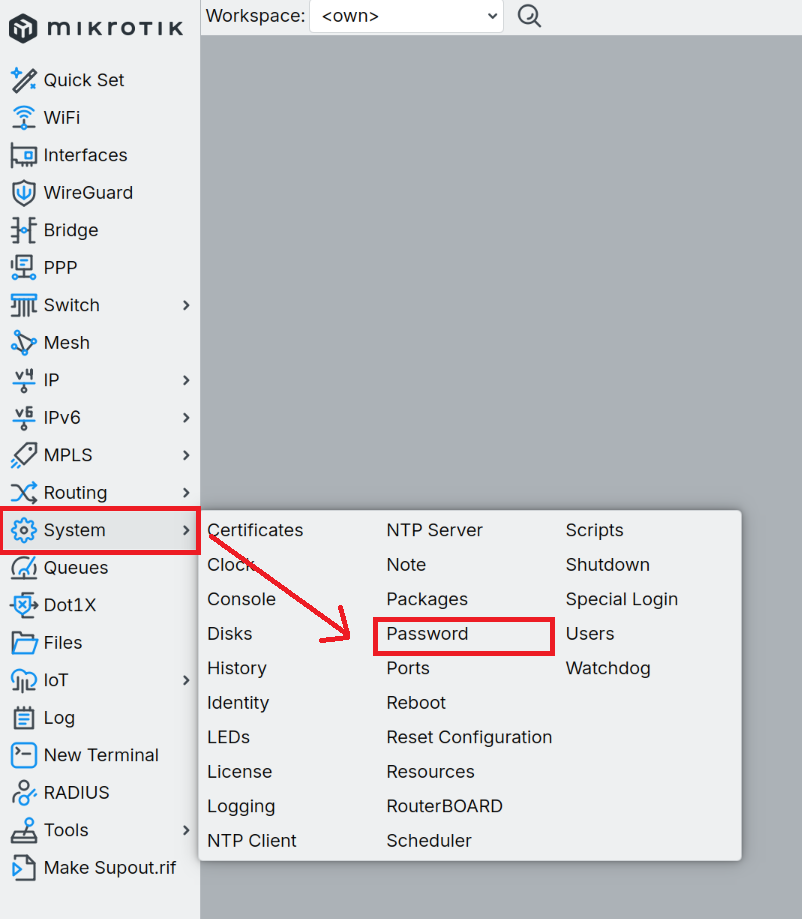
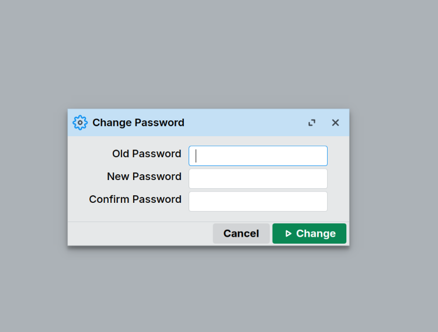
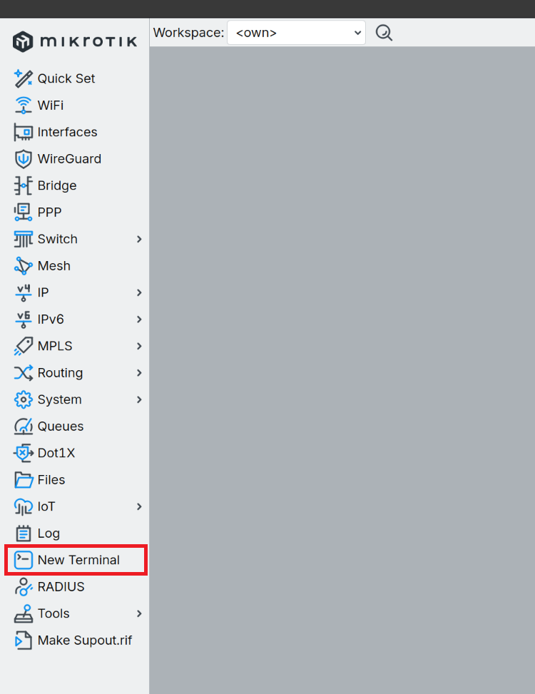
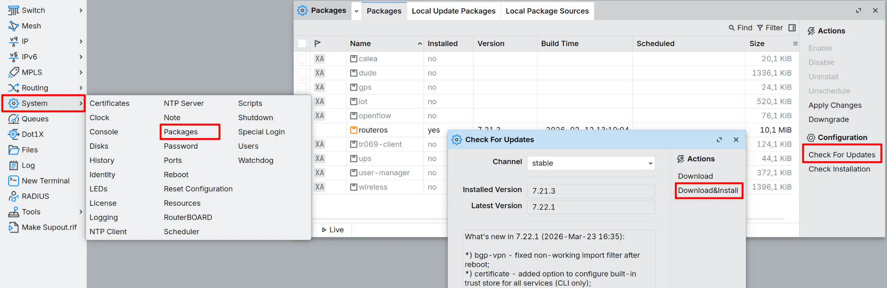
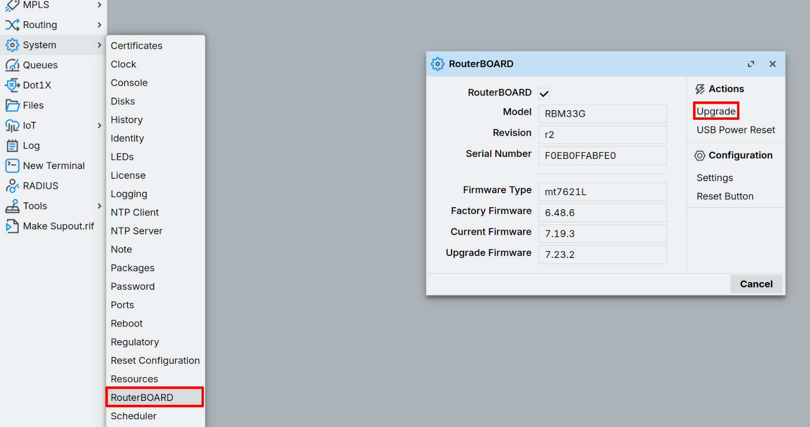

# Ruční nastavení zařízení EMBER {#ember-manual-setup}

Tato stránka navazuje na stránku [Nastavení hardwaru](hardware-setup.md) a popisuje ruční nastavení zařízení EMBER ve Winboxu. [Automatické nastavení](automated-setup.md) udělá totéž jedním skriptem.

:::warning Pro které zařízení je tento postup?

**Zařízení EMBER, které jste dostali od HARDWARIO, je už nastavené. Z těchto stránek nemusíte nic spouštět.**
RouterOS, balíček iot i základní konfigurace na něm už jsou a heslo uživatele admin najdete v protokolu nastavení,
který k němu dostanete. Začněte stránkou [První kroky](getting-started.md).

Tyto stránky popisují nastavení zařízení EMBER od nuly: po resetu, nebo pokud vám nepřišlo nastavené od HARDWARIO.

:::

---

## Krok 1: Počáteční konfigurační skript RouterOS {#step-1-initial-routeros-configuration-script}

### 1.1 První přihlášení {#11-first-login}

**Přihlaste se.** Ve Winboxu se přihlaste jako `admin`. Heslo je `admin`, u zařízení EMBER s RouterOS 6 je prázdné.

**Odstraňte výchozí konfiguraci MikroTik.** Po prvním spuštění Winbox nejdřív zobrazí okno **RouterOS Default Configuration**. Klikněte na **Remove Configuration** (ne na **OK**), aby EMBER začal s prázdnou konfigurací. EMBER se restartuje: připojte se znovu ze seznamu **Neighbors** (podle MAC adresy) a přihlaste se jako `admin` s prázdným heslem.



**Nastavte nové heslo.** Po přihlášení vás Winbox požádá o změnu hesla. Vyplňte staré heslo (to, se kterým jste se přihlásili), dvakrát nové heslo a klikněte na **Change Now**.



Pokud se vám toto okno nezobrazí, nastavte heslo ručně. Otevřete **nové okno terminálu** (**New Terminal**; pokud se
zeptá na softwarovou licenci, napište `n`; pokud se zeptá na **Login** a **Password**, zadejte `admin` a své heslo; u zařízení EMBER s vymazanou konfigurací je heslo prázdné, stačí stisknout **Enter**) a vložte:

```
/user set admin password=YOUR_NEW_PASSWORD
```

Nebo to udělejte ručně ve Winboxu:

1. V levém panelu otevřete **System → Password**.

   

2. Vyplňte pole a klikněte na **Change**:
   - Old Password: to, se kterým jste se přihlásili (u zařízení EMBER s vymazanou konfigurací prázdné, u nového zařízení EMBER od HARDWARIO **ember**)
   - New Password: `<YOUR_PASSWORD>`
   - Confirm Password: `<YOUR_PASSWORD>`

   

**Potom** se ve Winboxu odpojte a připojte se znovu s novým heslem. Winbox ho pak použije k opětovnému připojení po každém restartu.

### 1.2 Spuštění základní konfigurace {#12-run-base-configuration}

Otevřete **nové okno terminálu**. Pokud se terminál zeptá `Do you want to see the software license? [Y/n]`, napište `n`. Pokud se zeptá na **Login** a **Password**, zadejte `admin` a své heslo.



Potom vložte následující skript, nebo totéž udělejte ručně ve Winboxu (viz níže).

```routeros
/system identity set name=ember
/interface bridge add name=bridge0
/interface bridge port add bridge=bridge0 interface=ether2
/interface bridge port add bridge=bridge0 interface=ether3
/ip address add address=172.31.255.1/24 interface=bridge0 network=172.31.255.0
/ip dhcp-client add interface=ether1 disabled=no
/system note set show-at-login=no
```

Skript spusťte stisknutím **Enter**.
Pokud jste vložili skript, pokračujte krokem [1.3 Aktualizace RouterOS](#13-update-routeros).

#### Ručně ve Winboxu {#by-hand-in-winbox}

1. Nastaví identitu systému na „ember“. V **System → Identity** změňte identitu na **ember** a klikněte na **OK**.

   

2. Vytvoří rozhraní bridge (bridge0). V **Bridge → New** změňte název na **bridge0** a klikněte na **OK**.

   

3. Přiřadí rozhraní bridge IP adresu 172.31.255.1/24 pro přístup z LAN. Otevřete **IP → Addresses → New**, vyplňte **Address** a **Network**, vyberte **Interface** a potvrďte kliknutím na **OK**:
   - Address: **172.31.255.1/24**
   - Network: **172.31.255.0**
   - Interface: **bridge0**

   

4. Přidá ether2 do bridge. V okně Bridge přejděte na **Ports → New** a vyberte rozhraní **ether2**. Zkontrolujte, že je vybraný **bridge0**, a klikněte na **OK**.

   

5. Přidá ether3 do bridge. V okně Bridge přejděte na **Ports → New** a vyberte rozhraní **ether3**. Zkontrolujte, že je vybraný **bridge0**, a klikněte na **OK**.

   

6. Zapne klienta DHCP na ether1 (WAN) kvůli připojení k internetu. V levém panelu otevřete **IP → DHCP Client → New**, jako rozhraní vyberte **ether1** a klikněte na **OK**.

   

7. Vypne úvodní poznámku při přihlášení. V levém panelu otevřete **System → Note**, zrušte zaškrtnutí **Show At Login** a klikněte na **OK**.

   

---

### 1.3 Aktualizace RouterOS {#13-update-routeros}

V levém panelu otevřete **System → Packages** a klikněte na **Check for Updates**. V novém okně nastavte **Channel** na **stable**. Pokud se nainstalovaná a nejnovější verze liší, klikněte na **Download&Install** a několik minut počkejte, EMBER se sám restartuje.



---

### 1.4 Instalace balíčku IoT {#14-install-iot-package}

Až se znovu připojíte, otevřete v levém panelu **System → Packages** a klikněte na **Check for Updates**. Pokud už je **iot** nainstalovaný, tento krok přeskočte. Jinak v seznamu najděte **iot** a klikněte na něj. V pravém panelu klikněte na **Enable** a poté na **Apply Changes**. V novém okně klikněte na **OK** a několik sekund počkejte, EMBER se restartuje.


---

### 1.5 Aktualizace RouterBOARD {#15-upgrade-routerboard}

1. V levém panelu přejděte na **System → RouterBOARD** a klikněte na **Upgrade**. V novém okně klikněte na **OK**.

   

2. Po aktualizaci zařízení EMBER restartujte. V levém panelu přejděte na **System → Reboot** a v novém okně klikněte na **OK**.

   

---

### 1.6 Odstranění předem nastavených serverů LoRaWAN {#16-remove-preconfigured-lorawan-servers}

Až se znovu připojíte, vložte do **nového okna terminálu** tento příkaz:

```routeros
/iot lora servers remove [find]
```

**Co příkaz dělá:**
- Odstraní všechny předem nastavené záznamy síťového serveru LoRaWAN (LNS)

Spusťte ho stisknutím **Enter**.

Samotné rozhraní LoRa včetně volby `antenna=uFL` a hodnoty `antenna-gain` pro připojenou
anténu nastavíte spolu s backendem v kroku 3, viz
[Konfigurace hotspotu → LoRaWAN](hotspot-configuration/lorawan.md) a
[Zisk antény a výstupní výkon](mikrotik/antenna-gain.md).

---

## Krok 2: Kontrola nastavení {#step-2-check-the-setup}

Než zvolíte backend, zkontrolujte:

| Hotovo | Co zkontrolovat |
|:---:|---|
| ☐ | Ke kartě LoRa je připojená anténa: vnitřní z výroby, nebo externí na **LRW** |
| ☐ | Napájení je připojené (24 V DC nebo pasivní PoE 24 V přes WAN) |
| ☐ | Venkovní instalace: konektory směřují dolů |
| ☐ | Počítač je připojený k portu **LAN** (ether2 nebo ether3) se statickou IP adresou z rozsahu `172.31.255.0/24` a dosáhne na `172.31.255.1` (změněno z výchozí hodnoty) |
| ☐ | Přihlášení do RouterOS funguje (`admin` / `[vaše-heslo]`) |
| ☐ | Výchozí konfigurace MikroTik je odstraněná (žádná adresa `192.168.88.1/24`, žádný `bridgeLocal`) |
| ☐ | Počáteční konfigurační skript je hotový (krok 1) |
| ☐ | RouterOS je aktualizovaný na nejnovější stabilní verzi |
| ☐ | Balíček IoT je nainstalovaný |
| ☐ | Firmware RouterBOARD je aktualizovaný |

---

## Krok 3: Výběr backendu LoRaWAN {#step-3-choose-your-lorawan-backend}

### Spravovaný síťový server HARDWARIO (spravovaný backend) {#hardwario-managed-network-server-managed-backend}

HARDWARIO může síťový server LoRaWAN provozovat za vás jako plně **spravovanou službu**.  
Služba je určená pro rychlý start bez vlastní infrastruktury.

Služba obvykle zahrnuje:
- **The Things Stack**: síťový server LoRaWAN  
- **Node-RED**: zpracování dat, dekódování payloadu a přeposílání  
- Předem nastavené propojení brány, LNS a integrací

K zařízení EMBER může HARDWARIO volitelně dodat také **SIM kartu s konektivitou** pro páteřní připojení LTE a **bezpečný vzdálený přístup přes OpenVPN**.

Tuto možnost doporučujeme, pokud chcete **rychle získat data ze zařízení** a předávat je do aplikací nebo dashboardů.

#### Klíčové odkazy {#key-links}
- Přehled a koncept služby:  
  **https://docs.hardwario.com/ember/cloud-service/**

- Webový portál (správa služby):  
  https://docs.hardwario.com/ember/cloud-service/#web-management

- Node-RED ve spravované službě:  
  https://docs.hardwario.com/ember/cloud-service/#node-red-application

---

### ChirpStack (na vlastním serveru) {#chirpstack-self-hosted}

**Dokumentace:**
- ChirpStack (přehled síťového serveru LoRaWAN):  
  **https://docs.hardwario.com/ember/lorawan-network-server/lorawan-chirpstack**

Další zdroje:
- Přidání brány EMBER do ChirpStack v4 (návod HARDWARIO):  
  https://docs.hardwario.com/apps/chirpstack/chirpstack-configuration/chirpstack-gateways/

- (Volitelně) Instalace ChirpStack v4 (Debian/Ubuntu):  
  https://docs.hardwario.com/apps/chirpstack/chirpstack-installation/

---

### The Things Stack {#the-things-stack}

**Dokumentace**
- The Things Stack (přehled síťového serveru LoRaWAN):  
  **https://docs.hardwario.com/ember/lorawan-network-server/lorawan-tts**


---

### Vlastní server LoRaWAN {#self-hosted-lorawan-server}
Pokud už provozujete jiný server LoRaWAN, můžete EMBER nastavit tak, aby na něj přeposílal pakety.

Důležitá poznámka ze stránky Konfigurace hotspotu:
- Pokud **nepoužíváte spravovanou službu HARDWARIO**, zadejte **IP adresu svého serveru LoRaWAN**;
  **VPN tunely pak konfigurovat nemusíte**.

Viz: https://docs.hardwario.com/ember/hotspot-configuration/lorawan/

---

## Rychlé řešení problémů {#troubleshooting-quick}

#### Adresa `172.31.255.1` není dostupná {#cant-reach-172312551}
- Zkontrolujte, že je kabel zapojený do portu **LAN** (ether2 nebo ether3), ne do WAN. Po spuštění konfiguračního skriptu je adresa `172.31.255.1` na rozhraní bridge0 (LAN) a port WAN (ether1) je jen klient DHCP.
- Nastavte počítači statickou IP adresu z rozsahu `172.31.255.0/24` (např. `172.31.255.10`): konfigurační skript nespouští server DHCP.
- Zkontrolujte kontrolky linky na ethernetovém portu.
- Pokud jste ještě nespustili konfigurační skript, výchozí IP adresa může být stále `172.31.255.254`.
- Po **Remove Configuration** nemá EMBER až do spuštění konfiguračního skriptu žádnou IP adresu: připojte se podle MAC adresy ze seznamu **Neighbors**.

#### Brána je zapnutá, ale server LoRaWAN ji „nevidí“ {#gateway-is-powered-but-not-seen-in-the-lorawan-server}
- Zkontrolujte, zda je propojka vyjmutá. Obrázek najdete [zde](hardware-setup.md#21-connect-to-ember-using-winbox-4).
- Ověřte, kam brána přeposílá data (adresa serveru / porty / protokol).
- Zkontrolujte připojení k internetu přes WAN/LTE.
- Ověřte, že je nainstalovaný balíček IoT (příkazem `/system package print`).
- Ověřte, že je rozhraní LoRa nakonfigurované (příkazem `/iot lora print`).
- Pokud používáte spravovanou službu HARDWARIO, ověřte, že používáte URL služby, kterou jste od nás dostali, a správné konfigurační pokyny.

#### Reset zařízení {#reset-device}
Odpojte napájecí kabel, stiskněte a držte tlačítko reset a kabel znovu zapojte. Asi po 5 sekundách začne LED blikat: tlačítko hned uvolněte. Kde je tlačítko reset, ukazuje obrázek [zde](hardware-setup.md#21-connect-to-ember-using-winbox-4).

#### Základní konfigurace RouterOS {#want-to-understand-the-baseline-routeros-configuration}
- Referenční konfiguraci popisuje stránka:  
  https://docs.hardwario.com/ember/hotspot-configuration/
