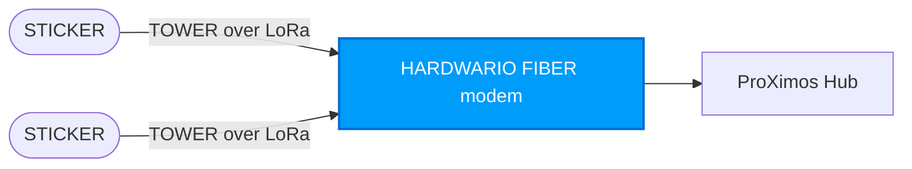

import Image from '@theme/IdealImage';

# Režim LoRa P2P (peer-to-peer) {#lora-p2p-peer-to-peer-mode}

:::info Dostupné od firmwaru v2.0.0
Režim LoRa P2P je součástí firmwaru STICKER **v2.0.0**. Stejný obraz firmwaru umí LoRaWAN i P2P; zařízení si jeden z nich zvolí při startu podle parametru `radio-mode`.
:::

**LoRa P2P** je druhý režim rádia pro lokality bez sítě LoRaWAN. STICKER nepotřebuje síťový server LoRaWAN (LNS). Spáruje se s **ProXimos Hubem** přes modem **HARDWARIO FIBER** a komunikuje **rádiovým protokolem HARDWARIO TOWER** přes LoRa.

---

## Hlavní výhody {#key-advantages}

- **Bez infrastruktury LoRaWAN:** Není potřeba brána LoRaWAN ani síťový server (ChirpStack, TTS). Síť řídí ProXimos Hub.
- **Potvrzované doručení:** Brána potvrzuje rámce přímo na místě. Jedno potvrzované odeslání vyšle rámec až třikrát, dokud nepřijde potvrzení (ACK). Bez potvrzení se odeslání po náhodné prodlevě zopakuje ještě nejvýš třikrát.
- **Stejné funkce jako LoRaWAN:** Telemetrie, alarmy, příkazy přes downlink, stránkované odpovědi, doplnění historie, síťový čas, dohled nad spojením, `get_radio_state` a ohlášení Info + nastavení po startu a každých `interval-announce` hodin.
- **Šifrování a autentizace:** Každý datový rámec chrání AES-128-CCM klíčem relace, který se odvodí při připojení k síti.

---

## Architektura a topologie {#architecture--topology}



- **Párování:** Uzel se připojí k síti rádiem. JoinRequest identifikuje uzel jeho DevEUI a je autentizovaný klíči odvozenými z jeho AppKey. Hub odpoví zprávou JoinAccept a obě strany si odvodí nový klíč relace. Spárování se uloží, takže restart nevyžaduje nové připojení.
- **Rámce:** Rámce TOWER se 14bajtovou hlavičkou a 8bajtovým autentizačním tagem. MTU je 96 B, na užitečná data tedy zbývá 74 B na rámec.
- **Potvrzované vysílání:** Alarmy (při `radio-alarm-ack true`), odpovědi a rámce historie potvrzuje brána. Každé odeslání má až 3 vysílání a bez potvrzení se zopakuje nejvýš třikrát. Ve firmwaru v2.0.0 se potvrzuje i každé pravidelné hlášení telemetrie.
- **Downlinky:** Hub zařadí příkaz pro uzel do fronty a ohlásí ho příznakem PENDING v následujícím potvrzení. Uzel pak nechá přijímač zapnutý, dokud downlink nepřijme. Příkaz tak čeká nejvýš jeden interval hlášení.
- **Payloady:** Payloady STICKER jsou bajt po bajtu stejné jako payloady na fPortech LoRaWAN (telemetrie 2, alarmy 3, odpovědi 85), takže platí stejné příkazy, dekodér i pravidla stránkování.
- **Duty cycle:** Uzel si sám hlídá rozpočet vysílacího času v klouzavé hodině podle subpásma EU868, do kterého spadá `p2p-frequency`.

:::caution Uzly a Hub aktualizujte současně
Firmware v2.0.0 převedl P2P na protokol TOWER bez možnosti návratu. Uzly a ProXimos Hub je nutné aktualizovat současně a každý uzel se po aktualizaci připojí znovu.
:::

---

## Parametry rádia {#radio-parameters}

Uzel i Hub musí mít stejné parametry rádia. P2P nemá ADR, řízení výkonu ani změnu SF: všechny parametry jsou pro danou síť pevné.

| Parametr | Výchozí hodnota | Popis |
|---|---|---|
| **`p2p-frequency`** | `869525000` (869,525 MHz) | Nosná frekvence v Hz, 863–870 MHz (jen pásmo EU868). Jeden kanál pro uplink, potvrzení i downlink. |
| **`p2p-spreading-factor`** | `7` | Spreading factor 6–12. Vyšší hodnota znamená delší dosah i delší dobu vysílání. |
| **`p2p-tx-power`** | `14` | Vysílací výkon 2–14 dBm, pokud ho Hub nepřidělí ve zprávě JoinAccept. |
| **`p2p-modulation`** | `lora` | `lora` pro ProXimos Hub. `fsk` zvolí fyzickou vrstvu TOWER GFSK pro standardní bránu HARDWARIO TOWER (páruje se vlastním párováním TOWER). |

Při `p2p-modulation lora` jsou ostatní fyzické parametry pevné: šířka pásma 125 kHz, coding rate 4/5, preambule 8 symbolů, explicitní hlavička, CRC zapnuté.

---

## Konfigurace a správa {#configuration--management}

Parametry rádia P2P lze zapsat **jen ve vývojářském shellu přes RTT**, který mají ladicí a produkční (provisioning) obraz firmwaru. Release obraz shell nemá. Pracuje s hodnotami `p2p-*` uloženými v NVS: s hodnotami, které zapsal ladicí nebo produkční obraz předtím, než se přes něj bez mazání nahrál release obraz, jinak s výchozími hodnotami z tabulky výše. Zařízení s release obrazem proto komunikuje s Hubem na výchozích hodnotách (869,525 MHz, SF7, 14 dBm, `lora`), pokud jeho parametry nebyly nastaveny tímto způsobem, a Hub je potřeba nastavit shodně. Přes NFC umí aplikace [**HARDWARIO Manager**](/sticker/hardwario-manager/) přepnout `radio-mode` na `p2p`, parametry `p2p-*` ale nastavit nedokáže: firmware jejich zápis přes NFC odmítne. Přes NFC i přes rádio jsou jen ke čtení (vrací je `get_config` / `get_param`). Přes rádio by navíc jejich změna přerušila spojení, kterým přišla.

```bash
config radio-mode p2p
config p2p-frequency 869525000
config p2p-spreading-factor 7
config p2p-tx-power 14
config p2p-modulation lora
settings save
```

Identitu uzlu určují stejné parametry jako u LoRaWAN: `radio-deveui` (DevEUI, které Hub zaregistruje) a `radio-appkey` (kořenový klíč pro připojení). Samostatný klíč pro P2P neexistuje. Při nulovém DevEUI nebo AppKey rádio odmítne start.

### Diagnostika {#diagnostics}

- **`get_radio_state`** (přes NFC nebo rádio) vrací stav spojení, SF, vysílací výkon, RSSI/SNR v obou směrech, využití duty cycle a čítače od startu.
- Na ladicím obrazu s P2P ukáže `ats radio status` spárování a stav spojení. Při testování na stole pomohou `ats radio listen`, `ats radio unjoin` (zapomene spárování, restartuje) a `ats radio ack_drop`.

### Známá omezení {#known-limitations}

- Zatím chybí listen-before-talk.
- Parametry rádia P2P nejde nastavit přes NFC.
- Jen pásmo EU868.

Postupy uvedení do provozu v terénu najdete v dokumentaci aplikace [**HARDWARIO Manager**](/sticker/hardwario-manager/).
