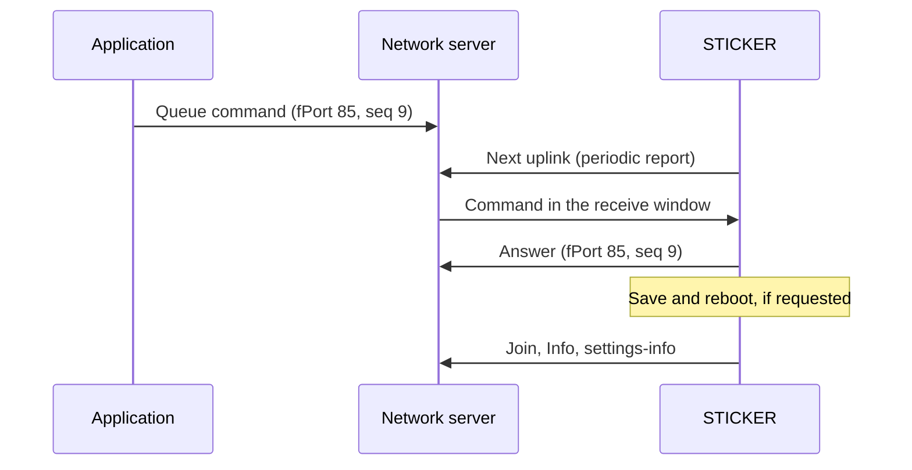

# Zpracování downlinků {#downlink-processing}

:::caution Koncept
Tato stránka je koncept pro interní kontrolu. Tvrzení označená **[ověřit]** je ještě potřeba potvrdit na hardwaru nebo u vlastníka produktu.
:::

:::info Firmware v2.0.0
Tato stránka popisuje **firmware STICKER v2.0.0**. Kde se firmware v1.4.x chová jinak, upozorní na to poznámka **Firmware v1.4.x**.
:::

Zařízení STICKER můžete ovládat na dálku downlinky, tedy zprávami, které mu posílá síťový server. Tato stránka vysvětluje, co zařízení s downlinkem udělá: které příkazy přes rádio přijme, kdy se změna projeví, jak odpoví a co znamenají jeho chybové kódy. Pomůže vám zjistit, proč příkaz neměl očekávaný účinek. Jak se jednotlivé příkazy kódují, popisuje stránka [**Příkazy přes downlink**](../connectivity/downlink-commands.md).

## Jak se downlink zpracuje {#how-a-downlink-is-handled}

STICKER je koncové zařízení LoRaWAN třídy A: downlink přijímá jen ve dvou krátkých přijímacích oknech hned po každém svém uplinku (uplink je zpráva, kterou zařízení odesílá). Příkaz, který zařadíte do fronty na síťovém serveru, tam proto čeká až do dalšího uplinku zařízení. Obvykle je to další pravidelné hlášení, které zařízení při výchozím `interval-report` posílá každých 900 s. V režimu [**LoRa P2P**](../connectivity/lora-p2p.md) drží ProXimos Hub příkaz stejně tak až do dalšího uplinku uzlu.

1. **Zařazení:** příkaz zařadíte do fronty na **fPort 85**. Číslo portu zprávy LoRaWAN (fPort) říká příjemci, co zpráva nese. Příkaz je krátká zpráva v kompaktním binárním formátu protobuf s pořadovým číslem `seq`, které si zvolíte sami. Zařadit ho můžete jako hex, nebo v JSON, pokud `ttn.js` slouží jako formátovač downlinků (viz [**Payload a dekodér**](payload.md)).
2. **Vykonání:** zařízení příkaz po svém dalším uplinku přijme, zkontroluje a vykoná.
3. **Odpověď:** zařízení odpoví hned vlastním uplinkem na fPort 85 se stejným `seq`, pokud odpověď nezdrží **duty cycle**. Duty cycle je zákonný limit vysílacího času: v regionu EU868 je to 1 % času, tedy 36 s za hodinu.
4. **Navazující akce:** příkaz, který ukládá nastavení, restartuje zařízení nebo zahajuje nové připojení k síti, spustí tuto akci až poté, co odejde jeho odpověď.



| Položka | Hodnota |
|---|---|
| Port příkazů | fPort 85 v obou směrech |
| Formát příkazu | Protobuf se `seq`, bez bajtu verze |
| Největší příkaz | 224 B; větší downlink zařízení bez odpovědi zahodí |
| Příkazy čekající na zpracování | 2; příkaz, který přijde, když jsou obě místa obsazená, zařízení bez odpovědi zahodí |
| Formát odpovědi | Uplink na fPort 85: bajt verze `0x01`, za ním protobuf se stejným `seq` |
| Velikost odpovědi | Nejvýš 64 B na rámec a ne víc, než dovolí aktuální datová rychlost; delší odpovědi se stránkují |
| `seq` 0 | Používají ho uplinky Info a settings-info, které zařízení posílá samo; svým příkazům dávejte `seq` 1 nebo vyšší |
| Downlinky na jiných fPortech | Jako příkazy se nezpracují |

V síti LoRaWAN je odpověď nepotvrzovaný uplink: síťový server její příjem nepotvrzuje, a když se cestou ztratí, zařízení ji znovu neodešle. V režimu LoRa P2P potvrzuje každou odpověď brána; nepotvrzenou odpověď zařízení pošle znovu nejvýš 3krát. Pokud odpověď nepřijde, přečtěte si nejdřív aktuální stav (například příkazem `get_settings` nebo `get_param`) a teprve potom opakujte příkaz, který ukládá nastavení nebo zařízení restartuje.

:::tip Příkazy v JSON
S kodérem `ttn.js` vnořte tělo příkazu pod klíč s názvem příkazu, například `{"command": "reset_counters", "seq": 5, "reset_counters": {"input_a": true}}`. Ploché tělo jako `{"command": "reset_counters", "input_a": true}` kodér ignoruje a odešle příkaz prázdný: `reset_counters` pak nic nevynuluje a `req_history` znovu odešle celou historii.
:::

## Příkazy přes rádio a přes NFC {#commands-over-the-radio-and-over-nfc}

Většina příkazů funguje přes rádio. Příkazy, které by mohly zařízení odříznout od sítě, prozradit jeho tajné údaje nebo změnit identitu, fungují jen přes NFC v aplikaci [**HARDWARIO Manager**](/apps/hardwario-manager/sticker/configuration) nebo v shellu sestavení debug.

| Kanál | Příkazy |
|---|---|
| Přes rádio (LoRaWAN a LoRa P2P) | `set_param`, `get_param`, `get_config`, `get_settings`, `get_info`, `get_radio_state`, `settings_save`, `reboot`, `reset_counters`, `w1_scan`, `lrw_join`, `clock_sync`, `sample`, `buzzer_play`, `force_send`, `req_history` |
| Jen přes NFC nebo shell | `device_reset`, `factory_reset`, `lrw_reset`, `enter_calibration`, `set_secret_key`, `req_history_page`, `claim_done`, `claim_active`, `get_claim_info`, `get_basic_info`; `vendor_reset` jen přes kanál NFC výrobce |

- **Nepovolený kanál:** příkaz, který dorazí kanálem, kde není povolený, dostane odpověď `NOT_READY` (kód 3).
- **Neznámý příkaz:** příkaz, který firmware nezná, například `enter_dfu` ze staršího firmwaru, dostane odpověď `NOT_SUPPORTED` (kód 7).
- **Jen přes rádio:** `force_send` a `req_history` fungují jen přes rádio, protože jejich odpovědí je přímo uplink: telemetrické hlášení na fPort 2 nebo série rámců historie na fPort 85.
- **Bez `Ack`:** `get_info`, `w1_scan`, `force_send`, `sample`, `clock_sync` a `req_history` odpovídají místo `Ack` rovnou svými daty. `clock_sync` pošle zprávu Info se svým `seq`, jakmile dorazí síťový čas.

Příkaz si sestavíte v [**generátoru příkazů přes downlink**](../connectivity/downlink-commands-generator.mdx).

:::note Firmware v1.4.x
Firmware v1.4.x přijímal přes LoRaWAN také `lrw_reset`, `enter_calibration` a `set_param` s parametrem `calibration`. Firmware v2.0.0 odpovídá na oba příkazy `NOT_READY` a na tento parametr `NOT_WRITABLE`, protože po resetu LoRaWAN na dálku by síťový server mohl odmítat každé další připojení a kalibrační režim vysílá s klíči, které jsou na všech kusech stejné.
:::

## Kdy se změna projeví {#when-a-change-takes-effect}

Downlink `set_param` změnu jen připraví. Zařízení dál pracuje se současným nastavením, dokud změny neuložíte, a po uložení se restartuje. Výjimkou jsou pravidla alarmů a nulování čítačů: ty se projeví hned.

| Co pošlete | Co se stane |
|---|---|
| `set_param` bez `save` | Změna se jen připraví. `get_config`, `get_param` a `get_settings` hned ukazují novou hodnotu, zařízení ale dál pracuje se starou. |
| `settings_save` nebo `set_param` se `save: true` | Zařízení zapíše všechny připravené změny do NVS (úložiště nastavení ve flash paměti) a pak proběhne studený restart. Nové nastavení platí od tohoto startu. |
| `reboot` | Zařízení se restartuje bez uložení; připravené změny se ztratí. |
| Pravidla alarmů v `set_param` včetně `alarms_replace` | Pravidla platí hned, bez restartu. Pokud je zároveň neuložíte, při dalším restartu se vrátí předchozí pravidla. |
| `reset_counters` | Vybrané čítače se hned vynulují a uloží do flash paměti, bez restartu. |
| `lrw_join` | Zařízení bez restartu zahájí nové připojení k síti. |

Po uložení se zařízení restartuje, znovu se připojí k síti a odešle uplinky Info a settings-info, takže settings-info ukáže klíčová nastavení v uložené podobě. Podrobnosti najdete na stránce [**Zprávy a časování**](messages.md).

Pokud zařízení `set_param` odmítne s chybou, nic z něj nepřipraví a jeho příznak `save` ignoruje, takže se nerestartuje.

<details>
<summary><b>Pořadí navazujících akcí</b></summary>

- **Nejdřív odpověď:** dokud má zařízení co odesílat, neukládá, nerestartuje se ani se znovu nepřipojuje k síti. Počká, až odejde odpověď, případné alarmové rámce ve frontě a případný potvrzovaný uplink, který ještě čeká na potvrzení.
- **Časování:** zařízení to kontroluje 8 s po příkazu a pak každých 8 s. Akci spustí nejpozději 120 s po prvním takovém příkazu, i když ještě něco zůstává neodeslané.
- **Více příkazů:** příkazy, které přijdou, zatímco akce čeká, se sloučí do jednoho běhu. Nejdřív se uloží čekající nulování čítačů, pak jednou proběhne nejsilnější restart: uložení má přednost před prostým `reboot`. Samotný restart stavy čítačů neukládá, takže impulzy napočítané od posledního pravidelného uložení se ztratí. Čekající `lrw_join` se zahodí, když má následovat restart, protože zařízení se při každém startu k síti stejně připojuje.
- **Neúspěšné uložení:** pokud zápis do flash paměti selže, zařízení se stejně restartuje a naběhne s tím, co je v ní uložené; připravené hodnoty se ztratí.
- **Velká konfigurace:** downlink unese jen tolik bajtů, kolik dovolí datová rychlost jeho přijímacího okna. Velkou konfiguraci proto rozdělte do několika downlinků `set_param`: jejich změny se postupně přidávají k připravené konfiguraci a `save` nastavíte až v posledním. Když takto přepisujete tabulku alarmů, nastavte `alarms_replace` jen v prvním downlinku. Pokud se zařízení restartuje dřív, než dorazí poslední downlink, připravená část se ztratí a musíte ji poslat znovu.

</details>

## Nastavení, která nelze změnit přes rádio {#settings-that-cannot-be-changed-over-the-air}

Downlinkem nelze změnit, jak se zařízení připojuje k síti. Chybná hodnota by mohla přerušit právě to spojení, kterým příkaz přišel, a síťový server nesmí mít možnost měnit identitu ani klíče zařízení. Přes rádio `set_param` nezapíše:

- celou skupinu `lorawan`: `radio-mode`, `lrw-region`, `lrw-sub-band`, `lrw-network`, `lrw-activation`, `lrw-adr`, `lrw-datarate`, `radio-link-check-interval`, `radio-link-check-fail-rejoin` i identifikátory a klíče (DevEUI, JoinEUI, AppKey, NwkKey, DevAddr, NwkSKey, AppSKey);
- skupinu `p2p` s parametry rádia LoRa P2P, které lze nastavit jen v shellu;
- parametr `calibration`, který lze nastavit jen přes NFC nebo v shellu;
- parametr `vendor-reset-allow`, který lze nastavit jen přes kanál NFC výrobce nebo v shellu.

Pokud `set_param` obsahuje kterékoli z těchto polí, zařízení odpoví `NOT_WRITABLE` (kód 8), v `fault_field` uvede, o které pole jde, a **celý příkaz vrátí zpět**: nepřipraví žádnou z jeho hodnot, ani ty platné. Tato nastavení změníte přes NFC, viz [**Konfigurace**](configuration.md).

Čtení tak přísně omezené není. Přes rádio vracejí `get_config` a `get_param` nastavení a identifikátory LoRaWAN, nikdy ale klíče (AppKey, NwkKey, NwkSKey, AppSKey). `get_config` přes rádio navíc vynechává ROM kódy sond 1-Wire; `get_param` je vrátí, když si je vyžádáte.

## Odpovědi a stránkování {#answers-and-paging}

Odpověď, která se nevejde do jednoho uplinku, se rozdělí na stránky. Zařízení pošle všechny stránky samo a dekodér každou z nich označí, abyste mohli odpověď složit dohromady.

- **Velikost rámce:** každý rámec odpovědi má nejvýš 64 B a nikdy není větší, než dovolí aktuální datová rychlost. **Datová rychlost** (DR) určuje, kolik bajtů se vejde do jednoho uplinku: nízká DR, například DR0 (SF12 v EU868), má větší dosah, ale unese méně bajtů a vysílání trvá déle.
- **Stránky:** každá stránka je úplná odpověď se stejným `seq` a s poli `page_index` a `page_count`; dekodér přidá `pages`, například `"2/4"`. Stránky jedné odpovědi spojujte podle DevEUI, fPortu a `seq`.
- **Tempo:** přes rádio posílá zařízení zbývající stránky samo, nejvýš jednu za 2 s a jen tak rychle, jak dovolí duty cycle. Přes NFC si telefon každou stránku vyžádá.
- **Výpisy konfigurace:** přes rádio používají `get_config` a `get_param` pevné rozvržení stránek, takže úplný `get_config` zabere zhruba 4 stránky a k tomu jednu stránku za každé pravidlo alarmu, a to při každé datové rychlosti, která stránku unese.
- **Chybějící stránka:** pošlete stejný `get_config` nebo `get_param` znovu s `page` nastaveným na index chybějící stránky; zařízení pak pošle všechno od této stránky do konce. Při nízké datové rychlosti ale nejdřív chvíli počkejte, protože stránka možná jen čeká na vysílací čas.
- **Duty cycle při DR0:** v EU868 při DR0 zabere jedna stránka zhruba 2,1 s vysílacího času z rozpočtu 36 s za hodinu. Při nízké datové rychlosti počítejte s tím, že sběr všech stránek velké odpovědi potrvá nejméně 1 h, a žádejte jen to, co potřebujete: `get_param` pro jednotlivá nastavení, `get_settings` pro klíčová nastavení v jednom rámci.
- **`BUDGET_TOO_SMALL` (kód 9):** odpověď se při aktuální datové rychlosti nevejde, ani když se rozdělí na stránky. Stává se to u `get_config` a `get_param` při nejnižších datových rychlostech s 11 B na rámec (US915 DR0, AU915 a AS923 DR2) nebo když datová rychlost klesla až po sestavení odpovědi. Zkuste to znovu, až ji zvýší ADR (adaptivní datová rychlost, při níž síťový server sám upravuje rychlost zařízení), nebo hodnotu přečtěte přes NFC.
- **Jeden přenos naráz:** dokud se ještě odesílá stránkovaná odpověď, další požadavek, který potřebuje stránky, dostane odpověď `NOT_READY` se svým `seq`. Pošlete ho znovu, až bude první odpověď kompletní.

## Chybové kódy {#error-codes}

Když zařízení nemůže příkaz vykonat, odpoví místo `Ack` chybou. Chyba má číselný kód a u odmítnutého nastavení navíc pole `fault_field`, které určuje, o jaké nastavení jde. Přes LoRaWAN nese chyba jen tato čísla, přes NFC a LoRa P2P také krátký anglický text.

| Kód | Název | Typická příčina |
|---|---|---|
| 0 | `UNKNOWN` | Přes NFC: odpověď je na odeslání příliš velká nebo se nepodařilo nastavit hodiny. |
| 1 | `BAD_REQUEST` | Downlink se nepodařilo dekódovat; pole skupiny `sensors` odebrané ve v2.0.0 (`fault_field` 300 + jeho dřívější číslo); neznámá melodie `buzzer_play` nebo doba opakování nad 999 s; čas v `clock_sync` přes NFC mimo přijímané rozmezí (2024 až 2099). |
| 2 | `OUT_OF_RANGE` | Hodnota mimo povolený rozsah (určuje ji `fault_field`); neplatné pravidlo alarmu (`fault_field` 400 + číslo pole pravidla); stránka, která neexistuje. |
| 3 | `NOT_READY` | Příkaz není na tomto kanálu povolený; `lrw_join`, dokud nejsou uložené změny LoRaWAN; ještě se odesílá jiná stránkovaná odpověď; sběrnice 1-Wire není připravená; bzučák není aktivní; `get_claim_info` po převzetí zařízení. |
| 4 | `HISTORY_UNAVAILABLE` | `req_history` nenašel v požadovaném časovém okně žádné uložené záznamy, například proto, že historie nebyla nikdy zapnutá. |
| 5 | `UNSUPPORTED_FIELD` | Kód je definovaný v protokolu, firmware v2.0.0 ho ale neposílá. |
| 6 | `PERSIST_FAILED` | Kód je definovaný v protokolu, firmware v2.0.0 ho ale neposílá. |
| 7 | `NOT_SUPPORTED` | Neznámý nebo odebraný příkaz; funkce, která v tomto obrazu firmwaru není (1-Wire, bzučák, kalibrace). |
| 8 | `NOT_WRITABLE` | Nastavení nelze přes tento kanál zapsat, například skupinu `lorawan` přes downlink. |
| 9 | `BUDGET_TOO_SMALL` | Odpověď se při aktuální datové rychlosti nevejde. Zkuste to znovu při vyšší datové rychlosti. |

Jak číst `fault_field`:

- **Hodnota:** skupina × 100 + číslo pole. Skupiny jsou 1 `lorawan`, 2 `application`, 3 `sensors`, 4 `alarms` a 5 `p2p`. Například 203 je pole 3 skupiny `application`, tedy `interval-report`.
- **Po dekódování:** dekodér hodnotu rozdělí na `fault_group` (skupinu) a `fault_field` (číslo pole), takže z hodnoty 203 vznikne `"fault_group": 2, "fault_field": 3`.
- **Pravidla alarmů:** neplatné pravidlo dává 400 + číslo pole svého slotu, od 403 pro `alarm_0` po 418 pro `alarm_15`. Dekodér rozdělí i toto číslo, takže chyba u odmítnutého pravidla `alarm_0` se dekóduje jako `"fault_group": 4` a `"fault_field": 3`. Pokud nejde určit jedno konkrétní pravidlo, je hodnota 400.
- **Odebraná pole:** pole schopnosti vstupu, PIR nebo bzučáku z v1.4.x (pole 3, 4, 7, 19, 20 nebo 21 skupiny `sensors`) dává `BAD_REQUEST` s hodnotou 300 + toto číslo.
- **Jen první chyba:** zařízení ohlásí první chybné pole, na které narazí, a celý `set_param` vrátí zpět.

<details>
<summary><b>Čísla polí pro fault_field</b></summary>

| Skupina | Čísla polí |
|---|---|
| 1 `lorawan` | 1 `lrw-region`, 2 `lrw-sub-band`, 3 `lrw-network`, 4 `lrw-adr`, 5 `lrw-activation`, 6 `radio-deveui`, 7 `lrw-joineui`, 8 `lrw-nwkkey`, 9 `radio-appkey`, 10 `lrw-devaddr`, 11 `lrw-nwkskey`, 12 `lrw-appskey`, 13 `radio-link-check-interval`, 14 `radio-link-check-fail-rejoin`, 15 `radio-mode`, 16 `lrw-datarate` |
| 2 `application` | 1 `calibration`, 2 `interval-sample`, 3 `interval-report`, 4 `history-enable`, 6 `battery-level`, 7 `vendor-reset-allow`, 8 `interval-announce`, 9 `history-channels` |
| 3 `sensors` | 1 `cap-hall-left`, 2 `cap-hall-right`, 5 `cap-light-sensor`, 6 `cap-barometer`, 8 `cap-w1-sensors`, 9 `cap-accelerometer`, 10 `accel-motion-sensitivity`, 11–14 `sensor1-rom` až `sensor4-rom`, 15 `hall-left-counter`, 16 `hall-right-counter`, 17 `input-a-counter`, 18 `input-b-counter`, 22 `cap-sht`, 23–26 `sensor1-type` až `sensor4-type`, 27 `cap-gpio-mode`, 28 `cap-gpio-input-a`, 29 `cap-gpio-input-b` |
| 4 `alarms` | 1 `alarm-limit`, 3–18 pravidla alarmů `alarm_0` až `alarm_15`, 20 `alarm-buzzer-mode`, 21 `radio-alarm-ack` |
| 5 `p2p` | 1 `p2p-frequency`, 2 `p2p-spreading-factor`, 3 `p2p-tx-power`, 4 `p2p-modulation` |

</details>

## Příklady {#examples}

Následující downlinky můžete rovnou zařadit na fPort 85. Další sestavíte v [**generátoru příkazů přes downlink**](../connectivity/downlink-commands-generator.mdx).

| Hex (fPort 85) | Příkaz | Co zařízení udělá |
|---|---|---|
| `08032200` | `get_info`, `seq` 3 | Odpoví zprávou Info se `seq` 3. |
| `08043200` | `settings_save`, `seq` 4 | Odpoví `Ack`, pak uloží připravená nastavení a restartuje se. |
| `08056200` | `clock_sync`, `seq` 5 | Vyžádá si od sítě čas; jakmile dorazí, pošle zprávu Info se `seq` 5. |
| `08064a00` | `force_send`, `seq` 6 | Odešle telemetrické hlášení na fPort 2; na fPort 85 žádná odpověď nepřijde. |
| `08118a0100` | `lrw_join`, `seq` 17 | Odpoví `Ack`, pak bez restartu zahájí nové připojení k síti. |
| `08021a070a010312020407` | `get_param`, `seq` 2: pole 3 skupiny `lorawan`, pole 4 a 7 skupiny `application` | Odpoví výpisem `config_dump` s hodnotami `lrw-network`, `history-enable` a `vendor-reset-allow`. |
| `080912021801` | `set_param` jen se `save: true`, `seq` 9 | Odpoví `Ack`, pak uloží vše, co je zatím připravené, a restartuje se. |
| `0807fa0100` | `get_settings`, `seq` 7 | Odpoví uplinkem settings-info se `seq` 7. |
| `080812023001` | `set_param` s `alarms_replace: true` a bez pravidel, `seq` 8 | Odpoví `Ack` a okamžitě smaže všech 16 pravidel alarmů; bez uložení se při dalším restartu vrátí. |

Typické odpovědi na fPort 85:

| Hex (fPort 85) | Význam |
|---|---|
| `0108011200` | `Ack` pro `seq` 1 |
| `0108033205080210cb01` | Chyba `OUT_OF_RANGE` (2) pro `seq` 3, `fault_field` 203: `interval-report` mimo rozsah 60–86400 s |
| `01080232020809` | Chyba `BUDGET_TOO_SMALL` (9) pro `seq` 2: zkuste to znovu při vyšší datové rychlosti |

<details>
<summary><b>Dekódované odpovědi</b></summary>

`0108011200`:

```json
{ "seq": 1, "ack": {} }
```

`0108033205080210cb01`:

```json
{ "seq": 3, "error": { "code": 2, "fault_field": 3, "fault_group": 2 } }
```

`01080232020809`:

```json
{ "seq": 2, "error": { "code": 9 } }
```

</details>

Příklad `set_param` z poznámek k vydání v1.4.0, `0801120c0a0220011202187822023001`, nastavuje jedním příkazem `lrw-adr`, `interval-report` a `cap-barometer`. Protože `lrw-adr` patří do skupiny `lorawan`, zařízení odpoví `NOT_WRITABLE` s `fault_field` 104 a nepoužije žádnou ze tří hodnot. Kód firmwaru v1.4.0 ho odmítá stejně. Bez části LoRaWAN vypadá stejná změna jako `080112081202187822023001` (jen připravená) nebo `0801120a12021878220230011801` (se `save`); `lrw-adr` nastavte přes NFC.
