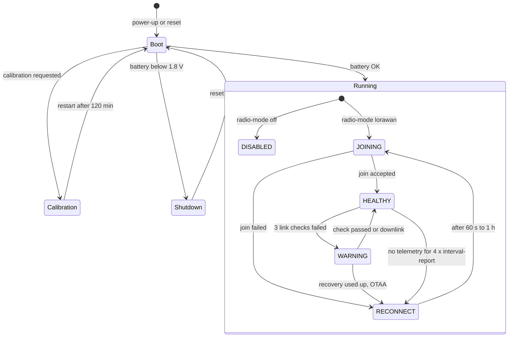

# Chování zařízení {#device-behavior}

:::caution Koncept
Tato stránka je koncept pro interní kontrolu. Tvrzení označená **[ověřit]** je ještě potřeba potvrdit na hardwaru nebo u vlastníka produktu.
:::

:::info Firmware v2.0.0
Tato stránka popisuje **firmware STICKER v2.0.0**. Kde se firmware v1.4.x chová jinak, upozorní na to poznámka **Firmware v1.4.x**.
:::

Tato kapitola popisuje, co zařízení STICKER dělá v jednotlivých situacích: po vložení baterií, při připojování k síti, při zhoršení rádiového spojení, po přijetí příkazu a když některý senzor nebo sonda vypadne. Je psaná pro podporu a pro zákazníky, kteří potřebují vědět, co zařízení dělá a proč. Parametry, kódování příkazů a zapojení najdete na referenčních stránkách, na které kapitola odkazuje.

## Stavy zařízení {#device-states}

Zařízení STICKER je vždy v jednom ze stavů níže. Za běžného provozu je v některém ze stavů rádia uvnitř stavu **Running**. Diagram ukazuje, jak mezi stavy přechází, a tabulka pod ním, podle čeho který stav poznáte. Stavy rádia píšeme tak, jak je pojmenovává firmware (`HEALTHY`, `WARNING` atd.). Stejně je uvidíte v shellu zařízení a malými písmeny i v dekódované odpovědi na `get_radio_state`.

| Stav | Co znamená | Stavová LED | Podrobnosti |
|---|---|---|---|
| Start (Boot) | Zařízení právě nastartovalo. Zkontroluje baterii a pak postupně spustí senzory, úložiště, rádio a NFC. | Jednou červená, žlutá a zelená (asi 3 s) | [**Start a inicializace**](startup.md) |
| Vypnutí (Shutdown) | Napětí baterie bylo při startu pod 1,8 V, a proto se zařízení samo vypnulo. | Startovní sekvence, pak 5 s rychlé červené blikání, 1 s červená a zhasnutí | [**Baterie a napájení**](battery.md) |
| Kalibrace (Calibration) | Testovací režim pro výrobu a servis, trvá 120 min. | Krátké oranžové bliknutí každou sekundu | [**Start a inicializace**](startup.md) |
| `DISABLED` | Rádio je záměrně vypnuté (`radio-mode off`), obraz firmwaru nastavený region nepodporuje, nebo LoRa P2P nemá klíče. Zařízení měří, ale nic neodesílá. | Jedno velmi krátké žluté bliknutí každé 3 s | [**Připojení k síti**](network-connection.md) |
| `JOINING`, `RECONNECT` | Zařízení není v síti a pokusy o připojení opakuje s prodlužující se pauzou (od 60 s až po 1 h). | Krátké žluté a červené bliknutí každé 3 s | [**Připojení k síti**](network-connection.md) |
| `HEALTHY` | Připojeno; hlášení odcházejí v intervalu `interval-report`. | Velmi krátké zelené bliknutí každé 3 s | [**Zprávy a časování**](messages.md) |
| `WARNING` | Stále připojeno, ale kontroly spojení selhávají. Zařízení kontroluje spojení s každým hlášením a zkouší odolnější datovou rychlost. | Dvě velmi krátká žlutá bliknutí každé 3 s | [**Připojení k síti**](network-connection.md) |

Navíc k těmto stavům může LED ukázat ještě dva signály. Velmi krátké červené bliknutí každé 3 s znamená aktivní alarm. Vzory stavů rádia mají přednost, takže ho uvidíte jen ve stavu `HEALTHY` (nebo `IDLE`). Dvojité bliknutí červeně a žlutě každé 3 s znamená, že uložené nastavení nešlo načíst a zařízení běží na výchozích hodnotách z výroby **[ověřit]**. Úplný přehled signalizace LED najdete na stránce [**Popis hardwaru**](../hardware-description.md).

:::note Firmware v1.4.x
Ve firmwaru v1.4.x nemá stav `WARNING` žádné kroky obnovy, takže od ztráty spojení po opětovné připojení uplyne asi 9–10 h místo 4–5 h. Kontrola baterie při startu chybí a některé vzory LED se liší. Viz [**Verze a aktualizace firmwaru**](firmware.md).
:::

## Ve zkratce {#at-a-glance}

S výchozím nastavením dělá připojené zařízení STICKER toto:

| Co | Kdy | Podrobnosti |
|---|---|---|
| Připojí se k síti (OTAA) | Při každém startu a po ztrátě spojení | [**Připojení k síti**](network-connection.md) |
| Odešle uplinky **Info** a **settings-info** | Po každém připojení a každých 24 h | [**Zprávy a časování**](messages.md) |
| Odešle telemetrické hlášení | Každých 900 s (15 min) | [**Zprávy a časování**](messages.md) |
| Zkontroluje rádiové spojení | S každým 5. hlášením | [**Připojení k síti**](network-connection.md) |
| Synchronizuje hodiny se sítí | Po připojení, pak jednou týdně | [**Zprávy a časování**](messages.md) |
| Odešle alarmové hlášení | Asi 10 s po začátku nebo konci alarmu | [**Alarmy**](alarms.md) |
| Uloží čítače do flash paměti | S každým hlášením, pokud se změnily | [**Historie a čítače**](history-and-counters.md) |
| Zaznamenává historii senzorů | Jen se zapnutým `history-enable` | [**Historie a čítače**](history-and-counters.md) |

## Rozcestník {#find-the-right-page}

| Situace | Stránka |
|---|---|
| LED se po vložení baterií chová nečekaně | [**Start a inicializace**](startup.md) |
| Zařízení se na síťovém serveru neobjeví nebo přestala přicházet data | [**Připojení k síti**](network-connection.md) |
| Chcete vědět, jaké uplinky můžete čekat a jak často | [**Zprávy a časování**](messages.md) |
| Poslali jste příkaz a nic se nezměnilo, nebo přišla chyba | [**Zpracování downlinků**](downlinks.md) |
| Potřebujete data z doby, kdy bylo zařízení offline | [**Historie a čítače**](history-and-counters.md) |
| Nastavili jste alarmy a chcete vědět, co odesílají | [**Alarmy**](alarms.md) |
| Sonda 1-Wire byla odpojena nebo vyměněna | [**Sondy 1-Wire**](one-wire.md) |
| Měníte nastavení telefonem přes NFC | [**Konfigurace**](configuration.md) |
| Máte otázku k výdrži baterie nebo ke slabé baterii | [**Baterie a napájení**](battery.md) |
| Zpracováváte payload ve vlastním systému | [**Payload a dekodér**](payload.md) |
| Potřebujete zjistit verzi firmwaru nebo chcete firmware aktualizovat | [**Verze a aktualizace firmwaru**](firmware.md) |
| Vycházíte z příznaku | [**Řešení problémů**](troubleshooting.md) |
