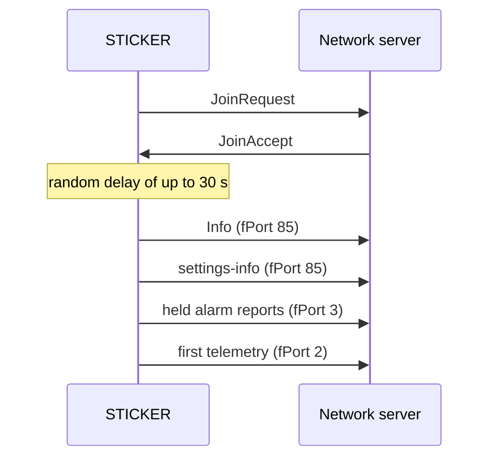

# Zprávy a časování {#messages-and-timing}

:::caution Koncept
Tato stránka je koncept pro interní kontrolu. Tvrzení označená **[ověřit]** je ještě potřeba potvrdit na hardwaru nebo u vlastníka produktu.
:::

:::info Firmware v2.0.0
Tato stránka popisuje **firmware STICKER v2.0.0**. Kde se firmware v1.4.x chová jinak, upozorní na to poznámka **Firmware v1.4.x**.
:::

Zařízení STICKER se po každém připojení k síti ohlásí, pak posílá pravidelná hlášení, ohlášení periodicky opakuje a synchronizuje si hodiny. Zde najdete, které zprávy přitom odcházejí, v jakém pořadí a jak často. Podle toho ověříte, jestli to, co vidíte na síťovém serveru, odpovídá očekávanému chování. Jak se zařízení do sítě dostane a co dělá při výpadku spojení, popisuje stránka [**Připojení k síti**](network-connection.md).

## Druhy uplinků {#uplink-types}

Uplink je zpráva ze zařízení do sítě, downlink putuje opačným směrem. Jaký druh zprávy uplink nese, určuje fPort, číslo obsažené v každém rámci LoRaWAN:

| fPort | Směr | Zpráva | Kdy |
|---|---|---|---|
| 2 | Uplink | **Telemetrie:** hodnoty senzorů, napětí baterie a stav alarmů | Jednou za `interval-report` a po každém připojení; navíc při začátku nebo konci alarmu a jako odpověď na `force_send` nebo `sample` |
| 3 | Uplink | **Alarmové hlášení:** alarmové události z jednoho okna pro sběr | Při začátku nebo konci alarmu, a to na konci okna `alarm-limit` (výchozí 10 s); viz [**Alarmy**](alarms.md) |
| 85 | Uplink | **Odpovědi:** uplinky **Info** a **settings-info**, výsledky příkazů a rámce historie senzorů | Po každém připojení, jednou za `interval-announce` a jako odpověď na příkaz |
| 85 | Downlink | **Příkazy** | Když příkaz odešle vaše aplikace nebo síťový server; viz [**Zpracování downlinků**](downlinks.md) |
| 10 | Uplink | **Kalibrační data** | Jen v kalibračním režimu, který slouží výrobě a servisu |

Každý uplink na fPort 2, 3 a 85 začíná bajtem verze formátu `0x01`, za kterým následuje zpráva protobuf; dekodér STICKER (`ttn.js`) z ní udělá JSON. Zpráva, která se při aktuální datové rychlosti (DR) nevejde do jednoho rámce, se rozdělí na stránky a dekodér každou stránku označí, například `pages: "1/2"`. Pole jednotlivých zpráv popisuje stránka [**Payload a dekodér**](payload.md).

Síťový server občas může ukázat uplink bez aplikačních dat. V takovém případě celý rámec zabraly příkazy MAC ze sítě (řídicí zprávy LoRaWAN) a zařízení na ně odpovědělo prázdným uplinkem.

## Co ukáže síťový server po zapnutí {#what-the-network-server-shows-after-power-up}

Tabulka ukazuje zařízení s aktivací OTAA (do sítě se připojuje zprávou JoinRequest) a výchozím nastavením (`interval-report` 900 s, `interval-announce` 24 h, kontrola spojení s každým 5. hlášením) v síti, která odpovídá.

| Čas | Co přijde | fPort | Poznámky |
|---|---|---|---|
| Několik sekund po zapnutí | Připojení: JoinRequest a JoinAccept | Žádný | Jen OTAA. Neúspěšné připojení se zopakuje asi po 1 min, pak s pauzou, která se pokaždé zdvojnásobí až na 1 h. |
| 0–30 s po připojení | **Info** | 85 | První uplink po připojení nese i příkaz MAC `DeviceTimeReq`; odpověď sítě nastaví hodiny. |
| Hned potom | **settings-info** | 85 | Dekóduje se jako `config_dump` |
| Hned potom | Alarmová hlášení | 3 | Jen pokud čekají alarmové události z doby, kdy zařízení nebylo v síti |
| Hned potom | První telemetrie | 2 | `boot: true`. Nese kontrolu spojení (`LinkCheckReq`), na kterou síť odpoví downlinkem. |
| Asi 900 s po zapnutí, plus nejvýš asi 70 s | Telemetrie | 2 | Pak každých 900 s ve stejném taktu. Každé 5. hlášení nese kontrolu spojení. |
| Při začátku nebo konci alarmu | Alarmové hlášení a telemetrický uplink navíc | 3 a 2 | Alarmové hlášení přijde na konci okna `alarm-limit` |
| 21,6–24 h po připojení | **Info** a **settings-info** | 85 | Pak znovu vždy po 21,6–24 h |
| 7 dní po prvním síťovém čase | `DeviceTimeReq` v běžném uplinku | Libovolný | Týdenní opakovaná synchronizace hodin; žádný uplink navíc |

První pravidelné hlášení přijde jeden `interval-report` po zapnutí, ne po připojení, takže první dva telemetrické uplinky od sebe dělí méně než 15 min. Po opětovném připojení bez restartu uvidíte stejný sled od **Info** dál, jen první telemetrie má `boot: false` a `DeviceTimeReq` chybí, pokud už byly hodiny od startu nastavené. Zařízení s aktivací ABP (uložené klíče relace, bez připojování) začíná rovnou zprávou **Info**.

## Zprávy po každém připojení {#messages-after-every-join}

Po každém úspěšném připojení, tedy po každém startu i opětovném připojení, se zařízení STICKER nejdřív ohlásí a teprve potom posílá data. Pořadí je pevné: nejdřív uplink **Info**, pak uplink **settings-info**, pak případná alarmová hlášení, která se nashromáždila, dokud zařízení nebylo v síti, a teprve potom první telemetrické hlášení. Tomuto sledu se říká ohlášení (announce). S aktivací ABP následuje po každém startu, v LoRa P2P po každém navázání spojení, včetně startu s uloženým spárováním.



| Položka | Hodnota |
|---|---|
| Začátek ohlášení | Po náhodném zpoždění nejvýš min(`interval-report` / 2, 30 s), při výchozích 900 s tedy nejvýš 30 s, aby zařízení, která se restartují současně, nevysílala naráz |
| Pořadí | **Info**, **settings-info**, zadržená alarmová hlášení, první telemetrie |
| `seq` | U **Info** a **settings-info** je 0, takže dekódovaný uplink pole `seq` nemá. Odpověď na příkaz nese `seq` příkazu (jeho pořadové číslo). |
| Čekající data | Alarmová hlášení a první telemetrie počkají na ohlášení, nejdéle však 60 s po náhodném zpoždění |
| První telemetrie | Odejde hned po ohlášení, bez posunu a náhodného zpoždění, které má pravidelné hlášení |
| Málo místa při aktuální datové rychlosti | **Info** a **settings-info** se rozdělí na stránky. Když se nevejde ani jedno pole, odejdou, až se datová rychlost zvýší; zařízení to kontroluje každých 5 s. |

### Info {#info}

Uplink **Info** sdělí síti, o jaké zařízení jde a v jakém je stavu:

- verze firmwaru a typ sestavení;
- sériové číslo;
- doba od startu a po nastavení hodin i aktuální čas;
- napětí baterie z posledního měření;
- příčina posledního restartu;
- stavové příznaky zařízení: druhy aktivních alarmů, vypnuté rádio nebo výpadek spojení, potíže s NFC, úložištěm nebo sběrnicí senzorů, nenastavené hodiny a otevřené claim okno;
- aktivní alarmy;
- stav každého slotu 1-Wire, pokud se slot používá;
- po restartu kvůli chybě firmwaru také důvod chyby a dvě adresy v kódu.

Při čtení přes NFC nese **Info** navíc DevEUI a claim token. Stav rádiového spojení **Info** neobsahuje; zjistíte ho příkazem `get_radio_state`.

<details>
<summary><b>Pole Info v dekódovaném uplinku</b></summary>

Dekodér ukládá **Info** pod klíč `info`.

| Klíč | Obsah |
|---|---|
| `fw_version`, `build_type_name`, `debug` | Verze firmwaru (například `2.0.0`), typ sestavení (`main` u vydané verze) a jestli jde o sestavení debug |
| `serial_number` | Sériové číslo |
| `uptime_s` | Sekundy od startu; malá hodnota znamená, že se zařízení právě restartovalo |
| `unix_time` | Aktuální čas; chybí, dokud nejsou nastavené hodiny |
| `battery` | Napětí baterie v mV; chybí před prvním měřením nebo když baterii nejde změřit |
| `reset_cause_flags` | Příčina posledního restartu, například `pin` a `brownout` po vložení nových baterií, `pin` a `software` po uložení nastavení nebo `pin` a `watchdog` po resetu watchdogem; viz [**Start a inicializace**](startup.md) |
| `device_status_flags` | Stavové příznaky, například `alarm_any`, `alarm_low_battery`, `radio_off`, `radio_link_down`, `time_unsynced` nebo `claim_active` |
| `active_alarms` | Jedna položka za každý aktivní alarm: slot, kanál a typ alarmu |
| `w1_slot_state` | Stav slotů 1-Wire 1–4: `none`, `ok`, `absent`, `replaced` nebo `mismatch`; viz [**Sondy 1-Wire**](one-wire.md) |
| `fault_reason_name`, `fault_pc`, `fault_lr` | Jen po restartu kvůli chybě firmwaru |

</details>

### settings-info {#settings-info}

Uplink **settings-info** posílá klíčová nastavení, aby jejich aktuální kopie byla vždy i na straně sítě:

- intervaly `interval_sample` a `interval_report` a přepínač `history_enable`;
- všechny příznaky schopností (`cap_*`), i ty vypnuté;
- nastavení pinů GP `cap_gpio_mode`, `cap_gpio_input_a` a `cap_gpio_input_b` tak, jak s nimi zařízení běží;
- zjištěný typ senzoru 1-Wire v každém slotu (`w1_slot_type`).

Má 34–46 B, takže se vejde do jednoho rámce i při EU868 DR0 (51 B). Zbytek konfigurace, například pravidla alarmů, získáte příkazem `get_config` nebo `get_param`; ROM kódy (sériová čísla) sond 1-Wire vrátí přes rádio jen `get_param`. Viz [**Příkazy přes downlink**](../connectivity/downlink-commands.md).

<details>
<summary><b>Příklad dekódovaného settings-info</b></summary>

Hodnoty níže jsou jen příklad. Příznaky se dekódují jako `0` nebo `1` a `w1_slot_type` uvádí sloty 1–4 s hodnotami `empty`, `dallas` nebo `machine-probe`.

```json
{
  "config_dump": {
    "application": { "interval_sample": 60, "interval_report": 900, "history_enable": 0 },
    "sensors": {
      "cap_hall_left": 1, "cap_hall_right": 0, "cap_light_sensor": 1,
      "cap_barometer": 0, "cap_w1_sensors": 1, "cap_accelerometer": 0,
      "cap_sht": 1, "cap_gpio_mode": "inputs", "cap_gpio_input_a": "pulse",
      "cap_gpio_input_b": "none"
    },
    "w1_slot_type": ["machine-probe", "dallas", "empty", "empty"]
  }
}
```

</details>

### Názvy v tiketech a starších poznámkách {#names-in-tickets-and-older-notes}

V tiketech a starších poznámkách se pro tyto zprávy občas objevují jiné názvy:

| Název v tiketech a poznámkách | Název v této dokumentaci | Klíč v dekódovaném uplinku |
|---|---|---|
| deviceInfo, Device Info | uplink **Info** | `info` |
| configDump | uplink **settings-info** | `config_dump` bez `seq` |
| syncTime | Taková zpráva neexistuje. Čas zařízení získává příkazem MAC `DeviceTimeReq` v běžném uplinku a vyžádat si ho můžete příkazem `clock_sync`; viz část o synchronizaci času níže. | Žádný |

Jako `config_dump` se dekódují i odpovědi na `get_config`, `get_param` a `get_settings`, a to se `seq` příkazu. Stejný obsah jako **settings-info** má jen odpověď na `get_settings`.

:::note Firmware v1.4.x
Firmware v1.4.x posílá po připojení jen **Info**; uplink **settings-info**, náhodné zpoždění před ohlášením i opakované ohlášení přinesla až verze v2.0.0. Ve v1.4.x ukazovala zpráva **Info** přečtená přes NFC i stav spojení (`lrw_state`), který v2.0.0 místo toho hlásí příkaz `get_radio_state`. Bity `device_status` mají ve v1.4.x jiné rozložení, proto používejte dekodér, který odpovídá verzi firmwaru uvedené v **Info**.
:::

## Opakované ohlášení {#periodic-re-announce}

Zařízení, které běží měsíce bez restartu, by **Info** a **settings-info** už nikdy znovu neposlalo. Proto je opakuje jednou za `interval-announce`, ve výchozím nastavení tedy denně. Stojí to zhruba 2 uplinky za den.

| Položka | Hodnota |
|---|---|
| Interval | `interval-announce`: výchozí 24 h, rozsah 1–168 h, `0` opakování vypne |
| Přesný čas | Náhodný okamžik v posledních 10 % období, při výchozím nastavení tedy 21,6–24 h po předchozím ohlášení |
| Podmínka | Zařízení je připojené (`HEALTHY` nebo `WARNING`). Jinak se nic neodešle; ohlášení stejně proběhne při příštím připojení. |
| Nové období | Každé připojení (start i opětovné připojení) začne období znovu |
| Čekající data | Žádná: **Info** a **settings-info** se jednoduše zařadí před příští telemetrii, bez náhodného zpoždění |
| Změna `interval-announce` | Přes NFC, downlinkem nebo v shellu. Nová hodnota platí po uložení, které zařízení restartuje. |

## Po změně konfigurace {#after-a-configuration-change}

- Většina nastavení se při změně jen připraví. Platit začne až po uložení, které zařízení restartuje. Po restartu se zařízení připojí k síti a **settings-info** ukáže hodnoty, které skutečně platí.
- Výjimkou jsou pravidla alarmů: platí hned, ale pokud je neuložíte, při příštím restartu se ztratí; viz [**Alarmy**](alarms.md).
- Připravené, ale neuložené nastavení se už objeví v odpovědi na `get_settings` i v opakovaném **settings-info**, přestože ještě neplatí. Jen nastavení pinů GP (`cap_gpio_*`) ukazuje, s čím zařízení skutečně běží.
- Aktuální zprávy si kdykoli vyžádáte příkazem `get_info` (odpovědí je **Info**) nebo `get_settings` (odpovědí je **settings-info**). Obě odpovědi nesou `seq` příkazu. Stav spojení, datovou rychlost, signál a čítače rádia vrátí `get_radio_state`.

Jak se projevují změny přes NFC a přes rádio, popisuje stránka [**Konfigurace**](configuration.md).

## Pravidelná hlášení {#regular-reports}

Zařízení STICKER posílá telemetrické hlášení jednou za `interval-report`: ve výchozím nastavení každých 900 s (15 min), v rozsahu 60–86400 s. Hlášení odcházejí v pevném taktu, který začíná startem zařízení. Aby mnoho zařízení nevysílalo ve stejné sekundě, odesílá každé zařízení hlášení s vlastním pevným posunem po každém taktu a k tomu s malým náhodným zpožděním. Dvě hlášení jednoho zařízení proto běžně dělí `interval-report`, plus minus náhodné zpoždění.

| Položka | Hodnota |
|---|---|
| Takt | Jednou za `interval-report`, počítáno od startu. První pravidelné hlášení přijde jeden interval po startu. Při nastavení hodin si takt zachová fázi. |
| Posun daný zařízením | Pevný, odvozený z DevEUI: nejvýš min(`interval-report` minus rozsah náhodného zpoždění minus 1 s, 60 s), při 900 s tedy 0–60 s |
| Náhodné zpoždění | Nejvýš min(`interval-report` / 10, 10 s), při 900 s tedy nejvýš 10 s |
| Bez posunu | První hlášení po připojení (také bez náhodného zpoždění), hlášení vyvolaná alarmem (jen náhodné zpoždění), `force_send` a `sample` (odejdou hned) |
| Hlášení navíc | Každý začátek nebo konec alarmu vyvolá hlášení, nejvýš jedno za `alarm-limit` (výchozí 10 s). Hlášení navíc takt neposouvají a do historie senzorů se nezapisují. |
| Velká hlášení | Rozdělí se na stránky podle aktuální datové rychlosti a odcházejí 3 s po sobě |
| Historie senzorů | Zaznamenává jen hlášení v taktu, pokud je zapnutý `history-enable`; viz [**Historie a čítače**](history-and-counters.md) |

:::note Firmware v1.4.x
Ve firmwaru v1.4.x odchází pravidelné hlášení nejpozději 10 s po svém taktu; posun daný zařízením (nejvýš 60 s) je novinka v2.0.0. Ve v1.4.x čekaly na náhodné zpoždění i `force_send` a `sample`.
:::

## Vzorkování a hlášení {#sampling-and-reporting}

Čtení senzorů (vzorkování) a odesílání hlášení můžou mít každé svůj interval:

| `interval-sample` | Chování |
|---|---|
| `0` (výchozí) | Senzory se přečtou jednou hned po startu a pak vždy těsně před hlášením. Teplota, vlhkost a další měřené hodnoty i prahové alarmy, které je hlídají, se proto obnovují jen jednou za `interval-report`. |
| 5–3600 s | Senzory se čtou podle vlastního časovače, poprvé 1 s po startu. Alarmy reagují na každý vzorek a hlášení odešle ten poslední. Častější vzorkování spotřebuje víc energie. |

Na `interval-sample` nezávisí vstupy, které zařízení hlídá nepřetržitě: Hallovy spínače a digitální vstupy kontroluje každých 100 ms a pohyb z PIR a akcelerometru počítá průběžně, jak nastává. Napětí baterie se měří s každým vzorkem.

## Obsah telemetrie {#telemetry-content}

Ve výchozím nastavení je telemetrický uplink krátký: napětí baterie, několik příznaků a teplota a vlhkost ze senzoru na desce.

| Klíč v dekódovaném uplinku | Obsah | Kdy se objeví |
|---|---|---|
| `voltage` | Napětí baterie ve V, v krocích po 20 mV; před prvním měřením `null` | Vždy |
| `boot` | `true` jen v prvním hlášení po startu | Vždy |
| `alarm_status`, `alarm_status_flags` | Bity alarmů: jakýkoli alarm, prahový, stavový, četnostní, chybějící data, slabá baterie, nesouhlas senzoru | Vždy |
| `temperature` | Teplota na desce ve °C, v krocích po 0,01 °C | S `cap-sht true` (výchozí) |
| `humidity` | Relativní vlhkost na desce v %RH, v krocích po 0,5 %RH | S `cap-sht true` (výchozí) |
| Další hodnoty | Barometr, senzor světla, akcelerometr, PIR, Hallovy spínače, vstupy a sondy 1-Wire | Jen se zapnutou příslušnou schopností |

Klíč s hodnotou `null` znamená, že je senzor zapnutý, ale nemá platné měření: chybí, selhal nebo byla hodnota mimo rozsah. Chybějící klíč znamená, že je schopnost vypnutá.

<details>
<summary><b>Příklad dekódovaného telemetrického uplinku ve výchozím nastavení</b></summary>

```json
{
  "voltage": 3.36,
  "boot": false,
  "alarm_status": 0,
  "alarm_status_flags": [],
  "temperature": 23.65,
  "humidity": 54
}
```

</details>

:::note Firmware v1.4.x
Telemetrie z firmwaru v1.4.x nemá bity `alarm_status` a měření 1-Wire i data alarmů kóduje jinak, přestože bajt verze je v obou případech `0x01`. Používejte dekodér, který odpovídá verzi firmwaru uvedené v **Info**.
:::

## Synchronizace času {#time-synchronization}

Zařízení STICKER má hodiny reálného času, podle kterých datuje záznamy historie senzorů a alarmové události. Čas získává ze sítě. V LoRaWAN přibalí k běžnému uplinku `DeviceTimeReq`, příkaz MAC, kterým se ptá na síťový čas, a síť odpoví v následujícím downlinku. Žádný uplink navíc není potřeba, takže samostatnou zprávu s časem na síťovém serveru nenajdete.

| Kdy | Co se stane |
|---|---|
| První připojení po startu | Dokud od startu nepřišel síťový čas, přibalí se `DeviceTimeReq` k nejbližšímu uplinku, obvykle k **Info**. |
| Každých 7 dní | Počítáno od prvního síťového času po startu: `DeviceTimeReq` v nejbližším uplinku, aby se opravila odchylka hodin. |
| Downlink `clock_sync` bez času | Zařízení si vyžádá čas od sítě, a jakmile čas dorazí, odpoví zprávou **Info** se `seq` příkazu. Pokud síťový čas dorazil před méně než 60 s, odejde **Info** hned. Jiné potvrzení zařízení neposílá. |
| `clock_sync` přes NFC s časem | Zařízení hned nastaví hodiny a odpoví zprávou **Info**. Takto aplikace HARDWARIO Manager předává zařízení čas z telefonu. |
| `clock_sync` přes NFC bez času | Telefon dostane potvrzení a **Info** odejde rádiem, jakmile dorazí síťový čas. |
| Omezení četnosti | Nejvýš jeden `DeviceTimeReq` za 60 s; další žádost v této době zařízení ignoruje. |
| Přijímaný čas | Od 1. 1. 2024 do 1. 1. 2099 (UTC), přičemž 1. 1. 2099 už do rozsahu nepatří. Jiný čas zařízení odmítne, ať přijde odkudkoli. |

- Když síťový server na `DeviceTimeReq` neodpoví, hodiny zůstanou nenastavené a `clock_sync` nedostane odpověď.
- Při ztrátě napájení hodiny o čas přijdou: když vyjmete baterie, nebo když se zařízení při startu pod 1,8 V samo vypne. Po každém restartu si zařízení při prvním připojení vyžádá čas od sítě znovu.
- Dokud hodiny nejsou nastavené, **Info** nemá `unix_time` a jeho `device_status_flags` obsahují `time_unsynced`.
- S `radio-mode off` nastaví hodiny jen `clock_sync` s časem přes NFC.
- V režimu LoRa P2P zařízení místo `DeviceTimeReq` posílá hubu žádost o čas.

Příkazy shellu `clock` a přijímaný rozsah v unixovém čase najdete na stránce [**Hodiny reálného času**](../developer-access/clock.md). Jak záznamy historie získají čas po ztrátě napájení, popisuje stránka [**Historie a čítače**](history-and-counters.md).

:::note Firmware v1.4.x
Ve firmwaru v1.4.x nese zpráva **Info** v odpovědi na `clock_sync` hodnotu `seq` 0, takže ji vaše aplikace se svým požadavkem nespáruje.
:::
