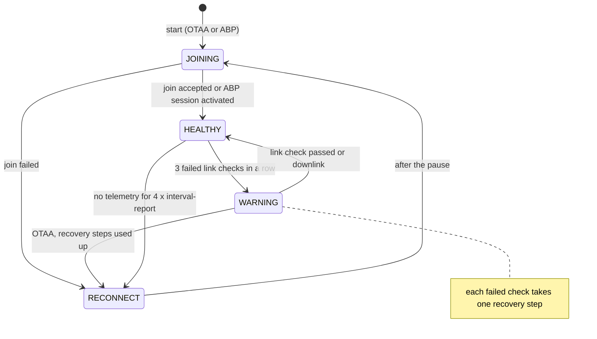

# Připojení k síti {#network-connection}

:::caution Koncept
Tato stránka je koncept pro interní kontrolu. Tvrzení označená **[ověřit]** je ještě potřeba potvrdit na hardwaru nebo u vlastníka produktu.
:::

:::info Firmware v2.0.0
Tato stránka popisuje **firmware STICKER v2.0.0**. Kde se firmware v1.4.x chová jinak, upozorní na to poznámka **Firmware v1.4.x**.
:::

Tato stránka vysvětluje, jak se zařízení STICKER dostane do rádiové sítě, jak zjistí, že jeho uplinky (zprávy ze zařízení do sítě) přestaly docházet, a jak se pak zotaví: nejdřív pomalejší, ale odolnější datovou rychlostí, potom novým připojením k síti. Ukazuje také, co přečká opětovné připojení nebo restart a co se stane s daty, která zařízení nemohlo odeslat. Přečtěte si ji, když se zařízení neobjeví na síťovém serveru nebo když od něj přestala přicházet data.

## Režim rádia {#radio-mode}

Zařízení STICKER má jedno rádio a parametr `radio-mode` určuje, jak ho zařízení používá:

| `radio-mode` | Co zařízení dělá |
|---|---|
| `off` | Rádio zůstává vypnuté. Zařízení dál měří, vyhodnocuje alarmy a zaznamenává historii (pokud je zapnutá), ale nic neodesílá. Je to výchozí hodnota firmwaru. |
| `lorawan` | LoRaWAN třídy A (zařízení čeká na downlink jen těsně po vlastních uplinkech) v regionu nastaveném parametrem `lrw-region`: EU868, US915, AU915 nebo AS923. Aktivace probíhá přes OTAA nebo ABP (`lrw-activation`). |
| `p2p` | LoRa P2P: přímé spojení s hubem ProXimos přes modem HARDWARIO FIBER, bez sítě LoRaWAN. Viz část o LoRa P2P na konci této stránky. |

Zařízení čte `radio-mode` jen při startu. Změňte ho přes NFC v aplikaci [**HARDWARIO Manager**](/apps/hardwario-manager/sticker/configuration) nebo v shellu a nastavení uložte; po uložení se zařízení restartuje a naběhne v novém režimu. Downlink (zpráva ze sítě do zařízení) nikdy nemůže změnit `radio-mode` ani žádné jiné nastavení LoRaWAN, protože chybná hodnota by přerušila spojení, kterým příkaz přišel. `factory_reset` vrátí `radio-mode` na `off` a smaže klíče a nastavení LoRaWAN kromě DevEUI a JoinEUI, kdežto `device_reset` je zachová.

## Stavy rádia {#radio-states}

Rádio je v každém okamžiku v jednom ze stavů níže. Stavová LED ukazuje stav každé 3 s, takže ho poznáte i bez telefonu. Úplný přehled signalizace LED najdete na stránce [**Popis hardwaru**](../hardware-description.md).

| Stav | Co znamená | Stavová LED každé 3 s |
|---|---|---|
| `DISABLED` | Rádio je záměrně vypnuté (`radio-mode off`) nebo nemůže nastartovat: obraz firmwaru neobsahuje nastavený region LoRaWAN nebo LoRa P2P nemá klíče. Zařízení nic neodesílá. | Jedno velmi krátké žluté bliknutí |
| `JOINING` | Probíhá připojování k síti: hned po startu nebo při pokusu o opětovné připojení. | Jedno žluté bliknutí, pak jedno červené |
| `RECONNECT` | Zařízení není v síti a čeká na další pokus o připojení. | Jedno žluté bliknutí, pak jedno červené |
| `HEALTHY` | Připojeno a kontroly spojení procházejí. | Jedno velmi krátké zelené bliknutí, nebo červené bliknutí, když je aktivní alarm |
| `WARNING` | Stále připojeno (relace trvá), ale kontroly spojení selhávají. Zařízení kontroluje spojení s každým hlášením a postupně přechází na odolnější datové rychlosti. | Dvě krátká žlutá bliknutí |

Kromě LED zjistíte stav také:

- v odpovědi na příkaz `get_radio_state` poslaný downlinkem, jako `state_name` v dekódovaném uplinku, malými písmeny (například `warning`); viz [**Příkazy přes downlink**](../connectivity/downlink-commands.md);
- přes NFC na obrazovce **Device info** v aplikaci [**HARDWARIO Manager**](/apps/hardwario-manager/sticker/device-info);
- v sestavení debug příkazem `ats radio status`; viz [**Diagnostika**](../developer-access/diagnostics.md).

<b>Více o stavech</b>

- **`IDLE`:** šestý stav. Zařízení LoRaWAN je ve stavu `IDLE` krátce po startu, před prvním pokusem o připojení. Zařízení LoRa P2P je ve stavu `IDLE` poté, co ho hub odpojil, a pak mlčí. `IDLE` nemá vlastní vzor LED, takže LED ukazuje zelené bliknutí, nebo červené bliknutí, když je aktivní alarm.
- **Nulové DevEUI:** zařízení s `radio-mode lorawan` a DevEUI složeným ze samých nul není ve stavu `DISABLED`. Pokouší se připojit, neuspěje a ukazuje `JOINING` a `RECONNECT`, takže chyba při zprovoznění je vidět.
- **Regiony:** obrazy release obsahují všechny čtyři regiony, obrazy debug jen EU868. Do jiného regionu zařízení nikdy nepřejde.
- **Stav zařízení:** v **Info** přečteném přes NFC obsahuje `device_status_flags` při `radio-mode off` příznaky `radio_off` a `lrw_disabled`. Když obraz firmwaru neobsahuje nastavený region nebo LoRa P2P nemá klíče, obsahuje `lrw_disabled` a `radio_link_down`. Ve stavech `JOINING`, `RECONNECT` a `IDLE` obsahuje jen `radio_link_down`.
- **Bliknutí alarmu:** dokud LED ukazuje vzor stavu `DISABLED`, `JOINING`, `RECONNECT` nebo `WARNING`, červené bliknutí alarmu se neukáže. Alarmy se přesto dál vyhodnocují a hlásí.

## Jak probíhá připojení {#joining-the-network}

### OTAA {#otaa}

Při OTAA (bezdrátové aktivaci) se zařízení a síť dohodnou na relaci při připojení (join): zařízení pošle JoinRequest a síť odpoví zprávou JoinAccept, která zařízení přidělí adresu a klíče relace. Zařízení STICKER se připojuje nanovo při každém startu, i když bylo těsně před restartem připojené. Když JoinAccept nepřijde, zkusí to zařízení znovu po pauze, která se s každým pokusem zdvojnásobí, od asi 1 min až po 1 h. Zařízení, které se k síti nedostane, tak nevybíjí baterie neustálými pokusy o připojení. Až příčinu odstraníte, například zařízení zaregistrujete nebo zapnete bránu, počkejte na další pokus, nebo zařízení restartujte a připojí se hned.

Datová rychlost (DR) určuje, jak rychle se rámec odvysílá. V EU868 je DR0 (spreading factor SF12) nejpomalejší a má největší dosah, DR5 (SF7) je nejrychlejší datová rychlost LoRa.

| Položka | Hodnota |
|---|---|
| První připojení | Hned po startu |
| Pauza po neúspěšném připojení | 60 s, s každým dalším pokusem se zdvojnásobí až na 1 h: 60, 120, 240, 480, 960 a 1920 s, pak 3600 s |
| Náhodný rozptyl | ±25 % každé pauzy, aby se zařízení, která ztratila síť současně, nepřipojovala ve stejnou chvíli |
| Příklad z měření | Na testovacím kusu (EU868) byly odstupy 59, 135, 198, 503, 1157 a 2102 s, pak 3299 s; první odstup se počítá od posledního hlášení před opětovným připojením |
| Neúspěšný pokus | Nepřišel JoinAccept, nebo je stack LoRaWAN 15 s po odeslání JoinRequest stále zaneprázdněný |
| Návrat pauzy na 60 s | Po úspěšném připojení a po každém restartu |
| Datová rychlost pro JoinRequest | Výchozí datová rychlost pro připojení v daném regionu; záznam z testovacího kusu v EU868 ukazuje SF12 |
| US915, AU915 | Připojení používá sub-band nastavený parametrem `lrw-sub-band` (výchozí 2), i po neúspěšných pokusech |

Každý JoinRequest nese DevNonce, čítač, podle kterého síť pozná a odmítne zopakovaný požadavek o připojení. Zařízení STICKER ho uchovává ve flash paměti (v NVS, úložišti, kde je i nastavení), takže žádnou jeho hodnotu nepoužije podruhé ani restart, ani opětovné připojení. Vynulují ho jen `lrw_reset`, `factory_reset`, `vendor_reset` a úplné smazání úložiště nastavení. Žádný z nich nefunguje přes downlink. Po kterémkoli z těchto resetů počítá zařízení znovu od nuly a síťový server LoRaWAN 1.0.4 jeho pokusy o připojení odmítá, dokud nevymažete hodnoty DevNonce, které si pro zařízení uložil.

:::note Firmware v1.4.x
Ve firmwaru v1.4.x rozkládalo zařízení v US915 nebo AU915 po zhruba 8 neúspěšných pokusech o připojení za sebou zprávy JoinRequest do všech osmi sub-bandů, takže k bráně, která poslouchá na jednom sub-bandu, se dostala jen zhruba každá osmá.
:::

### ABP {#abp}

Při ABP (aktivaci personalizací) jsou adresa zařízení a klíče relace uložené v zařízení, takže žádné připojování ani JoinRequest neprobíhá. Při každém startu zařízení aktivuje uloženou relaci a je hned připojené. Přijímací okna otevírá 1 s a 2 s po každém uplinku, což jsou výchozí hodnoty LoRaWAN. Zařízení s ABP se znovu připojit nemůže; co dělá místo toho, popisuje část o ztrátě spojení níže.

## Dohled nad spojením {#link-supervision}

Uplink LoRaWAN se nepotvrzuje, takže zařízení samo nepozná, jestli jeho hlášení docházejí. Proto se čas od času zeptá sítě. K hlášení přidá LinkCheckReq, malou řídicí zprávu LoRaWAN (příkaz MAC), která odejde spolu s uplinkem, takže žádný uplink navíc není potřeba. Síť odpoví počtem bran, které uplink zachytily. Jednu nebo dvě chybějící odpovědi zařízení toleruje, protože některé sítě neodpovídají na každou kontrolu. Po třech neúspěšných kontrolách za sebou přejde zařízení do stavu `WARNING`. Že spojení funguje, dokazuje i jakýkoli downlink, takže zařízení, které dostává příkazy nebo požadavky sítě, se k opětovnému připojení neblíží.

| Položka | Hodnota |
|---|---|
| Hlášení s kontrolou spojení | První hlášení po každém připojení, pak každé 5. hlášení (`radio-link-check-interval`, 0–255, výchozí 5). Ve stavu `WARNING` každé hlášení. `0` kontroly spojení vypne a s nimi i stav `WARNING` a opětovné připojení, které po něm následuje. |
| Časový limit odpovědi | 10 s, počítáno od konce přijímacích oken uplinku |
| Neúspěšná kontrola | Žádná odpověď v časovém limitu, nebo odpověď, která hlásí 0 bran |
| Úspěšná kontrola | Odpověď s aspoň 1 bránou, nebo jakýkoli ověřený downlink: příkaz, požadavek ADR (adaptivní datová rychlost, kdy síť nastavuje datovou rychlost a vysílací výkon), `DevStatusReq` nebo jiný příkaz MAC |
| Počet neúspěchů za sebou, po kterém nastane `WARNING` | 3 (pevná hodnota) |
| Neúspěchy ve stavu `WARNING` před opětovným připojením | `radio-link-check-fail-rejoin` (1–255, výchozí 5), a to až ve chvíli, kdy nezbývá žádný krok obnovy |
| Potvrzované uplinky | K posouzení spojení se nepoužívají. Hlášení a odpovědi jsou nepotvrzované. Alarmová hlášení jsou potvrzovaná jen s `radio-alarm-ack true` a pak se opakují až 3krát; alarm, který potvrzení nikdy nedostane, se jako neúspěšná kontrola nepočítá. |

Oba parametry lze stejně jako každé nastavení LoRaWAN měnit jen přes NFC nebo shell, viz [**Konfigurace**](../developer-access/configuration.md). Na síťovém serveru se kontrola spojení ukáže jako příkaz MAC `LinkCheckReq` v uplinku a `LinkCheckAns` v downlinku, který na něj odpovídá.

<b>Podrobnosti o počítání</b>

- Do počtu 5 se započítává každé hlášení, včetně hlášení navíc, která vyvolají alarmy, `force_send` nebo `sample`.
- Kontrola spojení se přidává jen k prvnímu rámci hlášení. Dokud kontrola čeká na odpověď, další se nepřidá.
- Odpověď, která přijde po vypršení časového limitu, zařízení ignoruje.
- Čítače začínají při každém připojení znovu od nuly, takže první hlášení po připojení nese kontrolu spojení vždy.

:::note Firmware v1.4.x
Ve firmwaru v1.4.x se parametry jmenují `lrw-link-check-interval` a `lrw-link-check-fail-rejoin`. Jejich uložené hodnoty se do v2.0.0 nepřevádějí, takže po aktualizaci mají oba opět hodnotu 5; pokud jste je měnili, nastavte je znovu. Ve v1.4.x se downlink počítal jako úspěšná kontrola jen tehdy, když nějaká kontrola čekala na odpověď.
:::

## Kroky obnovy ve stavu WARNING {#recovery-steps-in-the-warning-state}

Ve stavu `WARNING` si zařízení ponechá relaci a hlášení odesílá dál, ale každé hlášení teď nese kontrolu spojení a každá neúspěšná kontrola vyvolá jeden krok obnovy: vysílací výkon (TX) se vrátí na výchozí hodnotu (maximum) a datová rychlost klesne o jeden stupeň. Nižší datová rychlost znamená delší vysílání, ale větší dosah, takže zařízení, které se dostalo mimo dosah nebo přišlo o nejbližší bránu, se často do sítě znovu dostane i bez opětovného připojení. První krok udělá zařízení hned při přechodu do stavu `WARNING`. Jedna úspěšná kontrola nebo jakýkoli downlink vrátí zařízení do stavu `HEALTHY` se stejnou relací.

Se zapnutým ADR (`lrw-adr true`, výchozí) síťový server obvykle sníží vysílací výkon a zvýší datovou rychlost u zařízení, které dobře slyší. Když se spojení zhorší, kroky obnovy tyto změny vrátí.

| Položka | Hodnota |
|---|---|
| Přechod do stavu `WARNING` | Po 3 neúspěšných kontrolách spojení za sebou |
| Kontroly spojení ve stavu `WARNING` | S každým hlášením |
| Jeden krok obnovy | Obnoví výchozí vysílací výkon a sníží datovou rychlost o jeden stupeň |
| Kdy zařízení krok udělá | Jeden hned při přechodu do stavu `WARNING`, pak jeden za každou neúspěšnou kontrolu |
| Spodní hranice | Nejnižší datová rychlost regionu (EU868: DR0) při výchozím vysílacím výkonu |
| Odchod ze stavu `WARNING` | Jedna úspěšná kontrola spojení nebo jakýkoli downlink: zpět do `HEALTHY`, stejná relace |
| Po zotavení | Zařízení zůstane na nižší datové rychlosti. S ADR ji síť podle přijatých uplinků zase zvýší; s vypnutým ADR se při dalším připojení znovu použije `lrw-datarate`. |

Při nižší datové rychlosti se do rámce vejde méně dat (51 B v EU868 při DR0–DR2), takže hlášení může do opětovného zvýšení datové rychlosti potřebovat víc rámců.

<b>Proč má zařízení vlastní kroky obnovy</b>

Stack LoRaWAN má pro ADR vlastní mechanismus snižování datové rychlosti, první krok ale udělá až po 128 uplincích bez odpovědi, což je při intervalu hlášení 900 s asi 32 h. Zařízení by se vždy připojilo znovu dávno předtím, než by to pomohlo, a proto firmware prochází stejné kroky sám, jeden za každou neúspěšnou kontrolu spojení. Stejně se snižuje i datová rychlost pevně nastavená parametrem `lrw-datarate` (s vypnutým ADR).

:::note Firmware v1.4.x
Firmware v1.4.x kroky obnovy nemá. Ve stavu `WARNING` ponechá datovou rychlost i vysílací výkon a spojení kontroluje jen s každým 5. hlášením, takže zařízení, které se dostalo mimo dosah, získá odolnější datovou rychlost jen opětovným připojením.
:::

## Opětovné připojení {#rejoin}

Když jsou kroky obnovy vyčerpané a kontroly dál selhávají, zařízení s OTAA relaci opustí a připojí se k síti znovu (rejoin). Během čekání na další pokus ukazuje stav `RECONNECT`. Pauzy mezi pokusy jsou stejné jako po neúspěšném připojení po startu: nejdřív asi 1 min, pak se zdvojnásobují až na 1 h.

| Spouštěč | Kdy platí |
|---|---|
| Vyčerpané kroky obnovy | Nezbývá žádný krok (nejnižší datová rychlost při výchozím vysílacím výkonu) a ve stavu `WARNING` selhalo `radio-link-check-fail-rejoin` kontrol (výchozí 5) |
| Watchdog uplinků | Zařízení je připojené, ale po dobu 4 × `interval-report` (1 h při 900 s) z něj neodešel žádný telemetrický uplink. Neplatí, když ticho vysvětluje duty cycle (zákonný limit vysílacího času, viz níže): limit duty cycle zadržel odeslání během posledního intervalu hlášení plus 3 min a zadržování trvá méně než 75 min. |
| Příkaz `lrw_join` | Přes downlink, přes NFC nebo jako `join` v shellu. Připojování začne krátce po odeslání odpovědi na příkaz, bez pauzy a bez restartu. Dokud jsou nastavení LoRaWAN změněná, ale neuložená, zařízení příkaz odmítne s `NOT_READY`. |
| Neúspěšné připojení | Každý neúspěšný pokus naplánuje další s dvojnásobnou pauzou |

Watchdog uplinků zachytí zařízení, které nemůže vysílat vůbec. Při obyčejném výpadku brány hlášení ze zařízení dál odcházejí, takže tam rozhodují kontroly spojení.

| Krok | Co se stane |
|---|---|
| Přechod do stavu `RECONNECT` | Hlášení, které se právě odesílalo, se zahodí; odpovědi a alarmová hlášení zůstanou ve frontě. |
| Pauza | 60 s ±25 % před prvním pokusem, pak se s každým dalším pokusem zdvojnásobí až na 1 h ±25 % |
| Pokus (`JOINING`) | Stack LoRaWAN se restartuje s uloženým DevNonce, znovu nastaví sub-band a odešle JoinRequest. |
| Úspěch | `HEALTHY`. Odejdou **Info**, **settings-info**, čekající alarmová hlášení a jedno hlášení; viz [**Zprávy a časování**](messages.md). Pauza příště začne opět na 60 s. |
| Neúspěch | Zpět do stavu `RECONNECT` s další, dvojnásobnou pauzou |

## Ztráta spojení u OTAA a ABP {#connection-loss-with-otaa-and-abp}

| | OTAA | ABP |
|---|---|---|
| Zjištění ztráty | Kontroly spojení; 3 neúspěchy za sebou vedou do stavu `WARNING` | Stejně |
| Kroky obnovy ve stavu `WARNING` | Ano | Ano |
| Po vyčerpání kroků a dosažení `radio-link-check-fail-rejoin` neúspěchů | Opustí relaci: `RECONNECT`, pak se znovu připojuje s pauzami od 60 s až po 1 h | Znovu se připojit nemůže: zůstane ve stavu `WARNING` a dál kontroluje spojení s každým hlášením |
| Stavová LED během dlouhého výpadku | Dvě žlutá bliknutí, pak žlutá a červená | Dvě žlutá bliknutí |
| Hlášení během výpadku | Ve stavu `WARNING` se odesílají, ve stavu `RECONNECT` žádná | Odesílají se v intervalu `interval-report` na nejnižší datové rychlosti; nikdo je nepřijímá |
| Když je síť zpět | Data začnou přicházet po dalším úspěšném připojení, které může být při nejdelší pauze až asi za 1 h | Data přicházejí hned; další kontrola spojení nebo downlink vrátí zařízení do stavu `HEALTHY` |
| Watchdog uplinků | Opětovné připojení | Restartuje stack LoRaWAN a po obvyklé pauze znovu aktivuje uloženou relaci, bez JoinRequest |

## Od ztráty spojení po opětovné připojení {#timeline-from-link-loss-to-rejoin}

Tabulka ukazuje, co se stane, když přestane fungovat jediná brána. Předpokládá výchozí nastavení: EU868 s OTAA, zapnuté ADR, zařízení na DR5, `interval-report` 900 s a oba parametry kontroly spojení na hodnotě 5. Kontrola spojení se pak přidá ke každému 5. hlášení, tedy jednou za 75 min.

| Čas od ztráty spojení | Co se stane | Stavová LED |
|---|---|---|
| 0 | Brána přestane přijímat. Zařízení dál posílá hlášení každých 15 min, ale nikdo je nepřijímá. | Zelená |
| Do 75 min | Nejbližší hlášení s kontrolou spojení nedostane odpověď: 1. neúspěšná kontrola. | Zelená |
| O 75 min později | 2. neúspěšná kontrola. | Zelená |
| O 75 min později (2,5–3,75 h po ztrátě) | 3. neúspěšná kontrola: `WARNING`. Vysílací výkon se hned vrátí na výchozí hodnotu a datová rychlost klesne na DR4. | Dvě žlutá bliknutí |
| Další 4 hlášení s odstupem 15 min | Hlášení na DR4, DR3, DR2 a DR1 nesou každé kontrolu spojení. Každý neúspěch znamená další krok dolů. | Dvě žlutá bliknutí |
| 75 min po přechodu do stavu `WARNING` (3,75–5 h po ztrátě) | Selže i kontrola u hlášení na DR0. Nezbývá žádný krok a ve stavu `WARNING` selhalo už 5 kontrol, takže zařízení relaci opustí: `RECONNECT`. | Žlutá a červená |
| Asi o 1 min později | První JoinRequest. | Žlutá a červená |
| Potom | Další zprávy JoinRequest po zhruba 2, 4, 8, 16 a 32 min, pak zhruba každou hodinu, vždy ±25 %. | Žlutá a červená |
| Když síť odpoví | Připojení, pak **Info**, **settings-info** a hlášení. Zařízení je znovu ve stavu `HEALTHY` a ADR datovou rychlost zase zvýší. | Zelená |

S výchozím nastavením tedy od ztráty spojení po první JoinRequest uplyne asi 4–5 h. Přesná doba závisí na tom, do které části 75minutového cyklu kontrol spojení ztráta spadne. Kratší `interval-report` nebo `radio-link-check-interval` ji zkrátí. Na testovacím kusu s `interval-report` 120 s trvala stejná posloupnost 21 min do stavu `WARNING` a dalších 10 minut do stavu `RECONNECT`.

:::note Firmware v1.4.x
Ve firmwaru v1.4.x vyvolá stejná ztráta spojení opětovné připojení až asi po 9–10 h, protože stav `WARNING` kontroluje spojení jen s každým 5. hlášením a kroky obnovy nemá.
:::

## Co přečká opětovné připojení a restart {#what-a-rejoin-and-a-restart-keep}

| Položka | Po opětovném připojení | Po restartu |
|---|---|---|
| DevNonce | Zachová se | Zachová se |
| Síťová relace OTAA (adresa, klíče relace, čítače rámců) | Nahradí ji nová relace | Nahradí se: zařízení se připojí nanovo |
| Uložené nastavení, čítače impulzů, historie senzorů | Beze změny | Zachovají se, protože jsou uložené ve flash paměti; viz [**Historie a čítače**](history-and-counters.md) |
| Hlášení, které se právě odesílalo | Zahodí se | Ztratí se |
| Probíhající čtení historie (`req_history`) | Přeruší se; vyžádejte ho znovu | Ztratí se; vyžádejte ho znovu |
| Dlouhá odpověď, která se ještě posílá po stránkách | Přeruší se; vyžádejte ji znovu | Ztratí se |
| Odpovědi a alarmová hlášení čekající na odeslání | Zachovají se a odejdou po připojení | Ztratí se |
| Aktivní alarmy | Zachovají se | Vyhodnotí se znovu a každá podmínka, která pořád platí, se nahlásí ještě jednou |
| Čítače kontrol spojení | Vynulují se; první hlášení po připojení nese kontrolu spojení | Vynulují se stejně |
| Evidence vysílacího času pro duty cycle | Zachová se, protože připojení nepřidává žádný nový vysílací čas | Vymaže se |
| Síťový čas | Zachová se; znovu se vyžádá, jen pokud od startu žádný nepřišel | Znovu se vyžádá při prvním připojení |
| Rytmus hlášení | Pokračuje; po připojení následuje jedno hlášení navíc | Počítá se znovu od startu |

Zařízení s ABP aktivuje po opětovném připojení i po restartu stejnou uloženou relaci.

## Duty cycle {#duty-cycle}

V pásmu EU868 zákon omezuje, jak dlouho smí zařízení vysílat (duty cycle). Zařízení STICKER si samo vede evidenci vysílacího času za poslední hodinu a rámec odešle, jen když se vejde do 1 % hodiny, tedy do 36 s. Rámec, který se nevejde, počká, dokud z hodinového okna nevypadne dost staršího vysílacího času. Zahodí se jen hlášení, které čeká celý `interval-report`, protože další hlášení nese čerstvější data. Při výchozím `interval-report` 900 s se limitu nedosáhne ani při nejnižší datové rychlosti, kdy hlášení zaberou asi 8 s za hodinu. Limit hraje roli u krátkých intervalů hlášení na nízkých datových rychlostech a u dlouhých čtení, jako je historie senzorů nebo výpis celé konfigurace.

| Rádio a region | Limit vysílacího času, který zařízení dodržuje |
|---|---|
| LoRaWAN EU868 | 1 % přes všechny kanály: nejvýš 36 s v kterékoli klouzavé hodině. Stack LoRaWAN si navíc hlídá vlastní limit pro každé frekvenční pásmo; limit zařízení je přísnější, takže stack obvykle přijme každý rámec, který zařízení pustí dál. |
| LoRaWAN US915, AU915, AS923 | Žádný. Vysílací čas zařízení přesto počítá. |
| LoRa P2P | Podle pásma, do kterého spadá `p2p-frequency`: 10 % na výchozích 869,525 MHz, 1 % v rozsahu 865–868,6 MHz a 869,7–870 MHz, jinde 0,1 % |

- Na DR0 zabere jeden rámec asi 1,5–2,8 s vysílacího času, malé hlášení na DR5 méně než 0,1 s.
- Zadržený rámec čeká nejvýš jednu hodinu.
- `get_radio_state` ukazuje, jak dlouho se odesílání zadržuje (`duty_blocked_s`), a vysílací čas za poslední hodinu (`airtime_hour_ms`).
- Evidence je v RAM: opětovné připojení ji zachová, restart ji vymaže.

:::note Firmware v1.4.x
Ve firmwaru v1.4.x stack LoRaWAN rámec nad svůj limit odmítl a zařízení ho zkoušelo odeslat znovu každých 15 s, takže na nejnižší datové rychlosti se hlášení mohlo zahodit asi po 2 min. Watchdog uplinků navíc mohl během takového zadržení vyvolat opětovné připojení, které vynulovalo kredity vysílacího času.
:::

## Data, která nešla odeslat {#data-that-could-not-be-sent}

| Situace | Co zařízení udělá |
|---|---|
| Nastal čas hlášení, ale zařízení není připojené (`JOINING`, `RECONNECT`, `DISABLED`) | Žádný uplink. Zařízení dál měří, vyhodnocuje alarmy, ukládá čítače a se zapnutým `history-enable` zaznamenává historii. |
| Spojení vypadne během odesílání hlášení | Zbytek hlášení se zahodí. |
| Hlášení zadržuje duty cycle | Odejde později, jakmile to vysílací čas dovolí; zahodí se, když je staré jeden `interval-report`. |
| Rádio nebo stack LoRaWAN odeslání odmítne | Zařízení odeslání opakuje každých 15 s, nejvýš 8krát, a pak rámec zahodí. |
| Na odeslání čekají víc než 4 odpovědi | Další odpověď se zahodí. |
| Alarmové události, když už čekají 4 alarmové rámce | Události se podrží a posbírají do pozdějších rámců, nejvýš 16 v jedné dávce; další události se zahodí, ale dál se započítávají do `total`. |
| Čekající rámec se po snížení datové rychlosti už nevejde | **Info** a **settings-info** odejdou znovu, až datová rychlost zase stoupne. Odpověď na příkaz nahradí chyba `BUDGET_TOO_SMALL` se `seq` daného příkazu. Alarmový rámec se zahodí, ale stav alarmů dál putuje v každém telemetrickém uplinku. Telemetrický rámec se zahodí a zbytek hlášení pokračuje. |
| Příkazy MAC ze sítě zaplní celý rámec | Zařízení odešle uplink bez dat, aby odpovědi MAC mohly odejít. Hlášení, které bylo na řadě, se vynechá; čekající odpověď nebo alarmový rámec odejde až potom. |
| Alarmové události, když zařízení není připojené | Posbírají se a odejdou po dalším připojení, hned po **Info** a **settings-info**. |
| Hlášení zmeškaná, když bylo zařízení offline | Dodatečně se nikdy neodešlou. S `history-enable true` jsou hodnoty v historii senzorů; přečtete je příkazem `req_history`. Automaticky se nic neodesílá. Viz [**Historie a čítače**](history-and-counters.md). |

Odpovědi a alarmové rámce, které čekají na rádio, se uchovávají v RAM, takže se restartem ztratí.

## LoRa P2P {#lora-p2p}

S `radio-mode p2p` nekomunikuje zařízení STICKER se sítí LoRaWAN, ale přes modem HARDWARIO FIBER s hubem ProXimos. Stavy, vzory LED, kontroly spojení, watchdog uplinků i zprávy po připojení fungují stejně jako v LoRaWAN, s těmito rozdíly:

- **Párování:** připojení P2P (spárování) se ukládá, takže běžný restart žádný JoinRequest neposílá. Zařízení naváže na uložené spárování a odešle **Info** a **settings-info**.
- **Potvrzované odesílání:** každé hlášení, každou odpověď i každý rámec historie potvrzuje brána. Jedno odeslání znamená až 3 vysílání; bez potvrzení zařízení odeslání po náhodné pauze zopakuje ještě až 3krát. Alarmová hlášení se potvrzují jen s `radio-alarm-ack true`.
- **Kontrola spojení:** za neúspěšnou kontrolu se počítá jen hlášení s kontrolou spojení, které zůstalo bez potvrzení.
- **Bez kroků obnovy:** spreading factor i vysílací výkon jsou pro síť pevné, takže stav `WARNING` žádné kroky obnovy nemá. Po `radio-link-check-fail-rejoin` neúspěšných kontrolách ve stavu `WARNING` se zařízení spáruje znovu (`RECONNECT`) se stejnými pauzami jako v LoRaWAN. S výchozím nastavením nastane stav `WARNING` 2,5–3,75 h po ztrátě spojení a nové spárování asi o 1,25 h později.
- **Volba režimu:** jen přes `radio-mode p2p` a uložení přes NFC nebo shell. Parametry rádia P2P (`p2p-*`) lze nastavit jen v shellu.
- **Odpojení:** když hub zařízení odpojí, zůstane zařízení až do dalšího restartu nebo příkazu `lrw_join` ve stavu `IDLE`: mlčí, LED bliká stejně jako ve stavu `HEALTHY` a samo se znovu nespáruje.

Nastavení a parametry rádia: [**Režim LoRa P2P**](../connectivity/lora-p2p.md).

:::note Firmware v1.4.x
LoRa P2P je novinka firmwaru v2.0.0. Ve firmwaru v1.4.x je hodnota `radio-mode p2p` rezervovaná a rádio nechává vypnuté.
:::
