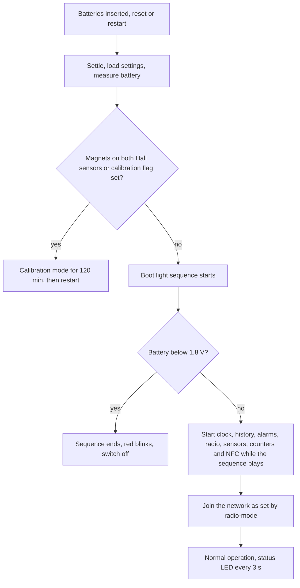

# Start a inicializace {#startup-and-initialization}

:::caution Koncept
Tato stránka je koncept pro interní kontrolu. Tvrzení označená **[ověřit]** je ještě potřeba potvrdit na hardwaru nebo u vlastníka produktu.
:::

:::info Firmware v2.0.0
Tato stránka popisuje **firmware STICKER v2.0.0**. Kde se firmware v1.4.x chová jinak, upozorní na to poznámka **Firmware v1.4.x**.
:::

Tato stránka popisuje, co zařízení STICKER dělá od chvíle, kdy dostane napájení, až po běžný provoz: v jakém pořadí probíhají kroky startu, co ukazuje LED, kdy zařízení odmítne nastartovat nebo přejde do kalibračního režimu a jak se zotaví z chyb. Podpora často nejrychleji pozná, co se s konkrétním kusem stalo, podle LED a podle příčiny resetu, kterou zařízení hlásí v uplinku **Info** (zprávě ze zařízení do sítě).

## Co se děje po zapnutí {#what-happens-after-power-up}

Zařízení startuje po vložení baterií, po resetu přes pin NRST i tehdy, když se restartuje samo, například po uložení nové konfigurace. Pokaždé proběhnou stejné kroky:

1. **Ustálení napájení.** Zařízení počká 0,5 s, aby senzory měly stabilní napájení dřív, než se spustí jejich ovladače.
2. **Načtení nastavení.** Přečte konfiguraci z NVS (úložiště nastavení ve flash paměti).
3. **Příčina resetu.** Zaznamená, proč se restartovalo, a převezme záznam o pádu z předchozího běhu, pokud nějaký zůstal.
4. **Kontrola baterie.** Změří baterii dřív, než začne odebírat proud cokoli dalšího.
5. **Watchdog a LED.** Spustí hardwarový watchdog a LED.
6. **Kontrola kalibrace.** Pokud jsou u obou Hallových spínačů magnety nebo je nastavený příznak kalibrace, zařízení přejde do kalibračního režimu a běžný start tady končí.
7. **Startovní sekvence LED.** Červená, žlutá a zelená, asi 3 s. Start mezitím pokračuje. Pokud kontrola baterie naměřila méně než 1,8 V, zařízení po sekvenci bliká červeně a samo se vypne.
8. **Inicializace.** Postupně se spustí hodiny, historie senzorů, pravidla alarmů, rádio, plán hlášení, sledování baterie, senzory, čítače impulzů a NFC. NFC startuje jako poslední a na telefon odpoví asi 1,2 s po resetu.
9. **Připojení k síti.** Zařízení se připojí tak, jak určuje `radio-mode`. V režimu LoRaWAN se připojuje znovu při každém startu, v režimu LoRa P2P se s hubem páruje, jen pokud ještě spárované není. S `radio-mode off` zařízení nevysílá. Viz [**Připojení k síti**](network-connection.md).
10. **Běžný provoz.** Od této chvíle zařízení obsluhuje watchdog a každé 3 s ukáže svůj stav na LED.

## Startovní sekvence LED {#boot-light-sequence}

Při každém běžném startu LED svítí 0,5 s červeně, 0,5 s žlutě a 1,5 s zeleně, mezi barvami jsou pauzy 0,25 s a celkem to trvá asi 3 s. Sekvence zároveň ukáže, že fungují všechny tři barvy LED.

- **Start nezdržuje.** Zařízení se během sekvence inicializuje. NFC odpoví telefonu asi 1,2 s po resetu, kdy sekvence ještě běží.
- **Přiložení telefonu ji přeruší.** Když k zařízení přiložíte telefon, LED hned přepne na vzory NFC.
- **Po ní následuje stavový heartbeat.** Heartbeaty, které připadnou na dobu sekvence, se vynechají, takže první stavový vzor se objeví až po jejím konci.
- **Nečekaná sekvence znamená, že se zařízení restartovalo.** Proč se to stalo, zjistíte z příčiny resetu v příštím uplinku **Info**, viz část Watchdog a zotavení po pádu níže.

V kalibračním režimu se sekvence nepřehrává.

:::note Firmware v1.4.x
Ve firmwaru v1.4.x startovní sekvence zdržovala zbytek startu asi o 5 s. Barvy a časování sekvence se nezměnily.
:::

## Stavová LED po startu {#status-led-after-startup}

Jakmile zařízení běží, LED každé 3 s ukáže jeden krátký vzor, takzvaný stavový heartbeat. Většina bliknutí trvá kvůli úspoře energie jen 5–10 ms, čekejte tedy spíš krátký záblesk než zřetelné bliknutí.

Zařízení prochází pevný seznam stavů a ukáže jen první, který platí, takže závažnější stav překryje méně závažný. Ukazuje je v tomto pořadí:

1. vzory NFC, dokud je přiložený telefon;
2. chybu nastavení, když se uloženou konfiguraci nepodařilo načíst **[ověřit]**;
3. stav sítě, když zařízení není v síti, když má zhoršené spojení nebo když má vypnuté rádio;
4. aktivní alarm;
5. zelenou, když neplatí nic z předchozího.

| Heartbeat každé 3 s | Co znamená |
|---|---|
| Červená a žlutá, dvakrát střídavě | Uložené nastavení se nepodařilo načíst **[ověřit]**. Zařízení běží na výchozích hodnotách z výroby, takže nemá klíče k síti a rádio má vypnuté. Viz část Pořadí inicializace a chyby níže. |
| Žlutá, pak červená | Zařízení není v síti. Hned po startu to znamená, že se připojuje; později, že ztratilo spojení a připojuje se znovu. Zkontrolujte pokrytí bránou, region a klíče. |
| Dvakrát žlutá | Zařízení je připojené, ale kontroly spojení (pravidelné testy, že ho síť stále slyší) selhávají. Relaci si ponechá a před novým připojením zkusí odolnější datovou rychlost. |
| Jednou žlutá | Rádio je vypnuté: `radio-mode off`, region LoRaWAN, který tento obraz firmwaru neobsahuje, nebo LoRa P2P bez klíčů. Zařízení měří, ale nic neposílá. |
| Jednou červená | Je aktivní alarm: spustilo ho například pravidlo alarmu, slabá baterie nebo senzor, který přestal odpovídat. |
| Jednou zelená | Běžný provoz: zařízení je připojené, kontroly spojení procházejí a žádný alarm není aktivní. Firmware debug přidá za zelené bliknutí ještě žluté. |
| Po startovní sekvenci asi minutu zhasnutá, pak znovu sekvence | Fatální chyba při startu. Zařízení se restartuje každých 60 s, viz část Pořadí inicializace a chyby níže. |
| Zhasnutá | Zařízení nemá napájení, vypnula ho kontrola slabé baterie, nebo jde o kus s firmwarem debug, který přešel do hlubokého spánku. |

Dokud LED ukazuje některý ze síťových vzorů, červené bliknutí alarmu se neobjeví. Alarm se přesto vyhodnocuje a jeho uplink se odešle. První hodinu po zapnutí LED navíc krátkými zelenými a oranžovými bliknutími potvrzuje změny vstupů, například přepnutí Hallova spínače nebo vstupu.

Úplný přehled signalizace LED včetně vzorů při přiložení telefonu najdete na stránce [**Popis hardwaru**](../hardware-description.md). Tabulku pro řešení potíží podle LED obsahuje [**Rychlý průvodce**](../first-steps.md).

:::note Firmware v1.4.x
Startovní sekvence a stavový heartbeat vypadají ve firmwaru v1.4.x stejně. Liší se vzory při přiložení telefonu: ve v1.4.x LED blikala při zpracování každého příkazu a svítila zeleně a žlutě, dokud na telefon čekala odpověď. Po použití konfigurace zapsané přes NFC LED desetkrát zeleně blikla.
:::

## Slabá baterie při startu {#low-battery-at-startup}

Pokud jsou baterie při startu téměř vybité, zařízení vůbec nenastartuje. Slabá baterie ho tak nemůže donutit k neustálým restartům.

Při každém startu, ještě než začne odebírat proud cokoli dalšího, zařízení změří baterii třikrát v odstupu 10 ms a použije nejvyšší hodnotu, takže jediné nízké měření nevypne zařízení s dobrou baterií. Pokud je výsledek nižší než 1,8 V, LED ukáže:

| Krok | LED | Doba |
|---|---|---|
| 1 | Startovní sekvence | asi 3 s |
| 2 | Červená, 0,1 s svítí a 0,1 s nesvítí, 25krát | 5 s |
| 3 | Červená, trvale | 1 s |
| 4 | Zhasnutá: zařízení se samo vypnulo | do probuzení |

- **Nic dalšího se nespustí.** Rádio, senzory, historie ani alarmy se vůbec nespustí a zařízení nic neodešle. Přejde do režimu Shutdown, nejhlubšího úsporného stavu svého procesoru.
- **Probudí ho jen dvě věci:** reset přes pin NRST nebo odpojení a připojení napájení, například výměna baterií. V obou případech proběhne kontrola baterie znovu. Baterie, která se sama zotaví, například když se zahřeje, zařízení neprobudí.
- **Nepovedené měření start neblokuje.** Pokud se sledování baterie nespustí nebo se žádné měření nepovede, zařízení nastartuje normálně, takže chyba měření nemůže nechat vypnuté zařízení, které je v pořádku.

Mez 1,8 V je pevně daná při sestavení firmwaru a konfiguračním parametrem ji změnit nejde. S alarmem slabé baterie (`battery-level`, výchozí 2,4 V), který varuje za běhu zařízení, nesouvisí. Viz [**Baterie a napájení**](battery.md).

:::note Firmware v1.4.x
Firmware v1.4.x baterii při startu nekontroluje. S téměř vybitou baterií se zařízení může restartovat pořád dokola, dokud baterie nevyměníte.
:::

## Stav rádia z výroby {#factory-state-of-the-radio}

Jak se nový kus chová při prvním startu, závisí na tom, jak ho připravili ve výrobě.

- **Výchozí stav firmwaru, rádio vypnuté.** Samotný firmware má ve výchozím stavu `radio-mode off`. Rádio se vůbec nespustí, takže zařízení nic neposílá a neplýtvá energií na pokusy o připojení. Dál ale měří a při zapnuté historii ukládá i záznamy. Heartbeat je jedno krátké žluté bliknutí každé 3 s. Chcete-li kus připojit k síti, nastavte v aplikaci HARDWARIO Manager `radio-mode` na `lorawan` (nebo `p2p`) spolu s nastavením sítě a zapište konfiguraci, viz [**Konfigurace**](/apps/hardwario-manager/sticker/configuration) v průvodci aplikací HARDWARIO Manager. Zařízení konfiguraci uloží, restartuje se a připojí.
- **Výrobní šablona, kus připravený k připojení.** Výrobní linka může do kusu zapsat `radio-mode lorawan` a klíče LoRaWAN ještě před prvním spuštěním firmwaru release. Takový kus se připojí hned po prvním startu: heartbeat ukazuje žlutou a pak červenou, dokud síť připojení nepřijme, potom zelenou.

Která z obou možností platí pro dodávané kusy, je ještě potřeba potvrdit **[ověřit]**. Podle [**Rychlého průvodce**](../first-steps.md) a stránky [**Správa napájení**](../power-management.md) se kusy dodávají s vypnutým rádiem, zatímco poznámky k vydání firmwaru v2.0.0 popisují výrobní krok, který nastaví `radio-mode lorawan`, aby se kus připojil hned při prvním startu.

Tovární reset vrátí `radio-mode` na `off` a smaže AppKey i ostatní nastavení LoRaWAN, takže resetovaný kus nevysílá, dokud znovu nezapíšete nastavení sítě a nezapnete rádio. Viz [**Údržba**](../developer-access/maintenance.md).

## Kalibrační režim {#calibration-mode}

Kalibrační režim je servisní režim pro výrobní a servisní testy. Zařízení v něm místo běžného provozu každých 30 s přečte senzory a odešle naměřené hodnoty s klíči LoRaWAN, které jsou na všech kusech stejné. Při běžném používání ho nepotřebujete.

### Jak kalibrační režim spustit {#how-to-enter-calibration-mode}

- **Magnety při startu:** během startu zařízení, například při vkládání baterií, přidržte magnet u každého z obou Hallových spínačů.
- **Magnety během prvních 30 min:** do 30 min po zapnutí přiložte magnety k oběma Hallovým spínačům. Zařízení je kontroluje každé 3 s a pak se restartuje do kalibračního režimu. Nechte oba magnety na místě, dokud nezačne rychlé oranžové blikání, protože zařízení je při tomto restartu hledá znovu.
- **Příkaz přes NFC nebo shell:** v aplikaci HARDWARIO Manager zvolte v nabídce [**Tools**](/apps/hardwario-manager/sticker/tools) položku **Calibration mode**, která pošle příkaz `enter_calibration`, nebo v konzoli sestavení debug nastavte `calibration` na `true` a nastavení uložte. Zařízení si uloží jednorázový příznak kalibrace a restartuje se. Přes rádio příkaz nefunguje nikdy, protože kalibrační uplinky používají klíče, které sdílejí všechny kusy. Na downlink (zprávu ze sítě do zařízení) s tímto příkazem zařízení odpoví chybou.

### Co zařízení v kalibračním režimu dělá {#what-the-device-does-in-calibration-mode}

- Aktivuje LoRaWAN přes ABP (aktivace personalizací: zařízení vysílá s uloženými klíči relace a k síti se nepřipojuje). Klíče jsou zabudované ve firmwaru a na všech kusech stejné. ADR (adaptivní datová rychlost, kterou ladí síť) je vypnuté a zařízení vysílá s datovou rychlostí (DR) DR5.
- Každých 30 s odešle na fPort 10 nepotvrzovaný uplink o délce 26 bajtů (síť jeho příjem nepotvrzuje). Číslo portu LoRaWAN, fPort, říká příjemci, co zpráva obsahuje. Uplink nese sériové číslo, dobu běhu, napětí baterie a teplotu a vlhkost ze senzoru na desce. Nese také hodnoty až ze dvou sond DS18B20 a dvou sond MACHINE PROBE, které zařízení čte, jen když je zapnuté `cap-w1-sensors`.
- Baterii změří při spuštění kalibrace a pak každých 30 min.
- Při spuštění kalibrace LED pětkrát rychle blikne oranžově (červená a zelená současně), 0,1 s svítí a 0,1 s nesvítí. Potom jednou za sekundu krátce oranžově blikne.

<b>Payload kalibrace (fPort 10, 26 bajtů)</b>

Všechny hodnoty jsou little-endian. Chybějící hodnota je `0x7FFF` a neplatné měření baterie `0xFFFF`; obě se dekódují jako `null`. Repozitář firmwaru obsahuje pro tento payload dekodér `calibration.js`.

| Bajty | Obsah | Kódování |
|---|---|---|
| 0–3 | Sériové číslo | 32bitové bez znaménka |
| 4–7 | Doba běhu v sekundách | 32bitové bez znaménka |
| 8–9 | Teplota na desce (SHT40) | 16bitové se znaménkem, °C × 100 |
| 10–11 | Vlhkost na desce (SHT40) | 16bitové se znaménkem, %RH × 100 |
| 12–13 | Teplota sondy DS18B20 č. 1 | 16bitové se znaménkem, °C × 100 |
| 14–15 | Teplota sondy DS18B20 č. 2 | 16bitové se znaménkem, °C × 100 |
| 16–17 | Teplota sondy MACHINE PROBE č. 1 | 16bitové se znaménkem, °C × 100 |
| 18–19 | Vlhkost sondy MACHINE PROBE č. 1 | 16bitové se znaménkem, %RH × 100 |
| 20–21 | Teplota sondy MACHINE PROBE č. 2 | 16bitové se znaménkem, °C × 100 |
| 22–23 | Vlhkost sondy MACHINE PROBE č. 2 | 16bitové se znaménkem, %RH × 100 |
| 24–25 | Napětí baterie | 16bitové bez znaménka, mV |

### Jak kalibrační režim skončí {#how-calibration-mode-ends}

- Po 120 min se zařízení restartuje do běžného provozu.
- Příznak kalibrace je jednorázový: zařízení ho smaže hned po spuštění kalibrace. Do běžného provozu ho proto vrátí i jakýkoli jiný restart, například reset watchdogem nebo nové baterie. Chcete-li kalibrační režim ukončit dřív, vyjměte baterie a vložte je znovu.
- Odebrání magnetů během kalibrace nic nezmění. Pokud magnety při restartu stále zůstávají u obou Hallových spínačů, zařízení znovu přejde do kalibračního režimu, proto je po spuštění kalibrace odeberte.

### Vedlejší účinky {#side-effects}

- Běžná aplikace se nespustí: žádná telemetrie, žádné alarmy, žádná historie senzorů a žádný stavový heartbeat.
- NFC se nespustí, takže se aplikace HARDWARIO Manager k zařízení do konce kalibrace nedostane.
- Startovní sekvence a kontrola slabé baterie při startu se vynechají.
- S `radio-mode off` se rádio LoRaWAN nespustí, takže zařízení bliká oranžově, ale nic neodesílá (chyba firmwaru #523).

:::note Firmware v1.4.x
Firmware v1.4.x přijímá příkaz `enter_calibration` i jako downlink LoRaWAN.
:::

## Pořadí inicializace a chyby {#initialization-order-and-errors}

Zařízení spouští své části v pevném pořadí. Většina z nich je volitelná: když některá selže, zařízení pokračuje bez ní a problém nahlásí. Několik částí je nezbytných: když selže některá z nich, zařízení se po 60 s restartuje.

| Krok | Co dělá | Když selže |
|---|---|---|
| Ustálení napájení | Počká 0,5 s, aby senzory měly stabilní napájení | Selhat nemůže |
| Načtení nastavení | Přečte konfiguraci z NVS | Běží na výchozích hodnotách z výroby, viz níže **[ověřit]** |
| Příčina resetu a kontrola baterie | Zaznamená, proč se zařízení restartovalo, a změří baterii | Nepovedené měření baterie: zařízení nastartuje normálně |
| Watchdog | Spustí hardwarový watchdog s limitem 10 s | Restart po 60 s; LED zůstane zhasnutá |
| LED | Spustí LED | Restart po 60 s; LED zůstane zhasnutá |
| Kontrola kalibrace | Na vyžádání přejde do kalibračního režimu | Restart po 60 s |
| Startovní sekvence LED | Přehraje sekvenci; pod 1,8 V se pak zařízení vypne | Selhat nemůže |
| Hodiny | Spustí hodiny reálného času | Pokračuje bez skutečného času |
| Historie senzorů | Otevře úložiště historie | Pokračuje bez historie; v uplinku **Info** se nastaví stavový příznak `history_down` |
| Pravidla alarmů | Načte pravidla alarmů | Pokračuje bez pravidel alarmů |
| Rádio | Spustí LoRaWAN nebo LoRa P2P podle `radio-mode`, s `off` nic | Restart po 60 s. Uložený region LoRaWAN, který obraz firmwaru neobsahuje, místo toho nechá rádio vypnuté (jedno žluté bliknutí, stavové příznaky `lrw_disabled` a `radio_link_down`) |
| Plán hlášení | Naplánuje pravidelná hlášení | Restart po 60 s |
| Sledování baterie | Připraví měření baterie | Pokračuje; v uplinku **Info** chybí pole `battery`, `voltage` v telemetrii je `null`, úroveň baterie hlášená síti je 255 (neznámá) a alarm slabé baterie se nemůže vyvolat |
| Senzory | Spustí senzory, přiřadí známé sondy 1-Wire a poprvé změří hodnoty | Pokračuje s funkčními senzory; chybějící hodnoty posílá jako `null` |
| Čítače impulzů | Obnoví z NVS celkové stavy čítačů Hallových spínačů a vstupů | Pokračuje. Pokud uložené stavy nejde přečíst, počítá od nuly a během tohoto běhu nic neukládá, takže uložené stavy zůstanou zachované pro další start |
| NFC | Spustí čip NFC, jako poslední ze všech | Pokračuje bez NFC; nastaví se stavový příznak `nfc_down` |
| Připojení k síti | Připojí se k síti (LoRaWAN), nebo se spáruje s hubem (LoRa P2P), pokud ještě spárované není | Nepovedené připojení se opakuje s rostoucími pauzami, viz [**Připojení k síti**](network-connection.md) |

**Restart po 60 s.** Když selže nezbytná část, zařízení zapíše chybu do logu, dál obsluhuje watchdog, počká 60 s a pak se restartuje. Stavový heartbeat během čekání neběží, takže LED zůstane zhasnutá. Pokud příčina trvá, zařízení se restartuje znovu a znovu. Když selže rádio nebo plán hlášení, uvidíte startovní sekvenci zhruba jednou za minutu; když selže watchdog nebo LED, zůstane LED zhasnutá pořád. V příčině resetu se každý takový restart objeví jako `software`.

**Nastavení, které nejde načíst.** Pokud konfiguraci nejde přečíst z NVS, zařízení se nezastaví. Běží na výchozích hodnotách firmwaru z výroby, tedy bez klíčů k síti a s `radio-mode off`, takže nic neposílá. Heartbeat každé 3 s ukáže dvakrát střídavě červenou a žlutou, což překryje všechny ostatní stavy **[ověřit]**. Zařízení jednou restartujte. Pokud se vzor objeví znovu, pošlete kus do servisu.

:::note Firmware v1.4.x
Ve firmwaru v1.4.x se NFC spouštělo před startovní sekvencí a konfigurace zapsaná do tagu NFC v době, kdy zařízení nebylo napájené, se použila při startu, ještě před připojením k síti. Firmware v2.0.0 takovou offline konfiguraci nemá: NFC potřebuje běžící zařízení a startuje jako poslední.
:::

## Watchdog a zotavení po pádu {#watchdog-and-crash-recovery}

Hardwarový watchdog zařízení restartuje, když firmware přestane fungovat. Watchdog je potřeba obsloužit aspoň jednou za 10 s. Hlavní smyčka ho obsluhuje každé 3 s a delší kroky startu, například prohledání sběrnice 1-Wire, ho obsluhují i průběžně, takže pomalé nebo vadné sondy restart nezpůsobí.

Watchdog zařízení restartuje ve dvou případech:

- Hlavní smyčka se zastaví, takže watchdog 10 s nikdo neobslouží.
- Úloha rádia nebo úloha hlášení se na 30 s zasekne. Hlavní smyčka pak watchdog záměrně přestane obsluhovat a zařízení se asi o 10 s později restartuje.

Po restartu watchdogem zařízení nastartuje od začátku a znovu se připojí k síti, takže se zaseknutý kus zotaví sám.

**Chyba procesoru (CPU fault).** Když procesor narazí na chybu, například na neplatný přístup do paměti, zařízení uloží důvod chyby a dvě adresy v kódu do paměti, která restart přežije, a okamžitě se restartuje. Uplinky **Info** po tomto restartu nesou tyto hodnoty jako `fault_reason` (s názvem v `fault_reason_name`), `fault_pc` a `fault_lr`. Předejte je podpoře HARDWARIO. Ztráta napájení, například vyjmutí baterií, uloženou chybu smaže.

### Kde najdete příčinu resetu {#where-to-find-the-reset-cause}

Zařízení při každém startu zaznamená, proč se restartovalo, a hlásí to až do dalšího restartu:

- v uplinku **Info** na fPort 85 jako `reset_cause` (bitová maska) a `reset_cause_flags` (dekódované názvy). Zařízení posílá **Info** po každém připojení k síti a každých `interval-announce` hodin (výchozí 24 h), viz [**Zprávy a časování**](messages.md);
- na vyžádání downlinkem `get_info`, viz [**Příkazy přes downlink**](../connectivity/downlink-commands.md);
- přes NFC v aplikaci HARDWARIO Manager na obrazovce [**Device info**](/apps/hardwario-manager/sticker/device-info) pod volbou **Advanced**;
- v konzoli sestavení debug příkazem `ats device info`, viz [**Diagnostika**](../developer-access/diagnostics.md).

| Příznaky v `reset_cause_flags` | Co obvykle znamenají |
|---|---|
| `pin`, `brownout` | Napájení se zapnulo nebo kleslo příliš nízko: nové baterie, výpadek napájení nebo slabá baterie |
| `pin`, `software` | Firmware se restartoval sám: po uložení konfigurace, po příkazu k restartu nebo resetu, po skončení kalibračního režimu, po fatální chybě při startu nebo po chybě procesoru (pak jsou v datech i pole chyby) |
| `pin`, `watchdog` | Watchdog zařízení restartoval, protože firmware přestal reagovat |
| jen `pin` | Reset přes pin NRST |

Procesor nastaví `pin` při každém restartu, takže `pin` znamená reset přes pin NRST jen tehdy, když je jediným příznakem. Po vložení baterií ukazuje **Info** příznaky `pin` a `brownout`. Příznak `power_on` zařízení STICKER nikdy nehlásí.

:::note Firmware v1.4.x
Ve firmwaru v1.4.x chyba procesoru zařízení zastavila, dokud ho nerestartoval watchdog. Pokud k chybě došlo dřív, než watchdog běžel, zůstalo zařízení stát až do odpojení a připojení napájení. Uplink **Info** neměl pole chyby, takže se takový restart projevil jen jako reset watchdogem.
:::
