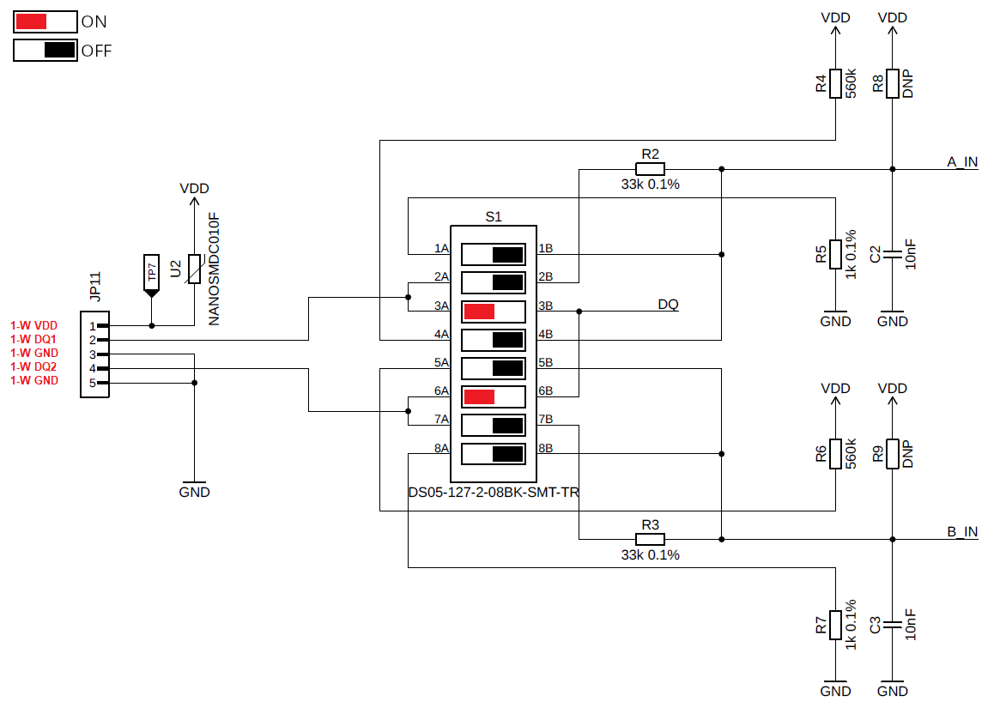
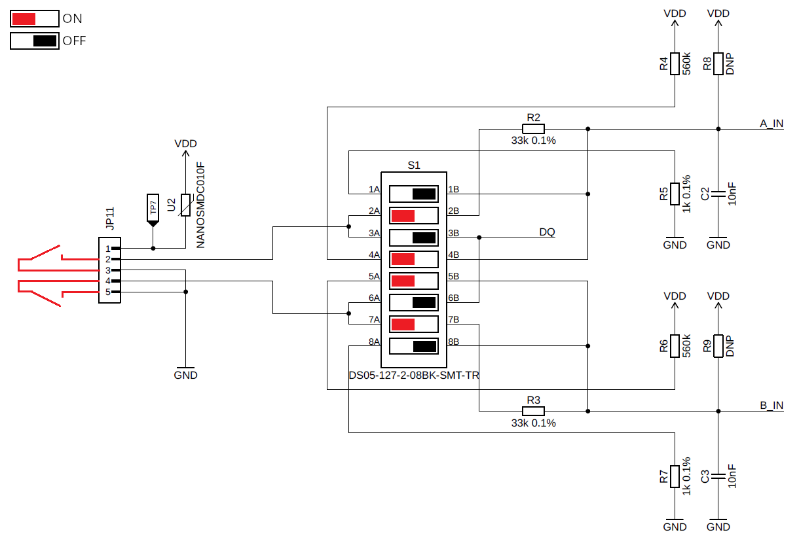
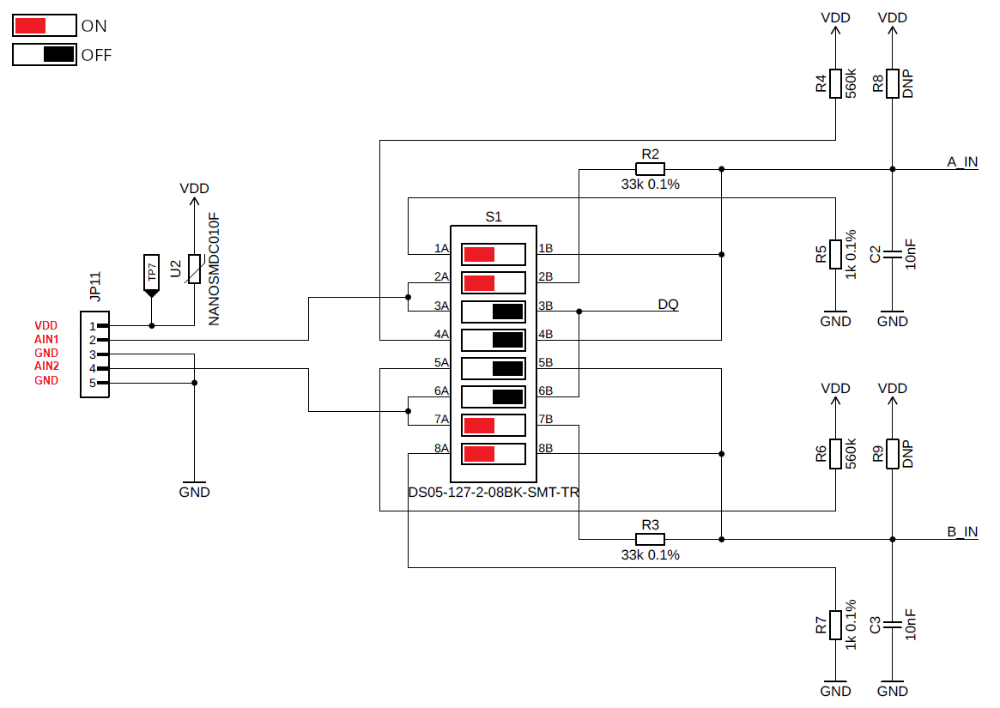
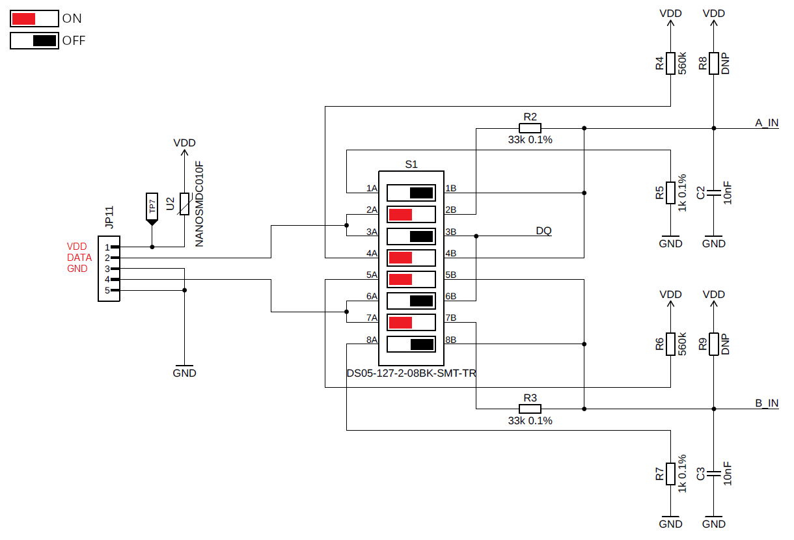

import Image from '@theme/IdealImage';

# Zapojení vstupů STICKER Input {#sticker-input-wiring}

## Legenda přepínačů DIP {#dip-switch-legend}

- |🟥←| **ON**: přepínač DIP v poloze ON (červeně)
- |→⬛| **OFF**: přepínač DIP v poloze OFF (černě)

## Nastavení přepínače DIP S1 {#dip-switch-s1-settings}

Externí konektor je propojen se vstupy nebo se sběrnicí 1-Wire jen přes osminásobný přepínač DIP **S1** na zařízení STICKER Input. Přepínače 1–4 patří ke vstupu **A** (`DQ1`), přepínače 5–8 ke vstupu **B** (`DQ2`):

| Přepínač S1 (A / B) | Připojí |
|:-:|---|
| 1 / 8 | Bočník 1 kΩ proti GND |
| 2 / 7 | Sériový rezistor 33 kΩ mezi konektorem a vstupem |
| 3 / 6 | Konektor na sběrnici 1-Wire |
| 4 / 5 | Pull-up rezistor 560 kΩ na VDD |

Přepínač a konfiguraci firmwaru nastavte vždy společně. Do polohy ON dejte jen přepínače uvedené pro daný vstup, ostatní nechte v poloze OFF:

| Použití vstupu | Konfigurace | S1 v poloze ON pro A / B |
|---|---|---|
| 1-Wire (Dallas, MACHINE PROBE) | `cap-w1-sensors true`, `cap-gpio-input-x none` | 3 / 6 |
| Analogový vstup 0–24 V | `cap-gpio-mode inputs`, `cap-gpio-input-x analog` | 1+2 / 7+8 |
| Bezpotenciálový kontakt nebo impulzní výstup S0 | `cap-gpio-mode inputs`, `cap-gpio-input-x digital` nebo `pulse` | 2+4 / 5+7 |

`cap-gpio-input-x` znamená `cap-gpio-input-a` nebo `cap-gpio-input-b`.

:::warning

Firmware polohu přepínače DIP nepozná. Pokud je vstup nastavený jako `analog`, ale jeho přepínač je v poloze pro 1-Wire, vstup zůstane nezapojený a naměřené hodnoty nemají smysl: většina z nich leží mimo rozsah věrohodnosti 0–30 V, takže se hodnota hlásí jako `null` a vznikne alarm chybějících dat, občas ale projde i nesmyslná hodnota. Na zařízení, které používá jen 1-Wire, nastavte `cap-gpio-mode none`.

:::

## Vstup 1-Wire {#1-wire-input}
Zapojení pro 1-Wire (Dallas, ...):
- Přepínače DIP zapínají datové linky (DQ1/DQ2).

---

## Vstup pro bezpotenciálový kontakt {#dry-contact-input}
Zapojení pro bezpotenciálový kontakt:  
- Pull-up rezistor 560 kΩ k VDD na vstupu; konektor je ke vstupu připojený přes sériový rezistor 33 kΩ (přepínače S1 2+4 pro A, 5+7 pro B).  

---

## Analogový vstup (0–24 V) {#analog-input-024-v}
Analogový vstup 0–24 V:  
- Dělič 1 kΩ / 33 kΩ.

## Senzor S0 {#so-sensor}

Impulzní výstup S0 měřiče energií nebo médií, počítaný v režimu `cap-gpio-input-x pulse`. Konfiguraci a způsob počítání popisuje stránka [Rozhraní S0](./s0-interface.md).

