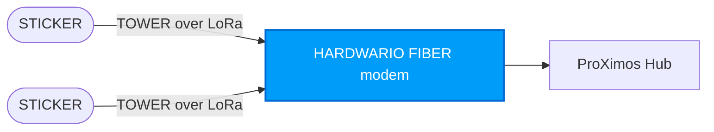

import Image from '@theme/IdealImage';

# LoRa P2P (Peer-to-Peer) Mode

:::info Available since firmware v2.0.0
LoRa P2P mode is part of STICKER firmware **v2.0.0**. The same firmware image supports both LoRaWAN and P2P; the device selects one at boot from `radio-mode`.
:::

**LoRa P2P** is a second radio mode for sites with no LoRaWAN network. STICKER does not need a LoRaWAN Network Server (LNS). It pairs with a **ProXimos Hub** through a **HARDWARIO FIBER** modem and talks the **HARDWARIO TOWER radio protocol** over LoRa.

---

## Key Advantages

- **No LoRaWAN infrastructure:** No LoRaWAN gateway and no network server (ChirpStack, TTS). The ProXimos Hub runs the network.
- **Confirmed delivery:** The gateway acknowledges frames locally. A confirmed send is up to 3 transmissions of the frame until its ACK arrives. With no ACK, the send is repeated up to 3 more times after a random back-off.
- **Same features as LoRaWAN:** Telemetry, alarms, downlink commands, paged answers, history backfill, network time, link supervision, `get_radio_state`, and the Info + settings announce after boot and every `interval-announce` hours.
- **Encrypted and authenticated:** Every data frame is protected with AES-128-CCM under a session key that is derived during the on-air join.

---

## Architecture & Topology



- **Pairing:** The node joins the network on air. The JoinRequest identifies the node by its DevEUI and is authenticated with keys derived from its AppKey. The Hub answers with a JoinAccept, and both sides derive a fresh session key. The pairing is stored, so a reboot does not cost a new join.
- **Frames:** TOWER frames with a 14 B header and an 8 B authentication tag. The MTU is 96 B, which leaves 74 B of payload per frame.
- **Confirmed sends:** Alarms (with `radio-alarm-ack true`), answers and history frames are confirmed by the gateway ACK, up to 3 transmissions per send and up to 3 repeated sends without an ACK. In firmware v2.0.0 every periodic telemetry report is confirmed as well.
- **Downlinks:** The Hub queues a command for the node and announces it with a PENDING flag in the next ACK. The node keeps its receiver on for that downlink. A command therefore waits at most one report interval.
- **Payloads:** The STICKER payloads are byte-identical to the LoRaWAN fPort payloads (telemetry 2, alarms 3, answers 85), so the same commands, decoder and paging rules apply.
- **Duty cycle:** The node keeps its own sliding-hour airtime budget, taken from the EU868 sub-band of `p2p-frequency`.

:::caution Update nodes and Hub together
Firmware v2.0.0 switched P2P to the TOWER protocol with no fallback. Nodes and the ProXimos Hub must be updated together, and every node joins afresh after the update.
:::

---

## Radio Parameters

Both the node and the Hub must use the same radio parameters. P2P has no ADR, no power control and no SF change: every parameter is fixed per network.

| Parameter | Default Value | Description |
|---|---|---|
| **`p2p-frequency`** | `869525000` (869.525 MHz) | Carrier frequency in Hz, 863–870 MHz (EU868 band only). One channel for uplink, ACK and downlink. |
| **`p2p-spreading-factor`** | `7` | Spreading factor 6–12. Higher means longer range and longer airtime. |
| **`p2p-tx-power`** | `14` | TX power 2–14 dBm, unless the Hub assigns one in the JoinAccept. |
| **`p2p-modulation`** | `lora` | `lora` for the ProXimos Hub. `fsk` selects the TOWER GFSK physical layer for a stock HARDWARIO TOWER gateway (pairs through TOWER's own pairing). |

With `p2p-modulation lora` the remaining physical parameters are fixed: bandwidth 125 kHz, coding rate 4/5, preamble 8 symbols, explicit header, CRC on.

---

## Configuration & Management

The P2P radio parameters are writable **only in the RTT developer shell**, which the debug and provisioning images provide. The release image has no shell. It runs with the `p2p-*` values stored in NVS: values that a debug or provisioning image wrote before the release image was flashed over it without an erase, or otherwise the defaults in the table above. A device on the release image therefore talks to a Hub on the defaults (869.525 MHz, SF7, 14 dBm, `lora`) unless its parameters were set this way, so set the Hub to match. Over NFC, [**HARDWARIO Manager**](/sticker/hardwario-manager/) can switch `radio-mode` to `p2p`, but it cannot set the `p2p-*` parameters: the firmware rejects them over NFC as not writable. Over NFC and over a radio they are read-only (`get_config` / `get_param` return them). Over a radio, a change would also cut the link that carries it.

```bash
config radio-mode p2p
config p2p-frequency 869525000
config p2p-spreading-factor 7
config p2p-tx-power 14
config p2p-modulation lora
settings save
```

The node's identity comes from the same parameters as on LoRaWAN: `radio-deveui` (the DevEUI the Hub registers) and `radio-appkey` (the root key of the join). There is no separate P2P key. With an all-zero DevEUI or AppKey the radio refuses to start.

### Diagnostics

- **`get_radio_state`** (over NFC or a radio) returns the link state, SF, TX power, RSSI/SNR of both link directions, duty-cycle use and counters since boot.
- On a debug image with P2P, `ats radio status` shows the pairing and link, and `ats radio listen`, `ats radio unjoin` (forget the pairing, reboots) and `ats radio ack_drop` help with bench testing.

### Known limitations

- No listen-before-talk yet.
- No NFC configuration of the P2P radio parameters.
- EU868 band only.

For field commissioning workflows, refer to the [**HARDWARIO Manager**](/sticker/hardwario-manager/) documentation.