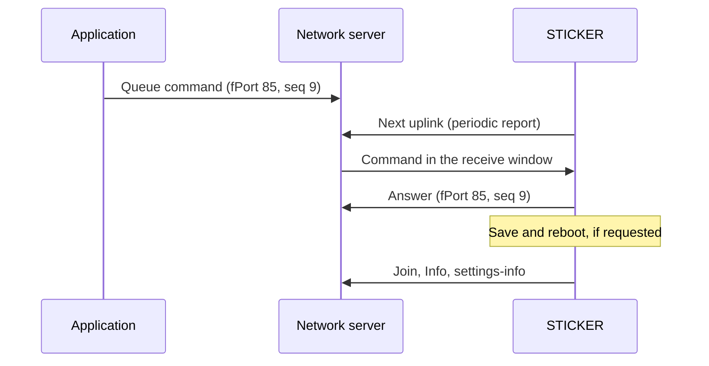

# Downlink processing

:::caution Draft
This page is a draft for internal review. Statements marked **[ověřit]** still need confirmation on hardware or from the product owner.
:::

:::info Firmware v2.0.0
This page describes **STICKER firmware v2.0.0**. Where firmware v1.4.x behaves differently, a **Firmware v1.4.x** note says so.
:::

You can control STICKER remotely with downlinks, the messages that the network server sends to the device. This page explains what the device does with a downlink: which commands it accepts over the radio, when a change takes effect, how it answers and what its error codes mean. It helps you find out why a command did not have the effect you expected. For the encoding of each command, see [**Downlink commands**](../connectivity/downlink-commands.md).

## How a downlink is handled

STICKER is a LoRaWAN Class A device: it listens for a downlink only in two short receive windows right after each of its own uplinks (an uplink is a message the device sends). A command that you queue on the network server therefore waits there until the device sends its next uplink. That is usually the next periodic report, which comes every 900 s with the default `interval-report`. Over [**LoRa P2P**](../connectivity/lora-p2p.md) the ProXimos Hub holds the command in the same way until the node's next uplink.

1. **Queue:** you queue the command on **fPort 85**. The fPort is the port number of a LoRaWAN message; it tells the receiver what the message carries. The command is a small protobuf message (a compact binary format) with a sequence number `seq` that you choose. You can queue it as hex, or as JSON when `ttn.js` is set as the downlink formatter, see [**Payload and decoder**](payload.md).
2. **Run:** after its next uplink the device receives the command, checks it and runs it.
3. **Answer:** the device sends the answer right away as its own uplink on fPort 85, with the same `seq`, unless the **duty cycle** holds it back. The duty cycle is the legal limit on transmit time, which in the EU868 region is 1 % of the time, or 36 s per hour.
4. **Follow-up action:** a command that saves the settings, reboots the device or starts a new join runs this action only after its answer has gone out.



| Item | Value |
|---|---|
| Command port | fPort 85, in both directions |
| Command format | Protobuf with `seq`, no version byte |
| Largest command | 224 B; a larger downlink is dropped without an answer |
| Commands waiting to be processed | 2; a command that arrives while both places are taken is dropped without an answer |
| Answer format | Uplink on fPort 85: version byte `0x01`, then protobuf with the same `seq` |
| Answer size | At most 64 B per frame, and at most what the current data rate allows; longer answers are paged |
| `seq` 0 | Used by the device's own Info and settings-info uplinks; give your commands `seq` 1 or higher |
| Downlinks on other fPorts | Not processed as commands |

Over LoRaWAN an answer is an unconfirmed uplink: the network server does not acknowledge it, and the device does not send it again if it is lost on the air. Over LoRa P2P the gateway acknowledges every answer, and the device repeats an unacknowledged answer up to 3 more times. If no answer arrives, read the state back first (for example with `get_settings` or `get_param`) before you repeat a command that saves or reboots the device.

:::tip JSON commands
With the `ttn.js` encoder, put the command body under the command name, for example `{"command": "reset_counters", "seq": 5, "reset_counters": {"input_a": true}}`. The encoder ignores a flat body such as `{"command": "reset_counters", "input_a": true}` and sends the command empty: `reset_counters` then resets nothing and `req_history` replays the whole history.
:::

## Commands over the radio and over NFC

Most commands work over the radio. Commands that could cut the device off the network, reveal its secrets or change its identity work only over NFC with [**HARDWARIO Manager**](/apps/hardwario-manager/sticker/configuration) or on the shell of a debug build.

| Channel | Commands |
|---|---|
| Over the radio (LoRaWAN and LoRa P2P) | `set_param`, `get_param`, `get_config`, `get_settings`, `get_info`, `get_radio_state`, `settings_save`, `reboot`, `reset_counters`, `w1_scan`, `lrw_join`, `clock_sync`, `sample`, `buzzer_play`, `force_send`, `req_history` |
| Only over NFC or the shell | `device_reset`, `factory_reset`, `lrw_reset`, `enter_calibration`, `set_secret_key`, `req_history_page`, `claim_done`, `claim_active`, `get_claim_info`, `get_basic_info`; `vendor_reset` only over the vendor NFC channel |

- **Wrong channel:** a command that is not allowed on the channel it arrived on is answered with `NOT_READY` (code 3).
- **Unknown command:** a command the firmware does not know, such as `enter_dfu` of older firmware, is answered with `NOT_SUPPORTED` (code 7).
- **Radio only:** `force_send` and `req_history` work over the radio only, because their answer is itself an uplink: a telemetry report on fPort 2, or a stream of history frames on fPort 85.
- **No `Ack`:** `get_info`, `w1_scan`, `force_send`, `sample`, `clock_sync` and `req_history` answer with their data instead of an `Ack`. `clock_sync` sends an Info with its `seq` once the network time has arrived.

To build a command, use the [**Downlink commands generator**](../connectivity/downlink-commands-generator.mdx).

:::note Firmware v1.4.x
Firmware v1.4.x also accepted `lrw_reset`, `enter_calibration` and a `set_param` with `calibration` over LoRaWAN. Firmware v2.0.0 answers the two commands with `NOT_READY` and the parameter with `NOT_WRITABLE`, because a LoRaWAN reset over the air could get every later join refused by the network server, and calibration mode transmits with keys that are the same on every unit.
:::

## When a change takes effect

A `set_param` downlink only prepares a change. The device keeps working with its current settings until you save, and saving restarts the device. Alarm rules and counter resets are the exceptions: they apply at once.

| What you send | What happens |
|---|---|
| `set_param` without `save` | The change is staged. `get_config`, `get_param` and `get_settings` show the new value at once, but the device still runs with the old one. |
| `settings_save`, or `set_param` with `save: true` | The device writes everything staged to NVS (the settings storage in flash) and cold-reboots. The new settings apply from that boot on. |
| `reboot` | The device reboots without saving; staged changes are lost. |
| Alarm rules in `set_param`, including `alarms_replace` | The rules apply at once, without a reboot. Unless you also save, the previous rules come back at the next reboot. |
| `reset_counters` | The selected counters are cleared at once and saved to flash, without a reboot. |
| `lrw_join` | The device starts a new join, without a reboot. |

After a save the device reboots, connects to the network again and sends its Info and settings-info uplinks, so the settings-info shows the key settings as saved. See [**Messages and timing**](messages.md).

If a `set_param` is rejected with an error, nothing from it is staged and its `save` flag is ignored, so the device does not reboot.

<details>
<summary><b>Order of follow-up actions</b></summary>

- **Answer first:** the device does not save, reboot or rejoin while it still has something to send. It waits until the answer, any queued alarm frames and any confirmed uplink still waiting for its acknowledgement have gone out.
- **Timing:** the device checks this 8 s after the command and then every 8 s. It runs the action at the latest 120 s after the first such command, even if something is still unsent.
- **Several commands:** commands that arrive while an action waits are merged into one run. A pending counter reset is stored first, then the strongest reboot runs once: a save wins over a plain `reboot`. A reboot does not store the counters by itself, so pulses counted since the last periodic save are lost. A pending `lrw_join` is dropped when a reboot follows, because the device joins at every boot anyway.
- **Failed save:** if writing to flash fails, the device still reboots and starts with what is stored in flash; the staged values are lost.
- **Large configuration:** a downlink can carry only as many bytes as the data rate of its receive window allows. Split a large configuration over several `set_param` downlinks: their changes collect in the staging area, and only the last downlink sets `save`. When you rewrite the alarm table this way, set `alarms_replace` in the first downlink only. If the device reboots before the last downlink arrives, the staged part is lost and you need to send it again.

</details>

## Settings that cannot be changed over the air

A downlink cannot change how the device connects to the network. A wrong value could cut off the very link that carries the command, and the network server must not be able to change the identity or keys of the device. Over the radio, `set_param` cannot write:

- the whole `lorawan` group: `radio-mode`, `lrw-region`, `lrw-sub-band`, `lrw-network`, `lrw-activation`, `lrw-adr`, `lrw-datarate`, `radio-link-check-interval`, `radio-link-check-fail-rejoin` and the identifiers and keys (DevEUI, JoinEUI, AppKey, NwkKey, DevAddr, NwkSKey, AppSKey);
- the `p2p` group with the LoRa P2P radio parameters, which only the shell can set;
- `calibration`, which only NFC or the shell can set;
- `vendor-reset-allow`, which only the vendor NFC channel or the shell can set.

If a `set_param` contains any of these fields, the device answers `NOT_WRITABLE` (code 8) with a `fault_field` that names the field, and **rolls back the whole command**: none of its values is staged, not even the valid ones. Change these settings over NFC, see [**Configuration**](configuration.md).

Reading is less strict. Over the radio, `get_config` and `get_param` return the LoRaWAN settings and identifiers but never the keys (AppKey, NwkKey, NwkSKey, AppSKey). `get_config` over the radio also leaves out the ROM codes of the 1-Wire probes; `get_param` returns them when you ask for them.

## Answers and paging

An answer that is too long for one uplink is split into pages. The device sends all pages by itself, and the decoder labels each page so that you can put the answer together.

- **Frame size:** each answer frame is at most 64 B and never larger than the current data rate allows. The **data rate** (DR) sets how many bytes fit into one uplink: a low DR such as DR0 (SF12 in EU868) reaches farther but carries fewer bytes and stays longer on the air.
- **Pages:** every page is a complete answer with the same `seq` and the fields `page_index` and `page_count`; the decoder adds `pages`, for example `"2/4"`. Merge the pages of one answer by DevEUI, fPort and `seq`.
- **Pace:** over the radio the device sends the remaining pages itself, at most one page every 2 s and only as fast as the duty cycle allows. Over NFC the phone asks for each page.
- **Configuration dumps:** over the radio `get_config` and `get_param` use a fixed page layout, so a full `get_config` takes about 4 pages plus one page for each alarm rule, at every data rate that fits a page.
- **Missing page:** send the same `get_config` or `get_param` again with `page` set to the index of the missing page; the device sends from that page to the end. At a low data rate wait before you do so, because the page may only be waiting for airtime.
- **Duty cycle at DR0:** at EU868 DR0 one page takes about 2.1 s of airtime, against a budget of 36 s per hour. Allow at least 1 h to collect all pages of a large answer at a low data rate, and ask only for what you need: `get_param` for single settings, `get_settings` for the key settings in one frame.
- **`BUDGET_TOO_SMALL` (code 9):** the answer does not fit the current data rate, not even in pages. This happens to `get_config` and `get_param` at the smallest data rates with 11 B per frame (US915 DR0, AU915 and AS923 DR2), or when the data rate dropped after the answer was built. Try again once ADR (adaptive data rate, the network server tuning the data rate of the device) has raised the data rate, or read the value over NFC.
- **One stream at a time:** while a paged answer is still being sent, a second request that needs pages is answered with `NOT_READY` and its `seq`. Send it again when the first answer is complete.

## Error codes

When the device cannot carry out a command, it answers with an error instead of an `Ack`. The error has a numeric code and, for a rejected setting, a `fault_field` that names the setting. Over LoRaWAN the error carries only these numbers; over NFC and LoRa P2P it also carries a short English text.

| Code | Name | Typical cause |
|---|---|---|
| 0 | `UNKNOWN` | Over NFC: the answer is too large to send, or the clock could not be set. |
| 1 | `BAD_REQUEST` | The downlink could not be decoded; a `sensors` field removed in v2.0.0 (`fault_field` 300 + its old number); an unknown `buzzer_play` melody or a repeat time over 999 s; an NFC `clock_sync` time outside the accepted window (2024 to 2099). |
| 2 | `OUT_OF_RANGE` | A value outside its allowed range (`fault_field` names it); an invalid alarm rule (`fault_field` 400 + the field number of the rule); a page that does not exist. |
| 3 | `NOT_READY` | The command is not allowed on this channel; `lrw_join` while LoRaWAN changes are not saved; another paged answer is still being sent; the 1-Wire bus is not ready; the buzzer is not active; `get_claim_info` after the device was claimed. |
| 4 | `HISTORY_UNAVAILABLE` | `req_history` found no stored records in the requested time window, for example because history was never enabled. |
| 5 | `UNSUPPORTED_FIELD` | Defined in the protocol; firmware v2.0.0 does not send it. |
| 6 | `PERSIST_FAILED` | Defined in the protocol; firmware v2.0.0 does not send it. |
| 7 | `NOT_SUPPORTED` | An unknown or removed command; a function not built into this firmware image (1-Wire, buzzer, calibration). |
| 8 | `NOT_WRITABLE` | The setting cannot be written over this channel, for example the `lorawan` group over a downlink. |
| 9 | `BUDGET_TOO_SMALL` | The answer does not fit the current data rate. Try again once the data rate is higher. |

How to read `fault_field`:

- **Value:** group × 100 + field number. The groups are 1 `lorawan`, 2 `application`, 3 `sensors`, 4 `alarms` and 5 `p2p`. For example, 203 is field 3 of the `application` group, `interval-report`.
- **Decoded:** the decoder splits the value into `fault_group` (the group) and `fault_field` (the field number), so 203 decodes as `"fault_group": 2, "fault_field": 3`.
- **Alarm rules:** an invalid rule gives 400 + the field number of its slot, from 403 for `alarm_0` to 418 for `alarm_15`. The decoder splits this number too, so a rejected `alarm_0` decodes as `"fault_group": 4` and `"fault_field": 3`. The value is 400 when no single rule can be named.
- **Removed fields:** a v1.4.x input, PIR or buzzer capability field (`sensors` field 3, 4, 7, 19, 20 or 21) gives `BAD_REQUEST` with 300 + that number.
- **First fault only:** the device reports the first faulty field it finds and rolls back the whole `set_param`.

<details>
<summary><b>Field numbers for fault_field</b></summary>

| Group | Field numbers |
|---|---|
| 1 `lorawan` | 1 `lrw-region`, 2 `lrw-sub-band`, 3 `lrw-network`, 4 `lrw-adr`, 5 `lrw-activation`, 6 `radio-deveui`, 7 `lrw-joineui`, 8 `lrw-nwkkey`, 9 `radio-appkey`, 10 `lrw-devaddr`, 11 `lrw-nwkskey`, 12 `lrw-appskey`, 13 `radio-link-check-interval`, 14 `radio-link-check-fail-rejoin`, 15 `radio-mode`, 16 `lrw-datarate` |
| 2 `application` | 1 `calibration`, 2 `interval-sample`, 3 `interval-report`, 4 `history-enable`, 6 `battery-level`, 7 `vendor-reset-allow`, 8 `interval-announce`, 9 `history-channels` |
| 3 `sensors` | 1 `cap-hall-left`, 2 `cap-hall-right`, 5 `cap-light-sensor`, 6 `cap-barometer`, 8 `cap-w1-sensors`, 9 `cap-accelerometer`, 10 `accel-motion-sensitivity`, 11–14 `sensor1-rom` to `sensor4-rom`, 15 `hall-left-counter`, 16 `hall-right-counter`, 17 `input-a-counter`, 18 `input-b-counter`, 22 `cap-sht`, 23–26 `sensor1-type` to `sensor4-type`, 27 `cap-gpio-mode`, 28 `cap-gpio-input-a`, 29 `cap-gpio-input-b` |
| 4 `alarms` | 1 `alarm-limit`, 3–18 alarm rules `alarm_0` to `alarm_15`, 20 `alarm-buzzer-mode`, 21 `radio-alarm-ack` |
| 5 `p2p` | 1 `p2p-frequency`, 2 `p2p-spreading-factor`, 3 `p2p-tx-power`, 4 `p2p-modulation` |

</details>

## Examples

The downlinks below are ready to queue on fPort 85. The [**Downlink commands generator**](../connectivity/downlink-commands-generator.mdx) builds others.

| Hex (fPort 85) | Command | What the device does |
|---|---|---|
| `08032200` | `get_info`, `seq` 3 | Answers with an Info that carries `seq` 3. |
| `08043200` | `settings_save`, `seq` 4 | Answers `Ack`, then saves the staged settings and reboots. |
| `08056200` | `clock_sync`, `seq` 5 | Asks the network for the time; sends an Info with `seq` 5 once the time has arrived. |
| `08064a00` | `force_send`, `seq` 6 | Sends a telemetry report on fPort 2; there is no answer on fPort 85. |
| `08118a0100` | `lrw_join`, `seq` 17 | Answers `Ack`, then starts a new join without a reboot. |
| `08021a070a010312020407` | `get_param`, `seq` 2: `lorawan` field 3, `application` fields 4 and 7 | Answers with a `config_dump` of `lrw-network`, `history-enable` and `vendor-reset-allow`. |
| `080912021801` | `set_param` with only `save: true`, `seq` 9 | Answers `Ack`, then saves everything staged so far and reboots. |
| `0807fa0100` | `get_settings`, `seq` 7 | Answers with the settings-info, carrying `seq` 7. |
| `080812023001` | `set_param` with `alarms_replace: true` and no rules, `seq` 8 | Answers `Ack` and clears all 16 alarm rules at once; without a save they come back at the next reboot. |

Typical answers on fPort 85:

| Hex (fPort 85) | Meaning |
|---|---|
| `0108011200` | `Ack` for `seq` 1 |
| `0108033205080210cb01` | Error `OUT_OF_RANGE` (2) for `seq` 3, `fault_field` 203: `interval-report` outside 60–86400 s |
| `01080232020809` | Error `BUDGET_TOO_SMALL` (9) for `seq` 2: try again at a higher data rate |

<details>
<summary><b>Decoded answers</b></summary>

`0108011200`:

```json
{ "seq": 1, "ack": {} }
```

`0108033205080210cb01`:

```json
{ "seq": 3, "error": { "code": 2, "fault_field": 3, "fault_group": 2 } }
```

`01080232020809`:

```json
{ "seq": 2, "error": { "code": 9 } }
```

</details>

The `set_param` example in the v1.4.0 release notes, `0801120c0a0220011202187822023001`, sets `lrw-adr`, `interval-report` and `cap-barometer` in one command. Because `lrw-adr` belongs to the `lorawan` group, the device answers `NOT_WRITABLE` with `fault_field` 104 and applies none of the three values. The firmware code of v1.4.0 rejects it in the same way. Without the LoRaWAN part the same change is `080112081202187822023001` (staged only) or `0801120a12021878220230011801` (with `save`); set `lrw-adr` over NFC.
