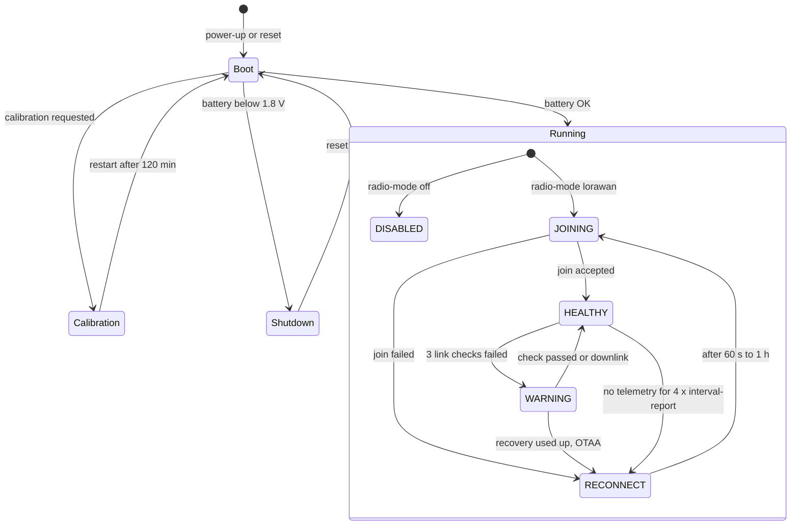

# Device behavior

:::caution Draft
This page is a draft for internal review. Statements marked **[ověřit]** still need confirmation on hardware or from the product owner.
:::

:::info Firmware v2.0.0
This page describes **STICKER firmware v2.0.0**. Where firmware v1.4.x behaves differently, a **Firmware v1.4.x** note says so.
:::

This chapter explains what STICKER does in each situation: after you insert the batteries, while it joins the network, when the radio link gets weak, when it receives a command and when a sensor or probe disappears. It is written for support and for customers who need to know what the device is doing and why. Parameters, command encodings and wiring stay in the reference pages, and this chapter links to them.

## Device states

STICKER is always in one of the states below. While it runs normally, it is in one of the radio states inside **Running**. The diagram shows how it moves between them; the table after it shows how you recognize each state. Radio states are written as the firmware names them (`HEALTHY`, `WARNING` and so on), which is also how they appear in the device shell and, in lower case, in the decoded `get_radio_state` answer.

| State | What it means | Status LED | Details |
|---|---|---|---|
| Boot | The device has just started. It checks the battery, then starts its sensors, storage, radio and NFC one after another. | Red, yellow and green once (about 3 s) | [**Startup and initialization**](startup.md) |
| Shutdown | The battery was below 1.8 V at startup, so the device switched itself off. | Boot sequence, then fast red blinking for 5 s, red for 1 s and dark | [**Battery and power**](battery.md) |
| Calibration | Factory and service test mode for 120 min. | Short orange flash every second | [**Startup and initialization**](startup.md) |
| `DISABLED` | The radio is off on purpose (`radio-mode off`), the configured region is not supported by the firmware image, or LoRa P2P has no keys. The device measures but sends nothing. | One very short yellow flash every 3 s | [**Network connection**](network-connection.md) |
| `JOINING`, `RECONNECT` | The device is not on the network and retries the join with a growing pause (60 s up to 1 h). | Short yellow and red flash every 3 s | [**Network connection**](network-connection.md) |
| `HEALTHY` | Connected; reports go out every `interval-report`. | Very short green flash every 3 s | [**Messages and timing**](messages.md) |
| `WARNING` | Still connected, but link checks fail. The device checks the link on every report and tries a more robust data rate. | Two very short yellow flashes every 3 s | [**Network connection**](network-connection.md) |

Two more LED signals can appear on top of these states. A very short red flash every 3 s means that an alarm is active; the radio state patterns take priority over it, so it shows only while the device is `HEALTHY` (or `IDLE`). A red and yellow double flash every 3 s means that the stored settings could not be loaded and the device runs on factory defaults **[ověřit]**. The complete LED reference is in [**Hardware description**](../hardware-description.md).

:::note Firmware v1.4.x
In firmware v1.4.x the `WARNING` state has no recovery steps, so a lost link takes about 9–10 h instead of 4–5 h to trigger a rejoin. There is no battery check at startup and some LED patterns differ. See [**Firmware versions and updates**](firmware.md).
:::

## At a glance

With the default settings, a connected STICKER does the following:

| What | When | Details |
|---|---|---|
| Joins the network (OTAA) | At every startup and after a lost connection | [**Network connection**](network-connection.md) |
| Sends the **Info** and **settings-info** uplinks | After every join and every 24 h | [**Messages and timing**](messages.md) |
| Sends a telemetry report | Every 900 s (15 min) | [**Messages and timing**](messages.md) |
| Checks the radio link | With every 5th report | [**Network connection**](network-connection.md) |
| Synchronizes its clock with the network | After the join, then weekly | [**Messages and timing**](messages.md) |
| Sends an alarm report | About 10 s after an alarm starts or ends | [**Alarms**](alarms.md) |
| Saves counters to flash | With every report, when they changed | [**History and counters**](history-and-counters.md) |
| Records sensor history | Only when `history-enable` is on | [**History and counters**](history-and-counters.md) |

## Find the right page

| Situation | Page |
|---|---|
| The LED does something unexpected after you insert the batteries | [**Startup and initialization**](startup.md) |
| The device does not appear in the network server, or data stopped arriving | [**Network connection**](network-connection.md) |
| You want to know which uplinks to expect and how often | [**Messages and timing**](messages.md) |
| You sent a command and nothing changed, or you got an error | [**Downlink processing**](downlinks.md) |
| You need data from a period when the device was offline | [**History and counters**](history-and-counters.md) |
| You set up alarms and want to know what they send | [**Alarms**](alarms.md) |
| A 1-Wire probe was disconnected or replaced | [**1-Wire probes**](one-wire.md) |
| You change settings with a phone over NFC | [**Configuration**](configuration.md) |
| You have a question about battery life or low battery | [**Battery and power**](battery.md) |
| You integrate the payload into your own system | [**Payload and decoder**](payload.md) |
| You need the firmware version or want to update | [**Firmware versions and updates**](firmware.md) |
| You start from a symptom | [**Troubleshooting**](troubleshooting.md) |
