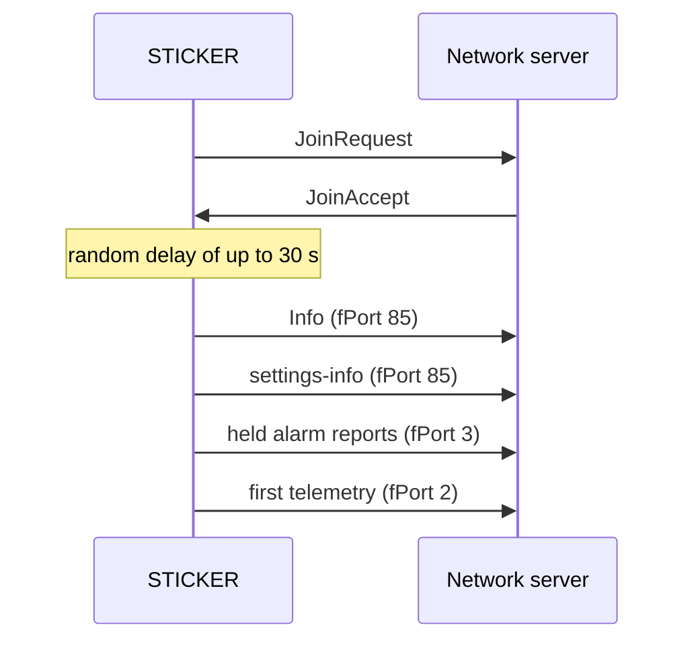

# Messages and timing

:::caution Draft
This page is a draft for internal review. Statements marked **[ověřit]** still need confirmation on hardware or from the product owner.
:::

:::info Firmware v2.0.0
This page describes **STICKER firmware v2.0.0**. Where firmware v1.4.x behaves differently, a **Firmware v1.4.x** note says so.
:::

This page lists the messages STICKER sends, in which order and how often: the announce after every join, the regular reports, the periodic re-announce and the clock synchronization. Use it to check whether what you see in the network server is expected. [**Network connection**](network-connection.md) describes how the device gets onto the network and what it does when the link is lost.

## Uplink types

An uplink is a message from the device to the network; a downlink goes the other way. The fPort, a number in every LoRaWAN frame, tells which kind of message an uplink carries:

| fPort | Direction | Message | When |
|---|---|---|---|
| 2 | Uplink | **Telemetry:** sensor values, battery voltage and alarm state | Every `interval-report` and after every join; also when an alarm starts or ends and as the answer to `force_send` or `sample` |
| 3 | Uplink | **Alarm report:** the alarm events of one collection window | When an alarm starts or ends, at the end of the `alarm-limit` window (default 10 s); see [**Alarms**](alarms.md) |
| 85 | Uplink | **Responses:** the **Info** and **settings-info** uplinks, answers to commands and sensor history frames | After every join, every `interval-announce` and as the answer to a command |
| 85 | Downlink | **Commands** | When your application or the network server sends one; see [**Downlink processing**](downlinks.md) |
| 10 | Uplink | **Calibration data** | Only in calibration mode, which is for factory and service use |

Every uplink on fPort 2, 3 and 85 starts with the format version byte `0x01`, followed by a protobuf message that the STICKER decoder (`ttn.js`) turns into JSON. A message that does not fit one frame at the current data rate (DR) is split into pages; the decoder marks each page, for example `pages: "1/2"`. The fields of each message are described in [**Payload and decoder**](payload.md).

Now and then the network server may show an uplink without application data. In that case the network's MAC commands (LoRaWAN control messages) filled the whole frame, and the device sent an empty uplink to answer them.

## What the network server shows after power-up

The table shows a device with OTAA (it joins the network with a JoinRequest) and the default settings (`interval-report` 900 s, `interval-announce` 24 h, a link check with every 5th report) in a network that answers.

| Time | What arrives | fPort | Notes |
|---|---|---|---|
| A few seconds after power-up | Join: JoinRequest and JoinAccept | None | OTAA only. A failed join is repeated after about 1 min, then with a pause that doubles up to 1 h. |
| 0–30 s after the join | **Info** | 85 | The first uplink after the join also carries the `DeviceTimeReq` MAC command; the network's answer sets the clock. |
| Right after | **settings-info** | 85 | Decoded as `config_dump` |
| Right after | Alarm reports | 3 | Only if alarm events waited while the device was offline |
| Right after | First telemetry | 2 | `boot: true`. It carries a link check (`LinkCheckReq`), which the network answers in a downlink. |
| About 900 s after power-up, plus up to about 70 s | Telemetry | 2 | Then every 900 s on the same rhythm. Every 5th report carries a link check. |
| When an alarm starts or ends | Alarm report and an extra telemetry uplink | 3 and 2 | The alarm report comes at the end of the `alarm-limit` window |
| 21.6–24 h after the join | **Info** and **settings-info** | 85 | Then again in every 21.6–24 h period |
| 7 days after the first network time | `DeviceTimeReq` on a regular uplink | Any | Weekly clock re-sync; no extra uplink |

The first periodic report follows one `interval-report` after power-up, not after the join, so the first two telemetry uplinks are less than 15 min apart. After a rejoin without a restart you see the same sequence from the **Info** on, but the first telemetry has `boot: false`, and there is no `DeviceTimeReq` when the clock was already set since the start. A device with ABP (stored session keys, no join) starts directly with the **Info**.

## Messages after every join

After every successful join, which means after every start and every rejoin, STICKER introduces itself before it sends data. The order is fixed: first the **Info** uplink, then the **settings-info** uplink, then any alarm reports that waited while the device was offline, and only then the first telemetry report. This sequence is called the announce. With ABP it follows every start, and on LoRa P2P every link-up, including a start with a stored pairing.



| Item | Value |
|---|---|
| Start of the announce | After a random delay of up to min(`interval-report` / 2, 30 s): up to 30 s at the default 900 s, so devices that restart together do not transmit at once |
| Order | **Info**, **settings-info**, held alarm reports, first telemetry |
| `seq` | 0 for the **Info** and the **settings-info**, so the decoded uplink has no `seq` field. An answer to a command carries the command's `seq` (the sequence number of the command). |
| Waiting data | Alarm reports and the first telemetry wait for the announce, but at most 60 s after the random delay |
| First telemetry | Sent right after the announce, without the offset and random delay of a periodic report |
| Not enough room at the current data rate | The **Info** and **settings-info** are split into pages. If not even one field fits, they go out once the data rate rises; the device checks every 5 s. |

### Info

The **Info** uplink tells the network who the device is and how it is doing:

- firmware version and build type;
- serial number;
- time since the start and, once the clock is set, the current time;
- battery voltage from the last measurement;
- why the device last restarted;
- device status flags: active alarm kinds, radio off or link down, problems with NFC, storage or the sensor bus, clock not set, claim window open;
- the active alarms;
- the state of each 1-Wire slot, when a slot is in use;
- after a restart caused by a firmware fault, the fault reason and two code addresses.

Read over NFC, the **Info** also carries the DevEUI and the claim token. The radio link state is not part of the **Info**; ask for it with `get_radio_state`.

<details>
<summary><b>Info fields in the decoded uplink</b></summary>

The decoder puts the **Info** under the key `info`.

| Key | Content |
|---|---|
| `fw_version`, `build_type_name`, `debug` | Firmware version (for example `2.0.0`), build type (`main` for a release) and whether it is a debug build |
| `serial_number` | Serial number |
| `uptime_s` | Seconds since the start; a small value means the device has just restarted |
| `unix_time` | Current time; missing while the clock is not set |
| `battery` | Battery voltage in mV; missing before the first measurement or when the battery cannot be measured |
| `reset_cause_flags` | Why the device last restarted, for example `pin` and `brownout` after new batteries, `pin` and `software` after a save or `pin` and `watchdog` after a watchdog reset; see [**Startup and initialization**](startup.md) |
| `device_status_flags` | Status flags, for example `alarm_any`, `alarm_low_battery`, `radio_off`, `radio_link_down`, `time_unsynced` or `claim_active` |
| `active_alarms` | One entry per active alarm: slot, channel and alarm type |
| `w1_slot_state` | State of 1-Wire slots 1–4: `none`, `ok`, `absent`, `replaced` or `mismatch`; see [**1-Wire probes**](one-wire.md) |
| `fault_reason_name`, `fault_pc`, `fault_lr` | Only after a restart caused by a firmware fault |

</details>

### settings-info

The **settings-info** uplink tells the network the key settings, so the network side always has a current copy:

- the intervals `interval_sample` and `interval_report` and the switch `history_enable`;
- every capability flag (`cap_*`), also those that are off;
- the GP pin settings `cap_gpio_mode`, `cap_gpio_input_a` and `cap_gpio_input_b`, as the device runs them;
- the detected 1-Wire sensor type of each slot (`w1_slot_type`).

It is 34–46 B long, so it fits one frame even at EU868 DR0 (51 B). The rest of the configuration, such as the alarm rules, comes with `get_config` or `get_param`; over the radio, the ROM codes (serial numbers) of the 1-Wire probes come only with `get_param`. See [**Downlink commands**](../connectivity/downlink-commands.md).

<details>
<summary><b>Example of a decoded settings-info</b></summary>

The values below are an example. Flags decode as `0` or `1`, and `w1_slot_type` lists slots 1–4 with `empty`, `dallas` or `machine-probe`.

```json
{
  "config_dump": {
    "application": { "interval_sample": 60, "interval_report": 900, "history_enable": 0 },
    "sensors": {
      "cap_hall_left": 1, "cap_hall_right": 0, "cap_light_sensor": 1,
      "cap_barometer": 0, "cap_w1_sensors": 1, "cap_accelerometer": 0,
      "cap_sht": 1, "cap_gpio_mode": "inputs", "cap_gpio_input_a": "pulse",
      "cap_gpio_input_b": "none"
    },
    "w1_slot_type": ["machine-probe", "dallas", "empty", "empty"]
  }
}
```

</details>

### Names in tickets and older notes

Tickets and older notes sometimes use other names for these messages:

| Name in tickets and notes | Name in this documentation | Key in the decoded uplink |
|---|---|---|
| deviceInfo, Device Info | **Info** uplink | `info` |
| configDump | **settings-info** uplink | `config_dump` with no `seq` |
| syncTime | There is no such message. The time comes with the `DeviceTimeReq` MAC command on a normal uplink, and the `clock_sync` command asks for it; see the time synchronization section below. | None |

The answers to `get_config`, `get_param` and `get_settings` are also decoded as `config_dump`, with the command's `seq`. Only the answer to `get_settings` has the same content as the **settings-info**.

:::note Firmware v1.4.x
Firmware v1.4.x sends only the **Info** after a join; the **settings-info** uplink, the random delay before the announce and the periodic re-announce are new in v2.0.0. In v1.4.x the **Info** read over NFC also showed the link state (`lrw_state`), which v2.0.0 reports with `get_radio_state` instead. The `device_status` bits of v1.4.x have another layout, so use the decoder that matches the firmware version in the **Info**.
:::

## Periodic re-announce

A device that runs for months without a restart would never send its **Info** and **settings-info** again. That is why it repeats them every `interval-announce`, by default once a day. The repetition costs about 2 uplinks per day.

| Item | Value |
|---|---|
| Interval | `interval-announce`: default 24 h, 1–168 h, `0` turns it off |
| Exact moment | A random point in the last 10 % of the period: 21.6–24 h after the previous announce at the default |
| Condition | The device is connected (`HEALTHY` or `WARNING`). Otherwise nothing is sent, and the next join announces anyway. |
| New period | Every join (start or rejoin) starts the period again |
| Waiting data | None: the **Info** and **settings-info** simply queue ahead of the next telemetry, with no random delay |
| Changing `interval-announce` | Over NFC, a downlink or the shell. A new value takes effect after a save, which restarts the device. |

## After a configuration change

- Most settings are only staged when you change them. They take effect after a save, and the save restarts the device. After the restart the device joins and the **settings-info** shows the values in effect.
- Alarm rules are the exception: they apply at once, but they are lost at the next restart unless saved; see [**Alarms**](alarms.md).
- A setting that is staged but not saved already shows in the answer to `get_settings` and in the periodic **settings-info**, although it is not in effect yet. Only the GP pin settings (`cap_gpio_*`) show what the device runs.
- To get the current messages at any time, send `get_info` (answered with an **Info**) or `get_settings` (answered with a **settings-info**). Both answers carry the command's `seq`. The link state, data rate, signal and radio counters come with `get_radio_state`.

How changes over NFC and over the radio apply is described in [**Configuration**](configuration.md).

## Regular reports

STICKER sends a telemetry report every `interval-report`: by default every 900 s (15 min), in the range 60–86400 s. The reports keep a fixed rhythm that starts when the device starts. So that many devices do not transmit in the same second, each device sends at its own fixed offset after each point of the rhythm, plus a small random delay. Two reports of one device are therefore normally `interval-report` apart, give or take the random delay.

| Item | Value |
|---|---|
| Rhythm | Every `interval-report`, counted from the start. The first periodic report comes one interval after the start. The rhythm keeps its phase when the clock is set. |
| Per-device offset | Fixed, derived from the DevEUI: up to min(`interval-report` minus the random delay span minus 1 s, 60 s), so 0–60 s at 900 s |
| Random delay | Up to min(`interval-report` / 10, 10 s), so up to 10 s at 900 s |
| No offset | The first report after a join (no random delay either), reports triggered by an alarm (random delay only), `force_send` and `sample` (sent at once) |
| Extra reports | Each start or end of an alarm triggers a report, at most one per `alarm-limit` (default 10 s). Extra reports do not move the rhythm and are not recorded in the sensor history. |
| Large reports | Split into pages at the current data rate, sent 3 s apart |
| Sensor history | Records only the reports on the rhythm, when `history-enable` is on; see [**History and counters**](history-and-counters.md) |

:::note Firmware v1.4.x
In firmware v1.4.x a periodic report leaves at most 10 s after its point of the rhythm; the per-device offset of up to 60 s is new in v2.0.0. In v1.4.x `force_send` and `sample` also waited for the random delay.
:::

## Sampling and reporting

Reading the sensors (sampling) and sending a report (reporting) can run on separate intervals:

| `interval-sample` | Behavior |
|---|---|
| `0` (default) | The sensors are read once right after the start and then right before each report. Temperature, humidity and the other measured values, and the threshold alarms that watch them, therefore refresh only once per `interval-report`. |
| 5–3600 s | The sensors are read on their own timer, the first time 1 s after the start. Alarms react to every sample, and a report sends the latest sample. More frequent sampling uses more energy. |

Inputs that the device watches all the time do not depend on `interval-sample`: the Hall sensors and the digital inputs are checked every 100 ms, and PIR and accelerometer motion are counted as it happens. The battery voltage is measured with every sample.

## Telemetry content

With the default settings a telemetry uplink is short: the battery voltage, a few flags and the onboard temperature and humidity.

| Key in the decoded uplink | Content | When present |
|---|---|---|
| `voltage` | Battery voltage in V, in 20 mV steps; `null` before the first measurement | Always |
| `boot` | `true` only in the first report after a start | Always |
| `alarm_status`, `alarm_status_flags` | Alarm bits: any alarm, threshold, state, rate, no data, low battery, sensor mismatch | Always |
| `temperature` | Onboard temperature in °C, in 0.01 °C steps | With `cap-sht true` (default) |
| `humidity` | Onboard relative humidity in %RH, in 0.5 %RH steps | With `cap-sht true` (default) |
| Other values | Barometer, light sensor, accelerometer, PIR, Hall sensors, inputs and 1-Wire probes | Only when their capability is on |

A key with the value `null` means that the sensor is enabled but has no valid reading: it is missing, it failed or the value was out of range. A key that is missing means that the capability is off.

<details>
<summary><b>Example of a decoded telemetry uplink with the default settings</b></summary>

```json
{
  "voltage": 3.36,
  "boot": false,
  "alarm_status": 0,
  "alarm_status_flags": [],
  "temperature": 23.65,
  "humidity": 54
}
```

</details>

:::note Firmware v1.4.x
Telemetry from firmware v1.4.x has no `alarm_status` bits, and its 1-Wire readings and alarm data are encoded differently, although the version byte is `0x01` in both. Use the decoder that matches the firmware version in the **Info**.
:::

## Time synchronization

STICKER has a real-time clock that dates the sensor history records and the alarm events. It gets the time from the network. On LoRaWAN it adds `DeviceTimeReq`, a MAC command that asks for the network time, to a normal uplink, and the network answers in the downlink that follows. No extra uplink is needed, so you will not find a separate time message in the network server.

| When | What happens |
|---|---|
| First join after a start | While no network time has arrived since the start, `DeviceTimeReq` rides on the next uplink, normally the **Info**. |
| Every 7 days | Counted from the first network time after the start: `DeviceTimeReq` on the next uplink, to correct the drift of the clock. |
| `clock_sync` downlink without a time | The device asks the network for the time and answers with an **Info** that carries the command's `seq` once the time has arrived. If the network time arrived less than 60 s ago, the **Info** goes at once. There is no other acknowledgement. |
| `clock_sync` over NFC with a time | The device sets the clock at once and answers with an **Info**. HARDWARIO Manager uses this to pass on the time of the phone. |
| `clock_sync` over NFC without a time | The phone gets an acknowledgement, and the **Info** goes out over the radio once the network time has arrived. |
| Rate limit | At most one `DeviceTimeReq` per 60 s; a further request within that time is ignored. |
| Accepted time | From 2024-01-01 up to, but not including, 2099-01-01 (UTC). Any other time is rejected, whatever its source. |

- If the network server does not answer `DeviceTimeReq`, the clock stays unset and a `clock_sync` gets no answer.
- The clock is lost when the power is lost: when the batteries are removed or when the device switches itself off below 1.8 V at the start. After every restart the device asks the network for the time again at the first join.
- While the clock is not set, the **Info** has no `unix_time`, and its `device_status_flags` contain `time_unsynced`.
- With `radio-mode off` only an NFC `clock_sync` with a time sets the clock.
- On LoRa P2P the device asks the Hub for the time with a time request instead of `DeviceTimeReq`.

The `clock` shell commands and the accepted range in Unix time are in [**Real-time clock**](../developer-access/clock.md). How history records get their time after a power loss is described in [**History and counters**](history-and-counters.md).

:::note Firmware v1.4.x
In firmware v1.4.x the **Info** that answers `clock_sync` carries `seq` 0, so your application cannot pair it with its request.
:::
