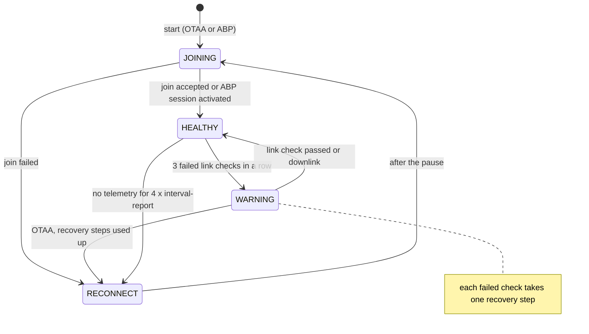

# Network connection

:::caution Draft
This page is a draft for internal review. Statements marked **[ověřit]** still need confirmation on hardware or from the product owner.
:::

:::info Firmware v2.0.0
This page describes **STICKER firmware v2.0.0**. Where firmware v1.4.x behaves differently, a **Firmware v1.4.x** note says so.
:::

This page explains how STICKER gets onto the radio network, how it finds out that its uplinks (messages from the device to the network) no longer arrive and how it recovers: first with a slower but more robust data rate, then with a new join. It also shows what a rejoin or a restart keeps and what happens to data the device could not send. Read it when a device does not appear in the network server or when its data stopped arriving.

## Radio mode

STICKER has one radio, and the `radio-mode` parameter decides how the device uses it:

| `radio-mode` | What the device does |
|---|---|
| `off` | The radio stays off. The device keeps measuring, evaluates alarms and records history (when enabled), but sends nothing. This is the firmware default. |
| `lorawan` | LoRaWAN Class A (the device listens for a downlink only right after its own uplinks) in the region set by `lrw-region`: EU868, US915, AU915 or AS923. The activation is OTAA or ABP (`lrw-activation`). |
| `p2p` | LoRa P2P: a direct link to a ProXimos Hub through a HARDWARIO FIBER modem, without a LoRaWAN network. See the LoRa P2P section at the end of this page. |

The device reads `radio-mode` only when it starts. Change it over NFC with [**HARDWARIO Manager**](/apps/hardwario-manager/sticker/configuration) or on the shell and save; the save restarts the device in the new mode. A downlink (a message from the network to the device) can never change `radio-mode` or any other LoRaWAN setting, because a wrong value would cut the link that carries the command. A `factory_reset` sets `radio-mode` back to `off` and erases the LoRaWAN keys and settings except the DevEUI and the JoinEUI, while a `device_reset` keeps them.

## Radio states

At any moment the radio is in one of the states below. The status LED shows the state every 3 s, so you can read it without a phone. The complete LED reference is in [**Hardware description**](../hardware-description.md).

| State | What it means | Status LED every 3 s |
|---|---|---|
| `DISABLED` | The radio is off on purpose (`radio-mode off`) or cannot start: the firmware image does not contain the configured LoRaWAN region or LoRa P2P has no keys. The device sends nothing. | One very short yellow flash |
| `JOINING` | A join is in progress: right after the start or during a rejoin attempt. | One yellow flash, then one red flash |
| `RECONNECT` | The device is not on the network and waits for its next join attempt. | One yellow flash, then one red flash |
| `HEALTHY` | Connected, and the link checks pass. | One very short green flash, or a red flash while an alarm is active |
| `WARNING` | Still connected (the session is kept), but link checks fail. The device checks the link with every report and steps down to more robust data rates. | Two short yellow flashes |

Besides the LED, you can read the state:

- in the answer to the `get_radio_state` downlink command, as `state_name` in the decoded uplink, in lower case (for example `warning`); see [**Downlink commands**](../connectivity/downlink-commands.md);
- over NFC on the **Device info** screen of [**HARDWARIO Manager**](/apps/hardwario-manager/sticker/device-info);
- on a debug build with `ats radio status`; see [**Diagnostics**](../developer-access/diagnostics.md).

<b>More about the states</b>

- **`IDLE`:** a sixth state. A LoRaWAN device is `IDLE` for a moment after the start, before its first join attempt. A LoRa P2P device is `IDLE` after the Hub detached it, and then it stays silent. `IDLE` has no LED pattern of its own, so the LED shows the green flash, or the red flash while an alarm is active.
- **All-zero DevEUI:** a device with `radio-mode lorawan` and an all-zero DevEUI is not `DISABLED`. It tries to join, fails and shows `JOINING` and `RECONNECT`, so the provisioning mistake is visible.
- **Regions:** release images contain all four regions, debug images only EU868. The device never falls back to another region.
- **Device status:** in the **Info** read over NFC, `device_status_flags` contains `radio_off` and `lrw_disabled` with `radio-mode off`. When the configured region is not in the firmware image or LoRa P2P has no keys, it contains `lrw_disabled` and `radio_link_down`. In `JOINING`, `RECONNECT` and `IDLE` it contains `radio_link_down` alone.
- **Alarm flash:** while the LED shows the pattern of `DISABLED`, `JOINING`, `RECONNECT` or `WARNING`, the red alarm flash is hidden. Alarms are still evaluated and reported.

## Joining the network

### OTAA

With OTAA (over-the-air activation) the device and the network agree on a session in a join: the device sends a JoinRequest, and the network answers with a JoinAccept that gives the device its address and session keys. STICKER joins afresh at every start, even when it was connected right before the restart. If no JoinAccept comes, the device tries again after a pause that doubles with every attempt, from about 1 min up to 1 h, so a device that cannot reach the network does not waste its batteries on constant join attempts. After you fix the cause, for example by registering the device or switching the gateway on, wait for the next attempt or restart the device to join at once.

The data rate (DR) sets how fast a frame goes on air. In EU868, DR0 (spreading factor SF12) is the slowest and reaches farthest, DR5 (SF7) is the fastest LoRa data rate.

| Item | Value |
|---|---|
| First join | Right after the start |
| Pause after a failed join | 60 s, doubled with every further attempt up to 1 h: 60, 120, 240, 480, 960 and 1920 s, then 3600 s |
| Random spread | ±25 % of each pause, so devices that lost the network together do not rejoin at the same moment |
| Measured example | On a bench device (EU868) the gaps were 59, 135, 198, 503, 1157 and 2102 s, then 3299 s; the first gap is counted from the last report before the rejoin |
| Failed attempt | No JoinAccept, or the LoRaWAN stack is still busy 15 s after the JoinRequest |
| Pause back to 60 s | After a successful join and after every restart |
| JoinRequest data rate | The default join data rate of the region; the EU868 bench trace shows SF12 |
| US915, AU915 | Joins use the sub-band set by `lrw-sub-band` (default 2), also after failed joins |

Every JoinRequest carries a DevNonce, a counter that the network uses to reject a replayed join. STICKER keeps it in flash (NVS, the storage that also holds the settings), so neither a restart nor a rejoin reuses one. Only `lrw_reset`, `factory_reset`, `vendor_reset` and a full erase of the settings storage clear it, and none of them works over a downlink. After one of these resets the device counts from zero again, and a LoRaWAN 1.0.4 network server rejects its joins until you clear the DevNonces it has stored for the device.

:::note Firmware v1.4.x
In firmware v1.4.x a US915 or AU915 device that failed about 8 joins in a row spread its JoinRequests over all eight sub-bands, so only about one in eight reached a gateway that listens on one sub-band.
:::

### ABP

With ABP (activation by personalization) the device address and the session keys are stored in the device, so there is no join and no JoinRequest. At every start the device activates the stored session and is connected right away. It opens its receive windows 1 s and 2 s after each uplink, the LoRaWAN defaults. ABP cannot rejoin; the section on connection loss below shows what the device does instead.

## Link supervision

A LoRaWAN uplink is not acknowledged, so the device cannot tell on its own whether its reports arrive. That is why it asks the network from time to time. It adds a LinkCheckReq to a report: a small LoRaWAN control message (a MAC command) that rides on the uplink, so no extra uplink is needed. The network answers with the number of gateways that heard the uplink. One or two missing answers are tolerated, because some networks do not answer every check. Three failures in a row move the device to `WARNING`. Any downlink also proves that the link works, so a device that receives commands or network requests does not drift towards a rejoin.

| Item | Value |
|---|---|
| Reports with a link check | The first report after every join, then every 5th report (`radio-link-check-interval`, 0–255, default 5). In `WARNING` every report. `0` turns link checks off, and with them `WARNING` and the rejoin that follows it. |
| Answer timeout | 10 s, counted from the end of the receive windows of the uplink |
| Failed check | No answer within the timeout, or an answer that reports 0 gateways |
| Successful check | An answer with at least 1 gateway, or any authenticated downlink: a command, an ADR request (adaptive data rate, the network setting the data rate and transmit power), a `DevStatusReq` or another MAC command |
| Failures in a row that start `WARNING` | 3 (fixed) |
| Failures in `WARNING` before a rejoin | `radio-link-check-fail-rejoin` (1–255, default 5), and only once no recovery step is left |
| Confirmed uplinks | Not used to judge the link. Reports and answers are unconfirmed. Alarm reports are confirmed only with `radio-alarm-ack true` and are then repeated up to 3 times; an alarm that never gets its acknowledgement does not count as a failed check. |

Both parameters can be changed over NFC or the shell only, like every LoRaWAN setting; see [**Configuration**](../developer-access/configuration.md). In the network server a link check shows as the MAC command `LinkCheckReq` in the uplink and `LinkCheckAns` in the downlink that answers it.

<b>Counting details</b>

- Every report counts towards the 5, including the extra reports that alarms, `force_send` or `sample` trigger.
- A link check rides on the first frame of a report only. While a check still waits for its answer, no new one is added.
- An answer that comes after the timeout is ignored.
- The counters start again at every join, so the first report after a join always carries a link check.

:::note Firmware v1.4.x
In firmware v1.4.x the parameters are called `lrw-link-check-interval` and `lrw-link-check-fail-rejoin`. Their stored values are not carried over to v2.0.0, so after the upgrade both are 5 again; set them again if you changed them. In v1.4.x a downlink counted as a successful check only while a check was waiting for its answer.
:::

## Recovery steps in the WARNING state

In `WARNING` the device keeps its session and keeps sending reports, but every report now carries a link check, and every failed check takes one recovery step: the transmit (TX) power goes back to its default (the maximum) and the data rate drops by one step. A lower data rate takes longer on air but reaches farther, so a device that moved out of reach or lost its nearest gateway often gets through again without a rejoin. The first step is taken at once when the device enters `WARNING`. One successful check, or any downlink, returns the device to `HEALTHY` with the same session.

With ADR on (`lrw-adr true`, the default) the network server normally lowers the TX power and raises the data rate of a device that it hears well. The recovery steps undo this when the link gets worse.

| Item | Value |
|---|---|
| Enters `WARNING` | After 3 failed link checks in a row |
| Link checks in `WARNING` | With every report |
| One recovery step | Restore the default TX power and lower the data rate by one step |
| When steps are taken | One at once when entering `WARNING`, then one per failed check |
| Floor | The lowest data rate of the region (EU868: DR0) at the default TX power |
| Leaves `WARNING` | One successful link check or any downlink: back to `HEALTHY`, same session |
| After a recovery | The device stays on the lower data rate. With ADR the network raises it again from the uplinks it receives; with ADR off the next join applies `lrw-datarate` again. |

A lower data rate carries less data per frame (51 B at EU868 DR0–DR2), so a report may need more frames until the data rate rises again.

<b>Why the device has its own recovery steps</b>

The LoRaWAN stack has its own data rate fallback for ADR, but it takes its first step only after 128 unanswered uplinks, about 32 h at a 900 s report interval. The device would always rejoin long before that helped, so the firmware walks the same steps itself, one per failed link check. A data rate pinned with `lrw-datarate` (ADR off) is stepped down the same way.

:::note Firmware v1.4.x
Firmware v1.4.x has no recovery steps. In `WARNING` it keeps its data rate and TX power and checks the link only with every 5th report, so a device that moved out of reach gets a more robust data rate only through a rejoin.
:::

## Rejoin

When the recovery steps are used up and the checks still fail, an OTAA device gives the session up and joins again: a rejoin. It shows `RECONNECT` while it waits for the next attempt. The pauses between attempts are the same as after a failed join at the start: about 1 min first, then doubling up to 1 h.

| Trigger | When it applies |
|---|---|
| Recovery steps used up | No step is left (lowest data rate at the default TX power) and `WARNING` has counted `radio-link-check-fail-rejoin` failed checks (default 5) |
| Stale-uplink watchdog | No telemetry uplink has left the device for 4 × `interval-report` (1 h at 900 s) while it is connected. Not when the duty cycle (the legal airtime limit, see below) explains the silence: the duty-cycle limit held a send within the last report interval plus 3 min, and the holding has lasted less than 75 min. |
| `lrw_join` command | Over a downlink, over NFC or as `join` on the shell. The join starts shortly after the answer to the command has been sent, without a pause and without a restart. The command is refused with `NOT_READY` while LoRaWAN settings are changed but not saved. |
| Failed join | Every failed attempt schedules the next one with a doubled pause |

The stale-uplink watchdog catches a device that cannot transmit at all. During a plain gateway outage the reports still leave the device, so there the link checks decide.

| Step | What happens |
|---|---|
| Enter `RECONNECT` | A report that was being sent is dropped; answers and alarm reports stay queued. |
| Pause | 60 s ±25 % before the first attempt, then doubled for each further attempt up to 1 h ±25 % |
| Attempt (`JOINING`) | The LoRaWAN stack restarts with the stored DevNonce, applies the sub-band again and sends a JoinRequest. |
| Success | `HEALTHY`. The **Info**, the **settings-info**, waiting alarm reports and one report go out; see [**Messages and timing**](messages.md). The pause starts at 60 s again next time. |
| Failure | Back to `RECONNECT` with the next, doubled pause |

## Connection loss with OTAA and ABP

| | OTAA | ABP |
|---|---|---|
| Detecting the loss | Link checks; 3 failures in a row lead to `WARNING` | The same |
| Recovery steps in `WARNING` | Yes | Yes |
| When the steps are used up and `radio-link-check-fail-rejoin` failures are reached | Gives the session up: `RECONNECT`, then rejoins with pauses of 60 s up to 1 h | Cannot rejoin: stays in `WARNING` and keeps checking the link with every report |
| Status LED during a long outage | Two yellow flashes, then yellow and red | Two yellow flashes |
| Reports during the outage | Sent while in `WARNING`, none while in `RECONNECT` | Sent every `interval-report` at the lowest data rate; nobody receives them |
| When the network is back | Data flows after the next successful join, which can be up to about 1 h away at the longest pause | Data arrives at once; the next link check or downlink returns the device to `HEALTHY` |
| Stale-uplink watchdog | Rejoin | Restarts the LoRaWAN stack and activates the stored session again after the usual pause, without a JoinRequest |

## Timeline from link loss to rejoin

The table shows what happens when the only gateway goes offline. It assumes the default settings: EU868 with OTAA, ADR on, the device at DR5, `interval-report` 900 s and both link check parameters at 5. A link check then rides on every 5th report, which is every 75 min.

| Time after the link is lost | What happens | Status LED |
|---|---|---|
| 0 | The gateway stops receiving. The device keeps sending its reports every 15 min, but nobody receives them. | Green |
| Up to 75 min | The next report with a link check gets no answer: 1st failed check. | Green |
| 75 min later | 2nd failed check. | Green |
| 75 min later (2.5–3.75 h after the loss) | 3rd failed check: `WARNING`. At once the TX power goes back to the default and the data rate drops to DR4. | Two yellow flashes |
| The next 4 reports, 15 min apart | The reports at DR4, DR3, DR2 and DR1 each carry a link check. Each failure takes one more step down. | Two yellow flashes |
| 75 min after entering `WARNING` (3.75–5 h after the loss) | The check of the report at DR0 fails too. No step is left and `WARNING` has counted 5 failures, so the device gives the session up: `RECONNECT`. | Yellow and red |
| About 1 min later | First JoinRequest. | Yellow and red |
| Then | Further JoinRequests after about 2, 4, 8, 16 and 32 min, then about every hour, each ±25 %. | Yellow and red |
| When the network answers | Join, then **Info**, **settings-info** and a report. The device is `HEALTHY` again, and ADR brings the data rate back up. | Green |

So with the defaults it takes about 4–5 h from the link loss to the first JoinRequest. The exact time depends on where in the 75 min link check cycle the loss falls. A shorter `interval-report` or `radio-link-check-interval` shortens it. On a bench device with `interval-report` 120 s the same sequence took 21 min to `WARNING` and 10 more minutes to `RECONNECT`.

:::note Firmware v1.4.x
With firmware v1.4.x the same link loss takes about 9–10 h to trigger a rejoin, because `WARNING` checks the link only with every 5th report and has no recovery steps.
:::

## What a rejoin and a restart keep

| Item | After a rejoin | After a restart |
|---|---|---|
| DevNonce | Kept | Kept |
| OTAA network session (address, session keys, frame counters) | Replaced by the new session | Replaced: the device joins afresh |
| Saved settings, pulse counters, sensor history | Unchanged | Kept, because they are stored in flash; see [**History and counters**](history-and-counters.md) |
| Report that was being sent | Dropped | Lost |
| History read-out (`req_history`) in progress | Stopped; ask again | Lost; ask again |
| Long answer still being sent page by page | Stopped; ask again | Lost |
| Answers and alarm reports waiting to be sent | Kept and sent after the join | Lost |
| Active alarms | Kept | Evaluated again; every condition that still holds is reported again |
| Link check counters | Reset; the first report after the join carries a link check | Reset in the same way |
| Duty-cycle airtime record | Kept, because a join grants no new airtime | Cleared |
| Network time | Kept; asked for again only if none arrived since the start | Asked for again at the first join |
| Report rhythm | Continues; one extra report follows the join | Starts again from the start |

An ABP device activates the same stored session after a rejoin and after a restart.

## Duty cycle

In the EU868 band the law limits how long a device may transmit (the duty cycle). STICKER keeps its own record of the airtime of the last hour and sends a frame only when it fits into 1 % of the hour, which is 36 s. A frame that does not fit waits until enough older airtime has left the one-hour window. Only a report that waits a whole `interval-report` is dropped, because the next report carries fresher data. At the default `interval-report` of 900 s the limit is not reached even at the lowest data rate, where the reports use about 8 s per hour. It matters for short report intervals at low data rates and for long read-outs such as sensor history or a full configuration dump.

| Radio and region | Airtime limit kept by the device |
|---|---|
| LoRaWAN EU868 | 1 % over all channels: at most 36 s in any sliding hour. The LoRaWAN stack also keeps its own limit per frequency band; the device's limit is stricter, so the stack normally accepts every frame the device lets out. |
| LoRaWAN US915, AU915, AS923 | None. The device still counts the airtime. |
| LoRa P2P | Taken from the band of `p2p-frequency`: 10 % at the default 869.525 MHz, 1 % at 865–868.6 MHz and 869.7–870 MHz, 0.1 % elsewhere |

- At DR0 one frame takes about 1.5–2.8 s of airtime, a small report at DR5 under 0.1 s.
- A held frame waits one hour at most.
- `get_radio_state` shows how long sends are being held (`duty_blocked_s`) and the airtime of the last hour (`airtime_hour_ms`).
- The record is kept in RAM: a rejoin keeps it, a restart clears it.

:::note Firmware v1.4.x
In firmware v1.4.x the LoRaWAN stack refused a frame over its limit and the device retried it every 15 s, so at the lowest data rate a report could be dropped after about 2 min. The stale-uplink watchdog could also rejoin during such a hold, which reset the airtime credits.
:::

## Data that could not be sent

| Situation | What the device does |
|---|---|
| Report time while the device is not connected (`JOINING`, `RECONNECT`, `DISABLED`) | No uplink. The device still measures, evaluates alarms, saves its counters and records history when `history-enable` is on. |
| The link goes down while a report is being sent | The rest of the report is dropped. |
| A report is held by the duty cycle | Sent late, once the airtime allows; dropped when it is one `interval-report` old. |
| The radio or the LoRaWAN stack refuses a send | Retried every 15 s, at most 8 times, then dropped. |
| More than 4 answers wait to be sent | A further answer is dropped. |
| Alarm events while 4 alarm frames already wait | The events are held and collected into later frames, up to 16 per batch; further events are dropped but still counted in `total`. |
| A waiting frame no longer fits after the data rate dropped | **Info** and **settings-info** go out again once the data rate rises. A command answer is replaced by the error `BUDGET_TOO_SMALL` with the command's `seq`. An alarm frame is dropped, but the alarm state still travels in every telemetry uplink. A telemetry frame is dropped and the rest of the report continues. |
| MAC commands from the network fill the whole frame | The device sends an uplink without data so the MAC answers can leave. A report that was due is skipped; a waiting answer or alarm frame is sent afterwards. |
| Alarm events while the device is not connected | Collected and sent after the next join, right after the **Info** and the **settings-info**. |
| Reports missed while offline | Never sent later. With `history-enable true` the values are in the sensor history; read them with `req_history`. Nothing is uploaded automatically. See [**History and counters**](history-and-counters.md). |

Answers and alarm frames that wait for the radio are kept in RAM, so a restart loses them.

## LoRa P2P

With `radio-mode p2p` STICKER talks to a ProXimos Hub through a HARDWARIO FIBER modem instead of a LoRaWAN network. The states, the LED patterns, the link checks, the stale-uplink watchdog and the messages after a join work as on LoRaWAN, with these differences:

- **Pairing:** the P2P join (pairing) is stored, so a normal restart sends no JoinRequest. The device resumes the stored pairing and sends its **Info** and **settings-info**.
- **Confirmed sends:** every report, answer and history frame is acknowledged by the gateway. One send is up to 3 transmissions; without an acknowledgement the device repeats the send up to 3 more times after a random pause. Alarm reports are confirmed only with `radio-alarm-ack true`.
- **Link check:** only a link check report left without an acknowledgement counts as a failed check.
- **No recovery steps:** the spreading factor and the TX power are fixed for the network, so `WARNING` has no steps. After `radio-link-check-fail-rejoin` failed checks in `WARNING` the device pairs again (`RECONNECT`) with the same pauses as LoRaWAN. At the defaults `WARNING` comes 2.5–3.75 h after the link is lost and the new pairing about 1.25 h later.
- **Selection:** only with `radio-mode p2p` and a save over NFC or the shell. The P2P radio parameters (`p2p-*`) can be set on the shell only.
- **Detach:** after the Hub detached the device, it is `IDLE` until the next restart or an `lrw_join`: silent, with the same LED as in `HEALTHY` and no automatic new pairing.

Setup and radio parameters: [**LoRa P2P mode**](../connectivity/lora-p2p.md).

:::note Firmware v1.4.x
LoRa P2P is new in firmware v2.0.0. In firmware v1.4.x the value `radio-mode p2p` is reserved and keeps the radio off.
:::
