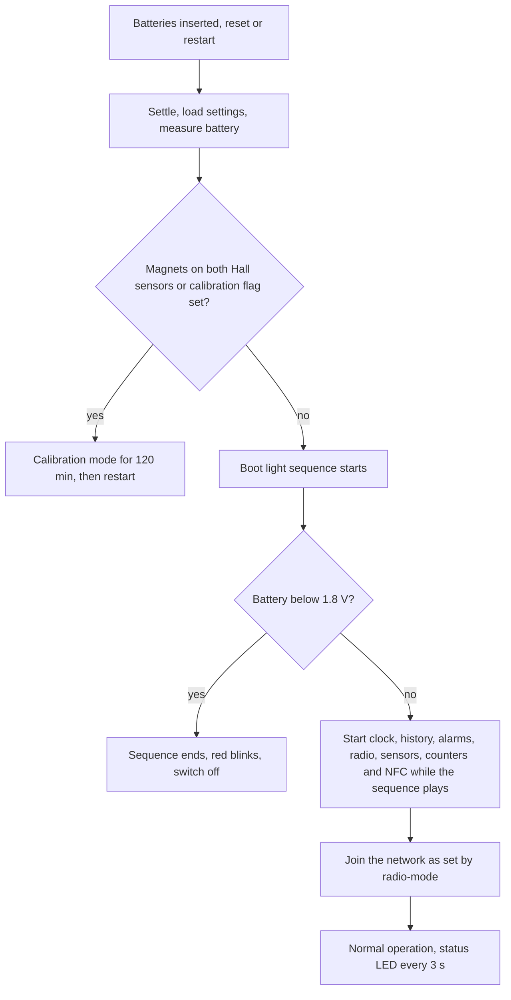

# Startup and initialization

:::caution Draft
This page is a draft for internal review. Statements marked **[ověřit]** still need confirmation on hardware or from the product owner.
:::

:::info Firmware v2.0.0
This page describes **STICKER firmware v2.0.0**. Where firmware v1.4.x behaves differently, a **Firmware v1.4.x** note says so.
:::

This page describes what STICKER does from the moment it gets power until it runs normally: the order of the startup steps, what the LED shows, when the device refuses to start or enters calibration mode and how it recovers from errors. For support, the LED and the reset cause that the device reports in its **Info** uplink (a message from the device to the network) are often the quickest way to tell what happened to a unit.

## What happens after power-up

Startup begins when you insert the batteries, when the device is reset through its NRST pin and when the device restarts itself, for example after you save a new configuration. The same steps run every time:

1. **Power settle.** The device waits 0.5 s so that the sensors have stable power before their drivers start.
2. **Settings load.** It reads its configuration from NVS (the settings storage in flash).
3. **Reset cause.** It records why it restarted and picks up a crash record left by the previous run, if there is one.
4. **Battery check.** It measures the battery before anything else draws current.
5. **Watchdog and LED.** It starts the hardware watchdog and the LED.
6. **Calibration check.** If magnets sit on both Hall sensors, or the calibration flag is set, the device enters calibration mode and the normal startup ends here.
7. **Boot light sequence.** Red, yellow and green, about 3 s. The startup goes on while it plays. If the battery check found less than 1.8 V, the device blinks red after the sequence and switches itself off.
8. **Initialization.** Clock, sensor history, alarm rules, radio, report schedule, battery monitor, sensors, pulse counters and NFC start one after another. NFC starts last and answers a phone about 1.2 s after a reset.
9. **Radio join.** The device joins the network as set by `radio-mode`. A LoRaWAN device joins again at every startup and a LoRa P2P device pairs with its Hub only if it is not paired yet. With `radio-mode off` the device stays silent. See [**Network connection**](network-connection.md).
10. **Normal operation.** From now on the device feeds the watchdog and shows its status on the LED every 3 s.

## Boot light sequence

At every normal startup the LED shows red for 0.5 s, yellow for 0.5 s and green for 1.5 s, with 0.25 s pauses in between, about 3 s in total. The sequence also shows that all three LED colors work.

- **It does not hold up the startup.** The device initializes while the sequence plays. NFC answers a phone about 1.2 s after a reset, while the sequence is still running.
- **An NFC tap cuts it short.** When you hold a phone to the device, the LED switches to the NFC patterns at once.
- **The status heartbeat follows it.** Heartbeats that fall into the sequence are skipped, so the first status pattern appears after the sequence ends.
- **Seeing it unexpectedly means that the device restarted.** The reset cause in the next **Info** uplink tells you why, see Watchdog and crash recovery below.

The sequence does not play in calibration mode.

:::note Firmware v1.4.x
In firmware v1.4.x the boot light sequence held up the rest of the startup for about 5 s. The colors and timing of the sequence are the same.
:::

## Status LED after startup

Once the device runs, the LED shows one short pattern every 3 s, the status heartbeat. Most flashes last only 5–10 ms to save energy, so expect a brief blip rather than a clear blink.

The device checks a fixed list of conditions and shows only the first one that applies, so a more serious condition hides a less serious one. In order, it shows:

1. the NFC patterns while a phone is connected;
2. a settings error, when the stored configuration could not be loaded **[ověřit]**;
3. the network state, when the device is not on the network, when its link is degraded or when its radio is off;
4. an active alarm;
5. green, when none of the above applies.

| Heartbeat every 3 s | What it tells you |
|---|---|
| Red and yellow, alternating twice | The stored settings could not be loaded **[ověřit]**. The device runs on factory defaults, so it has no network keys and its radio is off. See Initialization order and errors below. |
| Yellow, then red | The device is not on the network. Right after startup this means that it is joining; later it means that it lost the link and is rejoining. Check gateway coverage, the region and the keys. |
| Yellow twice | The device is joined, but its link checks (periodic tests that the network still hears it) fail. It keeps the session and tries a more robust data rate before it rejoins. |
| Yellow once | The radio is off: `radio-mode off`, a LoRaWAN region that this firmware image does not include or LoRa P2P without its keys. The device measures but sends nothing. |
| Red once | An alarm is active, for example an alarm rule, a low battery or a sensor that stopped answering. |
| Green once | Normal operation: the device is joined, its link checks pass and no alarm is active. Debug firmware adds a yellow flash after the green one. |
| Dark for about a minute after the boot light sequence, then the sequence again | A fatal startup error. The device restarts every 60 s, see Initialization order and errors below. |
| Dark | No power, switched off by the low-battery check or a debug unit that went into deep sleep. |

While one of the network patterns shows, the red alarm flash is hidden. The alarm is still evaluated and its uplink is still sent. During the first hour after power-up the LED also confirms input changes, such as a Hall sensor or an input switching, with short green and orange flashes.

The complete LED reference, including the NFC tap patterns, is in [**Hardware description**](../hardware-description.md). The [**Quick start guide**](../first-steps.md) has a troubleshooting table that starts from the LED.

:::note Firmware v1.4.x
The boot light sequence and the status heartbeat look the same in firmware v1.4.x. The NFC tap patterns differ: v1.4.x blinked while it processed each command and showed green and yellow while a reply waited for the phone. When it applied a configuration written over NFC, it blinked green ten times.
:::

## Low battery at startup

If the batteries are nearly empty when the device starts, it does not start at all. This keeps a weak battery from making the device restart over and over.

At every startup, before anything else draws current, the device measures the battery three times, 10 ms apart, and uses the highest reading, so a single low reading does not keep a good battery off. If the result is below 1.8 V, the LED shows:

| Step | LED | Duration |
|---|---|---|
| 1 | The boot light sequence | about 3 s |
| 2 | Red, 0.1 s on and 0.1 s off, 25 times | 5 s |
| 3 | Red, solid | 1 s |
| 4 | Dark: the device has switched itself off | until it is woken |

- **Nothing else starts.** The radio, the sensors, the history and the alarms never start, and the device sends nothing. It enters Shutdown, the deepest power-saving state of its processor.
- **Only two things wake it:** a reset through the NRST pin or a power cycle, such as new batteries. Both run the battery check again. A battery that recovers by itself, for example when it warms up, does not wake the device.
- **A failed measurement does not block the startup.** If the battery monitor does not start or no reading succeeds, the device starts normally, so a measurement fault cannot keep a good device switched off.

The 1.8 V limit is fixed when the firmware is built and is not a configuration parameter. It is separate from the low-battery alarm (`battery-level`, default 2.4 V), which warns while the device runs. See [**Battery and power**](battery.md).

:::note Firmware v1.4.x
Firmware v1.4.x has no battery check at startup. With a nearly empty battery the device can restart over and over until you replace the batteries.
:::

## Factory state of the radio

How a new unit behaves at its first startup depends on how it was prepared at the factory.

- **Firmware default, radio off.** The default of the firmware itself is `radio-mode off`. The radio is never started, so the device sends nothing and uses no energy on join attempts. It still measures, and it records history if history is enabled. The heartbeat is one short yellow flash every 3 s. To bring the unit online, set `radio-mode` to `lorawan` (or `p2p`) together with the network settings in HARDWARIO Manager and write the configuration, see [**Configuration**](/apps/hardwario-manager/sticker/configuration) in the HARDWARIO Manager guide. The device saves the configuration, restarts and joins.
- **Production template, ready to join.** The production line can write `radio-mode lorawan` and the LoRaWAN keys into the unit before the release firmware first starts. Such a unit joins right after its first startup: the heartbeat shows yellow then red until the network accepts the join, and green after that.

Which of the two applies to units as shipped still needs confirmation **[ověřit]**. The [**Quick start guide**](../first-steps.md) and [**Power management**](../power-management.md) describe shipped units as radio-silent, while the firmware v2.0.0 release notes describe a production step that sets `radio-mode lorawan` so that the unit joins at its first startup.

A factory reset returns `radio-mode` to `off` and erases the AppKey and the other LoRaWAN settings, so a reset unit stays silent until you write the network settings again and switch the radio on. See [**Maintenance**](../developer-access/maintenance.md).

## Calibration mode

Calibration mode is a service mode for factory and service tests. Instead of running normally, the device reads its sensors and sends the values every 30 s, using LoRaWAN keys that are the same on every unit. You do not need it in normal use.

### How to enter calibration mode

- **Magnets at startup:** hold a magnet to each of the two Hall sensors while the device starts, for example while you insert the batteries.
- **Magnets during the first 30 min:** hold magnets to both Hall sensors within 30 min after power-up. The device checks every 3 s and then restarts into calibration mode. Keep both magnets in place until the fast orange blinks start, because the device looks for them again during that restart.
- **Command over NFC or the shell:** choose **Calibration mode** in [**Tools**](/apps/hardwario-manager/sticker/tools) of HARDWARIO Manager, which sends the `enter_calibration` command, or set `calibration` to `true` and save in the console of a debug build. The device stores a one-time calibration flag and restarts. The command never works over the radio, because calibration uplinks use keys that every unit shares. A downlink (a message from the network to the device) with this command is answered with an error.

### What the device does in calibration mode

- It activates LoRaWAN with ABP (activation by personalization: the device sends with stored session keys and does not join). The keys are built into the firmware and are the same on every unit. ADR (adaptive data rate, where the network tunes the data rate) is off, and the device sends at data rate (DR) DR5.
- Every 30 s it sends an unconfirmed uplink (one that the network does not acknowledge) of 26 bytes on fPort 10. The fPort is the LoRaWAN port number that tells the receiver what a message contains. The uplink carries the serial number, the uptime, the battery voltage and the onboard temperature and humidity. It also carries the readings of up to two DS18B20 probes and two MACHINE PROBE units, which the device reads only when `cap-w1-sensors` is on.
- It measures the battery when calibration starts and then every 30 min.
- The LED blinks orange (red and green together) five times fast, 0.1 s on and 0.1 s off, when calibration starts. After that it flashes orange briefly once per second.

<b>Calibration payload (fPort 10, 26 bytes)</b>

All values are little-endian. A missing reading is `0x7FFF` and an invalid battery reading is `0xFFFF`; both decode to `null`. The firmware repository includes a decoder for this payload, `calibration.js`.

| Bytes | Content | Encoding |
|---|---|---|
| 0–3 | Serial number | unsigned 32-bit |
| 4–7 | Uptime in seconds | unsigned 32-bit |
| 8–9 | Onboard temperature (SHT40) | signed 16-bit, °C × 100 |
| 10–11 | Onboard humidity (SHT40) | signed 16-bit, %RH × 100 |
| 12–13 | DS18B20 probe 1 temperature | signed 16-bit, °C × 100 |
| 14–15 | DS18B20 probe 2 temperature | signed 16-bit, °C × 100 |
| 16–17 | MACHINE PROBE 1 temperature | signed 16-bit, °C × 100 |
| 18–19 | MACHINE PROBE 1 humidity | signed 16-bit, %RH × 100 |
| 20–21 | MACHINE PROBE 2 temperature | signed 16-bit, °C × 100 |
| 22–23 | MACHINE PROBE 2 humidity | signed 16-bit, %RH × 100 |
| 24–25 | Battery voltage | unsigned 16-bit, mV |

### How calibration mode ends

- After 120 min the device restarts into normal operation.
- The calibration flag is one-shot: the device clears it as soon as calibration starts. Any other restart, such as a watchdog reset or new batteries, therefore also returns the device to normal operation. To leave calibration mode early, remove the batteries and insert them again.
- Removing the magnets during calibration changes nothing. If the magnets are still on both Hall sensors when the device restarts, it enters calibration mode again, so remove them once calibration has started.

### Side effects

- The normal application does not start: no telemetry, no alarms, no sensor history and no status heartbeat.
- NFC does not start, so HARDWARIO Manager cannot reach the device until calibration ends.
- The boot light sequence and the low-battery check at startup are skipped.
- With `radio-mode off` the LoRaWAN radio is not started, so the device blinks orange but sends nothing (firmware issue #523).

:::note Firmware v1.4.x
Firmware v1.4.x also accepts the `enter_calibration` command as a LoRaWAN downlink.
:::

## Initialization order and errors

The device starts its parts in a fixed order. Most parts are optional: if one fails, the device continues without it and reports the problem. A few parts are essential: if one of them fails, the device restarts after 60 s.

| Step | What it does | If it fails |
|---|---|---|
| Power settle | Waits 0.5 s so that the sensors have stable power | Cannot fail |
| Settings load | Reads the configuration from NVS | Runs on factory defaults, see below **[ověřit]** |
| Reset cause and battery check | Records why the device restarted and measures the battery | A failed battery measurement: the device starts normally |
| Watchdog | Starts the 10 s hardware watchdog | Restarts after 60 s; the LED stays dark |
| LED | Starts the LED | Restarts after 60 s; the LED stays dark |
| Calibration check | Enters calibration mode when requested | Restarts after 60 s |
| Boot light sequence | Plays the sequence; below 1.8 V the device then switches off | Cannot fail |
| Clock | Starts the real-time clock | Continues without wall-clock time |
| Sensor history | Opens the history storage | Continues without history; the **Info** status flag `history_down` is set |
| Alarm rules | Loads the alarm rules | Continues without alarm rules |
| Radio | Starts LoRaWAN or LoRa P2P as set by `radio-mode`, or nothing with `off` | Restarts after 60 s. A stored LoRaWAN region that the firmware image does not include keeps the radio off instead (one yellow flash, status flags `lrw_disabled` and `radio_link_down`) |
| Report schedule | Plans the periodic reports | Restarts after 60 s |
| Battery monitor | Prepares the battery measurement | Continues; the `battery` field is missing from the **Info**, the telemetry `voltage` is `null`, the battery level reported to the network is 255 (unknown) and the low-battery alarm cannot trigger |
| Sensors | Starts the sensors, binds known 1-Wire probes and takes a first reading | Continues with the sensors that work; missing values are sent as `null` |
| Pulse counters | Restores the Hall and input counter totals from NVS | Continues. If the stored totals cannot be read, counting starts from zero and nothing is saved during this run, so the stored totals are kept for the next startup |
| NFC | Starts the NFC chip, last of all | Continues without NFC; the status flag `nfc_down` is set |
| Radio join | Joins the network (LoRaWAN), or pairs with the Hub (LoRa P2P) if it is not paired yet | A failed join is retried with growing pauses, see [**Network connection**](network-connection.md) |

**Restart after 60 s.** When an essential part fails, the device logs the error, keeps feeding the watchdog, waits 60 s and then restarts. The status heartbeat does not run during the wait, so the LED stays dark. If the cause persists, the device keeps restarting. When the radio or the report schedule fails, you see the boot light sequence about once a minute; when the watchdog or the LED fails, the LED stays dark all the time. Each of these restarts shows as `software` in the reset cause.

**Settings that cannot be loaded.** If the configuration cannot be read from NVS, the device does not stop. It runs on the factory defaults of the firmware, which means no network keys and `radio-mode off`, so it sends nothing. The heartbeat shows red and yellow alternating twice every 3 s, which hides every other status **[ověřit]**. Restart the device once. If the pattern comes back, return the unit for service.

:::note Firmware v1.4.x
In firmware v1.4.x NFC started before the boot light sequence, and a configuration written to the NFC tag while the device had no power was applied during startup, before the join. Firmware v2.0.0 has no such offline configuration: NFC needs a running device and starts last.
:::

## Watchdog and crash recovery

A hardware watchdog restarts the device when the firmware stops working. The watchdog must be fed at least every 10 s. The main loop feeds it every 3 s, and the longer startup steps, such as a 1-Wire scan, feed it in between, so slow or failing probes do not cause a restart.

The watchdog restarts the device in two cases:

- The main loop stops, so the watchdog is not fed for 10 s.
- The radio task or the report task stops making progress for 30 s. The main loop then stops feeding the watchdog on purpose, and the device restarts about 10 s later.

After a watchdog restart the device starts from scratch and joins the network again, so a stuck unit recovers on its own.

**CPU fault.** If the processor hits a fault, for example an invalid memory access, the device stores the fault reason and two code addresses in memory that survives a restart, and restarts at once. The **Info** uplinks after that restart carry the values as `fault_reason` (with its name in `fault_reason_name`), `fault_pc` and `fault_lr`. Pass them to HARDWARIO support. A power loss, such as removing the batteries, clears the stored fault.

### Where to find the reset cause

The device records why it restarted at every startup and reports it until the next restart:

- in the **Info** uplink on fPort 85 as `reset_cause` (a bit mask) and `reset_cause_flags` (the decoded names). The device sends the **Info** after every join and every `interval-announce` hours (default 24 h), see [**Messages and timing**](messages.md);
- on request with the `get_info` downlink, see [**Downlink commands**](../connectivity/downlink-commands.md);
- over NFC in HARDWARIO Manager, under **Advanced** in [**Device info**](/apps/hardwario-manager/sticker/device-info);
- in the console of a debug build with `ats device info`, see [**Diagnostics**](../developer-access/diagnostics.md).

| Flags in `reset_cause_flags` | What they usually mean |
|---|---|
| `pin`, `brownout` | The supply was switched on or dropped too low: new batteries, a power cut or a weak battery |
| `pin`, `software` | The firmware restarted itself: after a saved configuration, a reboot or reset command, the end of calibration mode, a fatal startup error or a CPU fault (then the fault fields are present too) |
| `pin`, `watchdog` | The watchdog restarted the device because the firmware stopped responding |
| `pin` alone | A reset through the NRST pin |

The processor sets `pin` at every restart, so `pin` means an NRST reset only when it is the only flag. After you insert batteries, the **Info** shows `pin` and `brownout`. STICKER never reports `power_on`.

:::note Firmware v1.4.x
In firmware v1.4.x a CPU fault stopped the device until the watchdog restarted it, or until a power cycle when the fault happened before the watchdog was running. The **Info** had no fault fields, so such a restart showed only as a watchdog reset.
:::
